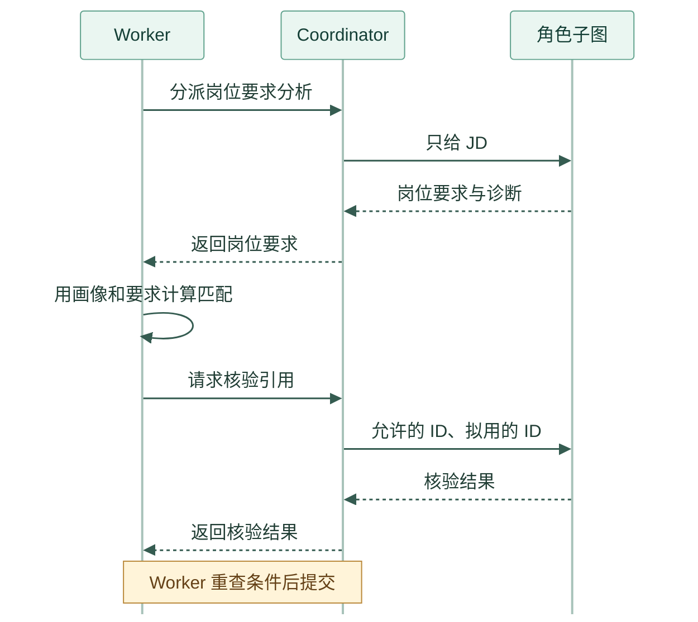

# 01-C · Coordinator 与子 Agent：一次岗位分析怎么分工

前面读的是一次对话。现在让林澈点「分析匹配度」，观察另一条调用链。这个动作适合拆成两份工作。先从招聘方的岗位描述（JD）提取要求，再核对匹配结果引用了哪些原文。

## 先分清任务编号和岗位分析编号

工作台把后台分析交给 `POST /api/v1/runs`。提交成功时，接口可以先返回一个 Run ID。它用于查询这次工作的状态。Worker 是从队列领取任务并执行的进程。任务成功后，Run 的 `result` 才给出岗位分析编号。工作台可以用那个编号打开分析结果。

跟上游读时，可以从「后台任务」打开一条岗位分析，找下面三个名字。综合课提供完整的请求和预期。 [运行接口](../../backend/app/api/routes/runs.py) · [综合跟做](01-D-综合跟做.md)

| 步骤名 | 谁负责 |
| --- | --- |
| `requirement_analyst` | 从 JD 找出岗位要求 |
| `evidence_verifier` | 检查候选引用有没有超出允许范围 |
| `persist` | Worker 在确认提交条件后，把结果写入数据库 |

## 代码怎样决定派给谁

看 `prepare_operation()` 的 `job_analysis` 分支。运行时已经知道提交的是哪类任务，因此直接指定角色。下面摘录了取资料、分派、计算与核验的顺序。

```python
async with factory() as session:
    profile, valid_ids = await job_inputs(session, user_id)
task = await coordinator.delegate("requirement_analyst", {"jd_text": data["jd_text"]})
values = prepare_analysis(
    profile, valid_ids, **data, requirements=task["requirements"],
    extraction=task["diagnostics"],
)
await coordinator.verify(
    valid_ids, [item_id for row in values["matches"] for item_id in row["evidence_ids"]]
)
```

`async with` 在这里打开一个有明确生命周期的数据库会话。先读画像和可以引用的编号。把 JD 交给第一个角色，收回要求。普通业务函数 `prepare_analysis` 用要求和画像计算匹配。第二个角色收到的是两个列表。一个装匹配用到的 ID，另一个装允许的 ID。



真实源码里的 `prepare_operation` 在 Worker 内执行。它返回一个准备好的保存函数。最后由 Worker 再检查任务仍能提交，调用保存函数，并记录 `persist` 步骤与成功状态。这样角色生成的候选和业务落库之间有一道明确的边界。 [后台操作分支](../../backend/app/runtime/operations.py#L94) · [Worker 提交](../../backend/app/runtime/worker.py#L54)

## 一个子 Agent 在代码里长什么样

`SPECIALISTS` 是角色登记表。为每个角色登记两项，一项挑选并检查输入，一项存放编译好的角色图。读下面这段 `delegate`，先找到角色名在哪里查表，实际执行从哪一行开始。

```python
if self._remaining <= 0:
    raise ValueError("Specialist budget exhausted")
self._remaining -= 1
await self._progress(role, "running")
project, graph = SPECIALISTS[role]
scoped = project(inputs)
state = await graph.ainvoke({"inputs": scoped})
result = state["result"]
```

`self._remaining` 是这个 Coordinator 本次剩下的调用次数，创建时为 2。先检查预算，再按角色筛输入，最后执行小图。每份小图只有 `START → perform → END`，`perform` 负责执行登记的角色函数。完成后，协调器把角色的步骤状态和诊断摘要交给进度记录。

| 角色名 | 适用任务 | 拿到的资料 |
| --- | --- | --- |
| `requirement_analyst` | 后台岗位分析 | 只读 `jd_text`，输出要求 |
| `wiki_curator` | 后台编译 Wiki | 标题和选中的证据摘录，输出草稿、引用及诊断 |
| `report_writer` | 后台报告 | 从分析准备出的报告上下文和可用引用范围 |
| `evidence_verifier` | 上面三类任务的核验步骤 | 接收允许的 ID 和候选引用，输出数量或范围错误 |

把岗位要求分析交给一个角色，并不需要把林澈的聊天给它。它要分析的是招聘方写的要求。核验也只需这次允许范围和实际引用的编号。程序按任务类型固定调用次序，两个角色都完成后才进入后续提交。 [角色小图](../../backend/app/runtime/agents.py#L42) · [Coordinator](../../backend/app/runtime/agents.py#L87) · [角色登记表](../../backend/app/runtime/agents.py#L123)

## 跟做：把一条引用改坏

设本次只允许 `E1`。给核验角色传 `allowed={"E1"}` 和 `refs=["E1", "E2"]`。先在纸上写下两个判断。

1. 候选中的每个 ID 都在允许集合里吗？Worker 会收到一份核验通过的候选吗？
2. 如果把 E2 删除，留下 E1。假设原文只是「本机跑过 Python 课程接口」，能不能直接写「维护过生产 Kubernetes 集群」？

<details>
<summary>按源码核对两处边界</summary>

第一问会在 `verification_task` 抛错，因为 E2 不在允许集合里。岗位分析分支不会走到返回 `save_job` 那一行。第二问只能通过 ID 范围检查。要确认「维护过生产集群」，仍需要能支持这个动作和环境的原文。

一次 Coordinator 的预算为 2，核验算一次。把一次岗位分析里的两位角色按顺序写出来，再加第三次调用，会碰到 `Specialist budget exhausted`。这个检查位于派发之前。

</details>

仓库有一个用例会额外向岗位要求角色传入不相干字段，检查投影后只留下 JD，再检查外部引用和调用预算。另一个用例确认报告结果和业务写入一起提交。已有开发环境的人可以运行下面两条。其余读者在测试文件内找 `assert`，也能从预期结果核对。 [调用预算和投影测试](../../backend/tests/test_run_runtime.py#L426)

```bash
cd backend
python -m pytest -q tests/test_run_runtime.py::test_coordinator_projects_context_and_rejects_foreign_citations
python -m pytest -q tests/test_run_runtime.py::test_report_result_and_business_write_commit_once
```

## 下一步

在 [01-D 综合跟做](01-D-综合跟做.md) 中，用同一份资料跑接口、打开证据、继续会话，再读一回后台 Run。试着从一次可观察的结果开始，反向找出它经过的代码。
