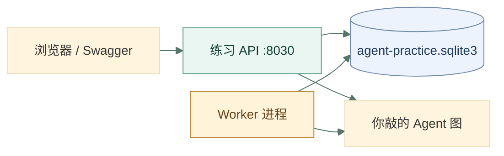

# 01-D · 启动自己敲出的 Agent，完整走一次请求

现在用练习副本启动真正的 CareerLens API。再导入林澈的合成资料，跑完聊天、原文查询、会话确认和后台分析。只用浏览器阅读时，可以沿着下文的请求和参考响应对照源码。 [源码章节目录](./README.md)

阅读约 24–28 分钟，动手约 40 分钟。学完你能用同一份资料走完四种路径（rag / wiki / 缺口 / 后台任务），并把每个现象定位到前面某一关的代码。这一课是对整段的验收，也是把「读代码」变成「跑代码」的地方。

## 先把这一关放在整条链里看

前面八个练习关卡分别补了入口、路由、检索、MCP 工具、答复、会话、画像和子 Agent。这里先跑一遍汇总测试，再把已实现的代码接进真实请求。

- `serve` 启动练习副本的 API（8030 端口），它用你敲的代码跑图。
- `worker` 启动后台 Worker，处理「分析匹配度」这类长任务。
- Swagger 让你用网页填参数、发请求、看真实响应。

API 和 Worker 共用一个 SQLite 文件。浏览器里的 Swagger 把请求发给 API，因此能通过同一份数据看到 Worker 保存的结果。这就是本课的端到端验证。



## 第 1 块：Swagger、HTTP 状态和后台查询

FastAPI 会从接口声明生成 **OpenAPI** 接口描述。`/docs` 是读取这个描述的 Swagger UI，可以填参数、发请求，再看实际响应。展开一条接口时，`POST` 用于提交本节的资料、对话或任务，`GET` 用于读取已有记录。`POST /api/v1/chat` 的请求体在 `backend/app/schemas/chat.py` 的 `ChatRequest` 定义，响应由 `backend/app/api/routes/chat.py` 的 `chat` 组装。 [请求和响应字段](../../backend/app/schemas/chat.py#L6-L26) · [对话接口](../../backend/app/api/routes/chat.py#L38-L144)

### 为什么用 Swagger 而不是 curl

Swagger 把请求用到的字段、请求体和请求头列在页面上。每次点 `Execute` 后，可以一起核对 HTTP 状态、响应正文和实际发送的请求。

打开 Swagger 的 **Server response**，把 HTTP 状态和响应体一起读。`201` 表示资料已创建，`202` 表示后台任务已受理，可以用返回的 Run ID 继续查。`422` 表示当前输入无法处理，本节会分别看到字段格式问题和缺少画像。后台查询的实现位于 `backend/app/api/routes/runs.py`，可以依次找到 `start_run`、`read_run` 和 `read_steps`。 [任务接口](../../backend/app/api/routes/runs.py#L59-L71) · [结果和步骤查询](../../backend/app/api/routes/runs.py#L133-L150)

### 202 的含义：受理 ≠ 完成

`202 Accepted` 表示任务已受理。响应里的 Run ID 是任务编号，可以拿它和 `user_id` 去 `GET /api/v1/runs/{run_id}` 查进度。第一次查到 `queued` 很常见，实验四会一直查到 `succeeded` 或 `failed`。

## 第 2 块：先把所有关卡跑一遍

从原项目根打开前面使用的 Python 环境。先运行综合检查，再启动练习副本。

```bash
python tutorials/01-agent-design/lab/practice.py check all
python tutorials/01-agent-design/lab/practice.py serve
```

综合检查读的是练习副本里的实现，覆盖注册并调用真实 MCP 工具、模型引用回退、两轮会话、确认写入和子 Agent。看到待补函数名时，到相应课继续实现。创建练习时指定过 `--workspace` 的读者，在两条命令里沿用同一个路径。

### check all 和单关 check 的区别

单关 `check` 适合调试当前函数，例如只看会话测试如何调用 `run_career_graph`。`check all` 会把八关选中的用例合并运行，综合练习预期显示 `25 passed`。报错含 `TODO` 时，先按函数名回到相应课。

启动器在练习副本创建 `agent-practice.sqlite3`，用 Demo 和本地检索运行。打开 [进程状态](http://127.0.0.1:8030/health/live) 看到 `"status": "ok"` 再继续。全栈的 `/health/ready` 还会探测 Qdrant，本练习用本地检索，可以用后面的导入请求验证 SQLite。此终端会一直显示请求日志。完成后按 Ctrl+C 关闭练习服务。

> `/health/live` 和 `/health/ready` 的区别：`live` 只问「进程活着吗」，`ready` 问「依赖都就绪吗（比如 Qdrant）」。练习用本地检索、没有 Qdrant，所以看 `live` 就够。

下面的预期字段以默认 `serve` 为准。想对比模型输出时，先保存这次 Demo 响应，再按 [模型配置](模型配置.md) 切换，用同一份资料比较响应的 `model`、`answer` 和引用。

## 第 3 块：准备一份可复现的输入

用一位从未导入资料的教学用户，例如 `agent-lesson`。要重做时，换一个新的教学编号，并替换本页所有请求中的用户标识。本例用的都是合成资料。

打开 [练习副本的 Swagger](http://127.0.0.1:8030/docs)。展开要用的接口，点击 **Try it out**。JSON 填在请求体编辑区。路径中的 `{user_id}`、`{evidence_id}` 等填在对应参数格里。发出请求前先对一下地址和用户编号。

1. 展开 `POST /api/v1/chat`，发送下面的问题。记下 HTTP 状态和 `detail`。
2. 只把 `mode` 改为 `paper`，再送一次。与第一组的 `detail` 对照，说明各自在哪一处失败。

```json
{
  "user_id": "agent-lesson",
  "message": "为什么认为我会 Python？",
  "mode": "rag"
}
```

预期两次都是 422。第一条 `detail` 是 `Build the user profile before chatting`。第二条的 `detail[0].loc` 是 `["body", "mode"]`。前者要准备资料，后者要改请求值。把这两条原因分开写。 [请求与状态](01-A1-请求与状态.md)

### 两种 422，回到 01-A1

这正是 01-A1 讲的两种校验：

- 带 `loc` 的 → Pydantic 在进接口前拦下，因为 `mode="paper"` 不在 `rag|wiki|hybrid` 里。
- 一句文字 → 请求合法，但 `chat()` 发现这个用户没画像，主动 `raise HTTPException(422)`。

不发这两次请求，光读代码很难体会「422 还分两种」。亲手发一次，看到响应结构不同，印象就深了。

接着向 `POST /api/v1/evidence/text` 填下面的合成材料。成功返回 201，记下 `items[0].id`。这份短文本会生成一条证据。

```json
{
  "user_id": "agent-lesson",
  "source_type": "self_statement",
  "source_name": "agent-course-sample",
  "content": "我用 Python 和 FastAPI 做过课程接口，用 Docker 在本机运行。"
}
```

再执行 `POST /api/v1/profiles/{user_id}/rebuild`，填 `agent-lesson`，成功时应该看到 Python 和 FastAPI 画像项。至此才有能运行对话图的上下文。

### rebuild 这一步在做什么

`rebuild` 从所有证据重新抽取画像项。它是 01-A1 里 `read_profile` 能读到东西的前提——没 rebuild，`profile` 是空的，`chat()` 就回 422。这一步对应真实产品里「导入材料后生成画像」的按钮。注意到它和聊天是分开的动作：导入材料不会自动重建画像，用户要显式触发。

## 第 4 块：实验一——同一句问题改变资料库

先发送最初的 `rag` 对话请求，记下返回的 `thread_id`，在练习笔记中简称 T。

| 字段 | 你要找到什么 | 对应哪一关 |
| --- | --- | --- |
| `intent` | `evidence_explanation` | 01-A2 分类 |
| `retrieval.mode` | `rag` | 01-B 检索 |
| `evidence[0].evidence_id` | 与刚导入的证据编号相同 | 01-B 候选 |
| `model.provider` | `demo` | 01-B1 provider |
| `messages` | 一问一答共 2 条 | 01-B2 会话 |

这里核对的隔离 Demo 使用本地检索。Compose 环境也可能显示 Qdrant 后端。先依据 `intent`、`mode`、命中编号和原文复核。通过 `GET /api/v1/evidence/{evidence_id}`，填实际证据编号和 `user_id=agent-lesson`，将 `content` 和你导入的句子逐字对一遍。

### 为什么要把原文逐字对一遍

`evidence[0].evidence_id` 说明这条原文进入了本轮候选。先打开 `content`，再判断它能支持哪句话。如果你把「在本机运行」改写成「生产上线」，即使候选 ID 没变，原文也支撑不了这个结论。把这一步和概念课里的收藏卡放在一起核对。 [00-2 的三关检查](../00-foundations/00-2-提示词与证据.md)

用同一个用户和问句另发一条请求，只把 `mode` 改为 `wiki`，暂时省略 `thread_id`。这个新教学账号还没编译 Wiki。你会看到 `intent` 仍是 `evidence_explanation`，而 `wiki_count=0`、`evidence=[]`。记下哪一个值确认查询执行过。 [工具调用](01-B-工具调用.md)

> `retrieval.mode="wiki"` 且 `wiki_count=0`，表示执行了 Wiki 查询，当前没有候选。聊天给出画像确认指引时，响应仍有 `retrieval` 字段，值为 `{}`。可以在下一节看到这个对照。

## 第 5 块：实验二——同一会话继续，长期画像仍需确认

现在用第一个 `rag` 回合返回的实际 T 继续聊。请把占位文字换成你手头的编号，再发给 `POST /api/v1/chat`。

```json
{
  "user_id": "agent-lesson",
  "message": "我更希望做后端开发。",
  "thread_id": "填第一轮返回的 thread_id",
  "mode": "rag"
}
```

对照本次响应，找四条消息、`intent="memory_update"`、`model.provider="workflow"` 和空的 `retrieval`。然后打开 `GET /api/v1/profiles/{user_id}`，看画像有没有新增「后端开发」。两类记录都查一遍，才知道本次写入发生在哪里。

### 这个实验验证了 01-B3 的核心

消息从 2 条变 4 条 → `chat()` 写入了这一问一答（01-B2）。`intent=memory_update`、空 `retrieval` → 图走了确认指引、没检索（01-A2）。画像**没有**新增「后端开发」 → 这句话没有直接改长期画像（01-B3）。三件事一起看，才完整证明「机器不替人写入」。

想核对草案时，展开下面的操作。它沿用同一教学账号。

<details>
<summary>实跑待确认和拒绝</summary>

1. 用 `POST /api/v1/profiles/{user_id}/proposals`，填 `agent-lesson`，请求体写 `{"message": "我更希望做后端开发。"}`。
2. 抄下草案的 `id`、`status` 和 `changes`。预期 `pending`，变更里有候选「后端开发」。查询画像，条目保持原样。
3. 用 `POST /api/v1/profiles/proposals/{proposal_id}/decision`，填草案 ID，请求体写 `{"approve": false}`。预期 `rejected`，再比对画像。

这里的 HTTP 响应会返回草案状态。只有提交批准的流程会应用变更。 [会话与画像确认](01-B2-会话与画像确认.md) · [长期画像与确认](01-B3-长期画像与确认.md)

</details>

**继续核对历史是否持久保存。** 记下 T，停止练习 API，再按相同的 `serve` 命令启动。用同一个 `thread_id` 发一条新问题。之前的四条消息仍在，响应里会多本轮的两条。这里保留历史的是 SQLite 中的消息表，图的内存 checkpoint 会随原进程结束。

> 这个重启实验把 01-B2 的「消息表 vs checkpoint」讲活了：进程重启后 checkpoint 没了，但消息还在——因为消息存 SQLite、checkpoint 存在进程内存。持久的是消息表。

## 第 6 块：实验三——给缺口问题附上岗位分析编号

在还没创建岗位分析时，用 `agent-lesson` 向 `POST /api/v1/chat` 问「我还差什么？」。省略 `job_analysis_id`，记录 `intent="skill_gap"` 和 `model.provider="demo"`。答复会请你先提交目标岗位描述。这是下面一组的对照。

### 为什么没有分析时是 demo 答复

`route_answer` 要求「skill_gap 且有分析」才走缺口答复。没有分析时走普通答复，Demo 的 `_fallback_answer` 对缺口类问题会提示先提交岗位描述。这正是 01-A2 里 `and state.get("job_analysis")` 那条规则的运行效果。

先向 `POST /api/v1/jobs/analyze` 提交这份岗位描述。该同步入口可以直接拿到结果。响应里的 `id` 就是这次保存的分析编号。

```json
{
  "user_id": "agent-lesson",
  "title": "后端开发实习生",
  "jd_text": "要求 Python、FastAPI 和 Kubernetes。",
  "weekly_hours": 6
}
```

然后把输出的编号填到 `job_analysis_id`，请求 `POST /api/v1/chat`。

```json
{
  "user_id": "agent-lesson",
  "message": "我还差什么？",
  "job_analysis_id": "填刚才返回的 id"
}
```

预期 `intent="skill_gap"`，`model.provider="job_analysis"`，答复提到 Kubernetes 缺口。再只改问句为「为什么我还差 Kubernetes？」。从 [分类条件的顺序](01-A2-路由与结束条件.md) 预测本次路径。如果把分析 ID 写成 `course-not-found`，响应会在接口准备阶段返回 404。三种结果各自对应关键词、已有业务数据或输入无效。

### 三种结果对应的三层

| 改动 | 结果 | 说明哪一层 |
| --- | --- | --- |
| 问句改成「为什么我还差…」 | 走 `evidence_explanation` 而非 `skill_gap` | 分类优先级（01-A2） |
| 附上有效分析 ID | `model.provider="job_analysis"` | 缺口答复读已存分析（01-A2/B2） |
| 分析 ID 写成不存在的 | 404 | 资源归属校验（01-B2） |

## 第 7 块：实验四——查一个后台任务用了哪两个角色

把 API 留在第一个终端。第二个终端回到原项目根，按[环境准备](../setup/动手准备.md#给源码练习准备一套-python)激活同一个 Python，再启动 Worker。指定过 `--workspace` 时，在 `worker` 前沿用该选项。API 和 Worker 会读同一份 SQLite 文件。

```bash
python tutorials/01-agent-design/lab/practice.py worker
```

回到 8030 端口的 Swagger，打开 `POST /api/v1/runs`，用下面的输入。岗位参数放在 `input` 里。

```json
{
  "user_id": "agent-lesson",
  "operation": "job_analysis",
  "input": {
    "title": "后端开发实习生",
    "jd_text": "要求 Python、FastAPI 和 Kubernetes。",
    "weekly_hours": 6
  }
}
```

1. 记录返回的 Run ID。响应为 202，通常先看到 `queued`。
2. 用 `GET /api/v1/runs/{run_id}`，填这个 ID 和 `user_id`。每隔几秒再查一次。等 `status="succeeded"`，将 `result.job_analysis_id` 填入 `GET /api/v1/jobs/{analysis_id}`，继续用同一个 `user_id` 查岗位结果。
3. 用同一 ID 读 `GET /api/v1/runs/{run_id}/steps`。找 `requirement_analyst`、`evidence_verifier` 和 `persist`，逐项核对谁负责。
4. 如果一直排队，先看 Worker 终端是否在运行、练习目录是否一致。结束实验后在 Worker 终端按 Ctrl+C。

### 同步 analyze 和后台 runs 的区别

实验三用的 `POST /api/v1/jobs/analyze` 是**同步**的：请求返回时结果已经好了，直接给 `id`。这里用的 `POST /api/v1/runs` 是**后台**的：返回 Run ID，要轮询。两者都能做岗位分析，但前者适合快速演示，后者适合真实产品里耗时的任务。实验四要看的正是后台这条链的角色分工——同步接口把过程藏起来了，后台接口把每一步都记在 steps 里。

下表是这部分在隔离 Demo 中实际观察到的终态。三个名称也能在 [后台代码图](01-C-子Agent.md) 对上。

| 记录 | 观测值 | 说明 |
| --- | --- | --- |
| `Run.status` | `succeeded` | 任务完成 |
| 岗位提取 `requirement_analyst` | `succeeded` | 角色子图执行了 |
| 引用核验 `evidence_verifier` | `succeeded` | 第二个子图执行了 |
| 提交结果 `persist` | `succeeded` | Worker 原子写入了 |

## 第 8 块：留下一份别人能复查的记录

把下面三行写在纸上。每一行先填**一种你看见的字段**，再写相应的源码名字。只有浏览器也可用上面的参考响应完成。

| 看到的现象 | 要写下的定位线索 | 对应关卡 |
| --- | --- | --- |
| 同样的 422，第一行是一句文字，第二行有 `loc` | 它们分别从哪检查 | 01-A1 |
| 同样没有证据，一次有 `retrieval.mode`，一次没有 | 哪一回真正检索，哪一回走了另一条路 | 01-B / 01-A2 |
| 后台返回 Run ID，又产生岗位分析 ID | 分别可以打开哪个记录 | 01-C / 01-B2 |
| 画像没变但草案是 pending | 写入停在哪一道门 | 01-B3 |

<details>
<summary>对照讲解</summary>

文字 422 来自 `chat()` 读不到画像，带 `loc` 的 422 来自 `ChatRequest` 请求校验。`retrieval.mode=wiki` 说明执行了那种检索，`memory_update` 配空诊断说明走了确认指引。Run ID 先打开任务和步骤，岗位分析 ID 打开计算结果。以后看到类似问题，把症状、字段和代码位置各写一项，就能逐步缩小范围。

</details>

### 这套记录方法为什么重要

真实排错时，先把能复现的现象写下来，再找响应里对应的字段，最后沿字段定位代码。

1. **现象**：用户说「为什么回答没引用」。
2. **字段**：看响应里 `intent`、`retrieval`、`model` 各是什么。
3. **代码**：字段指向某一关——`retrieval` 空且 `intent=memory_update`，去 01-A2 的路由；`retrieval` 有但 `answer` 没引用，去 01-B1 的校验。

把这三步写成习惯，你就从「猜哪里错了」变成「按线索定位」。这也是整段课反复训练的能力。

## 常见坑，提前绕开

- **`check all` 没过就启动服务。** 先把所有 TODO 补完。
- **只发一次 chat 就想看会话。** 会话要两轮才看出消息增加。
- **把空 retrieval 当检索失败。** 看 `intent` 是不是走了别的路径。
- **重启后找不到 checkpoint。** 内存 checkpoint 不持久，持久的是消息表。
- **后台任务查一次就以为失败。** 202 后要轮询到 `succeeded`。
- **忘开 Worker。** 后台任务没 Worker 领取，会一直 queued。
- **不打开原文核对。** 引用 ID 合法不代表内容支持结论。

## 这一段验收清单

走完四个实验，你能勾掉这些就算真正跑通了：

- `check all` 全绿，没有 TODO。
- 导入资料 + rebuild 后，rag 对话能拿到带 evidence_id 的答复，且原文逐字对得上。
- 同一 T 两轮对话，消息 2→4；重启 API 后历史还在。
- 「更希望」只给指引不改画像；草案默认 pending，拒绝后画像不变。
- 缺口问题在有分析时读分析结果，无分析时提示先提供 JD。
- 后台 Run 走到 `succeeded`，能查到两个角色步骤和单独的 `persist` 提交步骤；用返回的岗位分析 ID 能打开结果。

## 下一步

记下 `8030 / agent-lesson` 和这次的证据、岗位分析、Run ID，之后仍可在这份副本查到它们。结束 API 与 Worker 后，进入 [02 数据模型](../02-数据模型.md)。第四章默认使用 `8031 / kb-study`，两份 DOCX 会在那里得到新编号。 [换环境时核对三件事](../setup/动手准备.md#核对环境与编号)
