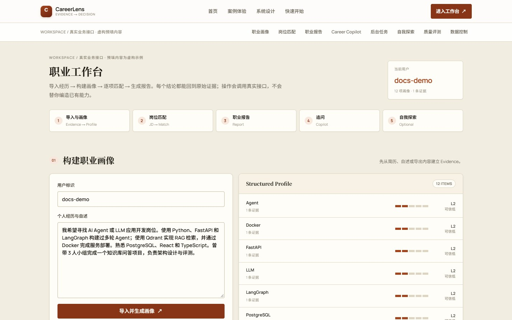

# 01 · 第一次把 CareerLens 跑起来

**目标**：在本机启动 CareerLens 完整闭环，亲手走一遍 `输入 → Evidence → 画像 → 岗位匹配 → 报告 → 对话`，建立对整个系统数据流的直觉。

**前置**：[开始页](从这里开始.md)的第一题（10 分钟，零安装）。本机跑通需要 Docker；**不需要** API Key、GPU 或真实个人资料。

**预计耗时**：本机准备与首次构建含镜像下载约 10–30 分钟，之后启动约 1 分钟。首次下载单独算，不承诺固定用时。

跑起来之后，你要操作的就是这个工作台：从「构建职业画像」开始，一路走到岗位匹配、报告和对话。



> 只想理解原理、暂时装不了软件？走[静态观察路线](静态观察路线.md)，同样能学懂，但那不算「本机跑通」。
> 服务已经启动？直接去[步骤 2](#步骤-2-确认部署正常)看各个组件是否就绪。

---

## 步骤 1 本机准备

本机只装 Docker，**不另装 Python 和 Node.js**（它们在镜像里）。想写脚本再做 [Python 选做准备](setup/Python准备.md)。

### 1.1 先拿到项目文件

不要求你会 Git。在 GitHub 项目页点 `Code` → `Download ZIP`，下载后解压到一个好记的目录（例如桌面下的 `careerlens`）。打开 PowerShell 或终端，进入这个目录：

```powershell
# Windows PowerShell：换成你自己的解压路径
cd "$HOME\Desktop\careerlens"
```

```bash
# macOS / Linux
cd ~/Desktop/careerlens
```

**怎么确认进对了**：列出目录内容，能看到 `docker-compose.yml` 就算成功。

```powershell
# Windows
Get-ChildItem
```

```bash
# macOS / Linux
ls
```

如果提示「找不到路径」或目录里没有 `docker-compose.yml`，就是还没解压或 `cd` 的路径不对——回到上一步核对目录位置。本教程所有命令都在这个目录里执行。

### 1.2 安装并启动 Docker

| 系统 | 做法与验收 |
| --- | --- |
| **Windows** | 按 [Docker Desktop Windows 安装指南](https://docs.docker.com/desktop/setup/install/windows-install/)安装。过程中若提示检查 WSL 2 或虚拟化，按指南开启。装完打开 Docker Desktop，等引擎就绪。 |
| **macOS** | 先分清 Apple 芯片还是 Intel，再按 [Docker Desktop macOS 安装指南](https://docs.docker.com/desktop/setup/install/mac-install/)安装。装完打开 Docker Desktop，等引擎就绪。 |
| **Linux** | 按 [Docker Engine 官方安装入口](https://docs.docker.com/engine/install/)安装；只承诺实际走查过的平台，其他发行版以官方页面为准。 |

**验收**：终端执行下面两条，能看到版本号，且 `docker version` 里有 `Server:` 部分（不只是 Client）：

```bash
docker version
docker compose version
```

只看到 Client、报「连不上 daemon」，说明 Docker 引擎没启动——先打开 Docker Desktop 并等它就绪。这一步**不需要**注册任何模型平台账号。

如果终端找不到 Docker，按上表安装后再验收。设备暂时不能装软件，可以走[静态观察路线](静态观察路线.md)，再到[第 04 篇](04-检索Agent.md)手算排名。

### 1.3 命令逐行解释

启动命令稍后会出现，先把会用到的三条命令讲清楚：

```powershell
docker compose up -d --build
```

- `docker compose`：用项目里的 `docker-compose.yml` 一次管理多个服务。
- `up`：按配置创建并启动服务。
- `-d`：后台运行（detached），终端不会被占住。
- `--build`：先根据 Dockerfile 构建镜像再启动。首次或改过代码时加，之后可省略。

```powershell
docker compose ps -a
```

- `ps`：查看各服务状态；`-a` 连已停止的也显示（迁移任务跑完就退出了，需要 `-a` 才看得到）。

```powershell
docker compose down
```

- 停止并清理本次启动的容器和网络。**不要加 `-v`**，否则会删除数据库和向量数据卷。

---

## 步骤 2 确认部署正常

在步骤 1 的目录下启动：

```powershell
docker compose up -d --build
```

Compose 会拉起 PostgreSQL、Qdrant、一次性 migration、API、MCP、Worker 和 Web。等服务就绪后：

```powershell
docker compose ps -a
```

`migrate` 服务应显示 `Exited (0)`（它是一次性任务，跑完退出是正常的）；其余常驻服务为 `Up` 或 `healthy`。

**检查就绪状态**——浏览器打开，或用终端访问：

```text
http://localhost:8000/health/ready
```

依赖都正常时返回 `{"status":"ok","checks":{"database":"ok","qdrant":"ok"}}`；数据库或 Qdrant 不可用时返回 HTTP 503 和 `status: degraded`。健康接口是 `/health/ready`，**没有** `/api/v1` 前缀。

> 迁移先于 API 执行。若你跳过 Compose 手动启动，必须先跑 `python -m app.migration_runner`，否则会连到未建表的数据库。

**首次下载慢、端口冲突、`migrate` 没成功怎么办**：见 [FAQ](常见问题.md#启动与安装)。

---

## 步骤 3：用合成资料走一遍业务闭环

打开工作台：

```text
http://localhost:3000/workspace
```

页面已预填**虚构**的学习者「林澈」的自述和岗位描述（见 `frontend/app/workspace/page.tsx` 的 `demoEvidence` / `demoJd`，以及展示页 `/demo`）。按顺序操作：

1. 点「**导入并生成画像**」——观察左侧出现带来源和 ID 的 Evidence，右侧出现带证据引用的技能画像。
2. 点「**分析匹配度**」。到「后台任务」区等分析成功（`succeeded`），再点结果卡片上的「**打开结果**」。在逐项结果里各挑一条有证据的要求和一个缺口，记下要求名称和原文。等级、权重怎么变成分数，以及周数怎么计算，见[第 07 篇的算例](07-接入与验证.md#手算匹配分和学习周数)。
3. 点「**生成职业报告**」——得到带引用的报告，可下载 Markdown，并保留版本。这一步同样是后台任务，要等任务成功后打开结果。
4. 在 Career Copilot 里问「为什么推荐这个方向？」——回答下方有检索诊断，可展开原始 Evidence。
5. 试一次后台任务：提交报告生成后，中途刷新页面，进度能从断点续看。

**观察重点**：画像条目和岗位匹配都带着 evidence ID，能点回原始材料。这就是第一题里你做的判断——**结论必须落到证据**。

> 所有预填内容都是虚构的。真实个人资料只应在获得授权并采取保护措施时导入。

---

## 步骤 4：在 Swagger 里重做一遍（理解数据流）

这是**第二条练习**，用浏览器调用接口，不写任何代码。打开：

```text
http://localhost:8000/docs
```

在 `/docs` 里展开接口，点 `Try it out`，填请求体或参数，再点 `Execute`。依次做：

1. `POST /api/v1/evidence/text` — 写入一条自述。返回体里 `items[0].id` 就是新证据的 ID。
2. `POST /api/v1/profiles/{user_id}/rebuild` 构建画像。再用 `GET /api/v1/profiles/{user_id}` 查看条目里的 `evidence_ids`。
3. `POST /api/v1/jobs/analyze` 分析岗位。保存响应顶层的 `id`，这是岗位分析 ID。`matches` 里可以逐项查看 `status` 和 `evidence_ids`。
4. `POST /api/v1/reports` 生成报告，在 `job_analysis_id` 填上一步保存的 ID。
5. `POST /api/v1/chat` — 切换 `mode` 为 `rag` / `wiki` / `hybrid`，比较检索诊断。

> 这里的接口地址和 JSON 是**在 Swagger 页面里填的**，不是让你在终端执行的命令。`user_id` 用一个练习名（如 `learner`）即可。

**观察重点**：第 2 步画像条目的 `evidence_ids` 指向第 1 步的证据；第 3 步每条要求也带证据。字段含义见[术语表](术语表.md)，报 422 见 [FAQ](常见问题.md#就绪检查与-api)。

---

## 步骤 5：提交一个后台任务并观察事件

在 `/docs` 里调用 `POST /api/v1/runs`：

```json
{
  "user_id": "learner",
  "operation": "report",
  "input": { "job_analysis_id": "<上节第 3 项的岗位分析 ID>" },
  "requires_confirmation": false
}
```

返回 `202` 和 run id。随后：

```text
GET /api/v1/runs/<run_id>         查看状态（queued → running → succeeded）
GET /api/v1/runs/<run_id>/events  查看有序事件
GET /api/v1/runs/<run_id>/stream  SSE 进度流
```

用同一个 `Idempotency-Key` 重复提交，会返回同一个 run，不会重复执行。任务一直 queued？先确认 Worker 服务在跑，见 [FAQ](常见问题.md#后台任务)。这些机制的细节在第 06 篇。

---

## 验收清单

做到以下各点，算完成本篇：

- [ ] 本机准备完成：`docker version` 有 Server 部分，`docker compose version` 可用
- [ ] `docker compose ps -a` 显示服务正常，`migrate` 为 `Exited (0)`
- [ ] `/health/ready` 返回 `status: ok`
- [ ] 工作台走通导入 → 画像 → 岗位 → 报告 → 对话五步
- [ ] 能说清楚 `Evidence ID` 在画像和岗位匹配里起什么作用
- [ ] 在 Swagger 里用 `items[0].id` 找到证据、用 `matches[].status` 看到匹配状态
- [ ] 提交后台 run 并看到它从 queued 走到 succeeded；刷新后进度可续看

---

## 常见问题

- **端口冲突**：Qdrant 宿主机端口可用 `QDRANT_HTTP_PORT` / `QDRANT_GRPC_PORT` 改；容器内端口不变。其他占用见 [FAQ](常见问题.md#启动与安装)。
- **首次构建很慢**：下载 PostgreSQL、Qdrant 镜像与依赖属正常。
- **后台任务一直 queued**：确认 Worker 服务已启动；手动启动时另跑 `python -m app.runtime.worker`。
- **想保留数据**：`docker compose down` 默认保留数据卷；加 `-v` 才会删除。
- 更多见[完整 FAQ](常见问题.md)。

## 下一步

你已经看到系统全貌。接下来读[第 02 篇：数据模型](02-数据模型.md)，理解支撑这一切的三张核心表；想先补概念就读[术语表](术语表.md)和阶段 0（[进度总览](README.md)）。
