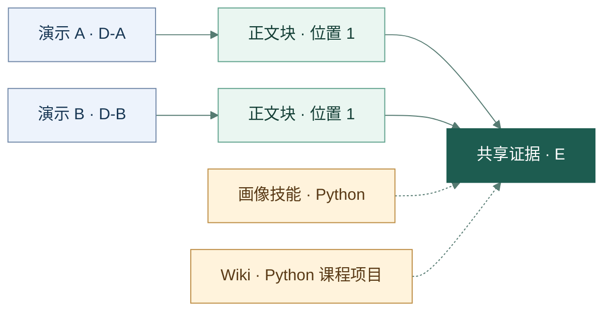
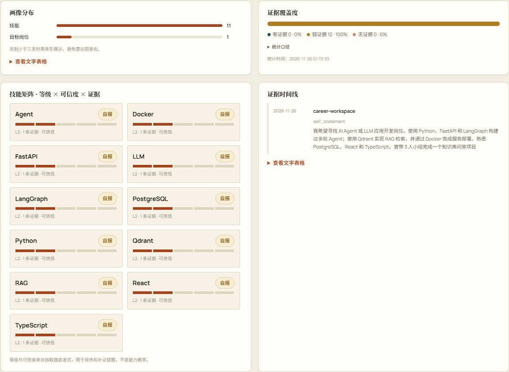

# 02 · 同一段经历为什么有好几个 ID

林澈把同一句经历写进了《演示 A》和《演示 B》。「我用 Python 做过一个课程项目，只在本机演示。」如果只存一条文字，他想看回《演示 B》就会失去位置；如果每次上传都新增一条证据，反复上传就能把同一句经历算好几次。CareerLens 把文件、位置和有效证据存成不同的记录。这一课先读懂它们，下一课再亲手上传。 [第四章目录](./04-knowledge-base/README.md)

只用浏览器即可。学完画一条回查路线，标出两个文档 ID、两个块位置和一个共享证据 ID，再用文末的问题核对。

从 01-D 继续时，把原来的编号记在笔记中。第四章会在 **8031** 的知识库副本重新导入 A、B，使用 `kb-study` 取得能在本章查询的编号。跟写之前先看[练习副本准备](04-knowledge-base/README.md#第一次打开练习)。

## 先认识数据库的行、主键与引用

可以把一张表看成带规则的工作表。每行保存一个对象，**主键**是这行的编号。同一句文字可以在两行不同的「文件位置」记录中出现。它们各有自己的位置 ID，又都可以带着同一个证据 ID。分别顺着这两个编号查，就能回答「在哪份文件里」和「我引用的是哪句话」。

CareerLens 用 **SQLAlchemy ORM** 表达这份设计。打开 `backend/app/models/parsed_block.py`，在 `class ParsedBlock` 下读这三行。`Mapped[...]` 写明 Python 类型，`mapped_column` 指定数据库里的类型和约束。`nullable=True` 表示可以没有这个值。例如扫描页留下了位置，但暂时没有可引用的正文，`evidence_id` 可以为空。 [数据库的块模型](../backend/app/models/parsed_block.py#L29-L60)

```python
evidence_id: Mapped[str | None] = mapped_column(String(36), nullable=True, index=True)
doc_id: Mapped[str] = mapped_column(String(36), nullable=False, index=True)
block_index: Mapped[int] = mapped_column(Integer, nullable=False)
```

**索引**帮助按列查找，唯一约束还会阻止约定键重复。例如 `UniqueConstraint("doc_id", "block_index", ...)` 允许两个不同文件各有一个第 1 块。代码用字符串 ID 和归属检查维护下面的关联。 [块位置唯一约束](../backend/app/models/parsed_block.py#L55-L61)

## 画出两份文件和一条共同证据

下图只画共同正文。两份文件还有各自的标题块。虚线表示画像或 Wiki 内保存了证据编号，可沿这条线回查原文。



| 要回答的问题 | 看什么记录 | 去哪里读源码 |
| --- | --- | --- |
| 上传过哪份文件？ | `SourceDocument.id`、`filename`、`source_hash`。同一用户上传相同文件字节时复用一条文档记录 | `backend/app/models/source_document.py` 的 `SourceDocument`。[文档模型](../backend/app/models/source_document.py#L20-L42) |
| 证据在哪一段？ | `ParsedBlock.doc_id`、`block_index`、`section_path`。PDF 还可能有 `page_no` 和 `bbox` | `backend/app/models/parsed_block.py` 的 `ParsedBlock`。[位置列](../backend/app/models/parsed_block.py#L29-L60) |
| 被引用的是哪句原文？ | `Evidence.id`、`content`，各个出处放在 `source_metadata.sources` | `backend/app/models/evidence.py` 的 `Evidence`。[证据模型](../backend/app/models/evidence.py#L10-L32) |
| 系统抽取了什么技能？ | `ProfileItem.name`、`category`、`evidence_ids` | `backend/app/models/profile.py` 的 `ProfileItem`。[画像模型](../backend/app/models/profile.py#L10-L30) |
| 哪一页在用这条原文？ | `WikiPage.id` 标识页面，`slug` 用来打开，`source_refs` 和 `chunk_refs` 带你回到原文 | `backend/app/models/wiki.py` 的 `WikiPage`。[Wiki 模型](../backend/app/models/wiki.py#L29-L62) |

下面用几个课堂记号。`D-A`、`D-B` 对应文档 ID，`E` 对应共享正文的证据 ID。运行时拿到的通常是 UUID 这样的长字符串。后面填请求时要用自己实际取得的值。

## 用一项画像走完回查

工作台里的 Python 画像可以有一个 `evidence_ids` 列表。选择其中的 `E` 来追。在第 03-A 课，打开 `GET /api/v1/evidence/{evidence_id}`，路径格填 `E` 的真实值，再填同一个 `user_id`。证据详情的 `content` 是「我用 Python 做过一个课程项目，只在本机演示。」同一响应的 `source_metadata.sources` 里记录了两个出处，例如：

```json
{
  "id": "E",
  "source_metadata": {
    "source_count": 2,
    "sources": [
      {"source_name": "demo-a.docx", "doc_id": "D-A", "block_index": 1, "section_path": "演示 A"},
      {"source_name": "demo-b.docx", "doc_id": "D-B", "block_index": 1, "section_path": "演示 B"}
    ]
  }
}
```

上面是教学简化响应。证据对象顶层的 `source_name` 和顶层的位置字段会延续最早一次写入时的信息。遇到同一段有多个出处时，展开 `sources` 逐条核对。凭 `doc_id` 和 `block_index` 也能在教学账号的导出数据里找到对应的 `parsed_blocks`；更细的字符位置保存在该块的 `char_start` 和 `char_end`。 [实际来源合并](../backend/app/services/evidence.py#L14-L26) · [块位置写入](../backend/app/services/source_ingestion.py#L74-L112) · [教学账号数据导出](../backend/app/api/routes/privacy.py#L17-L29)



读完原文后再给结论划线。「做过 Python 课程项目」有出处。「上线过生产服务」需要更直接的材料。画像字段 `confidence` 表示抽取时记录的信心，原文里的「只在本机演示」仍然要保留。

## 三个容易混在一起的编号

- **证据 ID** 会被画像和 Wiki 反复引用。把相同正文追加为第二个来源时，旧的引用仍指向原来的证据。
- **指纹**是用于判断重复的散列值。`source_hash` 用原始文件字节计算，`content_hash` 用规范化文字计算。两种字段各自参与同一用户内的去重键。下一课会看到同一个正文怎样对应两份文件字节。 [指纹实现](../backend/app/ingestion/contract.py#L23-L31)
- **Run ID** 表示一次后台导入或编译任务。用它查状态和步骤，拿到产物后再用证据 ID 或 Wiki `slug` 打开资料。`thread_id` 则来自第三章的聊天会话。 [后台任务模型](../backend/app/models/run.py#L23) · [两轮会话](01-agent-design/01-B2-会话与画像确认.md)

练习副本把 SQL 数据写入本机 SQLite，完整 Compose 运行通常用 PostgreSQL。Qdrant 保存可重建的检索索引，命中后系统还会按现有证据回查正文。需要调整正式库的表结构时，对照 `backend/app/migration_runner.py` 和 `backend/migrations/versions/` 的迁移。 [数据库迁移入口](../backend/app/migration_runner.py) · [证据与 Wiki 来源迁移](../backend/migrations/versions/a7b8c9d0e1f2_preserve_evidence_and_wiki_lineage.py) · [索引命中回查](../backend/app/retrieval/service.py#L43-L79)

## 新版画像周边数据放在哪

做完一周学习任务后，系统需要记住你做到了哪一步。它会把状态和已投入时间写到进度表。若你把作业另行导入，进度可以引用那条 Evidence，后续重建画像时才有新的原文可用。

| 你做的操作 | 对应的记录 | 导出时找哪个字段 |
| --- | --- | --- |
| 保存一份岗位原句 | `SavedJob` | `saved_jobs` |
| 记下阶段、状态、实际用时和引用 | `LearningProgress` | `learning_progress` |
| 提交测评或填写学习约束 | `AssessmentResult`、`UserConstraint` | `assessments`、`constraints` |
| 定义一个自选展示维度，或给面试故事附上证据 | `DimensionDefinition`、`ProfileExtension` | `dimensions`、`profile_extensions` |

Alembic 迁移是让已有数据库也能得到新表的步骤。到 `backend/migrations/versions/` 找 `c9d0e1f2a3b4` 和 `d0e1f2a3b4c5`。前者创建岗位与进度表，后者增加测评、约束、维度和扩展。路由的请求字段由现有服务读写这些记录，隐私导出和账号清理也按同一账号处理新数据。导出结果的顶层键名在 [`export_user_data`](../backend/app/services/privacy.py#L130-L160) 里可以直接看到：

```python
{
    "saved_jobs": [...],
    "learning_progress": [...],
    "assessments": [...],
    "constraints": [...],
    "dimensions": [...],
    "profile_extensions": [...],
}
```

[岗位与进度迁移](../backend/migrations/versions/c9d0e1f2a3b4_add_hy4_learning.py) · [测评与扩展迁移](../backend/migrations/versions/d0e1f2a3b4c5_add_hy4_assessment.py)

做完[第 10、11 篇的实战](10-导入与可回查画像.md)后，在同一服务用 `GET /api/v1/privacy/{user_id}/export` 导出合成账号 `hy4-lesson`。在 `saved_jobs` 里找两份岗位原句，在 `learning_progress` 里把 `plan_id` 与 A 的分析编号对上。

## 用三道题检查读懂了哪一层

1. 从画像的 `evidence_ids` 拿到 `E`，要找《演示 B》的位置，取顶层文件名还是对应的来源条目？
2. A 和 B 的正文共享证据。若 B 的标题由「演示 B」改成「演示 C」后重传，正文证据 ID 会怎样？文件位置又会怎样？
3. Wiki 候选同时给了 `page_id` 和 `slug`。用哪个值打开主题页？再从哪个字段取得原句的证据 ID？

<details>
<summary>核对三种路线</summary>

1. 读 `source_metadata.sources` 里文件名为 `demo-b.docx` 的一项，顺着 `doc_id` 与 `block_index` 找块。
2. 改标题后文件字节会变化，得到一个新的文档位置。共同正文没改，仍然可以复用 `E`，为它登记新的来源。
3. `page_id` 标识主题页，Wiki 详情接口的路径用 `slug`。先到主题页的 `chunk_refs` 看编译后留下的证据 ID，再用证据详情接口看对应原文。还可以比较 `source_refs` 看本次选中了哪些材料。

</details>

## 下一步

到 [03 让 DOCX 变成带位置的块](03-解析层.md)。先从一份真实 DOCX 找出标题和正文，看看 `block_index` 如何得到。
