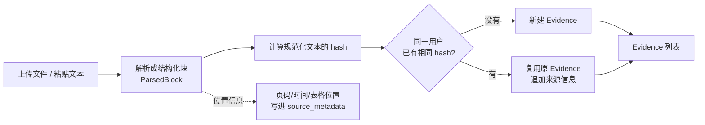

# 03 · 解析层：把文件变成带位置的证据

**成果**：你能说清一段文字是怎么从 PDF / DOCX / 表格变成带来源和位置的 Evidence；亲手导入合成文件，核对去重结果；选做实现一个小小的去重规则。

**前置**：[01](01-quickstart.md) 已跑通；读过 [00-4](00-foundations/00-4-data-model-in-plain-words.md) 的证据概念。

**对应版本**：本文接口按当前 `main` 核对；代码 tag 以仓库最新 Release 为准。

**对应源码**：`backend/app/ingestion/`、`backend/app/services/evidence.py`、`backend/app/services/source_ingestion.py`、`backend/app/models/parsed_block.py`。

---

## 图解：一次导入发生了什么

<details>
<summary>一张图（文字版在下面）</summary>



**文字版**：文件或文本先被解析成一块块结构化内容，每块算出规范化文本的 hash。若同一用户已有相同 hash，就复用原证据并追加一条来源信息；否则新建。解析得到的位置（页码、时间、表格位置等）写进证据的 `source_metadata`。

</details>

三个要点：

1. **解析与存储分离**：解析层只管把内容拆成带位置的块，不管去重；去重在证据服务里完成。
2. **位置不丢**：页码、时间、表格位置跟着证据走，供后面 Wiki 引用和核验使用。
3. **扫描 PDF 页不造假**：识别为扫描页时只标记「待 OCR」，**不编造文字**。

## 支持什么格式

| 类型 | 格式 | 解析方式 | 位置信息 |
| --- | --- | --- | --- |
| 文本 | TXT / MD / Markdown | 按 UTF-8 解码，整文件一个块 | 块序号 |
| 文档 | PDF | 逐页提取文本层 | 页码 + bbox |
| 文档 | DOCX | 按段落和表格顺序遍历 | 标题路径、表格内容 |
| 表格 | CSV / TSV / XLSX | 渲染成 Markdown 表 | 表内行、工作表名 |
| 媒体 | 图片 / 音视频 | 可选 OCR / ASR（进阶） | 每行位置或时间段 |

> 代码实际支持 CSV/TSV/XLSX；早期文档只写了 PDF/DOCX/TXT/Markdown，以代码为准。XLSX 用标准库解析，不需要 openpyxl。

**扫描 PDF 页怎么处理**：系统按图像占比和文字量判断某页是否是扫描页，是的话生成一个空的占位块并标 `ocr_pending: true`，文档整体记为 `partial`。它**不会**假装读出了文字，也没有自动把扫描页送去 OCR——真正的 OCR 只在单独上传图片时走可选路径。这体现了一个设计取舍：宁可说「读不出」，也不编造证据。

## 用真实接口观察

启动服务（见 [01](01-quickstart.md)）。下面都在 `http://localhost:8000/docs` 里做。

### 观察 1：粘贴文本，看证据和去重

`POST /api/v1/evidence/text` 的请求体：

```json
{
  "user_id": "learner",
  "source_type": "self_statement",
  "source_name": "goal",
  "content": "我用 Python 做过一个课程项目，只在本机演示。"
}
```

`source_type` 和 `source_name` 可省略（默认 `self_statement` / `manual-input`）。返回 `201`：

```json
{ "items": [{ "id": "<证据ID>", "...": "..." }], "count": 1 }
```

取 `items[0].id` 记下来。现在**原样再提交一次相同请求**（`user_id` 和 `content` 都不变），你会看到：

- 返回的 `items[0].id` **和第一次相同**；
- 没有产生第二条证据。

这就是去重：同一用户 + 相同规范化文本，复用同一条 Evidence，不会虚增证据数量。规范化规则只是统一换行符并去掉首尾空白，所以「同样的内容、末尾多一个换行」也会命中同一条。

### 观察 2：换个来源名，看来源被追加

把 `source_name` 从 `goal` 改成 `notes`，内容完全不变，再提交一次。证据 ID 仍然相同，但这条证据的来源列表多了一项。去[术语表](GLOSSARY.md)查 `source_metadata`，理解「一条证据可以有多个来源」。

### 观察 3：上传文件，看位置信息

`POST /api/v1/evidence/file` 是 **multipart/form-data**，不是 JSON。在 Swagger 里：

- `user_id` 填 `learner`；
- `source_type` 默认 `resume`，可改；
- `upload` 选一个本地 `.txt` 或 `.md` 文件。

返回同样是 `EvidenceBatchRead`。在返回的 `source_metadata` 里能看到 `block_count`（块数）、`doc_id`、`block_index` 等字段；PDF 还会有页码 `page_no` 和 `bbox`，音视频会有 `time_start` / `time_end`。

> 注意：`char_start` / `char_end` 这种字符级位置**不在**证据的 `source_metadata` 里，而是在结构化的 ParsedBlock 行上；要看到它们需要用数据导出接口（`GET /api/v1/privacy/{user_id}/export`）。

### 观察 4：列出证据

`GET /api/v1/evidence?user_id=learner&limit=100&offset=0` 返回证据列表，按创建时间倒序。返回的 `count` 是**本页条数**，不是数据库总数。

## 自查清单

- [ ] 能说清「解析」和「去重」分别在哪个环节做
- [ ] 导入同一段文字两次，能解释为什么 ID 相同、证据数不增
- [ ] 能说出至少三种支持的文件格式，以及扫描 PDF 页不会被伪造文字
- [ ] 能指出位置信息存在哪里（证据的 `source_metadata` vs ParsedBlock 行）

## 选做复刻挑战：写一个最小去重判断

不用连数据库，写一个 20 行的小函数，模拟「同一用户 + 规范化文本相同则复用」的判断逻辑：

```python
import hashlib

def fingerprint(text: str) -> str:
    normalized = text.replace("\r\n", "\n").replace("\r", "\n").strip()
    return hashlib.sha256(normalized.encode("utf-8")).hexdigest()

# 期望：fingerprint("你好") == fingerprint("你好\n")
assert fingerprint("你好") == fingerprint("你好\n")
assert fingerprint("你好") != fingerprint("你坏")
```

<details>
<summary>参考答案要点</summary>

- 规范化只做三件事：统一 CRLF、统一 CR、去首尾空白。不要改动中间内容。
- 真实系统里，去重键是「用户 ID + 这个 hash」组成的数据库唯一索引；hash 只针对规范化后的文本，不把用户 ID 拼进去做哈希。
- 命中重复时返回的是**原来那条证据**，只是把新来源追加进去；不是新建一条。

</details>

## 常见坑

- **把接口地址和 JSON 当终端命令**：本课的调用是在 Swagger 页面里点 `Try it out` 填的，不是在 shell 里直接敲的。
- **`/evidence/file` 当成 JSON 传**：它是 Form + File（multipart），不是 JSON body；`/evidence/text` 才是 JSON。
- **误以为扫描页会自动 OCR**：不会，只标记 `ocr_pending`；别把空的扫描页当成「系统读出了空白」。
- **误以为 `count` 是总数**：它是当前页返回条数。

## 下一步

证据变成带位置的材料了。接下来 [04 · 检索 Agent](04-retrieval-agent.md)——看系统怎么从这些证据里找出能支持结论的那些。
