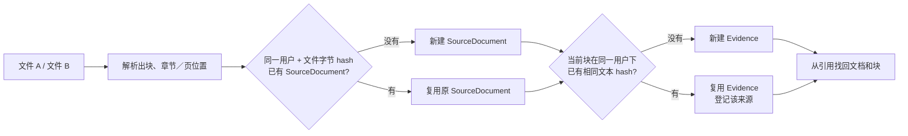

# 03 · 解析层：把文件变成带位置的证据

**成果**：你能说清一段文字是怎么从 PDF / DOCX / 表格变成带来源和位置的 Evidence；亲手导入合成文件，核对去重结果；选做实现一个小小的去重规则。

**前置**：[01](01-第一次跑起来.md) 已跑通；读过 [00-4](00-foundations/00-4-数据模型大白话.md) 的证据概念。

**对应版本**：本文接口按当前 `main` 核对；代码 tag 以仓库最新 Release 为准。

**对应源码**：`backend/app/ingestion/`、`backend/app/services/evidence.py`、`backend/app/services/source_ingestion.py`、`backend/app/models/parsed_block.py`。

---

## 图解：一次导入发生了什么

<details>
<summary>一张图（文字版在下面）</summary>



**图前问题**：为什么能有**两个文档 ID、却只有一条证据 ID**？（先想，再往下看。）

**文字版**：去重有两级，键不同——

1. **文件级**：`SourceDocument` 按 `(user_id, source_hash)` 判重，`source_hash` 是**原始文件字节的 SHA-256**（`contract.py:29-31`）。原样重传同一文件 → 复用原文档；换一个文件（哪怕内容大部分相同）→ 新文档。
2. **证据级**：块文本按 `(user_id, content_hash)` 判重。同一用户下两个不同文件含有逐字节相同的段落 → **共享一条 Evidence**，`sources[]` 有两项，两个 ParsedBlock（不同 `doc_id`/`block_index`）都指向同一个 `evidence_id`。

**图后判断依据**：想确认"是不是同一份文件"看 `source_hash`（字节级）；想确认"是不是同一段内容"看 `content_hash`（文本级）。两者不能混用——改文件名不改字节，仍是同一文档；两份不同的 DOCX 也能共享一段证据。

</details>

三个要点：

1. **解析与存储分离**：解析层只管把内容拆成带位置的块，不管去重；去重在证据服务里完成。
2. **位置不丢**：页码、时间、表格位置跟着证据走，供后面 Wiki 引用和核验使用。逐来源看 `source_metadata.sources[]`（每项含 `source_type`、`source_name` 及定位字段），`source_metadata.source_count` 是来源数；顶层的定位字段只代表第一次写入的来源。
3. **扫描 PDF 页不造假**：识别为扫描页时只标记「待 OCR」，**不编造文字**。

## 支持什么格式

| 类型 | 格式 | 解析方式 | 位置信息 |
| --- | --- | --- | --- |
| 文本 | TXT / MD / Markdown | 按 UTF-8 解码，整文件一个块 | 块序号 |
| 文档 | PDF | 逐页提取文本层 | 页码 + bbox |
| 文档 | DOCX | 按段落和表格顺序遍历 | 标题路径、表格内容 |
| 表格 | CSV / TSV / XLSX | 渲染成 Markdown 表 | 表内行、工作表名 |
| 媒体 | 图片 / 音视频 | 可选 OCR / ASR（进阶） | 每行位置或时间段 |

> 代码实际支持 CSV/TSV/XLSX；早期文档只写了 PDF/DOCX/TXT/Markdown，以代码为准。XLSX 用标准库解析，不需要 openpyxl。

**扫描 PDF 页怎么处理**：系统按图像占比和文字量判断某页是否是扫描页，是的话生成一个空的占位块并标 `ocr_pending: true`，文档整体记为 `partial`。它**不会**假装读出了文字，也没有自动把扫描页送去 OCR——真正的 OCR 只在单独上传图片时走可选路径。这体现了一个设计取舍：宁可说「读不出」，也不编造证据。

## 用真实接口观察

启动服务（见 [01](01-第一次跑起来.md)）。下面都在 `http://localhost:8000/docs` 里做。

### 观察 1：粘贴文本，看证据和去重

`POST /api/v1/evidence/text` 的请求体：

```json
{
  "user_id": "learner",
  "source_type": "self_statement",
  "source_name": "goal",
  "content": "我用 Python 做过一个课程项目，只在本机演示。"
}
```

`source_type` 和 `source_name` 可省略（默认 `self_statement` / `manual-input`）。返回 `201`：

```json
{ "items": [{ "id": "<证据ID>", "...": "..." }], "count": 1 }
```

取 `items[0].id` 记下来。**先预测，再提交**：下面四种改动，哪些会复用同一个 ID，哪些会新建？把答案写在纸上，再用 Swagger 逐个验证。

| 改动（同一 `user_id=learner`） | 你的预测 | 实际 | 为什么 |
| --- | --- | --- | --- |
| 原样再提交一次 | （先填） | 同一 ID，`source_count` 不变 | 来源条目字典完全相等就跳过追加（`evidence.py:22`） |
| 只把 `source_name` 改成 `notes` | （先填） | 同一 ID，`sources` 多一项 | 去重键不含 `source_name`，新来源被追加 |
| 只把 `user_id` 改成别的 | （先填） | 不同 ID | 去重键含 `user_id` |
| 内容末尾多一个换行 / 中间加双空格 | （先填） | 同一 ID | 文本接口会做额外规范化（见下） |
| 把 `Python` 改成 `python`（小写） | （先填） | 不同 ID | 规范化**不**折叠大小写 |

<details>
<summary>核对与解释</summary>

去重键是 `(user_id, content_hash)` 唯一索引（`models/evidence.py:31`）。`source_name` 不在键里，改它只会给同一条证据追加来源。命中重复时复用原 Evidence，把新来源追加到 `source_metadata.sources[]` 并把 `source_count` 加一，不新建行。

**规范化分两层**（这是上一版容易记错的地方）：

1. 文本接口 `POST /evidence/text` 先走 `chunk_text → normalize_text`（`ingestion/chunking.py:4-8`）：删 `\x00`、折叠 `[ \t]+` 为单空格、把 `\n{3,}` 折叠成 `\n\n`、去首尾空白。
2. 再走 `content_fingerprint`（`ingestion/contract.py:23-26`）：CRLF/CR → LF、去首尾空白、`sha256(utf-8)`。

所以双空格、NUL、多余空行在文本接口里都会命中同一条；但大小写、全角/半角、标点、词序**不**归一化，改了就是不同哈希。文件/媒体导入不走第一层，更接近底层规则。

</details>

> 验证时读不到 Evidence 的 `content_hash` 本身（`EvidenceRead` 不返回它），靠「ID 相同 + `source_count` 变大」判断即可。

### 观察 2：看来源被追加

把 `source_name` 从 `goal` 改成 `notes`，内容完全不变，再提交一次：证据 ID 相同，`sources` 多一项。用 `GET /api/v1/evidence/{id}` 看返回里的 `source_metadata`：逐来源的条目在 `sources[]`，来源是几项看 `source_count`。去[术语表](术语表.md)查 `source_metadata`。

### 实验 验证 DOCX 两级去重

林澈把同一段自述放进两份文档，标题用了「演示 A」和「演示 B」。先猜一个问题：资料库里应该保留几个文件？那句自述应该算几条证据？

打开 [demo-a.docx](../examples/tutorials/fixtures/demo-a.docx) 和 [demo-b.docx](../examples/tutorials/fixtures/demo-b.docx)，在文件页用 **Download raw file** 下载。两份文件的共同正文是「我用 Python 做过一个课程项目，只在本机演示。」有现成的文件和运行中的 Demo 就能完成实验。想修改样本的人可以使用[夹具生成脚本](../examples/tutorials/fixtures/README.md)。

1. 打开 `http://localhost:8000/docs`，在 `POST /api/v1/evidence/file` 点 **Try it out**。文件字段用表单上传，接口接收 `multipart/form-data`。
2. 选一个未用过的教学 `user_id`，如 `lesson-docx-01`，`source_type` 留默认。依次上传 A、B，再上传**刚才下载的那份** A。
3. 每次看到 `201` 后，在 `items` 里**先按 `content` 找到那句共同正文，再记录同一项的 `id`**。数组第一项是各自的标题，比较它们会得到两个不同的 ID。

| 上传顺序 | 标题项 | 共同正文项 | 共同正文的来源数 |
| --- | --- | --- | ---: |
| A | 演示 A，记作 `title-a` | 记作 `shared` | 1 |
| B | 演示 B，记作 `title-b` | 仍为 `shared` | 2 |
| 再传 A | 仍为 `title-a` | 仍为 `shared` | 2 |

表中的 ID 是记号。用你拿到的共同正文 ID 调 `GET /api/v1/evidence/{id}`，看 `source_metadata.sources[]`。两项的 `source_name` 是各自的文件名，`doc_id` 不同，`block_index` 都为 1，`section_path` 对应「演示 A」和「演示 B」。打开 `GET /api/v1/privacy/{user_id}/export`，同一个教学用户应有 **2 条 `source_documents` 和 4 条 `parsed_blocks`**。两个正文块都指向同一条 `evidence_id`。

文件指纹取原始字节，证据指纹取规范化后的块文本。文件容器里只要有字节变化，就可能是另一份来源。同一段可读正文仍然能复用证据。最后只换一个新的教学 `user_id` 再传 A，核对共同正文得到一个新 ID。用户参与两级去重键。

通过工作台上传 DOCX 或 XLSX 时，先在「后台任务」里等「解析完成」。文件任务会在卡片上直接显示证据条数。要对照某段内容、文件名和章节位置，继续用上面的证据接口。

<details>
<summary>参考判断与易错点</summary>

- "两个文档、一条证据"是对的：SourceDocument 按**文件字节**判重（`source_fingerprint` 用原始字节 SHA-256），Evidence 按**段落文本**判重（`content_fingerprint` 先换行归一 + strip 再 sha256）。两个不同的 DOCX 字节不同 → 两个文档；共享段落文本相同 → 一条证据。
- 文件导入的证据哈希**只走 `content_fingerprint`**，不走 `normalize_text` 那层额外规范化（删 NUL、折叠空格/空行只发生在文本接口 `/evidence/text`）。所以两份 DOCX 正文的空格、换行要真正一致。
- DOCX 没有页码/bbox：定位靠 `block_index` + `section_path`（标题用 Heading 样式才写 `section_path`）。PDF 才有 `page_no`/`bbox`，音视频有 `time_start`/`time_end`。
- `char_start`/`char_end` 这种字符级位置不在证据的 `source_metadata` 里，只在 ParsedBlock 行上，要经 `GET /api/v1/privacy/{user_id}/export` 才看得到。
- 换 `user_id` 再传同样的文件：两个去重键都含 `user_id`，会新建另一套文档和证据——这是用户隔离，不是 bug。

</details>

### 观察 4：列出证据

`GET /api/v1/evidence?user_id=learner&limit=100&offset=0` 返回证据列表，按创建时间倒序。返回的 `count` 是**本页条数**，不是数据库总数。

## 自查清单

- [ ] 能说清「解析」和「去重」分别在哪个环节做
- [ ] 导入同一段文字两次，能解释为什么 ID 相同、证据数不增
- [ ] 能说出至少三种支持的文件格式，以及扫描 PDF 页不会被伪造文字
- [ ] 能指出位置信息存在哪里（证据的 `source_metadata` vs ParsedBlock 行）

## 选做复刻挑战：写一个最小去重判断

不用连数据库，写一个约 20 行的小函数，模拟**文本接口**的指纹判断。要能预测上面观察 1 里的行为，就不能只照搬底层 hash——文本接口多了一层规范化：

```python
import hashlib, re

def normalize_text(text: str) -> str:
    text = text.replace("\x00", "")
    text = re.sub(r"[ \t]+", " ", text)      # 折叠空格/Tab
    text = re.sub(r"\n{3,}", "\n\n", text)   # 折叠多余空行
    return text.strip()

def fingerprint(text: str) -> str:
    normalized = normalize_text(text).replace("\r\n", "\n").replace("\r", "\n").strip()
    return hashlib.sha256(normalized.encode("utf-8")).hexdigest()

# 文本接口会复用：双空格、NUL、多余空行、末尾换行都被规范化掉
assert fingerprint("我用 Python") == fingerprint("我用  Python")     # 双空格
assert fingerprint("a\x00b") == fingerprint("ab")                     # NUL
assert fingerprint("a\n\n\nb") == fingerprint("a\n\nb")              # 3 个换行折叠成 2 个
assert fingerprint("a\n\nb") != fingerprint("a\nb")                  # 但 1 个换行不会被凑成 2 个
assert fingerprint("你好") == fingerprint("你好\n")                   # 末尾换行
# 不会复用：大小写、词序不同
assert fingerprint("Python") != fingerprint("python")
assert fingerprint("我用 Python") != fingerprint("Python 我")
```

<details>
<summary>参考答案要点</summary>

- 两层：先 `normalize_text`（删 NUL / 折叠空格与多换行 / strip），再 `content_fingerprint`（CRLF/CR → LF、strip、sha256）。少了第一层，就无法解释为什么双空格在文本接口里也会命中同一条。
- 真实系统里，去重键是「用户 ID + 这个 hash」组成的**唯一索引**；hash 只针对规范化后的文本，不把用户 ID 拼进去。
- 命中重复时返回**原来那条证据**，把新来源追加到 `sources[]`，不是新建一条。

</details>

## 常见坑

- **把接口地址和 JSON 当终端命令**：本课的调用是在 Swagger 页面里点 `Try it out` 填的，不是在 shell 里直接敲的。
- **`/evidence/file` 当成 JSON 传**：它是 Form + File（multipart），不是 JSON body；`/evidence/text` 才是 JSON。
- **误以为扫描页会自动 OCR**：不会，只标记 `ocr_pending`；别把空的扫描页当成「系统读出了空白」。
- **误以为 `count` 是总数**：它是当前页返回条数。

## 下一步

证据变成带位置的材料了。接下来 [04 · 检索 Agent](04-检索Agent.md)——看系统怎么从这些证据里找出能支持结论的那些。
