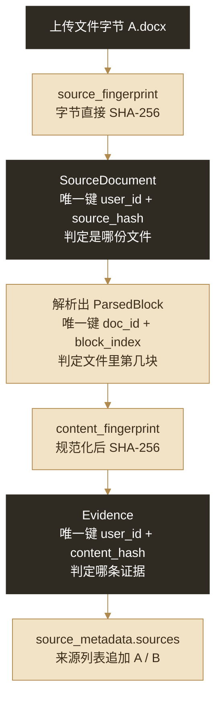

# 03-A · 写证据去重与来源合并

林澈的两份 DOCX 各有自己的标题，但共同正文是一字不差的。今天把两次上传拆成两场比较：先按文件字节判定是哪份文档，再按规范化文本判定是哪条证据。做完以后，你能从一个证据 ID 打开两个文件的准确位置。这一关在整条资料链上管的是「同一句话传两次，到底存一份还是两份」。 [第四章目录](./README.md)

## 为什么要写这一关

先看不写会怎样。假设林澈把同一份简历传了两次，系统如果每次都新建一条 Evidence，会发生三件坏事：

1. **来源数虚高。** 画像里「Python」这条能力被算成有两份材料支撑，其实是同一份文件传了两遍。证据先于结论的原则被污染了——结论看起来有据，实际上据是重复的。
2. **索引里堆重复向量。** 同一段话进 Qdrant 两次，检索榜首可能是两条一模一样的候选，挤掉了真正不同的材料。
3. **回溯指向单一出处。** 原本这条正文同时出现在 A、B 两份文档里，如果不合并来源，你只能记下「它来自最后一次上传的那份」，丢掉了另一个真实出处。

去重要同时做到两件看似矛盾的事：**正文只存一份**（避免上面三个问题），**出处记全**（A 和 B 都能查回）。这一关就是写这套「按内容判重、按来源追加」的逻辑。

## 一张地图：三层键各管一件事

很多人第一次读这段代码会问：既然正文一样为什么要算两次指纹？因为一份上传里其实有**三个不同的身份**，各自回答不同的问题。



| 层次 | 对象 | 唯一键 | 回答的问题 | 传输时换不换 |
| --- | --- | --- | --- | --- |
| 文件 | `SourceDocument` | `(user_id, source_hash)` | 这是不是同一份上传 | 字节一变就换 |
| 块 | `ParsedBlock` | `(doc_id, block_index)` | 这是文件里第几段 | 重排就换 |
| 证据 | `Evidence` | `(user_id, content_hash)` | 正文是不是同一条 | 规范化后正文不变就不换 |

关键在最后一行：**证据 ID 跟着正文走，不跟着文件走**。两份不同文件的同一段正文，正文规范化后字节相同，就复用同一个 Evidence。这就是「一条证据多个出处」的由来。

## 第 1 块：两种指纹，两种「一样」

`backend/app/ingestion/contract.py` 里有两个长得很像的函数，区别只在「算之前对不对输入动手脚」。

```python
def content_fingerprint(text: str) -> str:
    """Stable sha256 over normalized text — the evidence dedup key source."""
    normalized = text.replace("\r\n", "\n").replace("\r", "\n").strip()
    return hashlib.sha256(normalized.encode("utf-8")).hexdigest()


def source_fingerprint(raw: bytes) -> str:
    """File-level identity for idempotent re-uploads."""
    return hashlib.sha256(raw).hexdigest()
```

- `source_fingerprint` 收的是**原始字节**，一个字节都不改。Windows 的 `\r\n`、文档里的一个空格、甚至文件生成时间写进元数据，都会让字节摘要不同。它回答的是「这是不是同一个文件」，标准很严。 [两种指纹](../../backend/app/ingestion/contract.py#L23-L31)
- `content_fingerprint` 收的是**文字**，先做三步规范化：CRLF 换 LF、单独 CR 换 LF、去掉首尾空白。它回答的是「这两段话是不是同一段」，标准松一点。

顺序很重要：先替换 `\r\n` 再替换 `\r`。反过来先处理单独 `\r`，会把 `\r\n` 拆坏。Windows 的一组换行只应变成一个 LF。

`strip()` 只去首尾，不动中间。这一点是后面所有预测的边界。

### 用三行输入手算哪些内容会合并

这里有个容易踩的坑：**文本入口和文件入口走的规范化不是一套**。粘贴文本走 `chunk_text` → `normalize_text`，后者会折叠内部空格和多余空行；文件路径把解析出的块正文直接交给 `resolve_evidence` 算指纹，只做上面那三步。 [文本分块](../../backend/app/ingestion/chunking.py) · [文本入口](../../backend/app/services/evidence.py#L77-L121) · [文件的块处理](../../backend/app/services/source_ingestion.py#L60-L101)

| 两次输入的变化 | 文本路径（粘贴） | 文件中的正文块 | 原因 |
| --- | --- | --- | --- |
| 末尾多一个换行 | 指纹相同 | 指纹相同 | `strip()` 去首尾 |
| 中间一个空格变两个 | 折叠后相同 | **指纹不同** | `normalize_text` 折叠内部空格，`content_fingerprint` 不折叠 |
| `Python` 改为 `python` | 指纹不同 | 指纹不同 | 摘要区分大小写 |
| CRLF 换成 LF | 指纹相同 | 指纹相同 | 两种入口都统一换行 |

例如 `"A\r\nB\r"`：先变 `"A\nB\n"`，`strip()` 后是 `"A\nB"`，最后参与 SHA-256 的字节是 `b"A\nB"`。字符大小写、词序、标点都进摘要——SHA-256 不理解语义，只比对字节。

**SHA-256 的一个直觉**：它像一个把任意长度输入压成 64 位十六进制串的搅拌机。相同输入一定得到相同输出；不同输入「几乎一定」得到不同输出（碰撞概率低到工程上可忽略）。所以它适合当「这段字节我见过没有」的查表键，但不适合判断「两段话意思像不像」——那件事留给检索的余弦和 IDF 去做。

## 第 2 块：唯一键，数据库怎么保证「最多一行」

唯一键（unique constraint / index）让数据库在同一组键值上最多保留一行。代码里三层各有自己的键：

- `SourceDocument`：`(user_id, source_hash)`
- `Evidence`：`(user_id, content_hash)`
- `ParsedBlock`：`(doc_id, block_index)`

`user_id` 出现在前两个键里，这不是装饰。同一个账号第二次上传相同证据，会复用原行；**另一个账号上传相同文字时，文本指纹可能一样，但整组唯一键不同**，所以各存各的。教学账号之间天然隔离，这正是第 03-A 课让你换账号做对照的原因。 [文件唯一键](../../backend/app/models/source_document.py#L38-L42) · [证据唯一索引](../../backend/app/models/evidence.py#L28-L32) · [块位置约束](../../backend/app/models/parsed_block.py#L55-L61)

所以读到 `same hash` 三个字，先问一句：**哪个层次的键？** 同一个 `content_hash` 说明正文相同，不代表 `source_hash` 相同（可能来自两份文件），更不代表跨用户相同（`user_id` 还在键里）。

## 第 3 块：并发下怎么保证「两方指向同一条」

这是整关最值得慢慢读的一段。`resolve_evidence` 面对一个真实竞态：两个上传请求同时发现「这条证据还不存在」，如果都直接 `INSERT`，唯一键会让第二个报错，或者更糟——各写一行。

```python
fingerprint = content_fingerprint(content) if dedup else None
query = (
    select(Evidence)
    .where(Evidence.user_id == user_id, Evidence.content_hash == fingerprint)
    .with_for_update()
)
record = await session.scalar(query)
if record is None:
    statement = insert_no_conflict(
        session, Evidence, values, ["user_id", "content_hash"]
    )
    await session.execute(statement)
    record = (await session.scalars(query)).one()
_append_source(record, entry)
return record
```

四步拆开看：

1. **先查**（`SELECT ... FOR UPDATE`），看这条键在不在。
2. **查不到就原子插入**（`ON CONFLICT DO NOTHING`）。数据库保证同一键只成功一次，另一个请求被「礼貌地忽略」，不抛错。
3. **再重读**这个键对应的行。这时无论谁抢先插入，两方最终拿到的都是同一条记录。
4. **拿到行之后再合并来源**。合并放在查询之后，是因为只有确定了「是哪一行」才能往它的来源列表里追加。

`insert_no_conflict` 还有一层适配：SQLite 和 PostgreSQL 的 insert 方言不同，代码按 `session.get_bind().dialect.name` 选 `sqlite_insert` 还是 `postgres_insert`。练习副本用 SQLite，线上可以用 PostgreSQL，同一份业务代码不用改。 [原子插入](../../backend/app/services/evidence.py#L29-L74)

一个常见疑问：既然数据库有唯一键，为什么还要 `FOR UPDATE` 和 `ON CONFLICT DO NOTHING` 两套？因为唯一键只保证「不会写重复」，不保证「写失败的那个能拿到已存在行的 ID」。`ON CONFLICT DO NOTHING` + 重读组合起来，才让并发双方都指向同一条真实记录，而不是一个报错、一个成功。

## 跟写两个函数，让一条 Evidence 记住多个出处

```bash
python tutorials/04-knowledge-base/lab/kb_practice.py open sources
```

打开终端打印的练习文件。这两处默认在 `.cache/knowledge-practice/backend/app/ingestion/contract.py` 和 `.cache/knowledge-practice/backend/app/services/evidence.py`。原项目可以在同名的 `backend/app/...` 路径查完整流程。

先写 `content_fingerprint`：

1. 先处理 CRLF，再处理单独 CR。这个顺序让 Windows 的一组换行只变成一个 LF。
2. 用 `strip()` 去首尾，用 `encode("utf-8")` 得到字节，再取 `hexdigest()`。

再写 `_append_source`：

1. 把已有 `sources` 拿出来做一个列表副本 `list(...)`——不要直接在原列表上改。
2. 新来源整条字典已经相等时返回 `False`，不重复追加。这里比的是整个字典，不只是 `doc_id`。
3. 新建 `{**metadata, ...}` 并赋回 `record.source_metadata`，让 SQLAlchemy 认出整个 JSON 字段变了。`source_count` 用实际列表长度算出来，和来源一起写入。

为什么必须整体重新赋值？SQLAlchemy 对 JSON 字段的默认跟踪是「整个字段被替换」才标记为脏。如果只做 `record.source_metadata["sources"].append(entry)`，原地改了嵌套列表，ORM 可能察觉不到，更新就不会写进数据库——测试通过但落库失败是最隐蔽的一类 bug。 `{**metadata, "sources": sources}` 造了一个新字典，等于告诉 ORM「这个字段整块换了」。

<details>
<summary>核对 contract.py 中的 content_fingerprint</summary>

```python
def content_fingerprint(text: str) -> str:
    """Stable sha256 over normalized text — the evidence dedup key source."""
    normalized = text.replace("\r\n", "\n").replace("\r", "\n").strip()
    return hashlib.sha256(normalized.encode("utf-8")).hexdigest()
```

</details>

<details>
<summary>核对 evidence.py 中的 _append_source</summary>

```python
def _append_source(record: Evidence, entry: dict[str, Any]) -> bool:
    """Append a source to an existing evidence row; return True if it was new."""
    metadata = record.source_metadata or {}
    sources = list(metadata.get("sources", []))
    if entry in sources:
        return False
    sources.append(entry)
    record.source_metadata = {**metadata, "sources": sources, "source_count": len(sources)}
    return True
```

</details>

```bash
python tutorials/04-knowledge-base/lab/kb_practice.py check sources
```

测试会检查换行等价、用户隔离、同源重传和异源合并。 [用户与来源测试](../../backend/tests/test_source_dedup.py#L16-L105)

### 失败反推：check 报错时先查这里

| 测试现象 | 最可能漏了 | 怎么确认 |
| --- | --- | --- |
| CRLF 与 LF 的指纹不相等 | 替换顺序写反，或漏了单独 CR 那一步 | 打印 `repr(normalized)`，看是不是只剩 `\n` |
| 同源重传后 `source_count` 变 2 | `entry in sources` 判断被跳过，或比对时漏了字段 | 打印两条 entry 的完整字典 |
| 测试通过但重读数据库 `sources` 为空 | 原地改了嵌套列表，没整体赋回 `source_metadata` | 看有没有 `{**metadata, ...}` 这一行 |
| 两个用户拿到同一条 Evidence | 唯一键漏了 `user_id` | 对照模型的 `UniqueConstraint` |
| 内部两个空格没合并却期望合并 | 混淆了文本路径和文件路径的规范化 | 回看上面的四行对照表 |

## 用两份 DOCX 核对 A、B、A

已经启动第四章 API 时，直接沿用它。第一次启动时另开服务终端，保持它运行。用过自定义副本或端口时，沿用目录里给出的完整启动命令和相同的 Swagger 地址。 [启动练习 API](./README.md#启动练习-api)

```bash
python tutorials/04-knowledge-base/lab/kb_practice.py serve
```

下载 [demo-a.docx](../../examples/tutorials/fixtures/demo-a.docx) 和 [demo-b.docx](../../examples/tutorials/fixtures/demo-b.docx)，在 GitHub 文件页点 **Download raw file**。打开 [练习 Swagger](http://127.0.0.1:8030/docs)。只用浏览器阅读时也可以用下表做预测。

1. 在 `POST /api/v1/evidence/file` 点 **Try it out**，`user_id` 填 `kb-study`，`source_type` 留默认，`upload` 选 A，点 **Execute**。如果刚才预习已经用这个账号传过文件，换一个新账号，后续课程里的 `kb-study` 都统一改成你选的值。
2. `201` 响应里找 `content` 为「我用 Python 做过一个课程项目，只在本机演示。」的项，抄下它的 `id`。数组第一项是文档标题，先看正文再抄编号。
3. 用同一账号依次上传 B，最后再上传原文件 A。每次按同一句正文记 ID。

| 操作 | 标题的 ID | 共同正文的 ID | 共同正文的 `source_count` |
| --- | --- | --- | ---: |
| 传 A | A 标题的 ID | E | 1 |
| 传 B | B 标题的新 ID | E | 2 |
| 再传原样 A | 仍是 A 标题的 ID | E | 2 |

**为什么第三次传 A，标题 ID 不变？** 因为 `source_fingerprint` 对文件字节算摘要，同一个 A 文件字节完全一样，命中 `SourceDocument` 的唯一键，复用原文档行。而共同正文一直在复用同一个 E，来源里已经有 A 和 B 两条，A 的来源字典和已存在那条完全相等，`_append_source` 返回 `False`，`source_count` 保持 2。两个「不变」来自两个不同的键，别混为一谈。

在 `GET /api/v1/evidence/{evidence_id}` 的路径格填 E。展开 `source_metadata.sources`，应看到两个 `doc_id`、两个章节名，以及各自的 `block_index=1`。`GET /api/v1/privacy/{user_id}/export` 的路径格才填实际教学账号。`source_documents` 应有 2 条，`parsed_blocks` 有 4 条，两个正文块都保存了 E。再换另一个教学账号只传一次 A，应拿到该用户自己的文档和证据 ID——因为 `user_id` 在三组键里的两组中都参与。 [证据详情](../../backend/app/api/routes/evidence.py#L193-L207) · [导出服务](../../backend/app/services/privacy.py#L38-L77)

### 记录一组对照并排错

最后在纸上写下三样值：共享正文的 E，A 的文档 ID 和 B 的文档 ID。后面两课都用 E 追检索和 Wiki，这两个文档 ID 是回溯的终点。

| 现象 | 先查哪里 |
| --- | --- |
| 两次标题 ID 不同但预期相同 | 确认是不是同一份文件、字节是否完全一致；导出的 DOCX 元数据可能不同 |
| 共同正文出现两个 ID | 打印两段正文的 `repr()`，看内部空格、大小写、标点是否真的相同 |
| `source_count` 多于 2 | 用一个新教学账号复跑；或翻每项 `source_name`、`doc_id`、`section_path` 看多了哪条 |
| 分页 `count` 和预期不符 | 按这一页 `items` 的实际数量算，别把总数当成当页条数 |

选做时用另一个账号调用 `POST /api/v1/evidence/text`，分别送 `"我用 Python"` 和 `"我用  Python"`。两个请求的 `source_name` 可填同一个值。文本路径的 `normalize_text` 会折叠中间空格，所以它们会共用一条证据，来源字典也相同。再把 `Python` 改为小写，核对正文 ID 如何改变——大小写进摘要，会生成新证据。

## 这些概念在 CareerLens 里落在哪

| 本课的词 | 源码位置 | 后续在哪里用 |
| --- | --- | --- |
| `content_fingerprint` | `backend/app/ingestion/contract.py` | 证据唯一键，画像重建时的来源计数 |
| `source_fingerprint` | `backend/app/ingestion/contract.py` | 文件幂等重传，`SourceDocument` 唯一键 |
| `resolve_evidence` | `backend/app/services/evidence.py` | 所有导入入口共用的判重与来源合并 |
| `source_metadata.sources` | `backend/app/models/evidence.py` | 证据详情和隐私导出里的出处列表 |
| `enqueue_index` | `backend/app/runtime/index_outbox.py` | 证据确定后提交索引待办，可异步补齐 |

一个边界要记牢：**证据判重用的是规范化文本的 SHA-256，不是语义相似度**。「我用 Python 做过项目」和「我用 Python 开发过项目」意思接近，但字节不同，会存成两条证据。让相近表述归到一起是检索和 Wiki 编译的事，不是判重的事。判重只回答「这段字节我见过没有」，标准刻意定得保守——宁可多存一条，也不能把两段不同的正文错误合并。

## 下一步

到 [04 检索与引用](../04-检索Agent.md)。后续用 E 追检索和 Wiki，纸上记住原文里还有「只在本机演示」——下一关的评分函数会拿这句和别的正文抢榜首。
