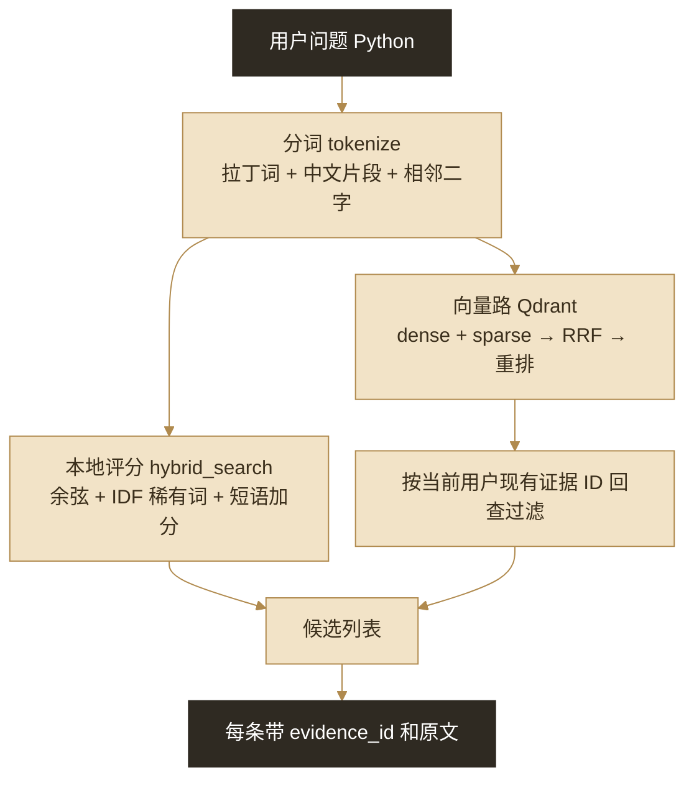
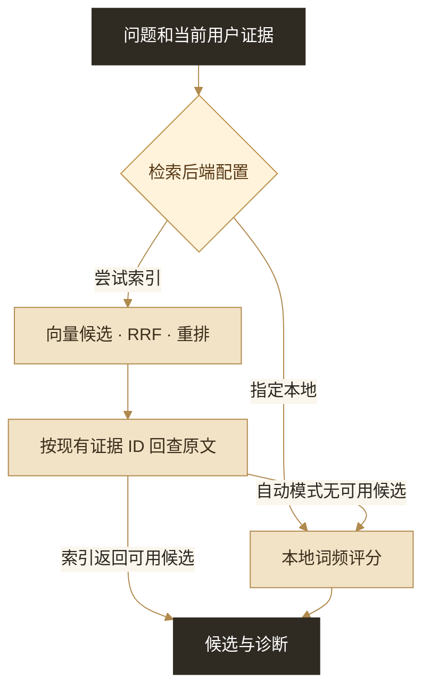

# 04-A · 写本地检索与索引回查

上节手算了两张榜如何融合。现在写 CareerLens 的检索代码。它读取当前用户的可用材料，按配置得出候选和诊断。贯穿问题仍是「林澈用过 Python 吗？」。这一关在整条资料链上管的是「给用户一个问题，从一堆证据里挑出最相关的几条，并且每条都能追回原文」。 [第四章目录](./README.md)

## 为什么要写这一关

证据存进来了，但用户不会按 ID 查。他问的是一句自然语言。检索要回答两件事：

1. **相关性**——哪些证据跟这句话有关？这不是精确匹配：「Python 项目」要能命中写着「用 Python 做过课程」的正文，即使两个字符串不一样。
2. **可追溯性**——返回的每条候选都带真实的 `evidence_id`，用户点开能读到原文。不能返回一段「AI 生成的话」却没有出处。

CareerLens 有本地评分和 Qdrant 两条证据检索路径。Qdrant 路径才会先融合两条榜，再回查数据库。练习默认走本地，本课会写本地评分与向量索引的回查。两条路径共用候选结构，并用诊断记录后端。

## 从问题到候选的五层



五层职责：

| 层 | 做什么 | 为什么需要 |
| --- | --- | --- |
| 分词 | 把字符串变成可计数的词 | 让「Python」和「用过 Python」有共同词 |
| 本地评分 | 余弦 + IDF + 短语加分 | 无需外部服务也能给出有序候选 |
| 向量检索 | dense/sparse 两路召回 + RRF | Qdrant 同时查稠密和稀疏向量，选配学习得到的 Embedding 时可尝试召回不同措辞 |
| 回查过滤 | 用数据库现有证据 ID 筛索引结果 | 索引可能滞后，不能返回已删证据 |
| 输出 | 统一结构 + 诊断字段 | 上层按同一种格式消费 |

## 第 1 块：分词，中文为什么要拆相邻两字

打开 `backend/app/retrieval/hybrid.py` 的 `tokenize`：

```python
def tokenize(text: str) -> list[str]:
    latin = re.findall(r"[a-zA-Z][a-zA-Z0-9.+#-]*", text.lower())
    chinese = re.findall(r"[\u4e00-\u9fff]{2,}", text)
    chinese_bigrams = [
        token[index : index + 2] for token in chinese for index in range(len(token) - 1)
    ]
    return latin + chinese + chinese_bigrams
```

它做三件事：

1. **拉丁词**：正则取以字母开头、后面可跟字母数字和 `.+#-` 的串，并转小写。`Python`、`FastAPI`、`c++` 都能整体留下。`Python` 变 `python`，所以大小写不影响匹配。
2. **中文连续片段**：取所有长度 ≥2 的连续汉字。
3. **中文相邻二字（bigram）**：每个中文片段里再切出所有相邻两字。

`Python` 会变成 `["python"]`。「课程项目」除了整体作为一个片段，还贡献「课程」「程项」「项目」三个 bigram。**为什么要 bigram？** 中文没有空格，两条材料如果都提到「项目」，即使一句写「课程项目」另一句写「个人项目」，bigram「项目」都能对上，提供重合信号。这是本地评分能处理中文的关键，不用分词词典也能工作。

代价是词表会膨胀：一个四字短语贡献 1 个整体 + 3 个 bigram。后面 IDF 会给常见 bigram 降权，避免「项目」这种高频词支配打分。 [真实分词](../../backend/app/retrieval/hybrid.py#L9-L16)

## 第 2 块：词频、点积与余弦

**词频向量**是一组按词排列的计数。`Counter("python python docker".split())` 相当于 `{"python": 2, "docker": 1}`。把问题 `"Python"` 写成 `[1, 0]`，正文是 `[2, 1]`。相同位置的数相乘再加，点积是 `2`。**余弦**再除以两个向量的长度：

```python
def _cosine(left: Counter[str], right: Counter[str]) -> float:
    numerator = sum(value * right.get(token, 0) for token, value in left.items())
    left_norm = math.sqrt(sum(value * value for value in left.values()))
    right_norm = math.sqrt(sum(value * value for value in right.values()))
    return numerator / (left_norm * right_norm) if left_norm and right_norm else 0.0
```

点积是 `1×2 + 0×1 = 2`。长度分别是 `1` 和 `√(2²+1²) = √5`。所以余弦是 `2 / (1 × √5) ≈ 0.8944`。

**为什么除以长度？** 不除的话，长文档因为词多，点积天然大，会压过短文档——即使短文档句句切题。除以长度后，比较的是「方向是否一致」，与文档绝对长度无关。任一长度为 0（空文档或空查询）时，代码给 0 分，避免除零。

遍历时只走 `left` 的键，缺的词用 `right.get(token, 0)`。这是 Counter 做稀疏点积的标准写法——两个向量的「位置」是词，没出现的词计数为 0，不必真的建一个全是 0 的长数组。

## 第 3 块：文档频率与 IDF——为什么常见词不值钱

余弦有个盲点：「项目」「本机」这些到处都有的词，会在每条文档里都贡献重合，把打分拉平。IDF（inverse document frequency，逆文档频率）专门治这个：**一个词出现在越多条材料里，它的权重越低**。

```python
document_frequency = Counter(
    token for record in evidence for token in set(tokenize(_field(record, "content")))
)
```

注意 `set(tokenize(...))`：对每条正文，同一个词出现几次都只给文档频率加 1。文档频率数的是「多少条材料有这个词」，不是「这个词总共出现多少次」。一条正文提到 Python 两次，df 仍加 1。

本地公式对每个查询词加权：

```python
min(query_tokens[token], document_tokens[token])
* math.log(1 + total / (1 + document_frequency[token]))
```

- `min(q, d)`：取查询词频和文档词频的较小者。问句里出现一次、正文里出现两次，算一次；避免正文刷词就无限加分。
- `ln(1 + N/(1+df))`：N 是材料总条数，df 是该词的文档频率。df 小（罕见词）时这一项大，df 大（常见词）时趋近 0。`+1` 是平滑，防止 df=0 或除零。
- 最后除以查询词总数 `max(sum(query_tokens.values()), 1)`，让长问句不会因为词多就把分数整体抬高——这是「平均每个查询词的稀有度」。

### 亲手复算 1.0337 分

假设只有 `E1="Python Python Docker"` 和 `E2="Docker"` 两条材料，只问 `Python`。N=2，「python」的 df=1（只有 E1 有），「docker」的 df=2。下表用相同的本地公式：

| 得分项 | E1 | E2 |
| --- | --- | --- |
| 余弦 | `2 / √5 ≈ 0.8944` | 0（没有 python） |
| 稀有词 | `min(1, 2) × ln(1 + 2/(1+1)) = ln(2) ≈ 0.6931` | 0 |
| 完整短语出现在正文 | `python in "python python docker"` → `+0.25` | 0 |
| `0.45 × 余弦 + 0.55 × 稀有词 + 短语` | `0.45×0.8944 + 0.55×0.6931 + 0.25 ≈ 1.0337` | `0`，不进候选 |
| 四位小数输出 | `1.0337`，进入候选 | `score=0` 被跳过 |

输出取四位小数。这是**排序值不是概率**，所以能超过 1——别把它当成「置信度 103%」。判断课程项目是否上线仍需要读 `content`，分数只负责排序。短语加分那 0.25 也让「整句出现」比「只有部分词重合」排得更前。 [本地评分实现](../../backend/app/retrieval/hybrid.py#L30-L60)

本地评分分别给余弦和稀有词 `0.45` 与 `0.55` 的权重。完整短语命中时再加固定的 `0.25` 分。换一批材料时，可以沿用第 08-2 课的相关性标注方法，观察这些分数如何影响排序。

## 第 4 块：把分数、正文、原记录绑在一起排序

```python
scored.sort(key=lambda pair: pair[0], reverse=True)
return [
    {
        "evidence_id": _field(record, "id"),
        "score": round(score, 4),
        "source_type": _field(record, "source_type"),
        "source_name": _field(record, "source_name"),
        "content": content,
    }
    for score, content, record in scored[:limit]
]
```

候选元组是 `(score, content, record)` 三件套。`key=lambda pair: pair[0]` 只拿分数排序，但整个元组一起移动——**ID、正文、分数保持成对**。这是很容易写错的地方：如果只排序分数、再从原列表按下标取记录，就会张冠李戴。截断 `[:limit]` 放在排序之后，先取分数最高的几条，再打包输出。

`_field` 是一个小适配层：记录既可能是 SQLAlchemy 的 `Evidence` 对象（属性访问），也可能是练习里的字典（下标访问）。同一个评分函数两种都能吃。

## 跟写本地评分和返回值

```bash
python tutorials/04-knowledge-base/lab/kb_practice.py open retrieve
```

打开 `.cache/knowledge-practice/backend/app/retrieval/hybrid.py`。补 `_cosine` 与 `hybrid_search`。

1. 点积只遍历一侧，缺少的词用 0。两个向量都用「每项平方求和再开根」计算长度。有一个长度为 0，就回 0。
2. 读取问题词频，空就返回空列表。统计文档频率时，每条正文的词先变成 `set`。
3. 逐条算余弦、稀有词得分和完整短语加分，三项加权求和，留下正分候选。
4. 按分数降序取前 `limit` 条。`key` 只取元组第一项，整个元组会一起移动，输出 ID 和对应正文保持成对。

<details>
<summary>核对 _cosine 和 hybrid_search</summary>

```python
def _cosine(left: Counter[str], right: Counter[str]) -> float:
    numerator = sum(value * right.get(token, 0) for token, value in left.items())
    left_norm = math.sqrt(sum(value * value for value in left.values()))
    right_norm = math.sqrt(sum(value * value for value in right.values()))
    return numerator / (left_norm * right_norm) if left_norm and right_norm else 0.0


def hybrid_search(
    query: str, evidence: list[Evidence | dict[str, Any]], limit: int = 5
) -> list[dict]:
    query_tokens = Counter(tokenize(query))
    if not query_tokens:
        return []

    scored: list[tuple[float, str, Evidence | dict[str, Any]]] = []
    total = max(len(evidence), 1)
    document_frequency = Counter(
        token for record in evidence for token in set(tokenize(_field(record, "content")))
    )
    for record in evidence:
        content = _field(record, "content")
        document_tokens = Counter(tokenize(content))
        dense_score = _cosine(query_tokens, document_tokens)
        sparse_score = sum(
            min(query_tokens[token], document_tokens[token])
            * math.log(1 + total / (1 + document_frequency[token]))
            for token in query_tokens
        )
        sparse_score = sparse_score / max(sum(query_tokens.values()), 1)
        exact_bonus = 0.25 if query.lower() in content.lower() else 0.0
        score = 0.45 * dense_score + 0.55 * sparse_score + exact_bonus
        if score > 0:
            scored.append((score, content, record))

    scored.sort(key=lambda pair: pair[0], reverse=True)
    return [
        {
            "evidence_id": _field(record, "id"),
            "score": round(score, 4),
            "source_type": _field(record, "source_type"),
            "source_name": _field(record, "source_name"),
            "content": content,
        }
        for score, content, record in scored[:limit]
    ]
```

</details>

### 失败反推：评分写错会怎样

| 现象 | 最可能的原因 |
| --- | --- |
| 所有候选分数都是 0 | `_cosine` 的长度算错，或 `tokenize` 没返回词 |
| 长文档总是压过短文档 | 忘了除向量长度，直接返回了点积 |
| 短查询分数异常高 | 忘了除以查询词总数，稀有词累加被放大 |
| 输出的 ID 和正文对不上 | 排序或截断时把元组拆开了 |
| 空查询报除零 | 没在 `query_tokens` 为空时提前返回 |

## 第 5 块：向量那一路——RRF 融合与重排

到 `backend/app/retrieval/qdrant_store.py` 看 `ensure_collection` 和 `search`。

- `dense` 用余弦距离，`sparse_vector` 把分词计数变成稀疏编号，集合开启 IDF 修正。
- `models.Prefetch` 让 dense 和 sparse 两路各自找候选，Qdrant 用 **RRF（Reciprocal Rank Fusion）** 融合成一个排名。
- 候选再交给 `reranker.score`，默认词法重排用交集大小除以并集大小（Jaccard）。

本地算式是 `0.45 × 余弦 + 0.55 × 稀有词 + 短语加分`，只有正文含完整问句时最后一项才是 `0.25`。Qdrant 路径先按名次融合，再按所配置的重排器评分。用 `retrieval.backend` 和 `retrieval.fusion` 确认自己走的是哪一路。 [索引配置与检索](../../backend/app/retrieval/qdrant_store.py#L43-L140) · [词法重排器](../../backend/app/retrieval/providers.py#L52-L64)

### 为什么分数不能直接相加

稠密向量的余弦和稀疏向量的词计数得分各有自己的尺度。词法重排的 Jaccard 在 0 到 1 之间。RRF 只按各榜的名次算贡献，再把贡献相加，原始分数无需归一化。 [00-7 混合 RAG](../00-foundations/00-7-混合RAG与排名融合.md)

**重排的范围由召回决定**：如果前一步没把某条证据召回，重排器根本看不到它，再强的重排也救不回来。应用服务向 Qdrant 索取 `min(100, limit × 4)` 条重排后的候选，为回查过滤留出余量。Qdrant 存储层还给自己的两路召回设置了候选池上限 `max(prefetch_limit, 索引查询的 limit × 4)`。

## 第 6 块：回查过滤——索引不是真相，数据库才是

假设索引还记着 `E-deleted` 和 `E-current`，但当前用户的 SQL 数据只剩 `E-current`（E-deleted 被删了）。如果直接返回索引结果，用户点引用的证据会 404。

服务按数据库实际能用的 ID 过滤索引结果，再用数据库的 `content` 替换索引返回的文本。这样用户打开引用时会看见**当前的原文**，而不是索引里那份可能过期的副本。



### 跟写 search_evidence

打开 `.cache/knowledge-practice/backend/app/retrieval/service.py` 的 `search_evidence`。先按已传入的证据列表做 `live` 字典。把 `hit["evidence_id"]` 用来查 `live`，找得到才放入结果。截断放在过滤之后，前面的索引查询先多取几个候选。原函数使用 `:=` 在判断中给 `record` 赋值，初学者也可以先用普通循环写出这一步，再对照源码。

```python
live = {item["id"] if isinstance(item, dict) else item.id: item for item in evidence}
results = [
    {
        **hit,
        "content": record["content"] if isinstance(record, dict) else record.content,
    }
    for hit in results
    if (record := live.get(hit["evidence_id"])) is not None
][:limit]
```

海象运算符 `:=` 在 `if` 里完成两件事：把查到的记录赋给 `record`，同时用「是不是 None」当过滤条件。这样后面 `"content": record...` 能直接用它，不用查两次。用普通 `for` 循环写等价逻辑完全可以——先学会思路，再对照这个紧凑写法。

**配置与诊断对照**：

| 配置或结果 | 写出的行为 |
| --- | --- |
| 显式 `local` | 直接调用本地 `hybrid_search`，原因 `configured_local` |
| `auto`，索引返回可用项 | 返回过滤的结果，诊断 `backend=qdrant`、`fusion=rrf` |
| `auto`，数据库的可读证据列表为空 | 索引查询成功时直接返回空结果，诊断仍可为 `backend=qdrant` |
| `auto`，已有证据但索引无可用项 | 用本地评分，原因 `qdrant_empty` |
| `auto`，索引请求异常 | 用本地评分，原因取异常类型 |
| 显式 `qdrant` | 无可用候选时交回空列表，请求异常时继续抛出 |

显式 `qdrant` 和 `auto` 的关键差别：显式模式下不静默降级——索引挂了就抛错或返回空，因为你明确要的就是索引；`auto` 模式下降级到本地，保证用户仍能查到东西。诊断字段 `fallback` 和 `reason` 让上层能分辨「这是主动选的本地」还是「索引失败被迫回退」。 [完整实现](../../backend/app/retrieval/service.py)

<details>
<summary>核对 search_evidence 完整实现</summary>

```python
async def search_evidence(
    *, user_id: str, query: str, evidence: list[Evidence] | list[dict[str, Any]], limit: int = 5
) -> tuple[list[dict], dict]:
    settings = get_settings()
    if settings.retrieval_backend != "local":
        try:
            results = await get_qdrant_store().asearch(
                user_id=user_id,
                query=query,
                limit=min(100, limit * 4),
            )
            live = {item["id"] if isinstance(item, dict) else item.id: item for item in evidence}
            results = [
                {
                    **hit,
                    "content": record["content"] if isinstance(record, dict) else record.content,
                }
                for hit in results
                if (record := live.get(hit["evidence_id"])) is not None
            ][:limit]
            if results or not evidence or settings.retrieval_backend == "qdrant":
                return results, {
                    "backend": "qdrant",
                    "fusion": "rrf",
                    "reranker": get_reranker_provider().name,
                    "fallback": False,
                }
            fallback_reason = "qdrant_empty"
        except Exception as exc:
            if settings.retrieval_backend == "qdrant":
                raise
            fallback_reason = type(exc).__name__
    else:
        fallback_reason = "configured_local"

    results = hybrid_search(query, evidence, limit=limit)
    for item in results:
        item["rerank_score"] = item["score"]
        item["retrieval_method"] = "local_dense_sparse_fallback"
    return results, {
        "backend": "local",
        "fusion": "weighted_score",
        "reranker": "lexical-v1",
        "fallback": True,
        "reason": fallback_reason,
    }
```

</details>

```bash
python tutorials/04-knowledge-base/lab/kb_practice.py check retrieve
```

到 `backend/tests/test_qdrant_retrieval.py` 看 `test_deleted_evidence_is_filtered_from_stale_vector_index`。用例让索引返回已删除条目，最后查输出是否只含数据库仍有的证据。另一个用例把分数和原文一起比对。 [检索真实回归](../../backend/tests/test_qdrant_retrieval.py#L30-L115)

## 用接口确认自己运行的是哪一路

实现保存后，先按 Ctrl+C 停止课前开的服务，再执行原来的 `serve` 命令。打开原端口的 Swagger，展开 `GET /api/v1/evidence/search`，填 `kb-study`、`query=Python`、`limit=5`。候选在 `items`。找到共同正文 E，对照原文中的「只在本机演示」。 [启动练习 API](./README.md#启动练习-api) · [证据搜索接口](../../backend/app/api/routes/evidence.py#L147-L166)

练习模式预期 `backend=local`、`fusion=weighted_score`、`reason=configured_local`，命中项的 `retrieval_method` 为 `local_dense_sparse_fallback`。`fallback=true` 表示使用本地路径，`reason` 告诉你这是主动配置的，不是失败。换一个全新的教学账号，查询同一个词应得到 `count=0`——没有证据就没有候选，评分函数不会凭空造结果。

## 这些概念在 CareerLens 里落在哪

| 本课的词 | 源码位置 | 上层怎么用 |
| --- | --- | --- |
| `tokenize` / `hybrid_search` | `backend/app/retrieval/hybrid.py` | RAG 模式的证据召回，也被 Wiki 查询复用 |
| `_cosine` / IDF | `backend/app/retrieval/hybrid.py` | 本地评分的两路信号 |
| `search_evidence` | `backend/app/retrieval/service.py` | 聊天、报告、Wiki 编译共用的检索入口 |
| RRF / 重排 | `backend/app/retrieval/qdrant_store.py` | 索引模式的融合，诊断标 `fusion=rrf` |
| 回查过滤 | `backend/app/retrieval/service.py` | 保证返回的 ID 和原文都是当前数据库的真值 |

一个容易混淆的点：**`score` 和 `rerank_score` 在本地路是同一个数**。本地路没有单独的重排阶段，所以代码把评分直接赋给 `rerank_score`。Qdrant 路里这两个数才不同——`score` 是召回阶段的分，`rerank_score` 是重排后的分。两条路径都给出这两个字段。需要解释次序时，先从诊断确认路径，再回看分数各来自哪一步。

## 下一步

到 [05 编译第一张 Wiki 主题页](../05-Wiki知识组织.md)。用刚查回的 E 与一张案例表生成一页，观察它们怎样保留出处。下一关开始，主角从「原始证据」变成「编译后的主题页」。
