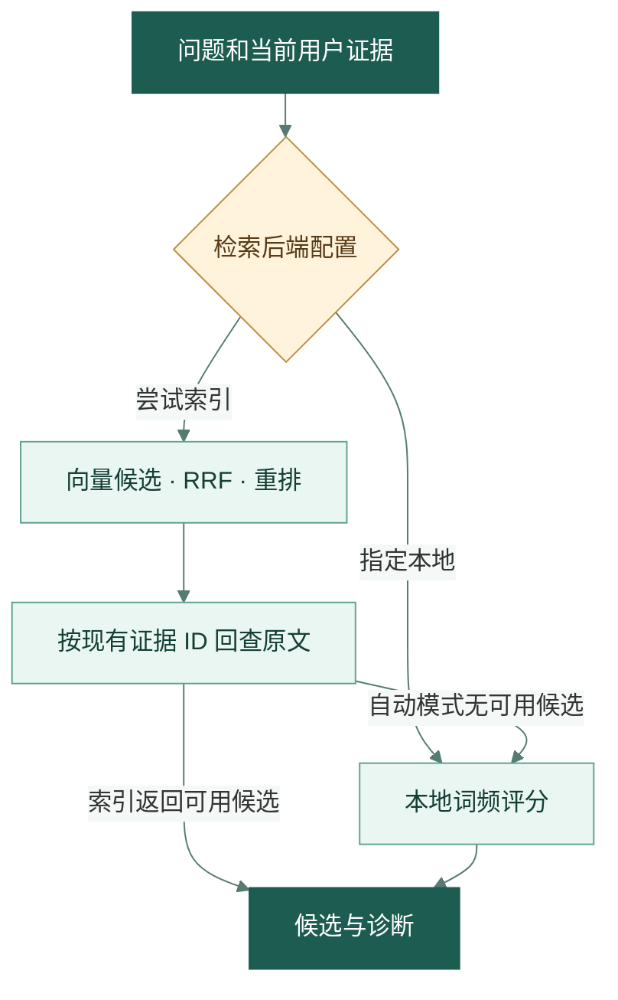

# 04-A · 写本地检索与索引回查

上节手算了两张榜如何融合。现在写 CareerLens 的检索代码。它读取当前用户的可用材料，按配置得出候选和诊断。贯穿问题仍是「林澈用过 Python 吗？」。 [第四章目录](./README.md)

## 先认识分词、词频与余弦

**分词**把字符串变成可计数的词。打开 `backend/app/retrieval/hybrid.py` 的 `tokenize`，它取小写的拉丁词，也取连续中文片段和其中相邻两个字。`Python` 会变成 `python`。「课程项目」还可以贡献「课程」「程项」「项目」。这样两句只要共享部分中文，也能提供重合信号。 [真实分词](../../backend/app/retrieval/hybrid.py#L9-L16)

**词频向量**是一组按词排列的计数。`Counter("python python docker".split())` 相当于 `{"python": 2, "docker": 1}`。把问题 `"Python"` 写成 `[1, 0]`，正文是 `[2, 1]`。相同位置的数相乘再加，点积是 2。**余弦**再除以两个向量的长度，也就是 `2 / (1 × √5)`，约 `0.8944`。任一长度为 0 时，代码给 0 分。

**文档频率**统计某个词出现在多少条材料里。一条正文提到 Python 两次，文档频率仍加 1。**IDF** 让较少见的词贡献更高。项目本地公式用 `ln(1 + N / (1 + df))` 对每个查询词加权，乘该词在问句和正文的较小次数，最后除以查询词总数。`N` 是材料总条数，`df` 是该词的文档频率。 [本地评分实现](../../backend/app/retrieval/hybrid.py#L30-L60)

### 亲手复算 1.0337 分

假设只有 `E1="Python Python Docker"` 和 `E2="Docker"` 两条材料，只问 `Python`。下表用相同的本地公式。后面真正的长正文和候选池不同，分数会变化。

| 得分项 | E1 | E2 |
| --- | --- | --- |
| 余弦 | `2 / √5 ≈ 0.8944` | 0 |
| 稀有词 | `min(1, 2) × ln(1 + 2 / 2) ≈ 0.6931` | 0 |
| 完整短语出现在正文 | 加 `0.25` | 0 |
| `0.45 × 余弦 + 0.55 × 稀有词 + 短语` | `1.0337`，进入候选 | `0`，跳过 |

输出取四位小数。这是排序值，所以能超过 1。判断课程项目是否上线仍需要读 `content`。

## 写本地评分和返回值

```bash
python tutorials/04-knowledge-base/lab/kb_practice.py open retrieve
```

打开 `.cache/knowledge-practice/backend/app/retrieval/hybrid.py`。补 `_cosine` 与 `hybrid_search`。

1. 点积只遍历一侧，缺少的词用 0。两个向量都用「每项平方求和再开根」计算长度。有一个长度为 0，就回 0。
2. 读取问题词频。统计文档频率时，每条正文的词先变成 `set`。算完三项分数后，把分数、正文、原记录存在同一个元组。
3. 按分数降序取前 `limit` 条。下面的 `key` 只取元组第一项，整个元组会一起移动。这样输出 ID 和对应正文会保持成对。

```python
scored.sort(key=lambda pair: pair[0], reverse=True)
```

<details>
<summary>核对 _cosine 和 hybrid_search</summary>

```python
def _cosine(left: Counter[str], right: Counter[str]) -> float:
    numerator = sum(value * right.get(token, 0) for token, value in left.items())
    left_norm = math.sqrt(sum(value * value for value in left.values()))
    right_norm = math.sqrt(sum(value * value for value in right.values()))
    return numerator / (left_norm * right_norm) if left_norm and right_norm else 0.0


def hybrid_search(
    query: str, evidence: list[Evidence | dict[str, Any]], limit: int = 5
) -> list[dict]:
    query_tokens = Counter(tokenize(query))
    if not query_tokens:
        return []

    scored: list[tuple[float, str, Evidence | dict[str, Any]]] = []
    total = max(len(evidence), 1)
    document_frequency = Counter(
        token for record in evidence for token in set(tokenize(_field(record, "content")))
    )
    for record in evidence:
        content = _field(record, "content")
        document_tokens = Counter(tokenize(content))
        dense_score = _cosine(query_tokens, document_tokens)
        sparse_score = sum(
            min(query_tokens[token], document_tokens[token])
            * math.log(1 + total / (1 + document_frequency[token]))
            for token in query_tokens
        )
        sparse_score = sparse_score / max(sum(query_tokens.values()), 1)
        exact_bonus = 0.25 if query.lower() in content.lower() else 0.0
        score = 0.45 * dense_score + 0.55 * sparse_score + exact_bonus
        if score > 0:
            scored.append((score, content, record))

    scored.sort(key=lambda pair: pair[0], reverse=True)
    return [
        {
            "evidence_id": _field(record, "id"),
            "score": round(score, 4),
            "source_type": _field(record, "source_type"),
            "source_name": _field(record, "source_name"),
            "content": content,
        }
        for score, content, record in scored[:limit]
    ]
```

</details>

## 索引里的材料怎样回查原文

到 `backend/app/retrieval/qdrant_store.py` 看 `ensure_collection` 和 `search`。`dense` 用余弦距离，`sparse_vector` 把分词计数变成稀疏编号，集合开启 IDF 修正。`models.Prefetch` 找两路候选，Qdrant 用 RRF 融合。候选再交给 `reranker.score`，默认词法重排用交集大小除以并集大小。这里的重排范围由召回提供。 [索引配置与检索](../../backend/app/retrieval/qdrant_store.py#L43-L140) · [词法重排器](../../backend/app/retrieval/providers.py#L52-L64)

假设索引还记着 `E-deleted` 和 `E-current`，但当前用户的 SQL 数据只剩 `E-current`。服务按数据库实际能用的 ID 过滤索引结果，再用数据库的 `content` 替换索引返回的文本。这样用户打开引用时会看见当前的原文。



### 跟写 search_evidence

打开 `.cache/knowledge-practice/backend/app/retrieval/service.py` 的 `search_evidence`。先按已传入的证据列表做 `live` 字典。把 `hit["evidence_id"]` 用来查 `live`，找得到才放入结果。截断放在过滤之后，前面的索引查询先多取几个候选。原函数使用 `:=` 在判断中给 `record` 赋值，初学者也可以先用普通循环写出这一步，再对照源码。

| 配置或结果 | 写出的行为 |
| --- | --- |
| 显式 `local` | 直接调用本地 `hybrid_search`，原因 `configured_local` |
| `auto`，索引返回可用项 | 返回过滤的结果，诊断 `backend=qdrant`、`fusion=rrf` |
| `auto`，已有证据但索引无可用项 | 用本地评分，原因 `qdrant_empty` |
| `auto`，索引请求异常 | 用本地评分，原因取异常类型 |
| 显式 `qdrant` | 无可用候选时交回空列表，请求异常时继续抛出 |

<details>
<summary>核对 search_evidence 完整实现</summary>

```python
async def search_evidence(
    *, user_id: str, query: str, evidence: list[Evidence] | list[dict[str, Any]], limit: int = 5
) -> tuple[list[dict], dict]:
    settings = get_settings()
    if settings.retrieval_backend != "local":
        try:
            results = await get_qdrant_store().asearch(
                user_id=user_id,
                query=query,
                limit=min(100, limit * 4),
            )
            live = {item["id"] if isinstance(item, dict) else item.id: item for item in evidence}
            results = [
                {
                    **hit,
                    "content": record["content"] if isinstance(record, dict) else record.content,
                }
                for hit in results
                if (record := live.get(hit["evidence_id"])) is not None
            ][:limit]
            if results or not evidence or settings.retrieval_backend == "qdrant":
                return results, {
                    "backend": "qdrant",
                    "fusion": "rrf",
                    "reranker": get_reranker_provider().name,
                    "fallback": False,
                }
            fallback_reason = "qdrant_empty"
        except Exception as exc:
            if settings.retrieval_backend == "qdrant":
                raise
            fallback_reason = type(exc).__name__
    else:
        fallback_reason = "configured_local"

    results = hybrid_search(query, evidence, limit=limit)
    for item in results:
        item["rerank_score"] = item["score"]
        item["retrieval_method"] = "local_dense_sparse_fallback"
    return results, {
        "backend": "local",
        "fusion": "weighted_score",
        "reranker": "lexical-v1",
        "fallback": True,
        "reason": fallback_reason,
    }
```

</details>

```bash
python tutorials/04-knowledge-base/lab/kb_practice.py check retrieve
```

到 `backend/tests/test_qdrant_retrieval.py` 看 `test_deleted_evidence_is_filtered_from_stale_vector_index`。用例让索引返回已删除条目，最后查输出是否只含数据库仍有的证据。另一个用例把分数和原文一起比对。 [检索真实回归](../../backend/tests/test_qdrant_retrieval.py#L30-L115)

## 用接口确认自己运行的是哪一路

实现保存后，先按 Ctrl+C 停止课前开的服务，再执行原来的 `serve` 命令。打开原端口的 Swagger，展开 `GET /api/v1/evidence/search`，填 `kb-study`、`query=Python`、`limit=5`。候选在 `items`。找到共同正文 E，对照原文中的「只在本机演示」。 [启动练习 API](./README.md#启动练习-api) · [证据搜索接口](../../backend/app/api/routes/evidence.py#L147-L166)

练习模式预期 `backend=local`、`fusion=weighted_score`、`reason=configured_local`，命中项的 `retrieval_method` 为 `local_dense_sparse_fallback`。`fallback=true` 表示使用本地路径，`reason` 告诉你这是主动配置的。换一个全新的教学账号，查询同一个词应得到 `count=0`。

## 下一步

到 [05 编译第一张 Wiki 主题页](../05-Wiki知识组织.md)。用刚查回的 E 与一张案例表生成一页，观察它们怎样保留出处。
