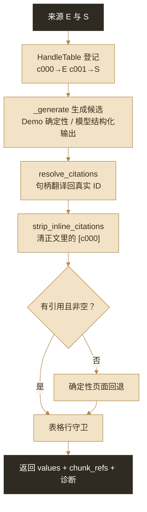
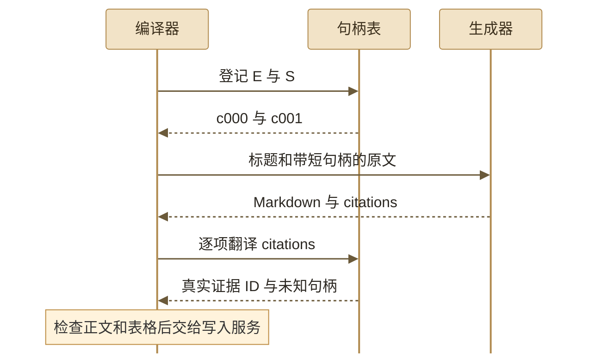

# 05-A · 写短句柄与 Wiki 编译流程

上一课交给接口的是两个长证据编号，Wiki 正文则能直接阅读。从长编号到短句柄，再回到长编号，靠的是一张只在本轮使用的表。把它和生成流程一起写出来，就能解释为何一段模型输出还要经过处理才可以保存。这一关在整条资料链上管的是「把原始证据编译成一页可读的主题页，同时每一步引用都能回查」。 [第四章目录](./README.md)

## 为什么要写这一关

直接把长 UUID 证据 ID 交给模型会有两个麻烦：

1. **费 token。** 一个 UUID 36 个字符，一页里引用十几次，光编号就吞掉几百 token。
2. **模型爱编 ID。** 长串随机字符模型记不住，很容易输出一个看起来像 ID、实际不存在的串。一旦把这个假 ID 存进 `chunk_refs`，用户点引用就指向空气。

短句柄 `c000`、`c001` 解决第一个问题；但第二个问题不能只靠「让模型别编」——**模型输出始终是不可信输入**。真正可靠的做法是：编译前发短句柄，编译后把短句柄翻译回真实 ID，翻译不了的就丢弃并记录诊断。这一关的核心思想就是这句：**允许模型用短名字说话，但落库前必须由程序把名字换成它认识的真 ID**。

## 一张地图：一轮编译的六步



六步职责：

| 步 | 做什么 | 关键点 |
| --- | --- | --- |
| 登记 | 每条来源领一个短句柄 | 双向映射，幂等 |
| 生成 | Demo 确定性拼接 / 模型结构化输出 | 两条路径都返回候选页 |
| 翻译 | `citations` 里的句柄换回真 ID | 未知句柄丢弃、去重保序 |
| 清理 | 去掉正文里的 `[c000]` 标记 | 稳定引用放在 `chunk_refs`，不混进正文 |
| 回退 | 无引用或空正文时重建确定性页 | 保证「宁可朴素，不可失真」 |
| 守卫 | 检查表格行有没有被悄悄删掉 | 下一课展开 |

## 第 1 块：句柄表——一次编译内的临时字典

**句柄**是一次操作里指向资源的短名字。把证据 E 和表格 S 分别交给本次编译的 `HandleTable`，它会登记 `c000→E`、`c001→S`。这样生成器只要在 `citations` 里填短名字。每次编译都新建映射，另一页的 `c000` 可以指向别的证据——**句柄只在本次编译有效，不是全局 ID**。 [句柄类](../../backend/app/wiki/handles.py#L15-L57)

```python
class HandleTable:
    def __init__(self, prefix: str = "c", width: int = 3, start: int = 0) -> None:
        self._prefix = prefix
        self._width = width
        self._next = start
        self._by_handle: dict[str, str] = {}
        self._by_id: dict[str, str] = {}
        self._unknown: list[str] = []
```

三张内部结构各管一件事：

- `_by_handle`：`c000 → 真实 ID`，用来把模型输出翻译回真值。
- `_by_id`：真实 ID → `c000`，用来登记时去重、渲染时查句柄。
- `_unknown`：翻译失败的句柄清单，供诊断查看是哪一项写错了。

`register` 是**幂等**的：同一个 ID 第二次登记返回同一个句柄，不浪费编号。`f"{self._prefix}{self._next:0{self._width}d}"` 里 `:03d` 把数字补成三位——`0` 变 `c000`，`1` 变 `c001`。宽度只在编号 ≥1000 时才需要调整。`HANDLE_PATTERN = re.compile(r"^c\d{3,}$")` 定义了合法格式，清理正文时靠它识别短引用标记。

`resolve` 用 `get` 查不到就返回 `None`，同时把句柄记进 `_unknown`。**未知句柄绝不当成真 ID 使用**——这是整关最重要的一条防线。

### 跟写 register 与 resolve

```bash
python tutorials/04-knowledge-base/lab/kb_practice.py open handles
```

打开练习的 `.cache/knowledge-practice/backend/app/wiki/handles.py`。类的构造函数已经初始化 `_next`、`_by_id`、`_by_handle` 与 `_unknown`。

1. 给 E 第一次发号时，`_next=0`、`_width=3`，所以 `f"{self._prefix}{self._next:0{self._width}d}"` 得 `c000`。当前号用完才加 1。
2. 再登记 E 应返回之前的编号（幂等），下一项 S 才得到 `c001`。写完后把两份映射按键分别念一遍，确认它们查的是相反方向。
3. 实现 `resolve` 时用 `get`。找不到返回 `None`，同时向 `_unknown` 追加当前句柄。

<details>
<summary>核对 HandleTable 的 register 与 resolve</summary>

下面两个方法各留在现有的 `class HandleTable` 中，旁边的 `handle`、`render_block` 和属性继续保留。

```python
    def register(self, stable_id: str) -> str:
        """Register a stable id and return its short handle (idempotent)."""
        if stable_id in self._by_id:
            return self._by_id[stable_id]
        handle = f"{self._prefix}{self._next:0{self._width}d}"
        self._next += 1
        self._by_handle[handle] = stable_id
        self._by_id[stable_id] = handle
        return handle


    def resolve(self, handle: str) -> str | None:
        """Translate a handle to its stable id; record unknown handles."""
        stable = self._by_handle.get(handle)
        if stable is None:
            self._unknown.append(handle)
        return stable
```

</details>

## 第 2 块：结构化输出——让生成结果能按字段读

**结构化输出**让一段生成结果能按字段读取。`backend/app/wiki/compiler.py` 的 `COMPILE_SCHEMA` 约定返回标题、Markdown 正文、摘要与 `citations`。应用取其中的 `citations` 数组做回查。 [返回结构](../../backend/app/wiki/compiler.py#L28-L43)

```python
COMPILE_SCHEMA = {
    "type": "object",
    "required": ["title", "content", "summary", "citations"],
    "properties": {
        "title": {"type": "string"},
        "content": {"type": "string", "description": "Markdown with [c000] inline citations"},
        "summary": {"type": "string"},
        "citations": {
            "type": "array",
            "items": {"type": "string"},
            "description": "Handles of sources supporting this page",
        },
    },
}
```

`required` 列出四个必填字段，`generate_json` 会约束模型按这个结构返回。**为什么不用自由文本再正则去扒？** 因为自由文本格式不稳：模型可能把引用写在脚注、写在句尾、或者干脆漏掉。规定成 JSON 数组字段，程序就能稳定地遍历每一项去翻译。第三章的 `generate_json` 在这里换了角色 `wiki` 复用。

但结构化输出只保证「格式对」，不保证「内容对」。模型仍可能：

- 在 `citations` 里写一个没登记过的 `c777`（幻觉句柄）。
- 在正文里写 `[c000]` 却没把它列进 `citations`（引用没登记）。
- 把源表删掉一行却写得通顺漂亮。

所以程序必须逐项校验。这就是下面 `resolve_citations` 和下一课表格守卫存在的理由。

### 生成器的两条路径



打开 `backend/app/wiki/compiler.py` 的 `_generate`。它先看 provider 的诊断：

- **Demo 路径**：`diagnostics["provider"] == "demo"` 时直接走 `_deterministic_page`，把每份原文附上它的 `[c000]` 句柄拼成页。**练习环境默认走这条**，不需要模型也能学完整流程。
- **模型路径**：用 `render_block` 把每条证据包成 `<c id="c000" index="0">正文</c>`，调用第三章见过的 `generate_json`，配置角色是 `wiki`。系统提示词里明确要求「只使用短句柄，不要发明句柄」「不要删除或压缩表格中的任何行」。
- **失败回退**：模型调用抛异常时，也生成确定性页面，并把 `fallback=True` 写进诊断。 [生成器的两条路径](../../backend/app/wiki/compiler.py#L48-L121)

`_deterministic_page` 本身就是一个小教学样本——它展示了「一个合格页面最少要有什么」：

```python
def _deterministic_page(title, sources, handles):
    parts = []
    for source in sources:
        handle = handles.handle(source["evidence_id"])
        parts.append(f"{source['content'].strip()}\n\n[{handle}]")
    content = "\n\n".join(parts)
    return {
        "title": title,
        "summary": f"由 {len(sources)} 条证据编译，所有引用均可回溯。",
        "content": content,
        "citations": [handles.handle(s["evidence_id"]) for s in sources],
    }
```

正文是原文拼接，每个来源后面跟一个短句柄标记，`citations` 列出全部句柄。它不优美，但**每一句话都能追回原文**——这正是 Wiki 页的底线要求。

## 第 3 块：翻译引用——未知句柄必须丢

`resolve_citations` 是防线第一道：

```python
def resolve_citations(citations: list[str], handles: HandleTable) -> list[str]:
    resolved: list[str] = []
    for handle in citations:
        stable = handles.resolve(handle)
        if stable is not None and stable not in resolved:
            resolved.append(stable)
    return resolved
```

三个判定合在一行里：

1. `handles.resolve(handle)` 翻译。查不到返回 `None`，同时已被记进 `_unknown`。
2. `stable is not None` —— 未知句柄直接跳过，不进结果。
3. `stable not in resolved` —— 同一个 ID 只保留第一次出现，去重保序。

**保序很重要**：`resolved` 的次序跟随模型给出的 `citations` 次序，下游展示引用时顺序稳定、可复现。用 `set` 去重会打乱顺序，所以这里用列表 + `not in`。

### 手算一轮编译会留下哪些 ID

假设选的是 `[E, S]`（E 是共同正文，S 是案例表），并假设生成正文里完整保留了源表。按下面的输出预测编译器怎样处理：

| 模型的 `citations` | 翻译出的引用 | 页面与诊断 |
| --- | --- | --- |
| `["c000", "c001"]` | `[E, S]` | 页面可带两条引用 |
| `["c001", "c777", "c001"]` | `[S]` | 保留第一个 S，记 `unknown_handles=["c777"]`。`source_refs` 仍是 `[E, S]` |
| `["c777"]` | 初步得到 `[]` | 触发回退：改用确定性页面，最终 `chunk_refs=[E,S]`，带回退诊断 |
| `[]` | 空列表 | 同样触发回退，不让「有正文却零引用」的页面过关 |

注意第二行：即使模型把 E 漏了、只引用 S，`source_refs` 仍然是编译请求带进来的全部来源 `[E, S]`。两个字段含义不同：

- `source_refs`：**这次编译用了哪些材料**（输入侧，调用者给定）。
- `chunk_refs`：**页面正文实际引用了哪些证据**（输出侧，从 `citations` 翻译）。

模型漏引一条，`chunk_refs` 会少，但 `source_refs` 不变。这种差异是诊断线索——说明这次生成没充分用到输入。

第三行更关键：如果翻译后一个真 ID 都没有，说明模型输出整页都不可信，程序不采用它，而是回退到确定性页面。**宁可要一页朴素但句句可查的原文拼接，也不要一页漂亮却全是不可信引用的文字。**

这一步只检查编号能否在本轮映射中找到。仍需打开 E、S，核对「本机演示」究竟支撑哪句话。若生成正文少了一行源表，即使编号能翻译，也要进入下一课的保护分支。 [编译结果的校验与回退](../../backend/app/wiki/compiler.py#L163-L198)

## 第 4 块：清理正文里的短标记

模型的正文里可能写着「林澈用 Python 做过课程 `[c000]`」。这些 `[c000]` 是给生成阶段看的临时记号，**不该出现在最终页面**——用户看到的应该是干净的句子，稳定引用统一放在 `chunk_refs` 里。

`strip_inline_citations` 用正则清掉形如 `[c000]` 或 `[c000, c001]` 的标记：

```python
return re.sub(r"[ \t]*\[c\d{3,}(?:[,;]\s*c\d{3,})*\]", "", markdown).strip()
```

正则允许多个句柄用逗号或分号分隔（`[c000, c001]`），也允许单个（`[c000]`）；前面的 `[ \t]*` 把标记前的空格一起吃掉，避免清完留一堆空隔。末尾 `strip()` 去首尾空白。这与 WeKnora 的 `wikiInlineChunkCitationRegex` 思路一致：稳定引用存在结构化字段里，不混进渲染文本。

## 跟写 prepare_page：把六步接起来

打开 `.cache/knowledge-practice/backend/app/wiki/compiler.py`。先写 `resolve_citations`（上面已给），再写 `prepare_page`，按练习注释分四步：

1. 空来源列表抛 `WikiCompileError`。其余先保留去重后的来源 ID（`dict.fromkeys` 去重保序），再新建句柄表，逐条登记输入来源。
2. 调用已有的 `_generate` 得到候选，翻译 `citations`，清理正文中的短标记。正文为空或翻译后没有可用引用，就用 `_deterministic_page` 重建，把 `chunk_refs` 换回合法的 source IDs。
3. 选出看起来含表格的源正文（含 `|` 字符），交给 `assert_rows_preserved`。如果抓到 `DroppedTableRowsError`，转换成对编译调用者可见的 `WikiCompileError`。
4. 返回三件东西：`values` 供写入使用，`chunk_refs` 带真实引用，诊断带 provider、fallback 和未知句柄。**此时还没有执行数据库写入**——写库是 `persist_page` 的事。

<details>
<summary>核对 prepare_page 完整实现</summary>

```python
async def prepare_page(title: str, sources: list[dict[str, Any]]) -> tuple[dict, list[str], dict]:
    if not sources:
        raise WikiCompileError("no sources to compile")
    source_ids = list(dict.fromkeys(source["evidence_id"] for source in sources))
    handles = HandleTable()
    for source in sources:
        handles.register(source["evidence_id"])

    generated, diagnostics = await _generate(title=title, sources=sources, handles=handles)

    # Resolve handle citations to stable ids; unknown handles are discarded.
    chunk_refs = resolve_citations(generated["citations"], handles)
    content = handles.strip_inline_citations(generated["content"])
    if not content or not chunk_refs:
        generated = _deterministic_page(title, sources, handles)
        chunk_refs = source_ids
        content = handles.strip_inline_citations(generated["content"])
        diagnostics = {**diagnostics, "fallback": True}

    # Guard: no source table rows may silently vanish in the rewrite.
    try:
        assert_rows_preserved(
            "",
            content,
            source_tables=[s["content"] for s in sources if "|" in s.get("content", "")],
        )
    except DroppedTableRowsError as exc:
        raise WikiCompileError(str(exc)) from exc

    values = {
        "title": (generated["title"] or title)[:255],
        "content": content,
        "summary": str(generated["summary"]) if generated.get("summary") is not None else None,
        "page_type": "concept",
        "status": "published",
    }
    return values, chunk_refs, {**diagnostics, "unknown_handles": handles.unknown_handles}
```

</details>

**为什么把生成和写入分开？** `prepare_page` 只准备内容，不碰数据库；`compile_page` 调用它拿到三个返回值后，才走 `check_page_version` 和 `persist_page` 写入。中间隔着版本检查——生成过程要等模型，可能有几秒，这几秒里别人可能已经改了这一页。把「生成」和「写入」分开，才能在写入前重新核对版本。这正是下一课 05-C 要处理的并发问题。 [编译和保存入口](../../backend/app/wiki/compiler.py#L116-L145)

还有两个细节值得看：`title` 被 `[:255]` 截断，因为数据库字段有长度上限；`summary` 用 `str(...)` 统一转成字符串，`None` 时才保留为 `None`。这些是「生成结果进数据库前的清洗」，和去重、翻译一样，都是不可信输入落地前的规范化。

## 核对未知句柄、去重和 fallback

```bash
python tutorials/04-knowledge-base/lab/kb_practice.py check handles
```

在 `backend/tests/test_wiki_compile.py` 找 `test_resolve_citations_drops_unknown_and_dedupes` 和 `test_compile_with_model_unknown_handles_dropped`。后者借假提供器控制返回结果，能验证未知编号留在诊断里。测试使用可预测输入，所以本节可以用 Demo 环境学习真实模型分支。 [句柄、编译和未知引用测试](../../backend/tests/test_wiki_compile.py#L21-L126)

### 失败反推

| check 现象 | 最可能漏了 |
| --- | --- |
| 同一 ID 出现两次 `c000` | `register` 的幂等判断 `if stable_id in self._by_id` 没写 |
| 未知句柄被当成真 ID 存进结果 | `resolve_citations` 漏了 `stable is not None` 判断 |
| 引用顺序乱了 | 用了 `set` 去重，应改列表 + `not in` |
| 正文里还留着 `[c000]` | 没调用 `strip_inline_citations` |
| 空引用页面没回退 | `if not content or not chunk_refs` 分支写错 |
| 表格丢行没转成 WikiCompileError | 没捕获 `DroppedTableRowsError` 并 `raise ... from exc` |

## 这些概念在 CareerLens 里落在哪

| 本课的词 | 源码位置 | 设计意图 |
| --- | --- | --- |
| `HandleTable` | `backend/app/wiki/handles.py` | 会话内短名，减少 token、抑制幻觉 ID |
| `COMPILE_SCHEMA` | `backend/app/wiki/compiler.py` | 结构化输出契约，让引用可被程序遍历 |
| `resolve_citations` | `backend/app/wiki/compiler.py` | 不可信输出的可信化：未知丢弃、去重保序 |
| `strip_inline_citations` | `backend/app/wiki/handles.py` | 稳定引用放结构化字段，正文保持干净 |
| `_deterministic_page` | `backend/app/wiki/compiler.py` | 无模型可跑的确定性回退，保证可追溯 |
| `prepare_page` / `persist_page` | `backend/app/wiki/compiler.py` | 生成与写入分离，中间可重查版本 |

一个边界要记牢：**句柄不是 ID，只是映射的钥匙**。`c000` 在这一页指 E，在另一页可能指完全不同的证据。任何把句柄直接当持久 ID 存的写法都是错的——落库前必须翻译回真实 `evidence_id`。诊断里的 `unknown_handles` 不是可有可无的装饰，它告诉你模型这次编了几个不存在的引用，是判断生成质量的重要信号。

## 下一步

到 [05-B 写表格行保护](05-B-表格行保护.md)。检验同为 Docker 的两行怎样分别计数，然后亲手造出一条会被拒绝的候选。上一课的 `assert_rows_preserved` 你只是接了线，下一课把它内部算损失的逻辑亲手写出来。
