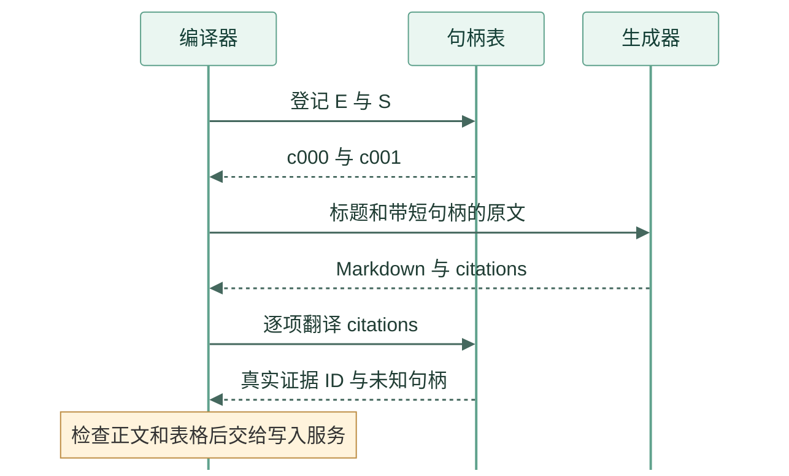

# 05-A · 写短句柄与 Wiki 编译流程

上一课交给接口的是两个长证据编号，Wiki 正文则能直接阅读。从长编号到短句柄，再回到长编号，靠的是一张只在本轮使用的表。把它和生成流程一起写出来，就能解释为何一段模型输出还要经过处理才可以保存。 [第四章目录](./README.md)

## 先认识短句柄、映射和结构化输出

**句柄**是一次操作里指向资源的短名字。把证据 E 和表格 S 分别交给本次编译的 `HandleTable`，它会登记 `c000→E`、`c001→S`。这样生成器只要在 `citations` 里填短名字。每次编译都新建映射，另一页的 `c000` 可以指向别的证据。应用保存真实证据 ID 后，以后的用户才能用同一个编号打开原文。 [句柄类](../../backend/app/wiki/handles.py#L15-L57)

**结构化输出**让一段生成结果能按字段读取。`backend/app/wiki/compiler.py` 的 `COMPILE_SCHEMA` 约定返回标题、Markdown 正文、摘要与 `citations`。应用取其中的 `citations` 数组做回查。渲染前会清理正文里形如 `[c000]` 或 `[c000, c001]` 的短标记，解析出的稳定证据 ID 则放在 `chunk_refs`。 [返回结构](../../backend/app/wiki/compiler.py#L28-L43) · [清理短引用标记](../../backend/app/wiki/handles.py#L47-L54)



## 手算一轮编译会留下哪些 ID

打开 `backend/app/wiki/compiler.py` 的 `_generate`。Demo 走 `_deterministic_page`，为每份原文附上它的句柄。兼容模型路径用 `render_block` 组织证据，调用第三章见过的 `generate_json`，配置角色是 `wiki`。失败时它也可以生成确定性的页面。 [生成器的两条路径](../../backend/app/wiki/compiler.py#L48-L121)

假设选的是 `[E, S]`，并假设生成正文里完整保留了源表。按下面的输出预测编译器怎样处理：

| 模型的 `citations` | 翻译出的引用 | 页面与诊断 |
| --- | --- | --- |
| `["c000", "c001"]` | `[E, S]` | 页面可带两条引用 |
| `["c001", "c777", "c001"]` | `[S]` | 保留第一个 S，记 `unknown_handles=["c777"]`。`source_refs` 仍是 `[E, S]` |
| `["c777"]` | 初步得到 `[]` | 改用只依赖原文的页面，最终 `chunk_refs=[E,S]`，带回退诊断 |

这一步检查编号能否在本轮映射中找到。仍需打开 E、S，核对「本机演示」究竟支撑哪句话。若生成正文少了一行源表，即使编号能翻译，也要进入下一课的保护分支。 [编译结果的校验与回退](../../backend/app/wiki/compiler.py#L163-L198)

## 先补句柄表的两次查找

```bash
python tutorials/04-knowledge-base/lab/kb_practice.py open handles
```

打开练习的 `.cache/knowledge-practice/backend/app/wiki/handles.py`。类的构造函数已经初始化 `_next`、`_by_id`、`_by_handle` 与 `_unknown`。`_by_id` 用来查一条证据有没有领过短编号，`_by_handle` 用来把模型返回的编号变回证据。

1. 给 E 第一次发号时，`_next=0`、`_width=3`，所以 `f"{self._prefix}{self._next:0{self._width}d}"` 得 `c000`。当前号用完才加 1。
2. 再登记 E 应返回之前的编号，下一项 S 才得到 `c001`。写完后把两份映射按键分别念一遍，确认了它们查的是相反方向。
3. 实现 `resolve` 时用 `get`。找不到返回 `None`，同时向 `_unknown` 追加当前句柄，以便查看是哪一项写错了。

<details>
<summary>核对 HandleTable 的 register 与 resolve</summary>

下面两个方法各留在现有的 `class HandleTable` 中，旁边的 `handle`、`render_block` 和属性继续保留。

```python
    def register(self, stable_id: str) -> str:
        """Register a stable id and return its short handle (idempotent)."""
        if stable_id in self._by_id:
            return self._by_id[stable_id]
        handle = f"{self._prefix}{self._next:0{self._width}d}"
        self._next += 1
        self._by_handle[handle] = stable_id
        self._by_id[stable_id] = handle
        return handle


    def resolve(self, handle: str) -> str | None:
        """Translate a handle to its stable id; record unknown handles."""
        stable = self._by_handle.get(handle)
        if stable is None:
            self._unknown.append(handle)
        return stable
```

</details>

## 把映射接进编译器

打开 `.cache/knowledge-practice/backend/app/wiki/compiler.py`。先写 `resolve_citations`。按顺序遍历模型返回的句柄，用你刚写的 `resolve` 查 stable ID。检查这个值是否为空或已出现在结果列表中，最后返回列表。

<details>
<summary>核对 resolve_citations</summary>

```python
def resolve_citations(
    citations: list[str], handles: HandleTable
) -> list[str]:
    """Resolve model-produced handles to stable evidence ids, dropping unknowns."""
    resolved: list[str] = []
    for handle in citations:
        stable = handles.resolve(handle)
        if stable is not None and stable not in resolved:
            resolved.append(stable)
    return resolved
```

</details>

回到同一文件的 `prepare_page`，按练习注释分四步补写：

1. 空来源列表抛 `WikiCompileError`。其余先保留去重后的来源 ID，再新建句柄表，逐条登记输入来源。
2. 调用已有的 `_generate` 得到候选，翻译 `citations`，清理正文中的短标记。正文为空或翻译后没有可用引用，就用 `_deterministic_page` 重建，把 `chunk_refs` 换回合法的 source IDs。
3. 选出看起来含表格的源正文，交给 `assert_rows_preserved`。如果抓到 `DroppedTableRowsError`，转换成对编译调用者可见的 `WikiCompileError`。
4. 返回三件东西。`values` 供写入使用，`chunk_refs` 带真实引用，诊断带 provider、fallback 和未知句柄。此时还没有执行数据库写入。

<details>
<summary>核对 prepare_page 完整实现</summary>

```python
async def prepare_page(title: str, sources: list[dict[str, Any]]) -> tuple[dict, list[str], dict]:
    if not sources:
        raise WikiCompileError("no sources to compile")
    source_ids = list(dict.fromkeys(source["evidence_id"] for source in sources))
    handles = HandleTable()
    for source in sources:
        handles.register(source["evidence_id"])

    generated, diagnostics = await _generate(title=title, sources=sources, handles=handles)

    # Resolve handle citations to stable ids; unknown handles are discarded.
    chunk_refs = resolve_citations(generated["citations"], handles)
    content = handles.strip_inline_citations(generated["content"])
    if not content or not chunk_refs:
        generated = _deterministic_page(title, sources, handles)
        chunk_refs = source_ids
        content = handles.strip_inline_citations(generated["content"])
        diagnostics = {**diagnostics, "fallback": True}

    # Guard: no source table rows may silently vanish in the rewrite.
    try:
        assert_rows_preserved(
            "",
            content,
            source_tables=[s["content"] for s in sources if "|" in s.get("content", "")],
        )
    except DroppedTableRowsError as exc:
        raise WikiCompileError(str(exc)) from exc

    values = {
        "title": (generated["title"] or title)[:255],
        "content": content,
        "summary": str(generated["summary"]) if generated.get("summary") is not None else None,
        "page_type": "concept",
        "status": "published",
    }
    return values, chunk_refs, {**diagnostics, "unknown_handles": handles.unknown_handles}
```

</details>

从文件上方的 `compile_page` 看调用者怎样接这三个返回值。它先调用 `check_page_version`，完成生成后再让 `persist_page` 检查版本。保存时还可以按当前用户检查来源是否仍在，随后才尝试新增或更新页面。生成过程有等待，把这两次读分开可以处理期间发生的变化。 [编译和保存入口](../../backend/app/wiki/compiler.py#L123-L233)

## 核对未知句柄、去重和 fallback

```bash
python tutorials/04-knowledge-base/lab/kb_practice.py check handles
```

在 `backend/tests/test_wiki_compile.py` 找 `test_resolve_citations_drops_unknown_and_dedupes` 和 `test_compile_with_model_unknown_handles_dropped`。后者借假提供器控制返回结果，能验证未知编号留在诊断里。测试使用可预测输入，所以本节可以用 Demo 环境学习真实模型分支。 [句柄、编译和未知引用测试](../../backend/tests/test_wiki_compile.py#L21-L126)

## 下一步

到 [05-B 写表格行保护](05-B-表格行保护.md)。检验同为 Docker 的两行怎样分别计数，然后亲手造出一条会被拒绝的候选。
