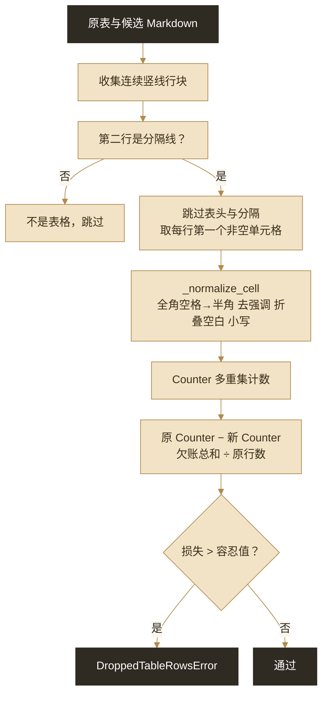

# 05-B · 写表格行保护

上节把候选的引用编号还原了。现在问另一件事：如果模型写了一页通顺的话，却把表中第二条 Docker 观察删了，系统怎么发现？你会给原表和候选数行，算出损失比例，让调用者拿到具体错误。这一关在整条资料链上管的是「生成结果即使编号都对，也要防止它悄悄丢数据」。 [第四章目录](./README.md)

## 为什么要写这一关

这不是假设出来的问题，而是 WeKnora 项目里真实踩过的坑（源码注释写在文件开头）：一个 Agent 重写整页，把 100 行的表压到 30 行，返回时 `finish_reason=stop`，**没有任何报错**。更隐蔽的是，如果重写后可见字段看起来「没变」，按版本规则这次写入甚至不会递增版本——调用者事后完全无法察觉丢了 70 行。

模型的天性是「总结」。给它一张表，它很容易把几行合并成一句「支持多种部署方式」。对于讲故事的正文这没问题，但表里的每一行往往是一条独立事实——两行 Docker 记录可能分别对应「本机启动」和「健康检查通过」，合并掉一行就丢了一条可追溯的观察。

守卫的思路：**在写入前，比较原表和候选表的行身份，损失超过容忍值就拒绝整页**。它不判断内容对不对（那是事实核验的事），只守住一条底线——不许悄悄少行。

## 一张地图：从表格文本到损失比例



## 第 1 块：认出哪几行是表格

Markdown 表的第一行是表头，第二行是分隔线，下面才是数据行。代码用两个正则识别：

```python
_ROW_LINE = re.compile(r"^\s*\|.*\|\s*$")       # 以竖线开头和结尾
_SEPARATOR = re.compile(r"^\s*\|[\s:|-]+\|\s*$") # 只有空格、冒号、竖线、短横
```

`table_row_identities` 先扫描全文，把**连续的**竖线行收进一个 `block`。遇到普通行就结算并清空，全文结尾再结算一次。结算时先检查 `block[1]` 是不是分隔线——不是就整块跳过（可能只是正文里几行带竖线的引用）。 [表格正则与归一化](../../backend/app/wiki/tables.py#L15-L40)

```python
def flush() -> None:
    if len(block) < 2 or not _SEPARATOR.match(block[1]):
        return
    # Skip header + separator (first two lines); only data rows remain.
    for line in block[2:]:
        cells = re.split(r"(?<!\\)\|", line.strip()[1:-1])
        ...
```

`block[2:]` 跳过表头和分隔线，只留数据行——**表头永远不会被当成一条数据身份**。`line.strip()[1:-1]` 去掉行首尾的竖线再切分。`re.split(r"(?<!\\)\|", ...)` 用「前面不是反斜杠的竖线」切分，这样单元格里的转义竖线 `\|` 不会被切开，仍留在同一个格子里。

为什么用 `flush()` 这个内部函数？因为要处理两种结算时机：遇到非表格行、以及全文结束。把结算逻辑写成一个函数，两处调用，避免重复代码。这是处理「连续块」类问题的常见写法。

## 第 2 块：行身份——取第一个非空单元格

一条行的身份不是整行内容，而是**第一个非空单元格**。看这个例子：

```text
| 能力   | 观察记录           |
| ------ | ------------------ |
| Docker | 课程接口只在本机启动 |
| Docker | /health/live 返回 ok |
| Python | 课程项目只在本机演示 |
```

`_normalize_cell` 对每个单元格做归一化：

```python
_EMPHASIS = str.maketrans("", "", "*_`")

def _normalize_cell(cell: str) -> str:
    cell = cell.replace("\u3000", " ").translate(_EMPHASIS)
    return " ".join(cell.split()).casefold()
```

四步：

1. 全角空格 `\u3000` 换成普通空格。
2. `translate(_EMPHASIS)` 删掉 `*`、`_`、反引号——这些是模型重排表格时最爱加的强调标记。
3. `" ".join(cell.split())` 折叠所有空白（空格、Tab、换行）成单个空格，并去掉首尾。
4. `casefold()` 转小写做比较，比 `lower()` 更彻底（能处理德语 ß 等）。

所以 `Docker` 与 `**docker**` 都会变成 `docker`。**为什么归一化这些？** 因为格式变化是模型重排时最常做的「无害改动」。如果这些就算丢行，守卫会疯狂误报。归一的目的是让「换个写法但其实是同一行」通过，只对「真的少了一行」报警。

**为什么要第一个非空单元格，而不是固定第一格？** 因为模型可能在左侧插入一列空单元格（这种情况很常见）。如果固定取第一格，插入空列后每一行的身份都变成空，守卫会以为所有行都丢了。取第一个非空项就避开了这个陷阱——新增的空列被跳过，仍从「Docker」这一格取身份。

这段代码里原表得到 `["docker", "docker", "python"]`，顺序保留。 [归一化实现](../../backend/app/wiki/tables.py#L20-L30)

## 第 3 块：多重集——为什么相同的两行要数两次

这是整关最值得停下来想的设计决定。

**集合（set）**只关心「有没有」；**多重集（multiset）**还关心「有几个」。Python 的 `Counter` 就是多重集。上面的身份列表 `["docker", "docker", "python"]` 经 `Counter` 变成 `{"docker": 2, "python": 1}`。

如果候选表删掉一条 Docker 记录，身份列表变成 `["docker", "python"]`，`Counter` 是 `{"docker": 1, "python": 1}`。用集合看，`docker` 和 `python` 都还在，似乎没丢；用多重集看，`docker` 从 2 变 1，确实少了一行。

```python
rewritten_counts = Counter(table_row_identities(rewritten))
missing = sum((Counter(original_ids) - rewritten_counts).values())
return missing / len(original_ids)
```

`Counter` 的减法 `原 - 新` 只对正数项保留差：原 `docker:2` 减新 `docker:1` 得 `docker:1`；`python:1` 减 `python:1` 得 0（被丢掉）。把剩下的 `.values()` 加起来，`missing = 1`。除以原列表长度 3，得到损失比例 `1/3 ≈ 0.3333`。

**注意分母用的是原始行实例总数（3），不是去重后的身份数（2）**。这正是项目刻意比 WeKnora 更严的地方——源码注释写得很明白：丢掉两条相同 Docker 行中的一条是真实的数据损失，不能被重复项稀释。如果按去重身份数 2 算，损失是 `1/2`，反而更严重；但关键是**集合做法会得到 0 损失，完全漏报**。多重集保证了「少一行就是少一行」。 [真实损失计算](../../backend/app/wiki/tables.py#L70-L84)

| 对比 | 集合做法 | 本项目多重集做法 |
| --- | --- | --- |
| 删掉两行相同 Docker 中的一行 | `docker` 还在 → 损失 0（漏报） | `2→1` → 损失 `1/3`（抓住） |
| 把 Docker 改成 `**docker**` | 归一化后相同 → 通过 | 归一化后相同 → 通过 |
| 整张表删掉 | 全空 → 能发现 | 分母 3、欠账 3 → 损失 1.0 |

## 先预测四次改动

| 修改候选表 | 原表欠了几行 | 默认损失结果 |
| --- | ---: | --- |
| 改 `Docker` 为 `**docker**` | 0 | 通过（强调标记被归一掉） |
| 删任一 Docker 数据行 | 1 | `1/3`，拒绝 |
| 把「本机启动」写成「生产上线」，首格维持 Docker | 0 | 行数检查通过，结论仍要核对 E 和 S |
| 把候选表头改名并保留三条数据 | 0 | 通过（表头不算数据行） |

第三行是重点：**行守卫只看第一格身份和数量，不看第二格的结论是否被人改了**。一行 `Docker | 课程接口只在本机启动` 被改成 `Docker | 课程接口已在生产上线`，首格还是 `Docker`，行数没少，守卫会通过。这不是守卫的失职——它的职责是防「悄悄少行」，不是防「悄悄改结论」。后者要靠打开 E、S 核对原文，或走事实核验流程（第一章讲过的三关）。

第四行：表头改名不影响，因为 `block[2:]` 从第三行才开始算身份。记住守卫的边界，才知道它挡得住什么、挡不住什么。

## 跟写取身份、算损失和抛错误

```bash
python tutorials/04-knowledge-base/lab/kb_practice.py open guard
```

打开 `.cache/knowledge-practice/backend/app/wiki/tables.py`。用下面三步把函数接起来。

1. `table_row_identities` 维护一组连续的 `block`。遇到普通行时结算并清空，在全文结尾再结算一次。`flush` 读取当前的 `block`。用 `re.split(r"(?<!\\)\|", ...)` 按未转义的竖线切分，单元格里的转义竖线留在这个格子中。找到第一项非空身份便可停止。
2. `row_identity_loss_ratio` 先查旧身份列表。空表比例为 0。其余分别做 `Counter`，用减法和 `.values()` 找欠账，除以旧列表长度。
3. `assert_rows_preserved` 接到 `source_tables` 时用空行拼接，空行让各张表在扫描时各自结算（遇到空行触发 `flush`）。否则用已有页面 `original`。只有实际损失**严格大于**允许值才抛 `DroppedTableRowsError`，把损失值格式化成百分比。

<details>
<summary>核对提取与计算的完整函数</summary>

```python
def table_row_identities(markdown: str) -> list[str]:
    """Extract ordered row identities (normalized first non-empty cell).

    Markdown tables are a header row, a separator row, then data rows. We walk
    consecutive pipe-line blocks and skip the first two lines of each block so
    the header is never mistaken for data. Per WeKnora, the identity is the
    first *non-empty* cell after normalization, so a model inserting a leading
    blank column does not erase every row's identity.
    """
    identities: list[str] = []
    block: list[str] = []

    def flush() -> None:
        if len(block) < 2 or not _SEPARATOR.match(block[1]):
            return
        # Skip header + separator (first two lines); only data rows remain.
        for line in block[2:]:
            cells = re.split(r"(?<!\\)\|", line.strip()[1:-1])
            identity = ""
            for cell in cells:
                normalized = _normalize_cell(cell)
                if normalized:
                    identity = normalized
                    break
            if identity:
                identities.append(identity)

    for line in markdown.splitlines():
        if _ROW_LINE.match(line):
            block.append(line)
        else:
            flush()
            block = []
    flush()
    return identities


def row_identity_loss_ratio(original: str, rewritten: str) -> float:
    """Fraction of original table-row identities missing from the rewrite.

    Cell identities are normalized by ``_normalize_cell`` (WeKnora's rule), but
    the ratio intentionally uses a multiset denominator rather than WeKnora's
    distinct-identity count: dropping one of two identical rows is a real data
    loss and must not be diluted by the duplicate. This keeps the guard a
    stricter safety net than the upstream variant.
    """
    original_ids = table_row_identities(original)
    if not original_ids:
        return 0.0
    rewritten_counts = Counter(table_row_identities(rewritten))
    missing = sum((Counter(original_ids) - rewritten_counts).values())
    return missing / len(original_ids)
```

</details>

<details>
<summary>核对 assert_rows_preserved</summary>

```python
def assert_rows_preserved(
    original: str,
    rewritten: str,
    *,
    max_loss_ratio: float = 0.0,
    source_tables: list[str] | None = None,
) -> None:
    """Reject a rewrite that dropped table rows beyond the tolerance.

    ``source_tables`` lets a compiler check each original source table against
    the rewritten page (WeKnora checks all tables on the page). When omitted,
    the original page content is used.
    """
    sources = source_tables if source_tables is not None else [original]
    loss = row_identity_loss_ratio("\n\n".join(sources), rewritten)
    if loss > max_loss_ratio:
        raise DroppedTableRowsError(
            f"rewrite dropped {loss:.0%} of table rows (limit {max_loss_ratio:.0%})"
        )
```

</details>

`max_loss_ratio` 默认是 `0.0`——**一行都不许丢**。编译流程没有传别的值，等于采用最严标准。`> max_loss_ratio` 用严格大于，所以损失恰好等于容忍值时通过。错误消息用 `{loss:.0%}` 把 `0.3333` 显示成 `33%`，调用者一眼能看出丢了多少。

### 失败反推

| check 现象 | 最可能漏了 |
| --- | --- |
| 强调标记改动被误判丢行 | `_normalize_cell` 没删 `*_\`` 或没 `casefold()` |
| 插了空列后全部行都算丢 | 取的是第一格，不是第一个**非空**格 |
| 两行相同 Docker 删一行没抓住 | 用了 `set` 而不是 `Counter` |
| 分母算成去重身份数 | 应除以 `len(original_ids)`（含重复） |
| 多张源表连在一起少行没发现 | `source_tables` 没用空行拼接，`flush` 时机不对 |
| 表头被算成一行数据 | 没跳过 `block[2:]` 的前两行 |

## 用一份表看实际错误

运行验收命令。`test_table_guard_counts_repeated_row_keys` 查重复行，`test_compile_rejects_dropped_table_rows` 给生成器预设了少行的输出，检查错误能否传到编译器。

```bash
python tutorials/04-knowledge-base/lab/kb_practice.py check guard
```

想单独观察 `1/3` 时，在激活虚拟环境的终端从项目根进入 `.cache/knowledge-practice/backend`，运行 `python`。出现 `>>>` 后，逐行输入下面的命令。可自选把哪一行传给 `replace`。`print` 给出比值，最后一次调用演示真实异常。

```python
from app.wiki.tables import assert_rows_preserved, row_identity_loss_ratio
original = "| 能力 | 观察 |\n| --- | --- |\n| Docker | 本机启动 |\n| Docker | 健康检查 |\n| Python | 课程项目 |"
rewritten = original.replace("| Docker | 健康检查 |\n", "")
print(row_identity_loss_ratio(original, rewritten))
assert_rows_preserved(original, rewritten)
```

预期先打印 `0.3333333333333333`，再看到 `rewrite dropped 33% of table rows (limit 0%)`。输入 `exit()` 退出。回到项目根再运行后续课程的启动器命令。指定过自定义副本时，进对应副本的 `backend`。

## 看同步接口和 Worker 怎样把错误交出来

默认 Demo 把源片段拼接成页，课堂中的丢行由测试替身产生。实际候选触发丢行时，`backend/app/wiki/compiler.py` 的 `prepare_page` 会包成 `WikiCompileError`。两条路线都会把错误交到调用者面前，但方式不同：

- **同步编译接口**把它转成 **HTTP 422**，`detail` 里能看到损失比例。
- **后台 Worker** 已经先返回过 202（任务已受理），错误出现在 Run 结果里，状态为 `failed`、`error_code=invalid_input`。

两条路线都会在页面写入前停止——这才是关键。守卫放在 `prepare_page` 里、`persist_page` 之前，所以丢行的候选根本到不了数据库。 [编译守卫](../../backend/app/wiki/compiler.py#L179-L187) · [同步接口异常处理](../../backend/app/api/routes/wiki.py#L74-L79) · [Worker 异常处理](../../backend/app/runtime/worker.py#L126-L137) · [丢行用例](../../backend/tests/test_wiki_compile.py#L128-L174)

## 这些概念在 CareerLens 里落在哪

| 本课的词 | 源码位置 | 作用 |
| --- | --- | --- |
| `_normalize_cell` | `backend/app/wiki/tables.py` | 让格式改动不算丢行 |
| `table_row_identities` | `backend/app/wiki/tables.py` | 从 Markdown 抽出有序行身份 |
| `row_identity_loss_ratio` | `backend/app/wiki/tables.py` | 多重集算损失，比上游更严 |
| `assert_rows_preserved` | `backend/app/wiki/tables.py` | 写入前的最后一道数据完整性闸门 |
| `DroppedTableRowsError` | `backend/app/wiki/tables.py` | 专用异常，便于上层转成 422 或 failed Run |

守卫的边界要记牢：**它保证行不丢，不保证行的内容对**。所以它和事实核验是互补的两道关——守卫挡住「悄悄少行」，事实核验挡住「行还在但结论被改错」。两者都不能省。这也是为什么项目即便有守卫，05-D 仍要你打开 E、S 核对「只在本机演示」——程序挡得住的交给程序，挡不住的留给人看。

## 下一步

到 [05-C 写版本、冲突和回滚](05-C-Wiki版本与回滚.md)。候选可以保存之后，再处理两个人同时改同一页的问题。
