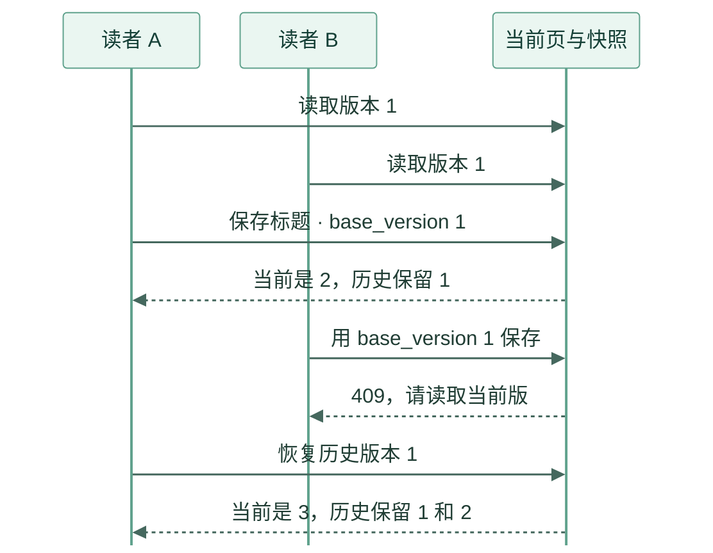

# 05-C · 写版本、冲突和回滚

林澈和同学同时打开第一版「Python 与 Docker 课程项目」。一位先把标题改得更准确，另一位还拿着第一版编辑。如果二人都能用旧版本直接保存，后提交的人就会覆盖先前成果。本课给编辑加上版本条件，再亲手把旧内容恢复成第三版。 [第四章目录](./README.md)

## 先认识当前行、快照和乐观并发

打开 `backend/app/models/wiki.py`。`WikiPage` 保存当前可见内容，每页在用户内用 `slug` 唯一定位。`WikiRevision` 保存曾被换下来的版本，按 `(page_id, version)` 唯一。当前版本可以直接读 `GET /api/v1/wiki/{slug}`。发生有效改动后，被替换的那一版才出现在 `revisions`。 [当前页与历史快照](../../backend/app/models/wiki.py#L29-L91)

**乐观并发**允许多人先读再编辑，提交时用数据库里的版本判断这份输入是否过期。传入的 `base_version` 是编辑时看到的数字。应用会先查一次它是否当前，提交时再用 `WHERE id=... AND version=...` 做一次**比较并更新**。读完到提交之间可能还有写入，后一项条件能覆盖这段时间。



## 看哪些变化会让版本前进

`backend/app/services/wiki_pages.py` 的 `VISIBLE_FIELDS` 包含标题、正文、摘要、页类型和状态。`source_refs` 或 `chunk_refs` 有变化时，也会保存旧版本。读到相同内容和引用时，只需写这次更新的元数据，版本号保持原样。快照带的是被换下的 `page.last_edit_source`，记录这版内容来自 `pipeline`、`user`、`agent` 或 `revert` 等途径。

| 情况 | 当前页变化 | 历史变化 |
| --- | --- | --- |
| 首次编译这个 slug | 版本 1 | 暂无快照 |
| 传入同样可见字段与引用 | 仍是 1 | 暂无快照 |
| 修改标题，基于版本 1 | 版本 2 | 保存之前的版本 1 |
| 另一人仍基于 1 再写 | 当前仍是 2 | 无新增快照 |
| 恢复版本 1 的标题和引用 | 当前版成为 3 | 保存刚被换下的版本 2 |

保留历史的代码也在同一文件。`_prune_revisions` 优先保留最近 5 份流水线快照，并用总上限 50 控制历史数量。更多旧改动被裁剪时，先处理流水线快照。恢复会重新检查历史所列的证据是否仍可用。 [字段、快照和裁剪](../../backend/app/services/wiki_pages.py#L19-L72) · [恢复时的来源校验](../../backend/app/services/wiki_pages.py#L182-L226)

## 跟写快照和条件更新

```bash
python tutorials/04-knowledge-base/lab/kb_practice.py open versions
```

打开 `.cache/knowledge-practice/backend/app/services/wiki_pages.py`。先写 `_snapshot`。假设当前版是 1、作者是 `pipeline`，传入的修改由 `user` 请求。快照里的 `version` 和 `edit_source` 应写 `1` 和 `pipeline`。`source_refs` 与 `chunk_refs` 转成列表副本，让后面的写入不会沿用同一个可变列表对象。

<details>
<summary>核对 _snapshot</summary>

```python
def _snapshot(page: WikiPage) -> WikiRevision:
    """Snapshot the current (about-to-be-superseded) page state."""
    return WikiRevision(
        page_id=page.id,
        user_id=page.user_id,
        version=page.version,
        title=page.title,
        page_type=page.page_type,
        content=page.content,
        summary=page.summary,
        status=page.status,
        source_refs=list(page.source_refs),
        chunk_refs=list(page.chunk_refs),
        # The author of the version being replaced, not the incoming writer.
        edit_source=page.last_edit_source,
    )
```

</details>

再写 `update_page`，按四段完成：

1. 若传入 `base_version`，先比对 `page.version`，不匹配就抛 `StaleWikiWriteError`。挑出可见字段，计算引用是否变动。
2. 有可见变化或引用变化才做快照。构造更新字典，再决定是否加新版本和值 `last_edit_source`。这里 `None` 代表某个引用参数没有传入，空列表则可用于明确清空，判断要用 `is not None`。
3. 使用下面的条件构造更新。`.returning(WikiPage.id)` 让数据库在命中时交回 ID。若得到 `None`，页面或版本在等待期间发生了变化，走冲突分支。
4. 更新成功才添加快照、flush 和裁剪旧历史。需要本函数提交时调用 `commit`，然后 `refresh` 读回当前值。同步编译入口可以在外层统一提交。

```python
update(WikiPage).where(WikiPage.id == page.id, WikiPage.version == page.version)
```

<details>
<summary>核对 update_page 完整实现</summary>

```python
async def update_page(
    session: AsyncSession,
    *,
    page: WikiPage,
    base_version: int | None,
    edit_source: str,
    values: dict,
    source_refs: list | None = None,
    chunk_refs: list | None = None,
    out_links: list | None = None,
    in_links: list | None = None,
    commit: bool = True,
) -> WikiPage:
    """Apply a write to a page under optimistic concurrency.

    ``base_version`` is the version the caller read. If it no longer matches,
    the write is stale and rejected — an old compiler run cannot clobber a
    newer page. Pass ``base_version=None`` to skip the guard (human edits).
    """
    if base_version is not None and page.version != base_version:
        raise StaleWikiWriteError(
            f"page version changed: expected {base_version}, found {page.version}"
        )

    visible = {field: values[field] for field in VISIBLE_FIELDS if field in values}
    changed = _changed_visible(page, visible)
    provenance_changed = (
        source_refs is not None and source_refs != page.source_refs
        or chunk_refs is not None and chunk_refs != page.chunk_refs
    )
    snapshot = _snapshot(page) if changed or provenance_changed else None
    updates = {**visible, "updated_at": datetime.now(UTC)}
    for field, value in (
        ("source_refs", source_refs), ("chunk_refs", chunk_refs),
        ("out_links", out_links), ("in_links", in_links),
    ):
        if value is not None:
            updates[field] = value
    if snapshot is not None:
        updates.update(version=page.version + 1, last_edit_source=edit_source)
    updated = await session.scalar(
        update(WikiPage)
        .where(WikiPage.id == page.id, WikiPage.version == page.version)
        .values(**updates)
        .returning(WikiPage.id)
        .execution_options(synchronize_session=False)
    )
    if updated is None:
        raise StaleWikiWriteError(f"page version changed: expected {page.version}")
    if snapshot is not None:
        session.add(snapshot)
        await session.flush()
        await _prune_revisions(session, page.id)
    if commit:
        await session.commit()
    await session.refresh(page)
    return page
```

</details>

```bash
python tutorials/04-knowledge-base/lab/kb_practice.py check versions
```

看看 `backend/tests/test_wiki_schema.py` 的 `test_stale_write_is_rejected_across_sessions`。它用两个数据库会话持有各自看到的版本，验证一方提交后旧对象仍无法覆盖更新。另一个用例会检查回滚本身会写成新版本。 [版本和并发测试](../../backend/tests/test_wiki_schema.py#L31-L123)

## 在 Swagger 重现 201、409 和恢复

改完练习代码后，在服务终端按 Ctrl+C，再用原来的 `serve` 命令重启，沿用原副本和端口。打开 `GET /api/v1/wiki/{slug}`，填自己记录的 slug 和 `user_id`，先看当前版本。如果它已经大于 1，用同一账号、原标题和 E、S 另建一个新 slug，`base_version` 留 `null`，让它从版本 1 开始。这组预期以 Demo 为准。 [第 05 课的初始编译请求](../05-Wiki知识组织.md)

1. 用原标题和相同证据，设 `base_version=1` 重编译。Demo 预期仍返回 201，`page.version=1`。
2. 这次改标题为「Python 与 Docker 课程项目 第二版」，仍带 `base_version=1`，可把 `edit_source` 改为 `user`。成功后版本是 2。打开 `GET /api/v1/wiki/{slug}/revisions`，填本次的 slug 和 `user_id`。应该看到旧版 1 的原题目和 `edit_source=pipeline`。
3. 再用旧的 `base_version=1` 发送，预期 **409**。`detail` 会说明期望的版本与当前版本。重读当前页时，标题仍为第二版。
4. 在 `POST /api/v1/wiki/{slug}/revert` 填同一个 slug，发送下面的 JSON。预期返回 200，标题恢复成原样，`version=3`，`last_edit_source=revert`。再查历史，版本 2 和版本 1 都在。

```json
{
  "user_id": "kb-study",
  "target_version": 1
}
```

恢复入口用历史快照填回内容与两组引用，然后仍调用 `update_page`。这次恢复有可见变化，所以生成新的版本。后台编译发现旧版本时，已受理的 Run 会以 `stale_input` 失败，可在任务详情中读原因。 [同步冲突处理](../../backend/app/api/routes/wiki.py#L74-L78) · [恢复接口](../../backend/app/api/routes/wiki.py#L117-L142) · [Worker 过期处理](../../backend/app/runtime/worker.py#L126-L137)

## 下一步

记下恢复成功的页使用的 slug 和 `user_id`。到 [05-D 查 Wiki、比较三种模式并回溯](05-D-Wiki查询与综合验收.md)，按这两个值查当前页的 `chunk_refs`，从其中的 E 追回两个 DOCX。
