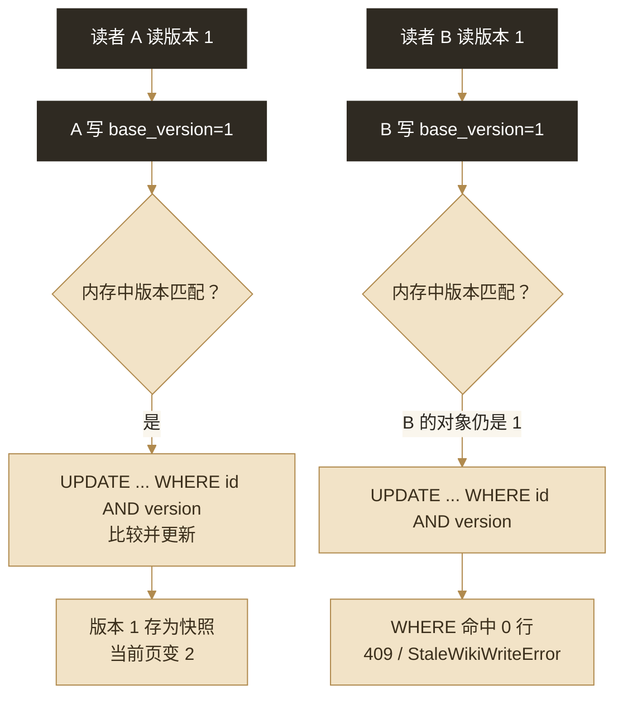

# 05-C · 写版本、冲突和回滚

林澈和同学同时打开第一版「Python 与 Docker 课程项目」。一位先把标题改得更准确，另一位还拿着第一版编辑。如果二人都能用旧版本直接保存，后提交的人就会覆盖先前成果。本课给编辑加上版本条件，再亲手把旧内容恢复成第三版。这一关在整条资料链上管的是「一页可以被多人、多流程反复改，但不能互相覆盖」。 [第四章目录](./README.md)

## 为什么要写这一关

上一关的 `compile_page` 里有个不起眼的 `check_page_version`——生成之前查一次版本，写入之前 `persist_page` 又查一次。为什么查两次？因为中间隔着模型生成，可能要几秒。这段等待里，别人可能已经改过这页。如果不管，一个几分钟前启动的编译任务会把最新的手工修改覆盖掉。

这类问题叫**丢失更新（lost update）**：两个人各自读到旧值，各自写回，后写的把先写的抹掉，而且双方都觉得自己保存成功了。传统的解决办法是加锁（悲观并发），但 Wiki 编辑常常是「读了好久才写」，长期持锁不现实。项目用**乐观并发**。阅读和生成期间可以放开数据库锁，提交时用带版本条件的 `UPDATE` 比对当前行。版本已变时，旧编辑会被拒绝。

回滚也有讲究。最直觉的做法是把旧内容直接盖回去、历史里删掉中间版本——但这会破坏可追溯性。项目把回滚也表达成**一次普通编辑**：内容是旧的，但作为一个新版本保存，先前的快照由历史保留规则管理，刚被替换的内容也会形成快照。这样能在仍保留的版本中追溯改动。

## 一张地图：当前页 + 快照 + 版本条件



注意一个微妙点：B 的内存对象可能还停在版本 1（A 的提交发生在另一个会话里），所以第一层「内存检查」B 也能通过。真正拦住 B 的是第二层——SQL 的 `WHERE version = 1` 在数据库里命中 0 行，因为当前已是 2。**两道检查缺一不可**：内存检查快速拒绝明显过期的情况，数据库条件覆盖「读完到提交之间」的竞态窗口。

## 第 1 块：当前行与快照是两张表

打开 `backend/app/models/wiki.py`。两张表分工明确：

- `WikiPage` 保存**当前可见内容**。每页在用户内用 `slug` 唯一定位，唯一键 `(user_id, slug)`。字段有 `version`、`status`、两组引用（`source_refs`、`chunk_refs`）、两组链接（`out_links`、`in_links`）。
- `WikiRevision` 保存**曾被换下来的版本**。按 `(page_id, version)` 唯一。它是一份不可变快照——写进去就不改。 [当前页与历史快照](../../backend/app/models/wiki.py#L29-L91)

当前版本可以直接读 `GET /api/v1/wiki/{slug}`。有效改动发生后，被替换的那一版才出现在 `revisions`。历史里看不到版本 2 时，先查当前页。如果当前就是 2，它还没有被换下。若当前版本更高，再检查旧快照是否已被裁剪。

`EDIT_SOURCES = ("user", "agent", "pipeline", "revert")` 四个值标出每一版是谁写的；`PAGE_STATUSES = ("draft", "published", "archived")` 是页面生命周期。两组都是字符串常量而非枚举——SQLite/PostgreSQL 都能存，保持模型简单。

## 第 2 块：哪些变化会让版本前进

`backend/app/services/wiki_pages.py` 的 `VISIBLE_FIELDS` 包含标题、正文、摘要、页类型和状态：

```python
VISIBLE_FIELDS = ("title", "content", "summary", "page_type", "status")
```

判断分两部分：

```python
visible = {field: values[field] for field in VISIBLE_FIELDS if field in values}
changed = _changed_visible(page, visible)
provenance_changed = (
    source_refs is not None and source_refs != page.source_refs
    or chunk_refs is not None and chunk_refs != page.chunk_refs
)
snapshot = _snapshot(page) if changed or provenance_changed else None
```

- **可见字段**变了 → 版本前进。
- **两组引用**变了 → 也前进，因为这改变了「这页依据哪些材料」。
- **链接账本**（`out_links`、`in_links`）变了 → **不**前进。这是页面间的导航关系，用户看不到，不该产生一个新版本。

`None` 和空列表要分清：`source_refs is not None` 才参与比较。传 `None` 表示「这次没动这个字段」，传 `[]` 表示「明确清空」。写成 `if source_refs:` 会把空列表当成没传，清空就永远不生效——这是很常见的 bug。

| 情况 | 当前页变化 | 历史变化 |
| --- | --- | --- |
| 首次编译这个 slug | 版本 1 | 暂无快照 |
| 传入同样可见字段与引用 | 仍是 1 | 暂无快照 |
| 修改标题，基于版本 1 | 版本 2 | 保存之前的版本 1 |
| 另一人仍基于 1 再写 | 当前仍是 2 | 无新增快照（被 409 拒绝） |
| 恢复版本 1 的标题和引用 | 当前版成为 3 | 保存刚被换下的版本 2 |
| 只更新 `out_links` | 版本不变 | 无快照 |

第一次编译得到版本 1，两次有效更新后是版本 3。仅更改链接账本时版本号保持原值。 [字段、快照和裁剪](../../backend/app/services/wiki_pages.py#L19-L74)

## 第 3 块：快照记的是「被换下来的那版」的作者

这是最容易被写反的一行。

```python
def _snapshot(page: WikiPage) -> WikiRevision:
    """Snapshot the current (about-to-be-superseded) page state."""
    return WikiRevision(
        page_id=page.id,
        user_id=page.user_id,
        version=page.version,
        title=page.title,
        page_type=page.page_type,
        content=page.content,
        summary=page.summary,
        status=page.status,
        source_refs=list(page.source_refs),
        chunk_refs=list(page.chunk_refs),
        # The author of the version being replaced, not the incoming writer.
        edit_source=page.last_edit_source,
    )
```

快照的 `edit_source` 取的是 **`page.last_edit_source`**——当前这版（即将被替换的那版）是谁写的，**不是**这次来写的人。假设版本 1 是 `pipeline` 编译的，用户把它改成版本 2：快照（版本 1）的 `edit_source` 应是 `pipeline`，而当前页版本 2 的 `last_edit_source` 才是 `user`。

为什么这么设计？因为历史条目回答的问题是「**这一版是谁留下的**」，不是「谁把它换下去的」。想知道「版本 1 是谁写的」，看快照里的 `edit_source` 就够；想知道「谁做的这次改动」，看当前页的 `last_edit_source`。两个信息都存在，不重复也不矛盾。

`source_refs=list(page.source_refs)` 和 `chunk_refs=list(page.chunk_refs)` 做列表副本——让后面的写入不会沿用同一个可变列表对象。SQLAlchemy 的 JSON 字段如果和快照共享列表引用，后续修改当前页可能连带改到快照，快照就不「不可变」了。 [恢复时的来源校验](../../backend/app/services/wiki_pages.py#L182-L226)

## 跟写快照和条件更新

```bash
python tutorials/04-knowledge-base/lab/kb_practice.py open versions
```

打开 `.cache/knowledge-practice/backend/app/services/wiki_pages.py`。先写 `_snapshot`。假设当前版是 1、作者是 `pipeline`，传入的修改由 `user` 请求。快照里的 `version` 和 `edit_source` 应写 `1` 和 `pipeline`。

<details>
<summary>核对 _snapshot</summary>

```python
def _snapshot(page: WikiPage) -> WikiRevision:
    """Snapshot the current (about-to-be-superseded) page state."""
    return WikiRevision(
        page_id=page.id,
        user_id=page.user_id,
        version=page.version,
        title=page.title,
        page_type=page.page_type,
        content=page.content,
        summary=page.summary,
        status=page.status,
        source_refs=list(page.source_refs),
        chunk_refs=list(page.chunk_refs),
        # The author of the version being replaced, not the incoming writer.
        edit_source=page.last_edit_source,
    )
```

</details>

再写 `update_page`，按四段完成：

1. 若传入 `base_version`，先比对 `page.version`，不匹配就抛 `StaleWikiWriteError`。挑出可见字段，计算引用是否变动。
2. 有可见变化或引用变化才做快照。构造更新字典，再决定是否加新版本和值 `last_edit_source`。这里 `None` 代表某个引用参数没有传入，空列表则可用于明确清空，判断要用 `is not None`。
3. 使用下面的条件构造更新。`.returning(WikiPage.id)` 让数据库在命中时交回 ID。若得到 `None`，页面或版本在等待期间发生了变化，走冲突分支。
4. 更新成功才添加快照、flush 和裁剪旧历史。需要本函数提交时调用 `commit`，然后 `refresh` 读回当前值。同步编译入口可以在外层统一提交。

```python
update(WikiPage).where(WikiPage.id == page.id, WikiPage.version == page.version)
```

`execution_options(synchronize_session=False)` 也别漏——SQLAlchemy 默认会试图同步会话里的对象，但我们紧接着就 `refresh`，让它别做重复工作，还能避开一些并发下的同步警告。

<details>
<summary>核对 update_page 完整实现</summary>

```python
async def update_page(
    session: AsyncSession,
    *,
    page: WikiPage,
    base_version: int | None,
    edit_source: str,
    values: dict,
    source_refs: list | None = None,
    chunk_refs: list | None = None,
    out_links: list | None = None,
    in_links: list | None = None,
    commit: bool = True,
) -> WikiPage:
    """Apply a write to a page under optimistic concurrency.

    ``base_version`` is the version the caller read. If it no longer matches,
    the write is stale and rejected — an old compiler run cannot clobber a
    newer page. Pass ``base_version=None`` to skip the guard (human edits).
    """
    if base_version is not None and page.version != base_version:
        raise StaleWikiWriteError(
            f"page version changed: expected {base_version}, found {page.version}"
        )

    visible = {field: values[field] for field in VISIBLE_FIELDS if field in values}
    changed = _changed_visible(page, visible)
    provenance_changed = (
        source_refs is not None and source_refs != page.source_refs
        or chunk_refs is not None and chunk_refs != page.chunk_refs
    )
    snapshot = _snapshot(page) if changed or provenance_changed else None
    updates = {**visible, "updated_at": datetime.now(UTC)}
    for field, value in (
        ("source_refs", source_refs), ("chunk_refs", chunk_refs),
        ("out_links", out_links), ("in_links", in_links),
    ):
        if value is not None:
            updates[field] = value
    if snapshot is not None:
        updates.update(version=page.version + 1, last_edit_source=edit_source)
    updated = await session.scalar(
        update(WikiPage)
        .where(WikiPage.id == page.id, WikiPage.version == page.version)
        .values(**updates)
        .returning(WikiPage.id)
        .execution_options(synchronize_session=False)
    )
    if updated is None:
        raise StaleWikiWriteError(f"page version changed: expected {page.version}")
    if snapshot is not None:
        session.add(snapshot)
        await session.flush()
        await _prune_revisions(session, page.id)
    if commit:
        await session.commit()
    await session.refresh(page)
    return page
```

</details>

### 失败反推

| check 现象 | 最可能漏了 |
| --- | --- |
| 传旧 `base_version` 没被第一层拒绝 | 漏了函数开头的版本比对 |
| 两人同时写仍互相覆盖 | `UPDATE` 的 `WHERE` 漏了 `version == page.version` |
| 清空引用不生效 | 用了 `if source_refs:` 而不是 `is not None` |
| 版本号在无效更新时也跳了 | 没判断 `changed or provenance_changed` 就建快照 |
| 快照作者记成了新写的人 | 写了 `edit_source` 而不是 `page.last_edit_source` |
| 快照内容被后续修改污染 | 引用列表没做 `list(...)` 副本 |

```bash
python tutorials/04-knowledge-base/lab/kb_practice.py check versions
```

看看 `backend/tests/test_wiki_schema.py` 的 `test_stale_write_is_rejected_across_sessions`。它用两个数据库会话持有各自看到的版本，验证一方提交后旧对象仍无法覆盖更新——这正是上面第二层检查存在的意义。另一个用例会检查回滚本身会写成新版本。 [版本和并发测试](../../backend/tests/test_wiki_schema.py#L31-L123)

## 第 4 块：把旧内容恢复成新版本

`revert_page` 的注释写得很清楚：「Revert to a revision as an ordinary edit: new version, history kept.」

```python
async def revert_page(
    session: AsyncSession, *, page: WikiPage, target_version: int
) -> WikiPage:
    """Revert to a revision as an ordinary edit: new version, history kept."""
    revision = await session.scalar(
        select(WikiRevision).where(
            WikiRevision.page_id == page.id,
            WikiRevision.version == target_version,
        )
    )
    if revision is None:
        raise WikiRevisionNotFound(f"no revision {target_version} for page {page.id}")
    if revision.source_refs is None or revision.chunk_refs is None:
        raise WikiRevisionNotFound("this legacy revision has no verifiable source lineage")
    source_ids = set(revision.source_refs + revision.chunk_refs)
    if source_ids:
        existing = set(await session.scalars(
            select(Evidence.id)
            .where(Evidence.user_id == page.user_id, Evidence.id.in_(source_ids))
            .order_by(Evidence.id)
            .with_for_update()
        ))
        if existing != source_ids:
            raise WikiRevisionNotFound("this revision references unavailable evidence")
    if target_version == page.version:
        # Reverting to current is a no-op target; treat as not found to avoid a
        # misleading no-change version bump.
        raise WikiRevisionNotFound("cannot revert to the current version")
    return await update_page(
        session,
        page=page,
        base_version=page.version,
        edit_source="revert",
        values={
            "title": revision.title,
            "content": revision.content,
            "summary": revision.summary,
            "page_type": revision.page_type,
            "status": revision.status,
        },
        source_refs=revision.source_refs,
        chunk_refs=revision.chunk_refs,
    )
```

四个设计点：

1. **目标版本必须存在**，否则 `WikiRevisionNotFound`。
2. **引用必须仍可核验**。旧快照的 `source_refs` 或 `chunk_refs` 为 `null` 时缺少可核验的血缘，也会被拒绝。空列表表示这组引用明确为空。非空引用中的每个证据 ID 都必须仍归该用户所有。因为回滚到一页引用失效的内容，等于制造一个不可追溯的页面。这与第一章「证据先于结论」一脉相承。
3. **不能回滚到当前版本**——那是无意义操作，还会产生一个「内容没变但版本跳了」的假版本。
4. **回滚走 `update_page`**，`edit_source="revert"`，`base_version=page.version`。所以它享受同一套乐观并发和快照逻辑：旧内容成为新版本，刚被换下的那版存进历史。超过保留上限时仍会裁剪旧快照。

`_prune_revisions` 先裁剪流水线快照，只保留最近 5 份。全部历史仍超过 50 份时，优先删较旧的流水线快照，再删其他较旧快照。代码把 `user`、`agent`、`revert` 归在优先保留的一组。 [裁剪逻辑](../../backend/app/services/wiki_pages.py#L19-L23) · [快照裁剪](../../backend/app/services/wiki_pages.py#L58-L74)

## 在 Swagger 重现 201、409 和恢复

改完练习代码后，在服务终端按 Ctrl+C，再用原来的 `serve` 命令重启，沿用原副本和端口。打开 `GET /api/v1/wiki/{slug}`，填自己记录的 slug 和 `user_id`，先看当前版本。如果它已经大于 1，用同一账号、原标题和 E、S 另建一个新 slug，`base_version` 留 `null`，让它从版本 1 开始。这组预期以 Demo 为准。 [第 05 课的初始编译请求](../05-Wiki知识组织.md)

1. 用原标题和相同证据，设 `base_version=1` 重编译。Demo 预期仍返回 201，`page.version=1`。**为什么没跳版本？** 因为可见字段和引用都没变，`changed or provenance_changed` 为假，不建快照也不递增。
2. 这次改标题为「Python 与 Docker 课程项目 第二版」，仍带 `base_version=1`，可把 `edit_source` 改为 `user`。成功后版本是 2。打开 `GET /api/v1/wiki/{slug}/revisions`，填本次的 slug 和 `user_id`。应该看到旧版 1 的原题目和 `edit_source=pipeline`。
3. 再用旧的 `base_version=1` 发送，预期 **409**。这条同步编译请求的 `detail` 会同时给出当前版本和期望版本。重读当前页时，标题仍为第二版——过期写入没有产生任何影响。
4. 在 `POST /api/v1/wiki/{slug}/revert` 填同一个 slug，发送下面的 JSON。预期返回 200，标题恢复成原样，`version=3`，`last_edit_source=revert`。再查历史，版本 2 和版本 1 都在。

```json
{
  "user_id": "kb-study",
  "target_version": 1
}
```

恢复入口用历史快照填回内容与两组引用，然后仍调用 `update_page`。这次恢复有可见变化，所以生成新的版本。后台编译发现旧版本时，已受理的 Run 会以 `stale_input` 失败，可在任务详情中读原因。 [同步冲突处理](../../backend/app/api/routes/wiki.py#L74-L78) · [恢复接口](../../backend/app/api/routes/wiki.py#L117-L142) · [Worker 过期处理](../../backend/app/runtime/worker.py#L126-L137)

## 这些概念在 CareerLens 里落在哪

| 本课的词 | 源码位置 | 作用 |
| --- | --- | --- |
| `WikiPage` / `WikiRevision` | `backend/app/models/wiki.py` | 当前值与不可变快照分离 |
| `VISIBLE_FIELDS` | `backend/app/services/wiki_pages.py` | 定义什么算「有效改动」 |
| `update_page` | `backend/app/services/wiki_pages.py` | 更新现有页时检查版本并保存被替换的快照 |
| `StaleWikiWriteError` | `backend/app/services/wiki_pages.py` | 过期写入的专用信号，上层转 409 |
| `revert_page` | `backend/app/services/wiki_pages.py` | 回滚即普通编辑，历史保留 |
| `_prune_revisions` | `backend/app/services/wiki_pages.py` | 优先裁机器快照，保住人工编辑 |

同步编译、后台编译和回滚在改动已有页面时共用 `update_page`。首次创建走 `create_compiled_page`，由用户与 slug 的唯一约束处理并发新建。 [页面写入路径](../../backend/app/services/wiki_pages.py) · [编译保存入口](../../backend/app/wiki/compiler.py)

## 下一步

记下恢复成功的页使用的 slug 和 `user_id`。到 [05-D 查 Wiki、比较三种模式并回溯](05-D-Wiki查询与综合验收.md)，按这两个值查当前页的 `chunk_refs`，从其中的 E 追回两个 DOCX。
