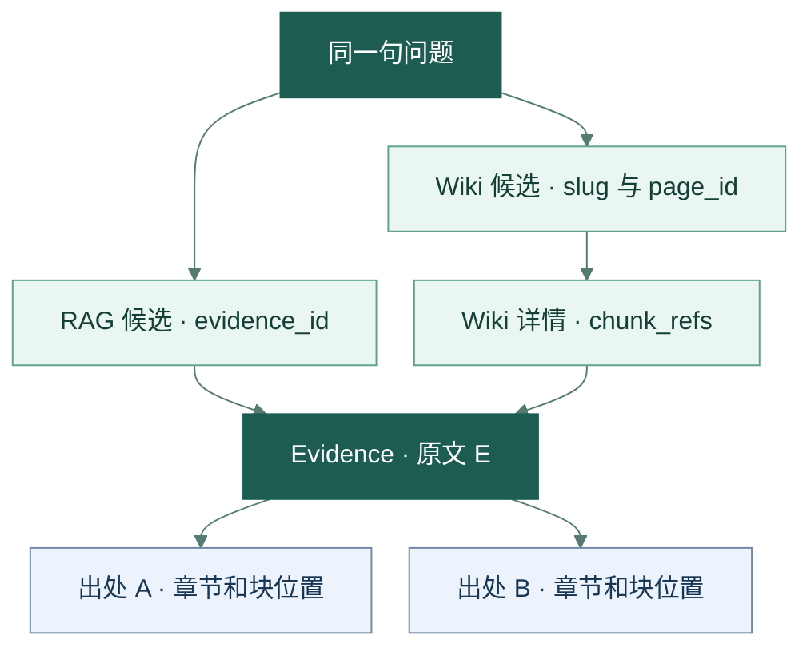

# 05-D · 查 Wiki、比较三种模式并回溯

现在有两份可查的数据：源证据与已发布的主题页。它们都能回答关于 Python 的问题，返回的编号却指向不同对象。本课写 Wiki 查询，观察三种模式，最后从一个 Wiki 命中追回林澈的原句和两个文件位置。 [第四章目录](./README.md)

## 先认识查询时选择与页面检索

**导入**形成可以查询的 Evidence；**编译**形成 WikiPage。完成后，调用者可以在每一次对话请求里改变 `mode`。工作台切换知识模式后会把值交给第三章见过的 `sendChat`。后端 `backend/app/services/knowledge.py` 的 `search_knowledge` 据此选择用哪个入口查资料。 [工作台的请求](../../frontend/lib/api.ts#L475-L489) · [模式分支](../../backend/app/services/knowledge.py#L35-L83)

打开 `backend/app/wiki/search.py`，从 `search_wiki_pages` 往下读。它用 SQL 查**当前用户已发布的 Wiki 页**，把「标题 + 正文」交给 04-A 的 `hybrid_search`。评分函数仍用熟悉的 `evidence_id` 键传回命中对象的 ID，但在这次调用里，它对应的是**页面的 ID**。因此 Wiki 查询还要用它找到原页面，包装成带 `page_id`、`slug` 与引用列表的响应。 [Wiki 查询实现](../../backend/app/wiki/search.py#L17-L63)



## 跟写 Wiki 分支

```bash
python tutorials/04-knowledge-base/lab/kb_practice.py open wiki-query
```

打开 `.cache/knowledge-practice/backend/app/wiki/search.py`。先写 `_wiki_hit`，把 ID、slug、标题、摘录和两组引用打包，`source_kind` 填 `wiki`。调用者可以据此找到本次命中的种类。两个引用字段从原对象转成列表。

再写 `search_wiki_pages`：

1. 一条 `select(WikiPage)` 同时用 `user_id` 与 `status=="published"` 限制行。若第一页都没有，返回空数组。
2. 把每行投影成评分器认识的字段，尤其是 `"id": page.id` 与 `"content": f"{page.title}\n{page.content}"`。标题中的词也会为匹配贡献分数。
3. 逐条读取评分返回的 `item["evidence_id"]`，用页面字典找回实际页面，调用 `_wiki_hit`。例如只命中页 P 时，外部响应应该给 `page_id=P`。从 P 读取的 `chunk_refs=[E,S]` 仍然是证据编号。

<details>
<summary>核对 _wiki_hit 和 search_wiki_pages</summary>

```python
def _wiki_hit(page: WikiPage, score: float, snippet: str) -> dict:
    return {
        "page_id": page.id,
        "slug": page.slug,
        "title": page.title,
        "content": snippet,
        "score": round(score, 4),
        "chunk_refs": list(page.chunk_refs),
        "source_refs": list(page.source_refs),
        "source_kind": "wiki",
        "retrieval_method": "wiki_page_hybrid",
    }


async def search_wiki_pages(
    session: AsyncSession, *, user_id: str, query: str, limit: int = 5
) -> list[dict]:
    pages = list(
        await session.scalars(
            select(WikiPage).where(
                WikiPage.user_id == user_id,
                WikiPage.status == "published",
            )
        )
    )
    if not pages:
        return []

    # Feed page bodies through the same local hybrid scorer used for evidence.
    scored = hybrid_search(
        query,
        [
            {
                "id": page.id,
                "content": f"{page.title}\n{page.content}",
                "source_type": "wiki_page",
                "source_name": page.slug,
            }
            for page in pages
        ],
        limit=limit,
    )
    by_id = {page.id: page for page in pages}
    hits: list[dict] = []
    for item in scored:
        page = by_id.get(item["evidence_id"])
        if page is None:
            continue
        hits.append(_wiki_hit(page, item["score"], item["content"]))
    return hits
```

</details>

```bash
python tutorials/04-knowledge-base/lab/kb_practice.py check wiki-query
```

现有测试会为一个用户编页，按三种模式查回，检查种类和引用字段。返回混合结果时，`search_knowledge` 用 `zip_longest(rag_hits, wiki_hits)` 按位置配对，按 R1、W1、R2、W2 的顺序放进一个列表，空位跳过，最后截断。比如两路分别是 `[R1,R2,R3]` 与 `[W1]`，限制 3 条，就看到 `[R1,W1,R2]`。原文与页面各自保持身份，诊断里的 `knowledge_fusion=rank_interleave` 记录了这一步。 [模式切换测试](../../backend/tests/test_knowledge_mode.py#L31-L160) · [交错实现](../../backend/app/services/knowledge.py#L60-L83)

## 用同一句话跑三种查询模式

先在项目根跑所有第四章关卡，预期 `54 passed`。若练习 API 还开着，在服务终端按 Ctrl+C，再用之前记下的 `serve` 命令启动。数据继续使用原本的 SQLite 文件。自选过练习副本或端口时，沿用原命令的选项。 [启动练习 API](./README.md#启动练习-api)

```bash
python tutorials/04-knowledge-base/lab/kb_practice.py check all
python tutorials/04-knowledge-base/lab/kb_practice.py serve
```

确认已经按 03-A 上传 A 和 B，并记下第 05-C 课最后的 slug 和 `user_id`。先在第四章服务端口的 Swagger 调 `POST /api/v1/profiles/{user_id}/rebuild`，用这个账号建一遍画像。然后对 `POST /api/v1/chat` 发以下请求，使用实际账号，只改 `mode`，依次跑 `rag`、`wiki` 与 `hybrid`。省略会话编号可以让每次问题用一组新的对话上下文。

```json
{
  "user_id": "kb-study",
  "message": "我做过哪些 Python 项目？",
  "mode": "rag"
}
```

| 模式 | 你要核对的字段 | 怎么回查 |
| --- | --- | --- |
| `rag` | `retrieval.mode=rag`，`wiki_count=0`，数组里有 `source_kind=rag` | 用 E 的 `evidence_id` 查 `GET /api/v1/evidence/{evidence_id}` |
| `wiki` | `retrieval.mode=wiki`，`rag_count=0`，命中 `source_kind=wiki` | 用 `slug` 查 `GET /api/v1/wiki/{slug}`，再取 `chunk_refs` |
| `hybrid` | `retrieval.knowledge_fusion=rank_interleave`，同时出现 `rag` 和 `wiki` | 各选一条。两个不同的入口都能追回 E |

RAG 的后端诊断中可以看到 `fusion=weighted_score`。Wiki 查询只执行主题页评分，因此 `retrieval` 里主要看 `mode`、两路数量和 `source_kinds`。默认 Demo 的答复文字会随意图而不同，实验以顶层 `evidence` 和实际原文作为记录。空 Wiki 先用 `GET /api/v1/wiki` 核对是否已为当前账号编页，再看页标题和正文里的查询词。忘了建画像时，聊天会先返回 422 和 `Build the user profile before chatting`。

如果命中了多张页，用记下的 slug 选本次完成版本实验的那张。排在截断范围外时，可直接用相同 slug 和 `user_id` 查详情。从页面的 `chunk_refs` 拿出 E，在证据详情或数据导出中写下这三个值：

1. `content` 中明确说了哪些事实。
2. `source_metadata.sources` 中两个文件各自的 `doc_id` 和 `section_path`，以及正文的 `block_index`。
3. 当前页面的 `version`。它在第 05-C 课核对过恢复与冲突。

只用浏览器阅读时，写出「Wiki slug → E → D-A、D-B」、以及从证据能得出的最强结论。练过 API 的读者可以再录一次相同请求的三张响应，展示怎样从三种答案的候选路径回到同一句「只在本机演示」。

## 选做：观察材料撤回后的结果

在新建的教学账号中另导入一条合成证据，并只用它创建一张临时 Wiki 页。用 `DELETE /api/v1/evidence/{evidence_id}` 删除这条合成证据。响应的 `removed_wiki_pages` 应为 1。再查那张页应得到 404。用原账号的 `kb-study` 继续读主线案例。

打开 `backend/app/services/privacy.py` 的 `delete_evidence_record`。它清理当前仍引用该资料的页面和相关快照，还会处理旧历史中单独引用该材料的版本。索引更新则提交一条删除待办。`test_wiki_revisions_restore_citations_and_delete_obsolete_sources` 检查当前页还可用或需要移除的两种情况。 [删除后清理来源](../../backend/app/services/privacy.py#L290-L395) · [历史引用清理测试](../../backend/tests/test_knowledge_mode.py#L165-L202)

## 下一步

带着页面 `slug`、生成时的证据 ID 和这次复查记录，去 [06 后台运行时](../06-后台运行时.md)。那一章会继续从工作台的 `wiki_compile` 和 Run ID 看 Worker 怎样领取、核验和提交任务。
