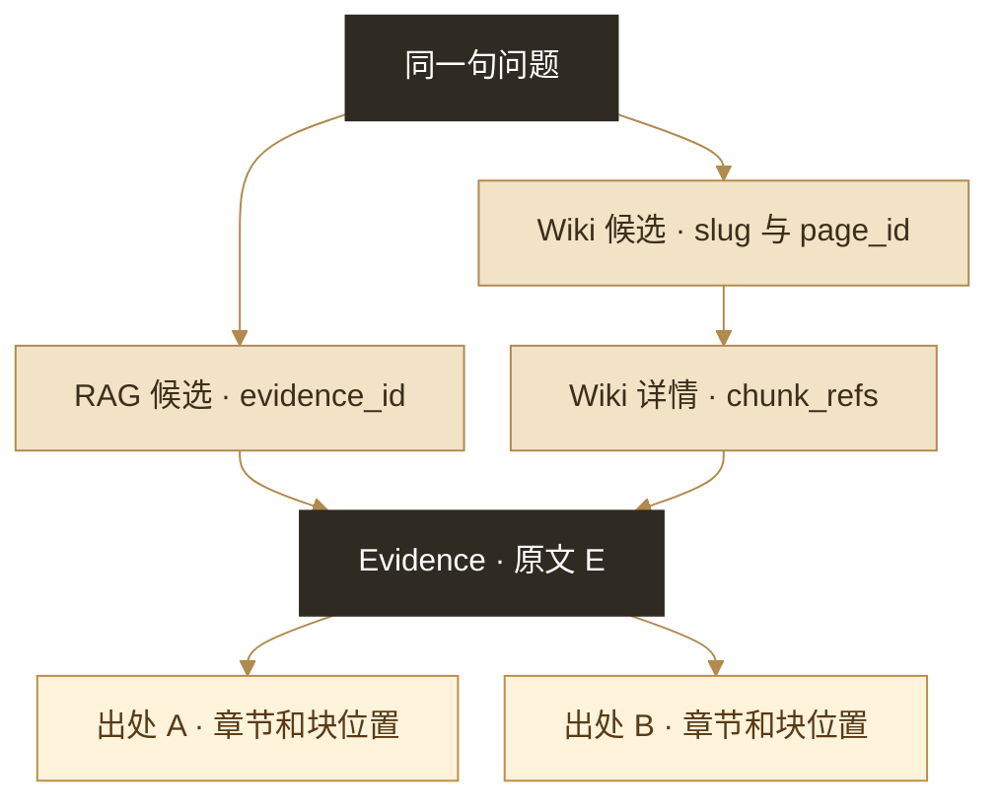

# 05-D · 查 Wiki、比较三种模式并回溯

现在有两份可查的数据：源证据与已发布的主题页。它们都能回答关于 Python 的问题，返回的编号却指向不同对象。本课写 Wiki 查询，观察三种模式，最后从一个 Wiki 命中追回林澈的原句和两个文件位置。这是第四章的综合验收关——前面六关写的判重、评分、编译、守卫、版本，都在这里被串成一条完整的查询与回溯路线。 [第四章目录](./README.md)

## 为什么要写这一关

前面几关一直在「建」：导入证据、编译 Wiki、保护表格、管理版本。用户真正关心的是「问一句话，能不能得到可追溯的答案」。这一关补上查询侧的最后一环，并回答一个容易混淆的问题：

**RAG 命中和 Wiki 命中都带一个 `evidence_id` 字段，它们一样吗？**

不一样。RAG 命中里的 `evidence_id` 真是证据 ID；Wiki 命中是**借了同一个评分函数的字段名**来传页面 ID。如果不在包装层把它翻译成 `page_id` 和 `slug`，上层就会拿一个页面 ID 去查证据详情，得到 404。这一关的核心就是把这个「借字段」的错位纠正过来，并让三种查询模式的结果能和平共处。

## 一张地图：两种产物，两条回查路



两条路最后**汇合到同一个 E**：RAG 直接拿到 E，Wiki 要先拿页面再读 `chunk_refs` 才能到 E，然后从 E 的 `source_metadata.sources` 追到两个 DOCX。这就是为什么三种模式虽然答案路径不同，最终都能回到同一句「只在本机演示」。

## 第 1 块：构建时定型，查询时切换

**导入**形成可以查询的 Evidence；**编译**形成 WikiPage。两者都在构建时完成，但调用者可以在每次对话请求里改变 `mode`。工作台切换知识模式后会把值交给第三章见过的 `sendChat`。后端 `backend/app/services/knowledge.py` 的 `search_knowledge` 据此选择用哪个入口查资料。 [工作台的请求](../../frontend/lib/api.ts#L475-L489) · [模式分支](../../backend/app/services/knowledge.py#L35-L83)

```python
VALID_MODES = ("rag", "wiki", "hybrid")
```

三种模式：

- `rag`：只查原始证据。
- `wiki`：只查编译后的主题页。
- `hybrid`：两路都查，交错合并。

**为什么模式放在查询时而不是构建时？** 因为两种产物可以同时存在，没有互斥关系。导入证据不妨碍编译 Wiki，编译 Wiki 也不需要丢弃证据。让用户每次问话时选模式，比要求「建库前先决定用哪种」灵活得多。源码注释把这点说得很清楚：no rebuild、no dual build-state。

## 第 2 块：Wiki 查询复用评分函数，但要纠字段错位

打开 `backend/app/wiki/search.py`，从 `search_wiki_pages` 往下读。它用 SQL 查**当前用户已发布的 Wiki 页**，把「标题 + 正文」交给 04-A 的 `hybrid_search`。

```python
pages = list(
    await session.scalars(
        select(WikiPage).where(
            WikiPage.user_id == user_id,
            WikiPage.status == "published",
        )
    )
)
if not pages:
    return []

scored = hybrid_search(
    query,
    [
        {
            "id": page.id,
            "content": f"{page.title}\n{page.content}",
            "source_type": "wiki_page",
            "source_name": page.slug,
        }
        for page in pages
    ],
    limit=limit,
)
```

三个设计点：

1. **`status == "published"`**：只查已发布页，草稿和归档页不出现在回答里。这是构建时的状态字段在查询时起作用。
2. **`content = f"{page.title}\n{page.content}"`**：标题也参与评分。用户问「Python 与 Docker」，页面光标题就命中了，即使正文用词不同。把标题拼进正文是最省事的做法，不用改评分函数。
3. **复用同一个 `hybrid_search`**：不建第二套评分逻辑，也不需要第二个 Qdrant 集合——一页文本不大，证据链接已经是稳定 ID。这是代码复用的直接收益：04-A 写的函数在这里原样再用一次。

**字段错位就在这里发生**：`hybrid_search` 固定从记录的 `"id"` 取值，输出键叫 `evidence_id`。我们喂给它的 `"id": page.id` 是**页面 ID**。所以评分返回的 `item["evidence_id"]` 实际是页面 ID。代码不能把它当证据 ID 用，必须先用它找回页面对象：

```python
by_id = {page.id: page for page in pages}
hits: list[dict] = []
for item in scored:
    page = by_id.get(item["evidence_id"])
    if page is None:
        continue
    hits.append(_wiki_hit(page, item["score"], item["content"]))
```

`by_id` 用页面 ID 建索引，`item["evidence_id"]`（其实是页面 ID）查回真实页面，再交给 `_wiki_hit` 包装成带 `page_id`、`slug` 与两组引用的响应。**这就是本次跟写最需要理解的一行**：字段名是借来的，语义在包装层被纠正。 [Wiki 查询实现](../../backend/app/wiki/search.py#L17-L63)

## 跟写 Wiki 分支

```bash
python tutorials/04-knowledge-base/lab/kb_practice.py open wiki-query
```

打开 `.cache/knowledge-practice/backend/app/wiki/search.py`。先写 `_wiki_hit`，把 ID、slug、标题、摘录和两组引用打包，`source_kind` 填 `wiki`。调用者可以据此找到本次命中的种类。两个引用字段从原对象转成列表（`list(...)`，避免共享可变对象）。

再写 `search_wiki_pages`：

1. 一条 `select(WikiPage)` 同时用 `user_id` 与 `status=="published"` 限制行。若第一页都没有，返回空数组。
2. 把每行投影成评分器认识的字段，尤其是 `"id": page.id` 与 `"content": f"{page.title}\n{page.content}"`。标题中的词也会为匹配贡献分数。
3. 逐条读取评分返回的 `item["evidence_id"]`，用页面字典找回实际页面，调用 `_wiki_hit`。例如只命中页 P 时，外部响应应该给 `page_id=P`。从 P 读取的 `chunk_refs=[E,S]` 仍然是证据编号。

<details>
<summary>核对 _wiki_hit 和 search_wiki_pages</summary>

```python
def _wiki_hit(page: WikiPage, score: float, snippet: str) -> dict:
    return {
        "page_id": page.id,
        "slug": page.slug,
        "title": page.title,
        "content": snippet,
        "score": round(score, 4),
        "chunk_refs": list(page.chunk_refs),
        "source_refs": list(page.source_refs),
        "source_kind": "wiki",
        "retrieval_method": "wiki_page_hybrid",
    }


async def search_wiki_pages(
    session: AsyncSession, *, user_id: str, query: str, limit: int = 5
) -> list[dict]:
    pages = list(
        await session.scalars(
            select(WikiPage).where(
                WikiPage.user_id == user_id,
                WikiPage.status == "published",
            )
        )
    )
    if not pages:
        return []

    # Feed page bodies through the same local hybrid scorer used for evidence.
    scored = hybrid_search(
        query,
        [
            {
                "id": page.id,
                "content": f"{page.title}\n{page.content}",
                "source_type": "wiki_page",
                "source_name": page.slug,
            }
            for page in pages
        ],
        limit=limit,
    )
    by_id = {page.id: page for page in pages}
    hits: list[dict] = []
    for item in scored:
        page = by_id.get(item["evidence_id"])
        if page is None:
            continue
        hits.append(_wiki_hit(page, item["score"], item["content"]))
    return hits
```

</details>

`retrieval_method="wiki_page_hybrid"` 是给诊断看的——和上节课本地证据的 `local_dense_sparse_fallback` 区分开。上层看到这个值就知道命中来自 Wiki 页评分，而不是证据检索。

```bash
python tutorials/04-knowledge-base/lab/kb_practice.py check wiki-query
```

### 失败反推

| check 现象 | 最可能漏了 |
| --- | --- |
| Wiki 命中里没有 `page_id` | `_wiki_hit` 没从页面对象取 `page.id` |
| 拿命中 ID 去查证据 404 | 把 `evidence_id` 当真证据 ID 了，忘了 `by_id` 纠偏 |
| 草稿页也出现在结果里 | `select` 漏了 `status == "published"` |
| 页面标题里的词搜不到 | `content` 没拼上 `page.title` |
| 跨用户查到别人的页 | `select` 漏了 `user_id` 限制 |

## 第 3 块：hybrid 模式的名次交错

现有测试会为一个用户编页，按三种模式查回，检查种类和引用字段。返回混合结果时，`search_knowledge` 用 `zip_longest(rag_hits, wiki_hits)` 按位置配对：

```python
hits = [
    hit for pair in zip_longest(rag_hits, wiki_hits) for hit in pair if hit is not None
][:limit]
```

按 R1、W1、R2、W2 的顺序放进一个列表，空位跳过，最后截断。比如两路分别是 `[R1,R2,R3]` 与 `[W1]`，限制 3 条，就看到 `[R1,W1,R2]`。

**为什么要交错而不是简单拼接？** 直接 `rag_hits + wiki_hits` 会让所有 RAG 结果排在前面，Wiki 结果全被挤到后面——如果限制 5 条、RAG 就有 5 条，Wiki 一条都看不到。交错保证两路都有露出的机会，用户能在同一屏看到「原始证据」和「编译页」两种答案。诊断里的 `knowledge_fusion=rank_interleave` 记录了这一步。 [模式切换测试](../../backend/tests/test_knowledge_mode.py#L31-L160) · [交错实现](../../backend/app/services/knowledge.py#L60-L83)

`zip_longest` 而不是 `zip` 是关键：`zip` 遇到较短的那路就停，长路后面的结果全丢；`zip_longest` 用 `None` 补齐空位，再被 `if hit is not None` 过滤掉。诊断字段 `rag_count`、`wiki_count`、`source_kinds` 让上层知道这次各路贡献了多少。

**注意这不是 RRF。** 第四、第一章讲过的 RRF 是**按名次算融合分数重新排序**；这里的 `rank_interleave` 只是**按位置轮流取**，不比较分数、不重排。两种机制目的不同：RRF 用于「同一路内部多召回源的融合」，交错用于「两种不同产物在展示层的公平露出」。别把 `knowledge_fusion=rank_interleave` 误读成「做了排名融合」。

## 用同一句话跑三种查询模式

先在项目根跑所有第四章关卡，预期 `54 passed`。若练习 API 还开着，在服务终端按 Ctrl+C，再用之前记下的 `serve` 命令启动。数据继续使用原本的 SQLite 文件。自选过练习副本或端口时，沿用原命令的选项。 [启动练习 API](./README.md#启动练习-api)

```bash
python tutorials/04-knowledge-base/lab/kb_practice.py check all
python tutorials/04-knowledge-base/lab/kb_practice.py serve
```

确认已经按 03-A 上传 A 和 B，并记下第 05-C 课最后的 slug 和 `user_id`。先在第四章服务端口的 Swagger 调 `POST /api/v1/profiles/{user_id}/rebuild`，用这个账号建一遍画像。然后对 `POST /api/v1/chat` 发以下请求，使用实际账号，只改 `mode`，依次跑 `rag`、`wiki` 与 `hybrid`。省略会话编号可以让每次问题用一组新的对话上下文。

```json
{
  "user_id": "kb-study",
  "message": "我做过哪些 Python 项目？",
  "mode": "rag"
}
```

| 模式 | 你要核对的字段 | 怎么回查 |
| --- | --- | --- |
| `rag` | `retrieval.mode=rag`，`wiki_count=0`，数组里有 `source_kind=rag` | 用 E 的 `evidence_id` 查 `GET /api/v1/evidence/{evidence_id}` |
| `wiki` | `retrieval.mode=wiki`，`rag_count=0`，命中 `source_kind=wiki` | 用 `slug` 查 `GET /api/v1/wiki/{slug}`，再取 `chunk_refs` |
| `hybrid` | `retrieval.knowledge_fusion=rank_interleave`，同时出现 `rag` 和 `wiki` | 各选一条。两个不同的入口都能追回 E |

RAG 的后端诊断中可以看到 `fusion=weighted_score`——那是 04-A 本地路的输出，和这里的 `knowledge_fusion` 是两个不同层级的字段。Wiki 查询只执行主题页评分，因此 `retrieval` 里主要看 `mode`、两路数量和 `source_kinds`。默认 Demo 的答复文字会随意图而不同，实验以顶层 `evidence` 和实际原文作为记录。空 Wiki 先用 `GET /api/v1/wiki` 核对是否已为当前账号编页，再看页标题和正文里的查询词。忘了建画像时，聊天会先返回 422 和 `Build the user profile before chatting`——这是第三章见过的门槛，不会因为是第四章就跳过。

### 综合回溯：从 Wiki 命中回到两个文件

如果命中了多张页，用记下的 slug 选本次完成版本实验的那张。排在截断范围外时，可直接用相同 slug 和 `user_id` 查详情。从页面的 `chunk_refs` 拿出 E，在证据详情或数据导出中写下这三个值：

1. `content` 中明确说了哪些事——这里应能看到「只在本机演示」，**不是**「已上线」。这是整章要守住的事实底线。
2. `source_metadata.sources` 中两个文件各自的 `doc_id` 和 `section_path`，以及正文的 `block_index`——这就是 03-A 合并的两个出处，现在派上用场了。
3. 当前页面的 `version`——它在 05-C 课核对过恢复与冲突，说明这页经历过的改动。

只用浏览器阅读时，写出「Wiki slug → E → D-A、D-B」、以及从证据能得出的最强结论。练过 API 的读者可以再录一次相同请求的三张响应，展示怎样从三种答案的候选路径回到同一句「只在本机演示」。

**这条链把六关串起来了**：03-A 让 E 记住两个出处 → 04-A 让 E 能被检索命中 → 05-A 把 E 编译进 Wiki 页的 `chunk_refs` → 05-B 保证编译时表格没丢行 → 05-C 保证页面改动可追溯 → 本关把 Wiki 命中翻译回页面、再沿 `chunk_refs` 回到 E 和两个文件。少任何一环，最后这一步都走不通。

## 选做：观察材料撤回后的结果

在新建的教学账号中另导入一条合成证据，并只用它创建一张临时 Wiki 页。用 `DELETE /api/v1/evidence/{evidence_id}` 删除这条合成证据。响应的 `removed_wiki_pages` 应为 1。再查那张页应得到 404。用原账号的 `kb-study` 继续读主线案例。

打开 `backend/app/services/privacy.py` 的 `delete_evidence_record`。它清理当前仍引用该资料的页面和相关快照，还会处理旧历史中单独引用该材料的版本。索引更新则提交一条删除待办。`test_wiki_revisions_restore_citations_and_delete_obsolete_sources` 检查当前页还可用或需要移除的两种情况。 [删除后清理来源](../../backend/app/services/privacy.py#L290-L395) · [历史引用清理测试](../../backend/tests/test_knowledge_mode.py#L165-L202)

这个选做和 05-C 的回滚校验是同一条原则的两面：**页面不能引用不存在的证据**。回滚时检查旧快照的引用还在不在，删除证据时清理引用它的页面——都在守护「每条结论都能回到真实原文」这条底线。

## 这些概念在 CareerLens 里落在哪

| 本课的词 | 源码位置 | 作用 |
| --- | --- | --- |
| `search_wiki_pages` | `backend/app/wiki/search.py` | 已发布页的文本检索，复用证据评分函数 |
| `_wiki_hit` | `backend/app/wiki/search.py` | 把页面 ID 从借来的字段里纠正出来 |
| `search_knowledge` | `backend/app/services/knowledge.py` | 三模式分支与名次交错 |
| `rank_interleave` | `backend/app/services/knowledge.py` | 展示层公平露出，不是 RRF 融合 |
| `delete_evidence_record` | `backend/app/services/privacy.py` | 材料撤回时清理引用它的页面与快照 |

## 下一步

带着页面 `slug`、生成时的证据 ID 和这次复查记录，去 [06 后台运行时](../06-后台运行时.md)。那一章会继续从工作台的 `wiki_compile` 和 Run ID 看 Worker 怎样领取、核验和提交任务——也就是把本章你在前台 Swagger 里一步步做的事，放到后台自动化执行。
