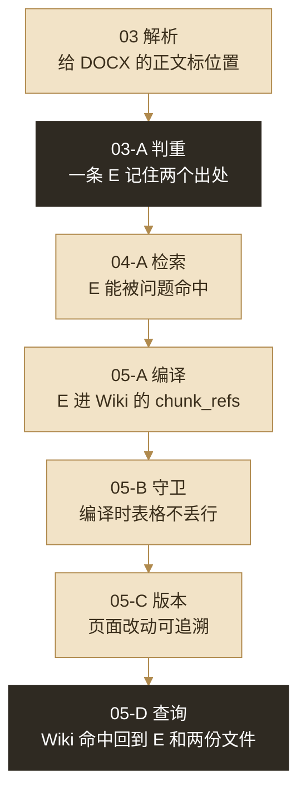

# 4. 读数据与知识库

林澈在两份文档里写了同一句话：「我用 Python 做过一个课程项目，只在本机演示。」他还整理了一张记录 Docker 启动和健康检查的表。用这三份材料一路追下去，你会写出 CareerLens 的文档解析、证据去重、本地检索和 Wiki 编译关键部分，最后亲手从 Wiki 找回原句和两个文件位置。

这一章围绕一个问题展开。林澈上传两份文件之后，系统怎样把一句话变成有出处的结论？带敲练习从 `backend/` 的原有实现选出函数，写完就用仓库里的测试核对。一个贯穿始终的问题：**一份材料从文件变成可追溯的结论，中间到底经过哪些处理，每一步为什么不能省？** 你写的每个函数都对着 `backend/` 里的真实源码，不是玩具示例。

## 课程地图

| 课程 | 做完能验证什么 |
| --- | --- |
| [02 同一段经历为什么有好几个 ID](../02-数据模型.md) | 从一条画像走到同一证据的两个出处，分清文件、块、证据和 Wiki 页 |
| [03 让 DOCX 变成带位置的块](../03-解析层.md) | 跟写文档解析，先读出标题，再给正文和表格标章节 |
| [03-A 写证据去重与来源合并](03-A-去重与来源.md) | 用 A、B、A 三次上传验证两级去重，再用另一个账号做对照 |
| [04 手算检索排名并核对证据](../04-检索Agent.md) | 手算两张榜单怎样融合，判断榜首证据能支持哪句话 |
| [04-A 写本地检索与索引回查](04-A-检索源码与诊断.md) | 从词频和余弦写到候选排序，实测索引返回的 ID 怎样回查数据库 |
| [05 编译第一张 Wiki 主题页](../05-Wiki知识组织.md) | 从两条原始证据编译一页，读懂 `source_refs`、`chunk_refs` 和版本 |
| [05-A 写短句柄与编译流程](05-A-Wiki编译与引用.md) | 把模型返回的 `c000` 翻译回真实证据 ID，观察未知值和回退 |
| [05-B 写表格行保护](05-B-表格行保护.md) | 计算重复行损失，测试同步编译怎样拒绝丢行 |
| [05-C 写版本、冲突和回滚](05-C-Wiki版本与回滚.md) | 写旧版快照和条件更新，复现同时编辑时的 409，恢复旧内容 |
| [05-D 查 Wiki、比较三种模式并回溯](05-D-Wiki查询与综合验收.md) | 写 Wiki 查询，比较 `rag`、`wiki`、`hybrid`，走完整条查询和回溯路线 |

先用 02、03、04、05 四节主课走一遍材料链，再在 03-A、04-A、05-A～05-D 六节源码课里补写相应环节。每个带敲关卡都给出预测用的输入、练习文件、完整实现和失败提示。第 03 课也带敲 DOCX 解析，因此动手路线一共七关。

## 从解析到回查



顺着箭头走，同一个证据编号 E 会被反复用到。每做完一关，记下这一步新增了哪个能查询的字段，最后用它回到 Wiki、证据正文或原文件。

## 选一种读法

**只用浏览器。** 看各课的例子、概念地图和可展开源码，先做 ID、排名、重复行和版本的预测，再对照结果。第一课会画出资料经过的每一张表。每篇都附了失败反推表：看到某个测试结果，先猜是哪一步漏了，再去核对代码。

**亲手敲。** 从仓库根执行命令，沿用第三章已装好 `backend[dev]` 的 Python。新建的知识库副本在 `.cache/knowledge-practice/backend`，默认端口 **8031**，账号 **`kb-study`**。各课共用这一份本地 SQLite，原来 8030 的证据 ID 可以留在记录中，这里会从两份 DOCX 取得新编号。 [两种练习环境](../setup/动手准备.md#核对环境与编号)

## 第一次打开练习

在包含 `backend` 和 `tutorials` 的项目根运行下面两条命令。`new` 会打印练习目录，`check parse` 先检查原始实现和环境，预期看到 `12 passed`。

```bash
python tutorials/04-knowledge-base/lab/kb_practice.py new
python tutorials/04-knowledge-base/lab/kb_practice.py check parse
```

每到一关才执行它的 `open` 命令。按打印的路径打开文件，保留函数签名，用注释提示一段段实现，最后移除会主动抛错的 `raise NotImplementedError`。每节先用一组具体输入讲清该留下哪些值，再给完整实现供核对。`check` 使用仓库现有测试。重复打开同一关可以继续上次的内容。 [练习启动器](lab/kb_practice.py)

已存在一份第四章练习时可继续用它。需要另开一份时，在启动器路径后、`new` 前传 `--workspace .cache/knowledge-practice-2`。后续的 `open`、`check`、`serve` 与 `worker` 都在子命令前传回同一个路径。

### 七关与对应的练习

| 关卡 | open 命令 | 你要写的函数 |
| --- | --- | --- |
| parse | `open parse` | `_docx_blocks`——解析 DOCX 段落与表格 |
| sources | `open sources` | `content_fingerprint`、`_append_source` |
| retrieve | `open retrieve` | `_cosine`、`hybrid_search`、`search_evidence` |
| handles | `open handles` | `HandleTable.register/resolve`、`resolve_citations`、`prepare_page` |
| guard | `open guard` | `table_row_identities`、`row_identity_loss_ratio`、`assert_rows_preserved` |
| versions | `open versions` | `_snapshot`、`update_page` |
| wiki-query | `open wiki-query` | `_wiki_hit`、`search_wiki_pages` |

其中 `parse` 对应主教程 [03 解析层](../03-解析层.md)，其余六关对应本章六篇带敲课。可以只 `check` 不 `open`——练习副本是完整可运行的实现，`check` 会直接跑它。打开某一关只是把函数体换成 TODO，让你自己重写。

## 启动练习 API

到 03-A 第一次上传材料时，另开一个服务终端，切到项目根并使用同一个虚拟环境。默认启动命令如下。保持它运行，原终端继续用来执行 `open` 和 `check`。

```bash
python tutorials/04-knowledge-base/lab/kb_practice.py serve
```

打开 [8031 的进程检查](http://127.0.0.1:8031/health/live)，看到 `status: ok` 后再进入 [知识库 Swagger](http://127.0.0.1:8031/docs)。想运行另一份知识库练习时，为副本选另一个端口，例如：

```bash
python tutorials/04-knowledge-base/lab/kb_practice.py --workspace .cache/knowledge-practice-2 serve --port 8033
```

记下完整命令和实际端口。下面的链接示范默认 8031，自选端口时修改浏览器地址。换课时保留同一份 SQLite。涉及重启的步骤先在服务终端按 Ctrl+C，再执行原启动命令。

做完 Demo 想试着用模型重写 Wiki 时，可以按第三章的设置填写本章副本的 `backend/.env.model`，在原 `serve` 命令末尾加 `--use-model-config`。 [模型配置课](../01-agent-design/模型配置.md)

## 验收路径

按顺序做完这些，你就完整走通了第四章：

1. `check all` 看到 `54 passed` —— 七关的实现全部通过仓库现有测试。
2. 03-A 用 A、B、A 三次上传，看到共同正文始终是同一个 E，`source_count` 到 2 后不再涨。
3. 04-A 查询 `Python`，看到 `backend=local`、`fusion=local_lexical_rrf_v1`，命中项带真实 `evidence_id`。
4. 05 编译出一页 Wiki，记下 slug；05-A 观察 `c000` 怎样翻译回 E。
5. 05-B 亲手造一条丢行的候选，看到 `DroppedTableRowsError` 和 33% 的损失比例。
6. 05-C 复现 201 → 409 → 恢复成版本 3 的完整序列。
7. 05-D 用同一句话跑 `rag`、`wiki`、`hybrid` 三种模式，从 Wiki 命中追回「只在本机演示」和两个文件位置。

从 [02 数据模型](../02-数据模型.md) 开始。先在纸上写下 D-A、D-B 和 E，后面会把它们换成接口给出的真实 ID。
