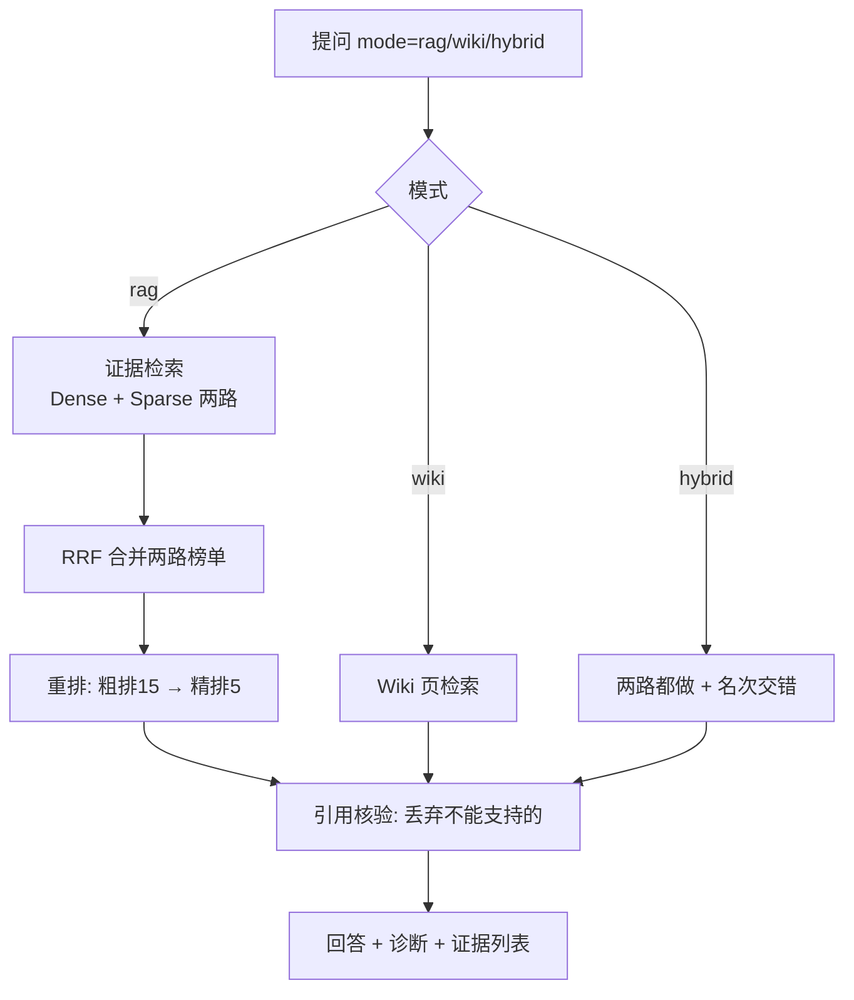

# 04 · 检索 Agent：从证据到有依据的回答

**成果**：你能用同一个问题比较三种检索模式，追到一条原始证据；能解释关键词、向量、融合、重排各自解决什么；能说明为什么一条「看着相关」的候选应该舍弃。

**前置**：[00-3](00-foundations/00-3-rag-and-vector.md)（检索大白话）、[03](03-parsing.md)（证据怎么来）。工作台里要有证据和一条 Wiki 页（准备步骤见下）。

**对应版本**：接口按当前 `main` 核对。

**对应源码**：`backend/app/services/knowledge.py`、`backend/app/retrieval/`、`backend/app/graph/career.py`、`backend/app/api/routes/chat.py`。

---

## 先准备：让工作台上既有证据也有 Wiki

三种模式里，`wiki` 和 `hybrid` 需要至少一页编译好的 Wiki。跳读这一节会导致「切到 wiki 却是空结果」却不知原因。

1. 按 [01](01-quickstart.md) 导入合成资料并生成画像。
2. 在工作台证据区勾选几条证据，点「编译 Wiki」，等任务成功；或走后台 run（`POST /api/v1/runs`，`operation: "wiki_compile"`）。
3. 确认 `GET /api/v1/wiki?user_id=learner` 至少返回一页。详见 [05](05-wiki.md)。

## 图解：一次提问走过哪些环节

<details>
<summary>一张图（文字版在下面）</summary>



**文字版**：提问带一个 `mode`。`rag` 走证据检索：Dense（语义）和 Sparse（关键词）两路召回，用 RRF 合并，再两级重排；`wiki` 走 Wiki 页检索；`hybrid` 两路都做并按名次交错。所有命中都要经过引用核验，才进入回答。回答同时给出检索诊断和证据列表。

</details>

## 四个环节各解决什么

| 环节 | 解决什么 | 怎么理解 |
| --- | --- | --- |
| Dense 检索 | 换个说法也能找到 | 文字变坐标，找意思接近的 |
| Sparse 检索 | 精确命中关键词 | 字面匹配，补语义的漏 |
| RRF 融合 | 合并两张榜单 | 两路各自排名，按名次融合成一张 |
| 重排 | 从「相关」里挑出「最该用的」 | 粗排先留 Top15，精排再收 Top5 |
| 引用核验 | 防止「相关但不支持」混进结论 | [00-3](00-foundations/00-3-rag-and-vector.md) 讲过：相关 ≠ 支持 |

默认配置下，Qdrant 可用时 RRF 由检索库服务端完成；Qdrant 不可用时降级到本地混合检索（加权融合），并在响应诊断里如实报告用了哪个 backend。重排默认单级；开启两级后，粗排 Top15、精排 Top5，两段分数分开处理避免量纲混用。

## 用真实接口观察三种模式

在 `http://localhost:8000/docs` 展开 `POST /api/v1/chat`，请求体：

```json
{
  "user_id": "learner",
  "message": "我适合什么 AI 岗位？有哪些证据？",
  "mode": "rag"
}
```

`mode` 是**请求体字段**（不是 URL 参数），取值 `rag` / `wiki` / `hybrid`，默认 `rag`。返回结构里重点看三处：

| 看哪里 | 是什么 |
| --- | --- |
| `answer` | 回答文本 |
| `evidence` | 命中的证据/页面数组；每条带 `source_kind`（`rag` 或 `wiki`） |
| `retrieval` | 诊断；`mode`、`rag_count`、`wiki_count`、`source_kinds` 等 |

**依次做三次**：把 `mode` 分别设为 `rag`、`wiki`、`hybrid`，比较：

1. `retrieval.mode` 是否跟着变；
2. `evidence[*].source_kind` 是 `rag` 还是 `wiki`；
3. `hybrid` 时是否出现 `retrieval.knowledge_fusion: "rank_interleave"`，`source_kinds` 是否同时含 `rag` 和 `wiki`。

> **一个诚实的细节**：`wiki` 模式不查证据检索器，所以它的 `retrieval` 里**没有** `backend` / `fusion` / `reranker` 这些键；只有 `rag` 和 `hybrid` 才有。别以为出了 bug——那正是「wiki 模式根本没走那条链路」的证据。

### 追到一条原始证据

从 `evidence` 数组里取一条 `source_kind: "rag"` 的命中，记下它的 `evidence_id`；再用 `GET /api/v1/evidence/{id}` 查原文。回答文本里的内联引用形如 `[Evidence: <id>]`，和这个数组对得上。

### 识别「相关但不支持」

`evidence` 里可能有一条分数不低、但并不能支持结论的命中（比如提到 Kubernetes 的收藏卡）。练习：指出它为什么该舍弃。

<details>
<summary>参考判断</summary>

一条命中「相关」只说明检索觉得它和问句接近；「支持」要求它真的能作为结论的依据。收藏了 Kubernetes 教程，无法支持「掌握 Kubernetes」——这跟 [00-2](00-foundations/00-2-prompt-and-evidence.md) 的规矩一致。系统的引用核验会把这类命中挡在最终结论之外。

</details>

## 自查清单

- [ ] 能用大白话解释 Dense、Sparse、RRF、重排各解决什么
- [ ] 同一问题切三种模式，能说出 `source_kind` 和诊断字段怎么变
- [ ] 能从 `evidence` 里的 `evidence_id` 追到原文
- [ ] 能说明为什么 `wiki` 模式的诊断里没有 `backend` / `reranker`
- [ ] 能指出一条「相关但不支持」的命中并说明该舍弃

## 常见坑

- **切 wiki 得到空结果**：没先编译 Wiki。回到开头「先准备」一节。
- **把 `mode` 放到 URL 上**：它是 JSON 请求体字段。
- **去 `retrieval.chunks` 找证据**：没有这个键；证据在顶层 `evidence` 数组。
- **把诊断里的分数当真实准确率**：那是检索排序分，不是能力评估。

## 下一步

证据能检索了，但散落的材料还需要被整理成可引用的主题页。[05 · Wiki 知识组织](05-wiki.md)讲这件事。术语见[术语表](GLOSSARY.md)。
