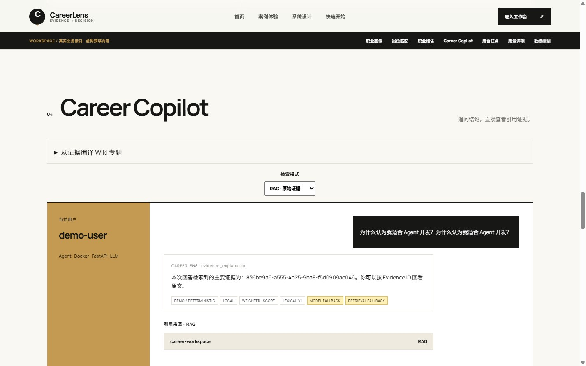

# 04 · 为什么这条证据排第一，却不能支持这句结论？

**副标题**：排名融合（RRF）、检索后端回退与引用校验的边界

**这一课你要交出什么**：一条你亲手算过、改过、能解释的融合排名；一张分清「检索候选 / 引用合法 / 事实支持」的对照表；以及一句「证据不足」的判断。做完你能回答：排第一的材料，凭什么不能拿来下结论。

**前置**：[00-2](00-foundations/00-2-prompt-and-evidence.md)（说得顺 ≠ 说得对）、[00-3](00-foundations/00-3-rag-and-vector.md)（检索大白话）。环节一、二只用浏览器和 Python 标准库，不装 Qdrant、不连服务；环节三可选本机观察，需要按 [01](01-quickstart.md) 先跑起服务、备好证据和 Wiki（见 [05](05-wiki.md)）。

**对应版本**：接口与源码按 `main` 当前提交核对，课内涉及的检索实现以 Qdrant `v1.15.4`（`docker-compose.yml` 锁定）为准。

---

这一课讨论的「排第一却不能支持结论」，在成品里就是 Copilot 的回答区：它先给出说法，再附上可展开的证据引用。你要学会的，正是判断这些引用到底能不能撑住那句话。



## 环节一 · 先猜：两张榜融合，谁第一？（浏览器即可）

先别看答案。假设同一个问题检索出两张榜，名次从 0 数：

```
榜单 A：A(第0名)  B(第1名)   C 缺席
榜单 B：C(第0名)  B(第1名)   A 缺席
```

融合规则是把每条证据在两张榜里的名次各算一次 `1/(k+名次)` 再加起来，缺席算 0。这里用**教学常数 `k=2`**（只为手算方便，不是服务里的真实值）。

**先写下你的答案**：A、B、C 各得多少分？谁排第一？只中一张榜的榜首，和两张榜都中但名次靠后的，谁分高？

<details>
<summary>点开核对</summary>

- B：两榜都第 1 名 → `1/(2+1) + 1/(2+1) = 1/3 + 1/3 = 2/3`
- A：只在 A 榜第 0 名 → `1/(2+0) + 0 = 1/2`
- C：只在 B 榜第 0 名 → `0 + 1/(2+0) = 1/2`
- **B 第一**（`0.667 > 0.5`）：两张榜都命中、哪怕都不是榜首，也会超过只中一榜的榜首。这就是排名融合（Reciprocal Rank Fusion, RRF）的核心直觉——它奖励「多路都认可」，而不是「某一路特别靠前」。

</details>

这是教学玩具榜单，不是真实用户数据或固定服务响应。真实 CareerLens 的融合由 Qdrant 服务端完成，源码里**没有显式指定 `k`**（`backend/app/retrieval/qdrant_store.py:107` 只传 `FusionQuery(fusion=Fusion.RRF)`）；Qdrant 1.15.4 的实现用零起始位置、内部默认常数。不同排名约定下常数不能直接套，别把这里的 `2/3` 当成服务分数。

## 环节二 · 做与改：写个小函数，改一个变量看结果

用 Python 标准库实现刚才的手算，然后**改一个变量**：把 B 从榜单 A 移除，重新算，看谁第一。再看一种完全不同的合并方式——按名次交错。

现成脚本：[lesson-05-rrf](../examples/tutorials/lesson-05-rrf/)（不用安装、不用连服务）。

```bash
python3 examples/tutorials/lesson-05-rrf/main.py
```

关键片段（`examples/tutorials/lesson-05-rrf/main.py`）：

```python
def rrf_score(rank, k=2):
    return 0.0 if rank is None else 1.0 / (k + rank)   # 名次从 0 数，缺席算 0

def fuse(*lists, k=2):
    scores = {}
    for ranking in lists:
        for rank, doc in enumerate(ranking):           # enumerate 从 0 开始
            scores[doc] = scores.get(doc, 0.0) + rrf_score(rank, k)
    return scores
```

**你先预测，再运行，再解释**：

| 改动 | 你预测谁第一 | 实际结果 | 为什么 |
| --- | --- | --- | --- |
| 原始两张榜 | （先填） | B（`2/3`） | 两榜都命中 |
| 把 B 从 A 榜移除 | （先填） | A、C 并列 `1/2`，B 掉到 `1/3` | B 只剩一榜命中，优势消失 |
| 改用名次交错 | （先填） | `['A','C','B']` | 交错按位置轮流取，不看分数 |

<details>
<summary>参考答案与提示</summary>

名次交错（`rank_interleave`）是 `hybrid` 模式合并 RAG 与 Wiki 两路的方式（`backend/app/services/knowledge.py:66-69`），它和 RRF 分数融合是**两件不同的事**——前者按名次轮流取，后者按倒数名次累加分。脚本里两种都算了，就是让你看清它们的依据不同。

想自己改：`LIST_A`、`LIST_B` 换成别的两张榜，`K` 改成别的数，重跑。观察「多路都命中」的文档是否总是占优。

</details>

## 环节三 · 接回真实实现：诊断里到底走了哪条链（可选，需本机服务）

手算懂了公式，再看真实服务怎么处理。跟读这四处源码，然后用同一个问题跑三种模式：

| 源码位置 | 看什么 |
| --- | --- |
| `backend/app/retrieval/qdrant_store.py:93-118` | Dense + Sparse 两路召回后，用 Qdrant 原生 RRF 融合；**没有自写 RRF、没有指定 k**。 |
| `backend/app/retrieval/hybrid.py:44-52` | Qdrant 不可用时的本地回退：词频余弦 + 手写 IDF 加权（`0.45` 稠密 / `0.55` 稀疏 + 精确命中 `0.25`），**不是标准 BM25**。 |
| `backend/app/retrieval/service.py:43-88` | 何时走 Qdrant、何时回退本地；诊断如实报 `backend`、`fusion`、`fallback`、`reason`。 |
| `backend/app/services/knowledge.py:51-82` | 三种模式怎么分；`hybrid` 才写 `knowledge_fusion: "rank_interleave"`。 |

**先备好前置**：按 [01](01-quickstart.md) 导入合成资料、生成画像；再编译至少一页 Wiki（见 [05](05-wiki.md)），否则 `wiki`/`hybrid` 会得到空结果。然后打开 `http://localhost:8000/docs`，展开 `POST /api/v1/chat`，请求体：

```json
{
  "user_id": "learner",
  "message": "我做过哪些 Python 项目？",
  "mode": "rag"
}
```

`mode` 是**请求体字段**，取值 `rag` / `wiki` / `hybrid`，默认 `rag`；chat 前必须有画像，否则返回 422（`backend/app/api/routes/chat.py:50-52`）。依次改成三种模式各跑一次，用 [lesson-03-chat-modes](../examples/tutorials/lesson-03-chat-modes/) 自动核对，或手动看返回的三个地方：

- `retrieval.backend` / `retrieval.fusion`：Qdrant 成功时是 `qdrant` / `rrf`；本地回退时是 `local` / `weighted_score`，且 `fallback: true`、`reason` 说明原因。**本机回退不走 RRF**——这正是环节一公式和真实链路要分开看的地方。
- `evidence[*].source_kind`：`rag` 或 `wiki`。`wiki` 模式不查证据检索器，所以它的诊断里**没有** `backend`/`fusion`/`reranker` 键——不是 bug，是它根本没走那条链。
- `retrieval.knowledge_fusion`：只有 `hybrid` 出现 `rank_interleave`（RAG 与 Wiki 名次交错），与 Dense+Sparse 的融合不是一回事。

> **重排的诚实说明**：级联重排（粗排 Top15 → 精排 Top5）默认**关闭**（`backend/app/core/config.py:42`），默认只有单级词法重排 `lexical-v1`。开启两级后才是粗排 15 / 精排 5。别把「两级重排」说成默认路径。

## 环节四 · 判错与迁移：榜首也可能不能支持结论

把环节一里排第一的 B 换成一个真实场景：「收藏了 Kubernetes 教程」这条材料被检索排到了榜首。问题变成——它能支持「林澈做过 Kubernetes 上线」吗？

**先自己判，再看参考判断。**

<details>
<summary>参考判断</summary>

不能。这里要分清三件经常被混为一谈的事：

| 层次 | 问的问题 | B 的情况 |
| --- | --- | --- |
| 检索候选 | 和问句相关吗、排第几？ | 相关，排第一 |
| 引用合法 | 有真实证据 ID、能追到原文吗？ | 可能有 |
| 事实支持 | 能作为「做过上线」的依据吗？ | **不能**——收藏教程只是兴趣线索（见 [00-2](00-foundations/00-2-prompt-and-evidence.md)） |

排序分高 ≠ 引用合法；引用合法 ≠ 事实支持。系统的引用核验会挡掉「相关但不支持」的命中，你自己的结论也要写「证据不足」。这正是 [00-2](00-foundations/00-2-prompt-and-evidence.md) 的规矩，也是这一课最该带走的一句话。

</details>

**迁移题**：换一条你没见过的材料（比如「课程项目只在本机演示」），先说它会不会被检索命中，再说它能不能支持「有生产上线经验」。把两个答案分开写。

## 课后习题

对标开源教程的分层设计，三档由浅入深。前两档有参考答案，第三档开放、没有标准答案——重点是把理由说清楚，而不是背结论。

### A · 概念辨析（有答案）

1. RRF 融合和「按相关度分数加权相加」是一回事吗？为什么名次融合对两路检索的分数量纲不敏感？
2. 一条材料被检索命中、也带合法的证据 ID，能不能直接写进结论说「他做过」？说出还缺哪一步核对。

<details>
<summary>参考答案</summary>

1. 不是。RRF 只用「在第几名」，不用原始分数：`score(d)=Σ 1/(k+rank(d))`。两路检索的分数量纲不同（一路余弦相似度、一路词频 IDF），直接相加会被量纲大的那路主导；排名把量纲抹掉，只保留次序。本项目真实 k 由 Qdrant 服务端决定，源码未显式写死。
2. 不能。命中只说明「相关、排得靠前」，合法 ID 只说明「能追到原文」。还要核对原文到底说的是不是这件事——收藏教程追得到原文，但原文说的是「感兴趣」，不是「做过上线」。这就是「事实支持」这一层。

</details>

### B · 改代码 / 改变量（可验证）

打开 [`lesson-05-rrf`](../examples/tutorials/lesson-05-rrf/)（离线、只用标准库），做两次修改并各跑一遍：

1. 把融合的 `k` 从 2 改成 10，观察「两榜都中」相对「一榜榜首」的优势是变大还是变小，并解释原因。
2. 给 B 材料再加一个榜单的命中，看它能不能反超 A——用自己的预测和脚本输出对照。

<details>
<summary>验证要点</summary>

1. k 越大，`1/(k+rank)` 里名次差异被压得越平，「两榜都中」的优势会变小；k 越小，名次差越被放大。脚本的环节二就是让你亲手改这个变量。
2. 预测先写在纸上，再跑脚本核对；不一致时先检查自己算的是名次还是分数。教材不要求你背输出数字，只要求「预测—实测—解释」三者能对上。

</details>

### C · 开放设计（无标准答案）

假设你要把这套检索用到一个**法律案例库**，用户会问「这个条款适不适用我的情况」。借鉴这一课的三个层次，设计你要额外加的一到两道校验，并说明：

- 它挡住的是哪一类「相关但不支持」的错误？
- 加这道校验会增加什么成本（漏召、人工、延迟）？
- 你愿意用多少成本换多少准确性，依据是什么？

> 提示：这一档没有标准答案。写得好的标准是「明确说出取舍」，而不是「列最多校验」。

## 自查清单

- [ ] 能手算两张榜的 RRF 分数，解释为什么「两榜都中」会赢过「一榜榜首」
- [ ] 改一个变量后，能说清排名怎么变、为什么变
- [ ] 能分清名次交错（`rank_interleave`）和分数融合（RRF / `weighted_score`）是两回事
- [ ] 能说明 Qdrant 回退到本地时不走 RRF，诊断里 `backend`/`fusion` 会变
- [ ] 能说出 `wiki` 模式诊断为什么没有 `backend`/`reranker`
- [ ] 能分清检索候选、引用合法、事实支持，并对一条榜首材料写「证据不足」
- [ ] 知道级联重排默认关闭，`k=2` 只是教学参数

## 常见坑

- **把 `k=2` 当真实常数**：真实 k 由 Qdrant 内部决定，源码未显式指定；名次从 0 还是 1 数也不同。
- **把稀疏检索说成 BM25**：Qdrant 侧是词频哈希 + IDF modifier，本地回退是手写 IDF 加权，都不是完整 BM25。BM25、HNSW 只作为可选比较概念，不是本项目自实现的步骤。
- **去 `retrieval.chunks` 找证据**：没有这个键；证据在顶层 `evidence` 数组。
- **把诊断分数当准确率**：那是检索排序分，不是能力评估。
- **切 wiki 得到空结果**：没先编译 Wiki，回到环节三的「先备好前置」。

## 下一步

证据能检索、能判断支持与否了，但散落的材料还要整理成可引用的主题页。[05 · Wiki 知识组织](05-wiki.md)讲这件事。术语见[术语表](GLOSSARY.md)。
