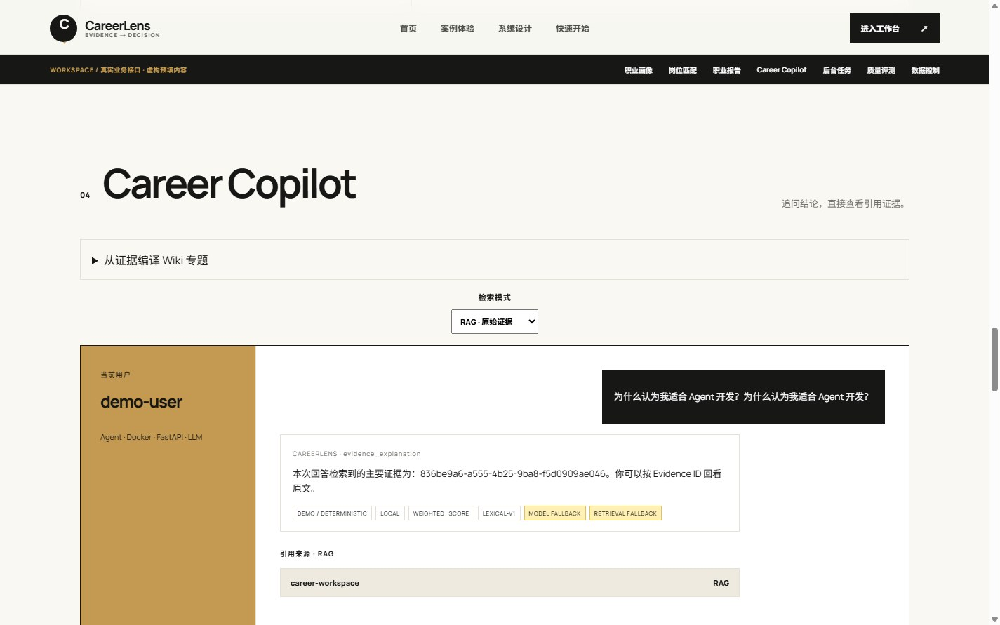

# 04 · 为什么这条证据排第一，却不能支持这句结论？

林澈想问「我做过哪些 Python 项目？」刚上传的证据能提供一段原文，检索还需要从库里挑出最值得读的几条。本课先手算两张榜怎样融合，再用原句里的「只在本机演示」判断一句结论是否有出处。

阅读时可以只做环节一和四，在纸上留下 A、B、C 的得分，再写一句这份原文能支持的结论。环节二的排名脚本只用 Python 标准库。想看真实候选时沿用 03-A 的合成材料和练习 API，先查 RAG。编完 Wiki 后再比较三种模式。 [第四章目录](./04-knowledge-base/README.md) · [合成材料](./04-knowledge-base/03-A-去重与来源.md)

工作台的 Copilot 会在答复下方展示候选。打开一条引用后，可以把模型写出的结论与原句对照。



## 先认识召回、名次和重排

把问句「林澈用过 Python 吗？」交给证据库，系统可以先找一小批候选。这一步叫**召回**。一条路线可按向量相似度找正文，另一条可以偏重共享的术语。两套方法有各自的分数。**排名融合**可以只取它们各自的名次，先做一份合并榜。**重排**再用同一套规则细排候选，查回事实仍需要打开对应原文。

在 `backend/app/retrieval/qdrant_store.py` 打开 `QdrantEvidenceStore.search`。这里有两个 `models.Prefetch`，各通过 `using` 选择 `dense` 和 `sparse`，再在 `query` 里选择 `models.Fusion.RRF`。返回的候选被交给 `reranker.score` 重排。接下来的手算先把自己放在两路榜单刚返回的那一步。 [候选融合与重排源码](../backend/app/retrieval/qdrant_store.py#L90-L140)

## 环节一 · 先猜：两张榜融合，谁第一？（浏览器即可）

先别看答案。假设同一个问题检索出两张榜，名次从 0 数：

```
榜单 A：A(第0名)  B(第1名)   C 缺席
榜单 B：C(第0名)  B(第1名)   A 缺席
```

融合规则是把每条证据在两张榜里的名次各算一次 `1/(k+名次)` 再加起来，缺席算 0。这里用**教学常数 `k=2`**（只为手算方便，不是服务里的真实值）。

**先写下你的答案**：A、B、C 各得多少分？谁排第一？只中一张榜的榜首，和两张榜都中但名次靠后的，谁分高？

<details>
<summary>点开核对</summary>

- B：两榜都第 1 名 → `1/(2+1) + 1/(2+1) = 1/3 + 1/3 = 2/3`
- A：只在 A 榜第 0 名 → `1/(2+0) + 0 = 1/2`
- C：只在 B 榜第 0 名 → `0 + 1/(2+0) = 1/2`
- **B 第一**（`0.667 > 0.5`）。在这组榜单里，B 从两路各拿到 `1/3`，超过只在一路排首位的 A 和 C。后面会用 B 在两榜都排第四的例子检验这种优势还能不能成立。

</details>

这是教学玩具榜单，不是真实用户数据或固定服务响应。真实 CareerLens 的融合由 Qdrant 服务端完成，源码里**没有显式指定 `k`**（`backend/app/retrieval/qdrant_store.py:107` 只传 `FusionQuery(fusion=Fusion.RRF)`）；Qdrant 1.15.4 的实现用零起始位置、内部默认常数。不同排名约定下常数不能直接套，别把这里的 `2/3` 当成服务分数。

## 环节二 · 做与改：写个小函数，改一个变量看结果

用 Python 标准库实现刚才的手算，然后**改一个变量**：把 B 从榜单 A 移除，重新算，看谁第一。再看一种完全不同的合并方式——按名次交错。

本篇使用[练习 05](../examples/tutorials/lesson-05-rrf/README.md) 的脚本。从仓库根目录运行，Python 标准库就够。先跑原始榜单，再各改一个参数。每条成功的命令会打印 `OK`。

Windows PowerShell 先运行 `python --version` 确认命令可用，再复制下面几行。习惯用 `py` 的读者可以先用 `py --version` 确认版本。

```powershell
python examples/tutorials/lesson-05-rrf/main.py
python examples/tutorials/lesson-05-rrf/main.py --k 10
python examples/tutorials/lesson-05-rrf/main.py --drop-b
```

macOS 或 Linux 用 `python3`。

```bash
python3 examples/tutorials/lesson-05-rrf/main.py            # 默认：原始两榜，k=2
python3 examples/tutorials/lesson-05-rrf/main.py --k 10     # 变体一：只把 k 改成 10
python3 examples/tutorials/lesson-05-rrf/main.py --drop-b   # 变体二：只从榜 A 移除 B
```

关键片段（`examples/tutorials/lesson-05-rrf/main.py`）：

```python
def rrf_score(rank, k=2):
    return 0.0 if rank is None else 1.0 / (k + rank)   # 名次从 0 数，缺席算 0

def fuse(*lists, k=2):
    scores = {}
    for ranking in lists:
        for rank, doc in enumerate(ranking):           # enumerate 从 0 开始
            scores[doc] = scores.get(doc, 0.0) + rrf_score(rank, k)
    return scores
```

先填「你预测谁第一」，再运行脚本核对。只用浏览器时，算好分数再查看右侧两列，把算出的名次写到自己的记录里。

| 入口 | 你预测谁第一 | 实测结果 | 为什么 |
| --- | --- | --- | --- |
| 默认（原始两榜，`k=2`） | （先填） | B（`2/3`），A、C 同分 `1/2` | 两榜都命中 |
| `--k 10`（只改 k） | （先填） | 仍 B 第一；分差从 `0.167` 缩到 `0.082`，倍率从 `1.33` 升到 `1.82` | 见下方「分差与倍率」 |
| `--drop-b`（只从榜 A 移除 B） | （先填） | A、C 并列 `1/2`，B 掉到 `1/3` | B 只剩一榜命中，优势消失 |
| 名次交错 | （先填） | `['A','C','B']` | 交错按位置轮流取，不看分数 |

**分别记录分差与倍率。** `k` 从 2 改为 10 时，B 对 A 的绝对分差从 `0.667−0.5≈0.167` 缩到 `0.182−0.1≈0.082`。分数倍率从 `0.667/0.5≈1.33` 升到 `0.182/0.1≈1.82`。两种数衡量的是不同的量。接下来把 B 移到更靠后的位置，看看名次变化能否让它失去第一。

<details>
<summary>参考答案与提示</summary>

名次交错（`rank_interleave`）是 `hybrid` 模式合并 RAG 与 Wiki 两路的方式（`backend/app/services/knowledge.py:66-69`），它和 RRF 分数融合是**两件不同的事**——前者按名次轮流取，后者按倒数名次累加分。脚本里两种都算了，就是让你看清它们的依据不同。

</details>

试一组新输入。两张榜里 B 都在第 4 个位置，从 0 数就是名次 3。先算 B 能否超过只出现在一张榜首的 A，用这条命令核对。

```bash
python3 examples/tutorials/lesson-05-rrf/main.py --rankings "A,X,Y,B" "C,U,V,B"
```

这次 A、C 各拿 `1/(2+0)=0.5`，B 的两个名次各贡献 `1/(2+3)=0.2`，合计 `0.4`。命中次数和名次都参与得分。如果想继续改，按顺序替换引号里的 ID，可加 `--k 10` 比较同一对榜单。直接运行默认命令仍用于核对原始算例。

## 环节三 · 接回真实实现：诊断里到底走了哪条链（可选，需本机服务）

问「林澈做过哪些 Python 项目」时，系统先要找出一批值得读的原文，再给这批候选排次序。把下面四步和刚才的两张榜单对起来读：

| 步骤 | 实现 | 你可以检查什么 |
| --- | --- | --- |
| 稠密召回 | `HashEmbeddingProvider` 默认把词映射到固定长度的向量，按余弦相似度查邻居。余弦计算向量点积除以两边的长度，比较方向。可选的 Qwen provider 换成学习出来的文本向量。 | 默认 `hash-v1` 擅长复现词重合，换成同义表达后未必能搜到同一条。 |
| 稀疏召回 | `sparse_vector` 只提交出现过的词及其计数。Qdrant 的 IDF 修正降低常见词的影响，使少见的术语有机会排到前面。 | IDF 和 BM25 都会考虑词在多少文档中出现。标准 BM25 还考虑词频饱和和文档长度，这条路径用的是词计数加 IDF。 |
| 榜单融合 | Qdrant 对两张榜做原生 RRF。这里的代码提交两路候选和融合类型，`k=2` 来自课堂示例。 | 看到 `backend=qdrant` 和 `fusion=rrf` 后，再用刚手算过的名次贡献去理解次序。 |
| 重排 | 默认 `lexical-v1` 用候选与问句的词集交集大小除以并集大小。比如问句的词集是 `{python, docker}`，候选词集再多一个 `compose`，这一分就是 `2/3`。 | 看 `rerank_score`。重排只处理已经召回的候选，第一步漏掉的材料到这里仍拿不到。 |

沿 [Qdrant 检索](../backend/app/retrieval/qdrant_store.py) 的 `ensure_collection` 和 `search` 看这四步。配置允许回退时， [本地检索](../backend/app/retrieval/hybrid.py) 直接计算 `0.45 × 词频余弦 + 0.55 × 稀有词得分 + 短语加分`。问句完整出现在正文时，加分为 `0.25`。[第 08-2 篇](08-advanced/08-2-评测.md) 会让你观察这项加分怎样改变一个实际指标。

在 [8031 端口的知识库 Swagger](http://127.0.0.1:8031/docs)，给 03-A 的 `kb-study` 执行一次 `POST /api/v1/profiles/{user_id}/rebuild`。再展开 `POST /api/v1/chat`，发送下面的请求。若前一课换过账号，继续使用你选的值。

```json
{
  "user_id": "kb-study",
  "message": "我做过哪些 Python 项目？",
  "mode": "rag"
}
```

用共同正文的 E 在响应的 `evidence` 查原文。记录 `retrieval.backend`、`retrieval.fusion` 和 `retrieval.reason`。启动器固定用本地检索，所以此处可以看到 `backend=local`、`fusion=local_lexical_rrf_v1`、`reason=configured_local`。现在完成 `rag` 这一组就可以继续读。待 Wiki 编好后，综合课会用同一句问题对比三组响应。

- `retrieval.backend` / `retrieval.fusion`：Qdrant 成功时是 `qdrant` / `rrf`；本地回退时是 `local` / `local_lexical_rrf_v1`，且 `fallback: true`、`reason` 说明原因。本地融合词法榜单，Qdrant 融合向量榜单。
- `evidence[*].source_kind`：`rag` 或 `wiki`。`wiki` 模式不查证据检索器，所以它的诊断里**没有** `backend`/`fusion`/`reranker` 键——不是 bug，是它根本没走那条链。
- `retrieval.knowledge_fusion`：只有 `hybrid` 出现 `rank_interleave`（RAG 与 Wiki 名次交错），与 Dense+Sparse 的融合不是一回事。

> **重排的诚实说明**：级联重排（粗排 Top15 → 精排 Top5）默认**关闭**（`backend/app/core/config.py:42`），默认只有单级词法重排 `lexical-v1`。开启两级后才是粗排 15 / 精排 5。别把「两级重排」说成默认路径。

## 环节四 · 判错与迁移：榜首也可能不能支持结论

把环节一里排第一的 B 换成一个真实场景：「收藏了 Kubernetes 教程」这条材料被检索排到了榜首。问题变成——它能支持「林澈做过 Kubernetes 上线」吗？

**先自己判，再看参考判断。**

<details>
<summary>参考判断</summary>

不能。这里要分清三件经常被混为一谈的事：

| 层次 | 问的问题 | 谁来判 | B 的情况 |
| --- | --- | --- | --- |
| 检索候选 | 和问句相关吗、排第几？ | 系统 | 相关，排第一 |
| 引用合法 | 行内引用 ID 是否在允许范围、能追到原文？ | 系统 | 合法 ID 可通过校验 |
| 事实支持 | 原文能不能支撑这句断言？ | **人（你）** | **不能**——收藏教程只是兴趣线索（见 [00-2](00-foundations/00-2-提示词与证据.md)） |

排序分高 ≠ 引用合法；引用合法 ≠ 事实支持。要把系统的检查和人的判断分开：**系统目前校验的是引用 ID 的合法性**（回答里的行内引用必须落在返回证据的 ID 范围内，未知 ID 会被拒绝），**它不做语义层面的事实核验**——一条合法 ID、能追到原文的「收藏教程」，照样能出现在回答里。所以「这条引用内容到底支不支持结论」这一步得由你来做，判不准就写「证据不足」。

引用校验失败时，聊天生成节点会改用备用答复，响应仍可为 200，诊断中会有 `fallback=true` 和 `reason=ValueError`。编号合法的回答还要逐句看原文。这条兴趣记录可以支持「收藏过教程」，上线经历需要别的材料。 [聊天答复节点](../backend/app/graph/career.py#L158-L216) · [引用回归](../backend/tests/test_job_intelligence.py#L249)

</details>

**迁移题**：换一条你没见过的材料（比如「课程项目只在本机演示」），先说它会不会被检索命中，再说它能不能支持「有生产上线经验」。把两个答案分开写。

## 遇到异常怎么判断

环节三接真实服务时，最常见的两种失败长得很像，但原因不同。先触发、再识别、再恢复：

| 怎么触发 | 会看到什么 | 怎么确认 | 怎么恢复 |
| --- | --- | --- | --- |
| 没建画像直接 `POST /api/v1/chat` | HTTP **422** | 响应体提示缺画像；对照 `backend/app/api/routes/chat.py:50-52` 的前置检查 | 先按 [01](01-第一次跑起来.md) 导入合成资料并 `POST /api/v1/profiles/{user_id}/rebuild` |
| 还没编译 Wiki | `wiki` 可能没有候选。 `hybrid` 仍可返回 RAG 候选 | 看 `retrieval.wiki_count` 是否为 0，以及 `evidence[].source_kind` | 按 [05](05-Wiki知识组织.md) 编译一页相关 Wiki，再用原问句重跑 |
| 第三章替身测试返回未知的行内引用 ID | 响应仍为 200，返回备用答复 | 查 `model.fallback` 与 `model.reason`，定位 `backend/app/services/citations.py` 的 `validated_citations` | 核对实际候选 ID，再按答复课预设有效引用重跑测试 |

## 课后习题

先选一道能独立解释的题。想继续写代码，就用下一组榜单检查你的解释。

### A · 概念辨析（有答案）

1. RRF 融合和「按相关度分数加权相加」是一回事吗？为什么名次融合对两路检索的分数量纲不敏感？
2. 一条材料被检索命中、也带合法的证据 ID，能不能直接写进结论说「他做过」？说出还缺哪一步核对。

<details>
<summary>参考答案</summary>

1. 不是。RRF 只用「在第几名」，不用原始分数：`score(d)=Σ 1/(k+rank(d))`。两路检索的分数量纲不同（一路余弦相似度、一路词频 IDF），直接相加会被量纲大的那路主导；排名把量纲抹掉，只保留次序。本项目真实 k 由 Qdrant 服务端决定，源码未显式写死。
2. 不能。命中只说明「相关、排得靠前」，合法 ID 只说明「能追到原文」。还要核对原文到底说的是不是这件事——收藏教程追得到原文，但原文说的是「感兴趣」，不是「做过上线」。这就是「事实支持」这一层。

</details>

### B · 改代码 / 改变量（可验证）

打开 [`lesson-05-rrf`](../examples/tutorials/lesson-05-rrf/README.md)（离线、只用标准库、要有一份 Python），用两个变体入口各跑一遍：

1. `python3 examples/tutorials/lesson-05-rrf/main.py --k 10`：观察「两榜都中」相对「一榜榜首」的**分差**和**倍率**分别怎么变。
2. `python3 examples/tutorials/lesson-05-rrf/main.py --drop-b`：B 只剩一榜命中后，谁排第一。

<details>
<summary>验证要点</summary>

1. k 越大，`1/(k+rank)` 里名次差异被压得越平：绝对分差变小（`0.167→0.082`），但倍率变大（`1.33→1.82`）。所以「优势变小」要指明是分差还是倍率，别混着说。
2. 移除 B 在榜 A 的命中后，B 掉到 `1/3`，A、C 各 `1/2` 并列在前——B 从第一变第三。
3. 预测先写在纸上，再跑脚本核对；不一致时先检查自己算的是名次还是分数。教材不要求背数字，只要求「预测—实测—解释」对得上。想进一步检验：两张长榜里 B 都在第 10 名、A 只在一张榜第 0 名时，A 更高，说明「两榜都命中就赢」有条件。

</details>

### C · 开放设计（无标准答案）

假设你要把这套检索用到一个**法律案例库**，用户会问「这个条款适不适用我的情况」。借鉴这一课的三个层次，设计你要额外加的一到两道校验，并说明：

- 它挡住的是哪一类「相关但不支持」的错误？
- 加这道校验会增加什么成本（漏召、人工、延迟）？
- 你愿意用多少成本换多少准确性，依据是什么？

> 提示：这一档没有标准答案。写得好的标准是「明确说出取舍」，而不是「列最多校验」。

## 自查清单

- [ ] 能手算两张榜的 RRF 分数，解释为什么「两榜都中」会赢过「一榜榜首」
- [ ] 改一个变量后，能说清排名怎么变、为什么变
- [ ] 能分清名次交错（`rank_interleave`）和分数融合（Qdrant 两路 RRF / 本地词法 RRF）是两回事
- [ ] 能说明 Qdrant 回退到本地时不走 RRF，诊断里 `backend`/`fusion` 会变
- [ ] 能说出 `wiki` 模式诊断为什么没有 `backend`/`reranker`
- [ ] 能分清检索候选、引用合法、事实支持，并对一条榜首材料写「证据不足」
- [ ] 知道级联重排默认关闭，`k=2` 只是教学参数

## 常见坑

- **把 `k=2` 当真实常数**：真实 k 由 Qdrant 内部决定，源码未显式指定；名次从 0 还是 1 数也不同。
- **把稀疏检索说成 BM25**：Qdrant 侧是词频哈希 + IDF modifier，本地回退是手写 IDF 加权，都不是完整 BM25。BM25、HNSW 只作为可选比较概念，不是本项目自实现的步骤。
- **去 `retrieval.chunks` 找证据**：没有这个键；证据在顶层 `evidence` 数组。
- **把诊断分数当准确率**：那是检索排序分，不是能力评估。
- **切 wiki 得到空结果**：没先编译 Wiki，回到环节三的「先备好前置」。

## 下一步

到 [04-A 写本地检索与索引回查](./04-knowledge-base/04-A-检索源码与诊断.md)。把本地的 RRF 拆成三份榜单，亲手写出它怎样挑候选。
