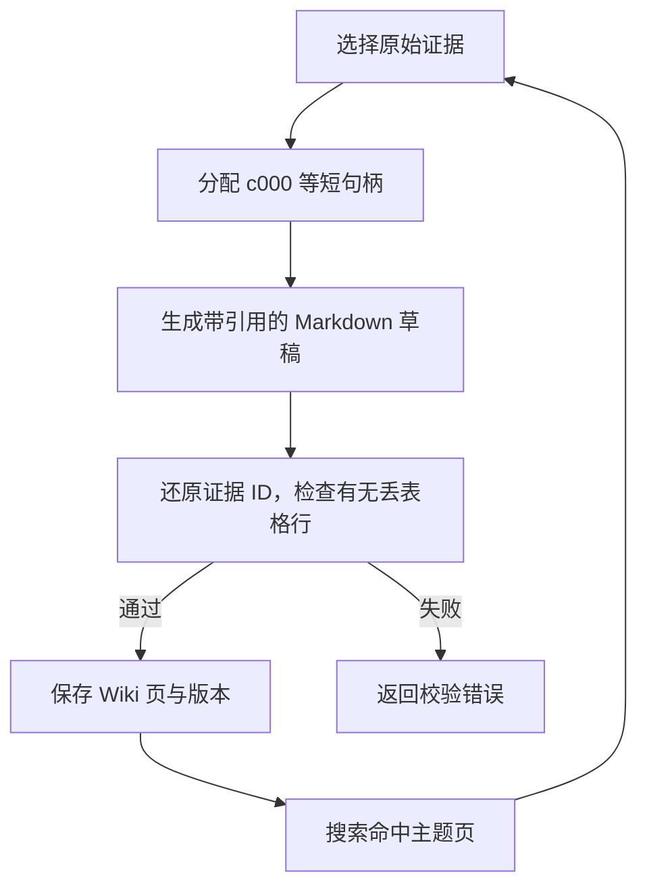

# 05 · Wiki 知识库：从主题页追回原文

**成果**：你能编译一页带引用的 Wiki，核对它的来源和版本；能说清短句柄 `c000` 和表格行守卫防的是什么；能解释「回滚是一次普通编辑」。

**前置**：[03](03-解析层.md) 的证据、[04](04-检索Agent.md) 开头已备好证据。

**对应版本**：接口按当前 `main` 核对。

**对应源码**：`backend/app/api/routes/wiki.py`、`backend/app/wiki/`、`backend/app/services/wiki_pages.py`。

---

## 为什么需要 Wiki

林澈可以用「Python」搜到很多项目片段。换个问法：「我在哪些项目里用过 Python？它们分别运行在哪里？」每次都拼一遍片段很麻烦。把选好的片段整理成一页「Python 项目经历」，就能先读主题页，再打开支撑一句话的原文。

这里的**编译**指选定证据、生成并校验 Markdown、保存主题页及其引用。导入证据时会做索引，编译时才生成 Wiki 页。每次有实质改动会保存版本，基于旧版本提交时会被拒绝。回滚也会留下新的编辑记录。



编译把选中的证据变成主题页。搜索命中时，可以从主题页沿引用回到原证据。上节课的 RAG 查证据片段，这一课的 Wiki 查已发布的 Markdown 页。`hybrid` 会按名次交错取两路结果。第 04 篇手算的 RRF 是证据检索内部融合 Dense 与 Sparse 榜单的规则。 [知识检索的模式分支](../backend/app/services/knowledge.py) · [Wiki 页检索](../backend/app/wiki/search.py)

## 用真实接口观察

### 方式一：工作台一键编译

在证据区勾选几条证据 → 点「编译 Wiki」→ 等任务成功 → 在工作台打开 Wiki 页。这是最省事的方式。

### 方式二：同步编译接口

`POST /api/v1/wiki/compile`，请求体：

```json
{
  "user_id": "learner",
  "slug": "my-python-journey",
  "title": "我的 Python 实践",
  "evidence_ids": ["<证据ID1>", "<证据ID2>"],
  "base_version": null,
  "edit_source": "pipeline"
}
```

`slug` 只能含字母、数字、下划线、连字符。`evidence_ids` 至少一条。返回 `{"page": {...}, "diagnostics": {...}}`，其中 `page.version` 从 1 开始。

### 方式三：后台 run（推荐理解运行时）

`POST /api/v1/runs`：

```json
{
  "user_id": "learner",
  "operation": "wiki_compile",
  "input": {
    "slug": "my-python-journey",
    "title": "我的 Python 实践",
    "evidence_ids": ["<证据ID>"],
    "base_version": 1
  }
}
```

走后台的好处是能观察进度事件（见 [06 · 后台运行时](06-后台运行时.md)）。注意 run 方式会把 `edit_source` 写死为 `agent`，而同步接口的 `edit_source` 可选（默认 `pipeline`）。

### 看页面和版本

```text
GET /api/v1/wiki?user_id=learner               列出所有页
GET /api/v1/wiki/{slug}?user_id=learner        看某一页（含 version、content、source_refs）
GET /api/v1/wiki/{slug}/revisions?user_id=...  看历史版本
```

### 实验：用同一个问题，换三个查询模式

用第 01 篇中已重建画像的练习账号和合成资料操作。挑一段确实提到 Python 项目的证据。

1. 编译前用 `rag` 问「有哪些 Python 项目经历？」。记录一个 `evidence_id`，打开它确认原文确实和项目有关。
2. 选择这条证据，按上面的方法编译「Python 项目经历」，记下返回的 `slug` 和 `version`。从 Wiki 页详情读取 `source_refs`，这是编译选进来的证据 ID。再看 `chunk_refs`，这是解析得到的引用 ID。用默认 Demo 时两份列表可能一样。
3. 用相同问题、相同账号分别选择 `wiki` 和 `hybrid` 再问一次。使用接口时，按 [01-B 的请求](01-agent-design/01-B-工具调用.md)改 `mode`。找 `source_kind=wiki` 的命中，抄下 `page_id` 或 `slug`，再用其中的 `chunk_refs` 打开原文。

对照记录时先看 `retrieval.wiki_count` 与 `retrieval.source_kinds`，然后比较 RAG 命中的一段话和 Wiki 命中的整页主题。若找不到页，先用 `GET /api/v1/wiki` 确认当前账号有已发布的页，再核对页标题和正文是否提到查询的关键词。只用浏览器读时，可以把 `E-1` 和 `python-projects` 当作练习编号，写下两条路径各从哪个编号查到原文。

## 三个不变量，为什么这样设计

### 1. 短句柄 `c000`：模型引用，落库换回稳定 ID

模型不擅长记住一长串证据 ID，所以编译时给每条证据发一个 `{前缀}{三位数字}` 的短句柄（c000、c001…），模型在草稿里用它标记引用。落库前：

- 认识的句柄 → 解析成稳定 `evidence_id`；
- **不认识的句柄 → 直接丢弃**，绝不信任；
- 行内的 `[c000]` 标记会被清掉。

这样模型「胡编的引用」进不了系统。

### 2. 表格行守卫：防止静默丢数据

这是从一次真实事故里学来的：模型重写整页时，把一张 100 行的表格悄悄压成 30 行，过程没有任何报错，而且因为「看起来没变化」不触发版本递增，调用方根本发现不了。

守卫的做法：落库前比较原始表格和生成内容的**行身份**（取每行第一个非空单元格，做格式归一化——全角空格、大小写、强调符号都不算差异），丢失超过阈值就抛错（默认阈值 0，即一行都不能丢）。用的是多重集计数，所以「两行相同、丢了一行」也算丢失（`tables.py:70-84`、`test_wiki_compile.py:172-174`）。

**失败表现按入口分叉**：同步接口 `POST /api/v1/wiki/compile` 返回 **HTTP 422**，detail 形如 `rewrite dropped 33% of table rows (limit 0%)`（`wiki.py:77-78`）；后台 `wiki_compile` run 则不返回 HTTP 错误，而是任务失败、`error_code="invalid_input"`（`worker.py:132-133`）。写教程或调试时别把两者说成一种。

**先预测，再看**（读 `backend/app/wiki/tables.py`）：

| 改动 | 你的预测 | 实际 |
| --- | --- | --- |
| 只改表格单元格大小写、加减号强调 | （先填） | 不算丢行，因为身份做了 `casefold()` 并去掉 `*_\`` |
| 两行首格相同的行，删掉其中一行 | （先填） | 算丢 50%，被拒绝——多重集不会因为重复而稀释 |
| 只改某行第二个单元格，首格不变 | （先填） | 测不出来——身份只取**第一个非空单元格** |
| 源证据里根本没有表格（无 `\|`） | （先填） | 守卫跳过——只检查含 `\|` 的源证据（`compiler.py:184`） |

最后两行是守卫的已知边界，不是它「保证」的部分：它防的是「整行被悄悄删掉」，不是「单元格内容被改写」。

### 3. 版本不变量：只在可见变化时才递增

假设 A 和 B 都读到了第 1 版。A 先改名成功，版本号变为 2。此时 B 手里的修改仍基于第 1 版，直接保存会覆盖 A 的改动。调用方把它读到的版本放进 `base_version`，数据库在更新时用 `WHERE version = ...` 再检查一次。SQL 这次实际更新了几行，决定谁的修改能提交。见 [Wiki 写入服务](../backend/app/services/wiki_pages.py)的 `update_page`。

新页从版本 1 开始。标题、正文、摘要或引用有变化时，才记一份新快照。用相同输入重编译通常仍是同一个版本，只有更新时间可能变化。回滚会把旧内容写成一次新编辑，之前的版本都能继续查。

## 可复跑实验：丢行被拒与版本冲突

上面两条守卫，用一份固定材料就能验证。**先能解释，再看怎么复跑。**

**固定输入**（合成，虚构）：一张源表，表头 `能力 | 证据`，数据三行的首格依次是 `Docker`、`Docker`、`Python`。行身份列表是 `["docker","docker","python"]`，共 3 个行实例。

**先预测这三种改动的行身份损失比例**（`row_identity_loss_ratio`，`tables.py:70-84`）：

| 改动 | 行身份列表变成 | 损失比例 | 是否被拒 |
| --- | --- | --- | --- |
| 只把 `Docker` 改成 `**docker**`、大小写变化 | 不变（归一化消掉强调、casefold） | `0` | 否，正常写入 |
| 删掉一行 `Docker` | `["docker","python"]` | `1/3 ≈ 33%` | **是**，默认阈值 0 |
| 只改某行第二列文字 | 不变（身份只取首个非空单元格） | `0` | 否 |

把旧表里的每个首格按出现次数记一笔。这里旧表是 `docker: 2, python: 1`，新表是 `docker: 1, python: 1`。欠一笔，所以损失是 `1/3`。如果只用集合，两边都是 `{docker, python}`，这次丢行就会被掩盖。

在已装后端依赖的 `backend/` 目录把下面保存为 `wiki_rows_demo.py`，用虚拟环境的 Python 运行 `python wiki_rows_demo.py`。

```python
from app.wiki.tables import DroppedTableRowsError, assert_rows_preserved, row_identity_loss_ratio

before = "| 能力 | 证据 |\n| --- | --- |\n| Docker | 本机启动 |\n| Docker | 健康检查 |\n| Python | 课程作业 |"
after = before.replace("| Docker | 健康检查 |\n", "")
print(row_identity_loss_ratio(before, after))
try:
    assert_rows_preserved(before, after)
except DroppedTableRowsError as error:
    print(error)
```

两行输出分别是 `0.3333333333333333` 和 `rewrite dropped 33% of table rows (limit 0%)`。恢复旧表，再把「健康检查」换成另一句话，损失会是 `0`。这解释了为什么仍要抽查第二列的出处。

**怎么用 API 观察**：Demo provider 会**原样拼接证据成页**（`compiler.py:83-84`），所以靠调 API 造不出「模型丢行」——这一步只能通过后端测试注入。可复跑命令：

```bash
# 在 backend/ 目录，跑守卫的四个测试（不含 Docker/Docker/Python，那个是下面的扩展）
pytest tests/test_wiki_compile.py -k "table_guard or dropped_table_rows" -v
```

- `test_table_guard_ignores_formatting_and_case_changes`：强调/大小写/前导空列 → 损失 0，放行。
- `test_compile_rejects_dropped_table_rows`：模拟丢行 → 抛 `WikiCompileError`，消息含 `table rows`。
- `test_table_guard_counts_repeated_row_keys`：`A/A` 丢一行 → 0.5。

版本冲突可以直接用上面的同步 API 验证。选一个新 `slug`，建页后记下版本 1。保留同一个 `slug` 和证据，**改一下 `title`**（例如「林澈的实践」改成「林澈的实践 第二版」），带 `base_version: 1` 提交，确认版本变成 2。接着用旧的 `base_version: 1` 再提交，预期 HTTP `409`，`detail` 中能看到期望版本和当前版本。后台入口的同一次拒写记录在任务结果，状态为 `failed`，`error_code` 为 `stale_input`。

**可核对的产物**：一张表，列「改动 / 损失比例 / 是否写入 / 写入后 version」，三行实验各填一行；再附一条 409 的 detail 原文。参考实现：`backend/app/wiki/tables.py:20-109`、`backend/tests/test_wiki_compile.py:50-58,88-98,128-174`。

## 自查清单

- [ ] 编译一页 Wiki 并打开，能看到版本和来源证据
- [ ] 能解释 `c000` 短句柄的作用，以及未知句柄为什么被丢弃
- [ ] 能说出表格行守卫防的是什么事故
- [ ] 能解释「内容没变化就不递增版本」和「回滚是一次普通编辑」
- [ ] 能说清 `base_version` 冲突时系统会怎么做

## 常见坑

- **编译后引用对不上**：确认选的证据 ID 有效；句柄解析会把未知引用丢掉，诊断里能看到 `unknown_handles`。
- **提交时报 409**：`base_version` 过期了，重新读当前版本再提交。
- **编译报 422**：表格行守卫是原因之一（检查有没有丢表格行），但也可能是证据 ID 不可用或请求体字段不合法——看 detail 原文再判断，别只猜守卫。
- **切 `wiki` 检索模式没结果**：先编译出至少一页，见 [04](04-检索Agent.md) 开头。

## 下一步

现在证据、检索、Wiki 都有了。接下来 [06 · 后台运行时](06-后台运行时.md)讲这些耗时操作怎么可靠地在后台跑完。术语见[术语表](术语表.md)。
