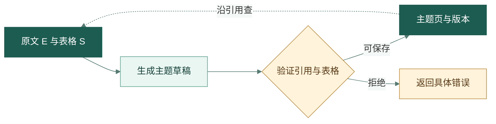

# 05 · 编译第一张 Wiki 主题页

搜「Python」时，林澈能找到几段内容，但每次回答「这个项目做了什么、在哪运行」都要重新翻材料。把相关原文整理成一页主题页，他可以先读整页，再回查关键句落在哪份文件。本课先通过 API 编出一页，把整条编译管线走一遍；后面四课（05-A～05-D）再分别把短句柄、表格保护、版本和查询拆开亲手写。 [第四章目录](./04-knowledge-base/README.md)

浏览器读者可以先用 E 和 S 预测两个引用字段。动手读者沿用 03-A 的 API 和账号，记下本次 `slug`、`version`、`source_refs` 和 `chunk_refs`，后面会用同一页练回滚。

## 为什么要编译主题页

原始证据是一条条独立文本，适合「查某句话出自哪里」，但不适合回答「这个项目的全貌是什么」。后者需要把多条相关材料组织成一页：有标题、有结构、有引用，读者可以打开这页登记的原文逐条核对结论。这就是 Wiki 主题页。

它和 Evidence 的分工要分清：

| | Evidence（证据） | WikiPage（主题页） |
| --- | --- | --- |
| 来源 | 导入时从文件/文本切出 | 编译时才产生，输入是已有 Evidence |
| 粒度 | 一段原文 + 出处 | 多段原文组织成的一页 |
| 用途 | 精确回溯、RAG 检索 | 直接阅读、主题级检索 |
| 关键字段 | `content_hash`、`source_metadata` | `slug`、`chunk_refs`、`version` |
| 会不会过期 | 原文删了就不存在 | 输入证据被删，页也可能被移除 |

**编译（compile）** 指从已存在的证据构建并保存主题页。CareerLens 先按当前用户读取所选证据，给每条材料一个本轮用的短编号，生成草稿，再校核引用和表格，最后保存。Demo 的初始实现把原文整理到同一页；配置模型后可以重写为主题正文，写入前同样经过校验。 [真实编译入口](../backend/app/wiki/compiler.py) · [Demo 与模型配置](01-agent-design/模型配置.md)



## 先认识主题页、编译和页地址

**Wiki 页**是一份保存好的 Markdown。它有标题、正文、来源和版本。两个 ID 容易混淆：

- `slug` 是路径里用于打开主题的名字，例如 `python-docker-course`。**同一个用户下 slug 唯一**，所以能用它反复打开这页。唯一键是 `(user_id, slug)`。
- `id` 是数据库给该行的编号（一个 UUID），详情和检索命中里还能看到它。

一个用户下同样的 slug 只能有一页。这也是为什么用已存在的 slug 再编译、却传 `base_version=null` 会得到 409——数据库里已经有这一页，新建冲突。 [页面模型和唯一键](../backend/app/models/wiki.py#L29-L62)

**版本（version）** 从 1 开始。只有可见字段（标题、正文、摘要、页类型、状态）或引用发生变化时才递增，同时把被换下的那版存成快照。第一次编译没有快照，`revisions` 是空数组。这套版本规则在 05-C 会亲手实现。

## 先拿到两项材料的证据 ID

沿用 03-A 的账号 `kb-study` 和共同正文的 E。练习 API 已停时，用之前的 `serve` 命令重启。没有记录 E 时，可用 `GET /api/v1/evidence` 查询同一个账号，在 `items` 按共同正文找 `id`。从此处直接开始的读者也可以用文本接口导入「我用 Python 做过一个课程项目，只在本机演示。」取得 E。完整回溯实验使用 03-A 上传的两个 DOCX。 [启动练习 API](./04-knowledge-base/README.md#启动练习-api) · [两个文件实验](./04-knowledge-base/03-A-去重与来源.md)

打开 [8031 端口 Swagger](http://127.0.0.1:8031/docs)，在 `POST /api/v1/evidence/text` 点 **Try it out**，发送以下请求。若选过别的教学账号，将下面的 `user_id` 一并改成你的值。JSON 中的 `\n` 表示下一行，解析后表格有一行标题、一行分隔和三行数据。记下返回 `items[0].id`，把它叫作 S。

```json
{
  "user_id": "kb-study",
  "source_type": "self_statement",
  "source_name": "kb-course-observations",
  "content": "| 能力 | 观察记录 |\n| --- | --- |\n| Docker | 课程接口只在本机启动 |\n| Docker | /health/live 返回 ok |\n| Python | 课程项目只在本机演示 |"
}
```

两个 Docker 行用于记录两件事。保存网页时，即使都以 Docker 开头，两条观察都要保留——这正是 05-B 表格守卫要防的情况：模型重写时把其中一行悄悄合并掉。这张表会在 05-B 再用一次。

**为什么要两条 Docker 记录？** 它们看着身份相同（首格都是 Docker），但第二格的内容不同：一条讲「本机启动」，一条讲「健康检查」。如果编译出的页面只剩一条，就丢了一项可追溯的观察。表格守卫用「第一个非空单元格」当行身份，两行身份都是 `docker`，所以它会按**多重集**计数——少一条 `docker` 就是少一行，即使另一种身份还在。

## 用同步接口编译并读回

展开 `POST /api/v1/wiki/compile`，点 **Try it out**。用你手中的两个实际 ID 替换下文的 E 和 S。首次编译选择一个新 slug，`base_version` 留 `null`。用简单的英文、数字与连字符可以直接作为路径使用。

```json
{
  "user_id": "kb-study",
  "slug": "python-docker-course",
  "title": "Python 与 Docker 课程项目",
  "evidence_ids": ["填入 E 的实际 ID", "填入 S 的实际 ID"],
  "base_version": null,
  "edit_source": "pipeline"
}
```

| 首次成功时 | 去哪里确认 |
| --- | --- |
| HTTP `201` | `page.id`、`page.slug` 与 `page.version=1` |
| 选择了两条证据 | `page.source_refs` 按输入保存去重后的证据 ID |
| 生成页引用的材料 | `page.chunk_refs`。Demo 里会收下 E 和 S，模型模式可能只引用部分来源 |
| 页正文 | `page.content` 中能看到原文与完整三行表格 |
| 模型路径 | 默认练习应看到 `diagnostics.provider=demo` 和 `diagnostics.unknown_handles=[]` |

`source_refs` 记录提交给编译器的证据。`chunk_refs` 记录生成结果的 `citations` 中能翻译回原文的 ID。Demo 两条都收下。模型漏掉一条时，`chunk_refs` 可能变短。`unknown_handles` 只记录查不到的句柄，单看它无法判断模型为何漏引。打开原文后，再核对具体句子。

再用 `GET /api/v1/wiki/{slug}`，路径格填刚用的 slug，另一个格填实际 `user_id`。它会返回当前页面。再展开 `GET /api/v1/evidence/{evidence_id}`，填 E 和实际 `user_id`，抄下 `content` 的原句和 `source_metadata.sources` 中的两个文件名。新页面还没有覆盖过任何版本，在 `GET /api/v1/wiki/{slug}/revisions` 填同样两个字段，预期得到空数组。第 05-C 课会动手建立版本记录。 [页面详情和历史接口](../backend/app/api/routes/wiki.py#L95-L162)

## 顺着这一次编译看原代码

一次编译请求穿过四层。按下面的顺序打开，能看到数据怎样从请求变成保存好的页。

按下面的函数名读源码。请求字段先看紧跟其后的片段，字段本身不需要跳转。

| 要读的函数 | 在哪一层 | 这一层在做什么 |
| --- | --- | --- |
| `WikiCompileRequest` | `backend/app/schemas/wiki.py` | 校验请求字段：`evidence_ids` 上限 50，`base_version` 有值时至少为 1，`edit_source` 限四个值 |
| [`compile_wiki_page`](../backend/app/api/routes/wiki.py#L31-L81) | API 路由 | 按 `user_id` 查出原文，按请求顺序建 `sources`，不可用的证据返回 422 |
| [`compile_page`](../backend/app/wiki/compiler.py#L118-L150)、[`prepare_page`](../backend/app/wiki/compiler.py#L164-L204)、[`persist_page`](../backend/app/wiki/compiler.py#L206-L239) | 编译管线 | 预检版本，生成和校验候选，保存前再看版本与来源 |
| [`create_compiled_page`](../backend/app/services/wiki_pages.py#L111-L125)、[`update_page`](../backend/app/services/wiki_pages.py#L127-L188) | 页面写入 | 新建或更新，使用唯一键和当前版本控制写入 |

### 请求校验：哪些输入会被挡在门外

`WikiCompileRequest` 的请求字段就是下面这几行：

```python
class WikiCompileRequest(BaseModel):
    user_id: str = Field(min_length=1, max_length=128)
    slug: str = Field(min_length=1, max_length=255)
    title: str = Field(min_length=1, max_length=255)
    evidence_ids: list[str] = Field(default_factory=list, max_length=50)
    base_version: int | None = Field(default=None, ge=1)
    edit_source: str = Field(default="pipeline", pattern="^(user|agent|pipeline|revert)$")
```

字段约束分三条：

- `evidence_ids`：默认空，**最多 50 条**（`max_length=50`）。
- `base_version`：`int | None`，默认 `None`，给了值就**至少为 1**（`ge=1`）。
- `edit_source`：默认 `pipeline`，只能是 `user|agent|pipeline|revert` 四个值之一。

路由层 [`compile_wiki_page`](../backend/app/api/routes/wiki.py#L31-L81) 还会做一层语义校验：把 `evidence_ids` 去重后，与数据库里该用户实际能查到的 Evidence 集合比较；只要有一个 ID 查不到或不属于这个用户，就返回 **422** `One or more evidence sources are unavailable`。这一层防的是「拿别人的证据 ID 来编译」和「拿已删除的 ID 来编译」。

### 编译管线：为什么生成和写入要分开

[`compile_page`](../backend/app/wiki/compiler.py#L118-L150) 的顺序值得逐行看：

1. `source_ids = list(dict.fromkeys(...))` —— 去重且保序。用 `dict.fromkeys` 而不是 `set`，因为顺序会影响后面句柄的编号。
2. `check_page_version(...)` —— **第一次查版本**。如果传了 `base_version`，它必须等于数据库当前版本。
3. `prepare_page(...)` —— 生成候选并校验（短句柄、翻译引用、表格守卫都在这里，05-A～05-B 展开）。这一步要等模型，可能几秒。
4. `persist_page(...)` —— 写入前**第二次查版本**，然后用条件更新保存。

**为什么要查两次版本？** 因为第 3 步等待期间，别人可能已经改了这一页。第一次查是尽早拒绝明显过期的情况；第二次查覆盖「生成期间的竞态窗口」。如果两次之间版本变了，`persist_page` 会抛 `StaleWikiWriteError`，路由映射成 409。这正是 05-C 要讲的乐观并发。

### 错误怎么映射到状态码

| 你看到的状态码 | 背后的异常/条件 | 常见原因 |
| --- | --- | --- |
| 422 | 证据 ID 不可用 | ID 写错、属于别的用户、或已被删除 |
| 422 | `WikiCompileError` | 生成内容没通过校验，例如表格丢了行 |
| 409 | `StaleWikiWriteError` | `base_version` 与当前版本不符，或 slug 已存在却传 `null` |
| 404 | 页面不存在 | detail / revisions / revert 里 slug 或用户不对 |

首次拿错 ID 时按 `detail` 判断即可。用已经存在的 slug 再交 `base_version=null` 得到 409 时，先读本页的 `version`，把它填进 `base_version` 表示「我基于这一版改」。 [请求字段](../backend/app/schemas/wiki.py#L7-L13) · [来源读取与错误映射](../backend/app/api/routes/wiki.py#L29-L79)

## 工作台做的也是这件事

在工作台展开「从证据编译 Wiki 专题」。打开 [`handleWikiCompile`](../frontend/lib/use-workspace.ts#L311-L326)，它读取选中的证据编号，调用 `createRun` 提交 `wiki_compile`。Worker 调用 `wiki_curator` 生成候选，再核验引用和保存，当前版本写入时的作者标记为 `agent`。这条路线可以看到任务 Run 与步骤。 [后台 Wiki 操作](../backend/app/runtime/operations.py#L132-L165)

**两个入口，一套产物。** 同步 `POST /api/v1/wiki/compile` 当场返回 201 和页面；工作台走 `POST /api/v1/runs` 提交后台任务，等 Run 成功后在任务中心点「打开结果」。两者最终创建的都是 `wiki_pages` 表里的同一类页面，共用 `prepare_page` → `persist_page` 的校验和写入逻辑。后台还会记录子 Agent 的步骤、重新核验所选材料、检查提交资格。两种入口复用同一套候选编译与页面写入代码。这条原则在第 07 课还会再遇到（岗位分析也是同步/后台两个入口、同一种产物）。

## 这些概念在 CareerLens 里落在哪

| 本课的词 | 源码位置 | 作用 |
| --- | --- | --- |
| `WikiCompileRequest` | `backend/app/schemas/wiki.py` | 请求契约：字段、上限、枚举 |
| `compile_wiki_page` | `backend/app/api/routes/wiki.py` | 同步编译入口，ID 归属校验与错误映射 |
| `compile_page` | `backend/app/wiki/compiler.py` | 编译总流程，两次版本检查 |
| `prepare_page` / `persist_page` | `backend/app/wiki/compiler.py` | 生成校验与写入分离 |
| `WikiPage` / `WikiRevision` | `backend/app/models/wiki.py` | 当前页与历史快照两张表 |
| `handleWikiCompile` | `frontend/lib/use-workspace.ts` | 工作台的后台编译入口 |

## 下一步

先记下 E、S、slug 和版本 1，后面的实验会复用这一页。只用浏览器时，可以把页面 ID 记作 P，比较 `P`、`E`、`S` 各自能打开什么。

到 [05-A 写短句柄与编译流程](./04-knowledge-base/05-A-Wiki编译与引用.md)。从一个模型给出的 `c000` 出发，亲手把它变回 E，并看看 Fallback 什么时候发生。
