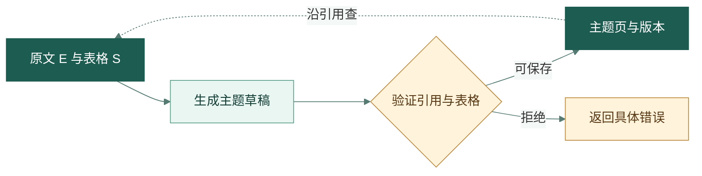

# 05 · 编译第一张 Wiki 主题页

搜「Python」时，林澈能找到几段内容，但每次回答「这个项目做了什么、在哪运行」都要重新翻材料。把相关原文整理成一页主题页，他可以先读整页，再回查关键句落在哪份文件。本课先通过 API 编出一页，后面四课分开写编译、表格保护、版本和查询。 [第四章目录](./04-knowledge-base/README.md)

## 先认识主题页、编译和页地址

**Wiki 页**是一份保存好的 Markdown。它有标题、正文、来源和版本。`slug` 是路径里用于打开主题的名字，例如 `python-docker-course`。同一个用户下 slug 唯一，所以能用它反复打开这页。`id` 是数据库给该行的编号，详情和检索命中里还能看到它。 [页面模型和唯一键](../backend/app/models/wiki.py#L29-L62)

**编译**指从已经存在的证据构建和保存主题页。CareerLens 先按当前用户读取所选证据，给每条材料一个本轮用的短编号，生成草稿，再校核引用和表格，保存页面。Demo 的初始实现把原文整理到同一页。配置模型后可以重写为主题正文，写入前同样经过校验。生成模型可接第三章的配置。 [真实编译入口](../backend/app/wiki/compiler.py) · [Demo 与模型配置](01-agent-design/模型配置.md)



## 先拿到两项材料的证据 ID

沿用 03-A 的账号 `kb-study` 和共同正文的 E。练习 API 已停时，用之前的 `serve` 命令重启。没有记录 E 时，可用 `GET /api/v1/evidence` 查询同一个账号，在 `items` 按共同正文找 `id`。从此处直接开始的读者也可以用文本接口导入「我用 Python 做过一个课程项目，只在本机演示。」取得 E。完整回溯实验使用 03-A 上传的两个 DOCX。 [启动练习 API](./04-knowledge-base/README.md#启动练习-api) · [两个文件实验](./04-knowledge-base/03-A-去重与来源.md)

打开 [8030 端口 Swagger](http://127.0.0.1:8030/docs)，在 `POST /api/v1/evidence/text` 点 **Try it out**，发送以下请求。若选过别的教学账号，将下面的 `user_id` 一并改成你的值。JSON 中的 `\n` 表示下一行，解析后表格有一行标题、一行分隔和三行数据。记下返回 `items[0].id`，把它叫作 S。

```json
{
  "user_id": "kb-study",
  "source_type": "self_statement",
  "source_name": "kb-course-observations",
  "content": "| 能力 | 观察记录 |\n| --- | --- |\n| Docker | 课程接口只在本机启动 |\n| Docker | /health/live 返回 ok |\n| Python | 课程项目只在本机演示 |"
}
```

两个 Docker 行用于记录两件事。保存网页时，即使都以 Docker 开头，两条观察都要保留。这张表会在 05-B 再用一次。

## 用同步接口编译并读回

展开 `POST /api/v1/wiki/compile`，点 **Try it out**。用你手中的两个实际 ID 替换下文的 E 和 S。首次编译选择一个新 slug，`base_version` 留 `null`。用简单的英文、数字与连字符可以直接作为路径使用。

```json
{
  "user_id": "kb-study",
  "slug": "python-docker-course",
  "title": "Python 与 Docker 课程项目",
  "evidence_ids": ["填入 E 的实际 ID", "填入 S 的实际 ID"],
  "base_version": null,
  "edit_source": "pipeline"
}
```

| 首次成功时 | 去哪里确认 |
| --- | --- |
| HTTP `201` | `page.id`、`page.slug` 与 `page.version=1` |
| 选择了两条证据 | `page.source_refs` 按输入保存去重后的证据 ID |
| 生成页引用的材料 | `page.chunk_refs`。Demo 里会收下 E 和 S，模型模式可能只引用部分来源 |
| 页正文 | `page.content` 中能看到原文与完整三行表格 |
| 模型路径 | `diagnostics.provider=demo`，`diagnostics.unknown_handles` 通常是空列表 |

再用 `GET /api/v1/wiki/{slug}`，路径格填刚用的 slug，另一个格填实际 `user_id`。它会返回当前页面。打开 E 的证据详情，抄一句原文与两个文件名。新页面还没有覆盖过任何版本，在 `GET /api/v1/wiki/{slug}/revisions` 填同样两个字段，预期得到空数组。第 05-C 课会动手建立版本记录。 [页面详情和历史接口](../backend/app/api/routes/wiki.py#L94-L168)

## 顺着这一次编译看原代码

| 打开哪个文件 | 搜索什么 | 这一层在做什么 |
| --- | --- | --- |
| `backend/app/schemas/wiki.py` | `WikiCompileRequest` | 填写需要的字段，`evidence_ids` 上限 50，`base_version` 有值时至少为 1 |
| `backend/app/api/routes/wiki.py` | `compile_wiki_page` | 按 `user_id` 查出原文，按请求顺序建 `sources`，不可用的证据会返回 422 |
| `backend/app/wiki/compiler.py` | `compile_page`、`prepare_page`、`persist_page` | 预检版本，生成和校验候选，保存前再看版本与来源 |
| `backend/app/services/wiki_pages.py` | `create_compiled_page`、`update_page` | 新建或更新，使用唯一键和当前版本控制写入 |

同步入口由 `dict.fromkeys` 给 ID 去重并保留顺序。然后用 `by_id[item_id].content` 从数据库取正文。这样发送 E、S 就足够，用户在请求中选择材料，编译器读取当前保存的内容。首次拿错 ID 时根据 `detail` 判断。`One or more evidence sources are unavailable` 对应证据缺失或归属不同，`no sources to compile` 表示需要至少一条。用已经存在的 slug 再交 `base_version=null` 可能得到 409，先读本页的 `version`。 [请求字段](../backend/app/schemas/wiki.py#L7-L13) · [来源读取与错误映射](../backend/app/api/routes/wiki.py#L29-L79)

## 工作台做的也是这件事

完整产品工作台有「编译 Wiki」。打开 `frontend/app/workspace/page.tsx` 的 `handleWikiCompile`，它收集选中的证据，调用 `createRun` 提交 `wiki_compile`。Worker 调用 `wiki_curator` 生成候选，再核验引用和保存，当前版本写入时的作者标记为 `agent`。这条路线可以看到任务 Run 与步骤。刚才的同步路线可以直接观察 201 响应和页面字段。 [工作台编译入口](../frontend/app/workspace/page.tsx#L189-L207) · [后台 Wiki 操作](../backend/app/runtime/operations.py#L132-L165)

先在练习笔记记下 E、S、slug 和版本 1。后面的实验会复用这一页。只用浏览器时，可以把页面 ID 记作 P，比较 `P`、`E`、`S` 各自能打开什么。

## 下一步

到 [05-A 写短句柄与编译流程](./04-knowledge-base/05-A-Wiki编译与引用.md)。从一个模型给出的 `c000` 出发，亲手把它变回 E，并看看 Fallback 什么时候发生。
