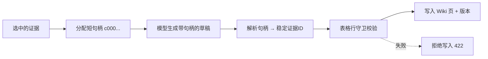

# 05 · Wiki 知识组织：把证据整理成带引用的页

**成果**：你能编译一页带引用的 Wiki，核对它的来源和版本；能说清短句柄 `c000` 和表格行守卫防的是什么；能解释「回滚是一次普通编辑」。

**前置**：[03](03-parsing.md) 的证据、[04](04-retrieval-agent.md) 开头已备好证据。

**对应版本**：接口按当前 `main` 核对。

**对应源码**：`backend/app/api/routes/wiki.py`、`backend/app/wiki/`、`backend/app/services/wiki_pages.py`。

---

## 为什么需要 Wiki

证据是一条条散的材料，检索能找到它们，但「我对这个领域的整体 understanding 是什么」这种问题，一页整理好的主题说明比一堆碎片更合适。Wiki 就是把散落证据**编译**成一页带引用的主题内容：

- 每页有版本号，改一次留一个快照；
- 每个结论都能追回来源证据；
- 版本用乐观并发保护，过期写入会被拒绝；
- 回滚不是删历史，而是「再编辑一次」。

<details>
<summary>一张图（文字版在下面）</summary>



**文字版**：编译开始时先给每条证据分配一个短句柄（c000、c001…），模型生成草稿时用这些短句柄标记引用；落库前把句柄解析回稳定证据 ID，并检查表格行有没有被弄丢；通过才写入并递增版本，失败则拒绝。

</details>

## 用真实接口观察

### 方式一：工作台一键编译

在证据区勾选几条证据 → 点「编译 Wiki」→ 等任务成功 → 在工作台打开 Wiki 页。这是最省事的方式。

### 方式二：同步编译接口

`POST /api/v1/wiki/compile`，请求体：

```json
{
  "user_id": "learner",
  "slug": "my-python-journey",
  "title": "我的 Python 实践",
  "evidence_ids": ["<证据ID1>", "<证据ID2>"],
  "base_version": null,
  "edit_source": "pipeline"
}
```

`slug` 只能含字母、数字、下划线、连字符。`evidence_ids` 至少一条。返回 `{"page": {...}, "diagnostics": {...}}`，其中 `page.version` 从 1 开始。

### 方式三：后台 run（推荐理解运行时）

`POST /api/v1/runs`：

```json
{
  "user_id": "learner",
  "operation": "wiki_compile",
  "input": {
    "slug": "my-python-journey",
    "title": "我的 Python 实践",
    "evidence_ids": ["<证据ID>"],
    "base_version": 1
  }
}
```

走后台的好处是能观察进度事件（见 [06 · 后台运行时](06-runtime.md)）。注意 run 方式会把 `edit_source` 写死为 `agent`，而同步接口的 `edit_source` 可选（默认 `pipeline`）。

### 看页面和版本

```text
GET /api/v1/wiki?user_id=learner               列出所有页
GET /api/v1/wiki/{slug}?user_id=learner        看某一页（含 version、content、source_refs）
GET /api/v1/wiki/{slug}/revisions?user_id=...  看历史版本
```

## 三个不变量，为什么这样设计

### 1. 短句柄 `c000`：模型引用，落库换回稳定 ID

模型不擅长记住一长串证据 ID，所以编译时给每条证据发一个 `{前缀}{三位数字}` 的短句柄（c000、c001…），模型在草稿里用它标记引用。落库前：

- 认识的句柄 → 解析成稳定 `evidence_id`；
- **不认识的句柄 → 直接丢弃**，绝不信任；
- 行内的 `[c000]` 标记会被清掉。

这样模型「胡编的引用」进不了系统。

### 2. 表格行守卫：防止静默丢数据

这是从一次真实事故里学来的：模型重写整页时，把一张 100 行的表格悄悄压成 30 行，过程没有任何报错，而且因为「看起来没变化」不触发版本递增，调用方根本发现不了。

守卫的做法：落库前比较原始表格和生成内容的**行身份**（取每行第一个非空单元格，做格式归一化——全角空格、大小写、强调符号都不算差异），丢失超过阈值就抛错（默认阈值 0，即一行都不能丢）。用的是多重集计数，所以「两行相同、丢了一行」也算丢失（`tables.py:70-84`、`test_wiki_compile.py:172-174`）。

**失败表现按入口分叉**：同步接口 `POST /api/v1/wiki/compile` 返回 **HTTP 422**，detail 形如 `rewrite dropped 33% of table rows (limit 0%)`（`wiki.py:77-78`）；后台 `wiki_compile` run 则不返回 HTTP 错误，而是任务失败、`error_code="invalid_input"`（`worker.py:132-133`）。写教程或调试时别把两者说成一种。

**先预测，再看**（读 `backend/app/wiki/tables.py`）：

| 改动 | 你的预测 | 实际 |
| --- | --- | --- |
| 只改表格单元格大小写、加减号强调 | （先填） | 不算丢行，因为身份做了 `casefold()` 并去掉 `*_\`` |
| 两行首格相同的行，删掉其中一行 | （先填） | 算丢 50%，被拒绝——多重集不会因为重复而稀释 |
| 只改某行第二个单元格，首格不变 | （先填） | 测不出来——身份只取**第一个非空单元格** |
| 源证据里根本没有表格（无 `\|`） | （先填） | 守卫跳过——只检查含 `\|` 的源证据（`compiler.py:184`） |

最后两行是守卫的已知边界，不是它「保证」的部分：它防的是「整行被悄悄删掉」，不是「单元格内容被改写」。

### 3. 版本不变量：只在可见变化时才递增

一个容易踩的坑：模型重编译一次，内容其实没变，版本却 +1，历史里堆满无意义快照。这里的规则是：

- 只有**用户可见的字段**（标题、正文、摘要等）或引用发生变化，才生成快照并把 `version + 1`；
- 仅仅刷新时间戳不算一次编辑；
- `base_version` 做乐观并发：如果你基于第 1 版编辑，但提交时已经是第 2 版，写入会被拒绝，避免过期覆盖。实现是「预检 + SQL `UPDATE ... WHERE version=? RETURNING id`」双保险（`wiki_pages.py:146-149,167-175`）。**两种路径的表现不同**：同步接口 `POST /api/v1/wiki/compile` 返回 **409**；后台 run 则是任务失败、`error_code="stale_input"`，不是 HTTP 409；
- 版本号只在可见字段或 `source_refs`/`chunk_refs` 变化时 `+1`（新建从 1 开始）；只刷 `updated_at` 不递增；
- 回滚 = 拿旧版本内容做一次普通编辑（`edit_source="revert"`），**保留全部历史**，不删除未来版本。

## 可复跑实验：丢行被拒与版本冲突

上面两条守卫，用一份固定材料就能验证。**先能解释，再看怎么复跑。**

**固定输入**（合成，虚构）：一张源表，表头 `能力 | 证据`，数据三行的首格依次是 `Docker`、`Docker`、`Python`。行身份列表是 `["docker","docker","python"]`，共 3 个行实例。

**先预测这三种改动的行身份损失比例**（`row_identity_loss_ratio`，`tables.py:70-84`）：

| 改动 | 行身份列表变成 | 损失比例 | 是否被拒 |
| --- | --- | --- | --- |
| 只把 `Docker` 改成 `**docker**`、大小写变化 | 不变（归一化消掉强调、casefold） | `0` | 否，正常写入 |
| 删掉一行 `Docker` | `["docker","python"]` | `1/3 ≈ 33%` | **是**，默认阈值 0 |
| 只改某行第二列文字 | 不变（身份只取首个非空单元格） | `0` | 否 |

注意 `1/3` 是「丢了 1/3 的**行实例**」（多重集缺失 1÷3），不是「独特身份少了 1/3」——`{docker, python}` 这个集合没变。两行相同的场景（`A/A` 丢一行）才是 50%（`test_table_guard_counts_repeated_row_keys`）。

**怎么用 API 观察**：Demo provider 会**原样拼接证据成页**（`compiler.py:83-84`），所以靠调 API 造不出「模型丢行」——这一步只能通过后端测试注入。可复跑命令：

```bash
# 在 backend/ 目录，跑守卫的四个测试（不含 Docker/Docker/Python，那个是下面的扩展）
pytest tests/test_wiki_compile.py -k "table_guard or dropped_table_rows" -v
```

- `test_table_guard_ignores_formatting_and_case_changes`：强调/大小写/前导空列 → 损失 0，放行。
- `test_compile_rejects_dropped_table_rows`：模拟丢行 → 抛 `WikiCompileError`，消息含 `table rows`。
- `test_table_guard_counts_repeated_row_keys`：`A/A` 丢一行 → 0.5。

**版本冲突**可以直接用 API 复现：先 `POST /api/v1/wiki/compile` 建页（记返回的 `version`，比如 1），再用 `base_version: 1` 编译一次让它变成 2，然后**仍用 `base_version: 1`** 提交——同步接口返回 **409**，detail 为 `page version changed: expected 1, found 2`（`wiki.py:75-76`、`test_wiki_compile.py:88-98`）。换成后台 `wiki_compile` run，同样的过期版本会得到 `status="failed"`、`error_code="stale_input"`，**不是** HTTP 409。

**可核对的产物**：一张表，列「改动 / 损失比例 / 是否写入 / 写入后 version」，三行实验各填一行；再附一条 409 的 detail 原文。参考实现：`backend/app/wiki/tables.py:20-109`、`backend/tests/test_wiki_compile.py:50-58,88-98,128-174`。

## 自查清单

- [ ] 编译一页 Wiki 并打开，能看到版本和来源证据
- [ ] 能解释 `c000` 短句柄的作用，以及未知句柄为什么被丢弃
- [ ] 能说出表格行守卫防的是什么事故
- [ ] 能解释「内容没变化就不递增版本」和「回滚是一次普通编辑」
- [ ] 能说清 `base_version` 冲突时系统会怎么做

## 常见坑

- **编译后引用对不上**：确认选的证据 ID 有效；句柄解析会把未知引用丢掉，诊断里能看到 `unknown_handles`。
- **提交时报 409**：`base_version` 过期了，重新读当前版本再提交。
- **编译报 422**：表格行守卫是原因之一（检查有没有丢表格行），但也可能是证据 ID 不可用或请求体字段不合法——看 detail 原文再判断，别只猜守卫。
- **切 `wiki` 检索模式没结果**：先编译出至少一页，见 [04](04-retrieval-agent.md) 开头。

## 下一步

现在证据、检索、Wiki 都有了。接下来 [06 · 后台运行时](06-runtime.md)讲这些耗时操作怎么可靠地在后台跑完。术语见[术语表](GLOSSARY.md)。
