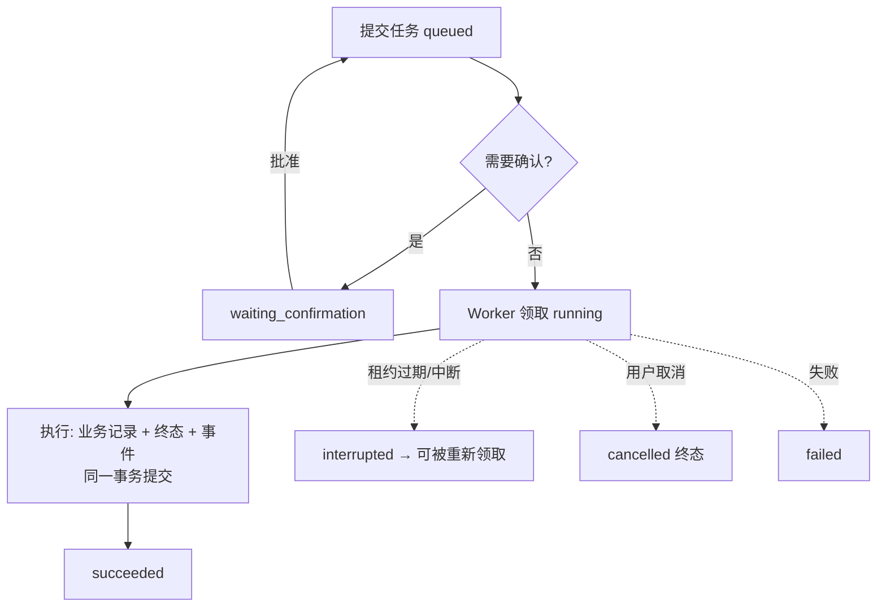

# 06 · 后台运行时：让长任务可靠地跑完

**成果**：你能提交一个后台任务、用幂等键重复提交得到同一个任务、刷新后从事件续看进度；能分清「进程已启动」「依赖已就绪」「后台任务已完成」三件事；能解释幂等键、租约、fencing 各防什么问题。

**前置**：[01](01-quickstart.md) 的后台任务一节；[05](05-wiki.md) 知道 Wiki 编译走后台。

**对应版本**：接口按当前 `main` 核对。

**对应源码**：`backend/app/runtime/`、`backend/app/models/run.py`、`backend/app/api/routes/runs.py`、`backend/app/schemas/run.py`。

---

## 为什么需要一套运行时

导入文件、编译 Wiki、分析岗位、生成报告都要几秒到几十秒，不能让浏览器一直干等。把这类操作丢到后台，就带来一串新问题：

- 网络重试导致同一任务提交两次，会不会做两遍？
- Worker 崩了，任务卡在「运行中」怎么办？
- 用户取消后，旧的 Worker 回调还能不能覆盖新状态？
- 刷新页面，进度怎么接上？

CareerLens 不用 Redis 做队列，而是**用数据库当队列**：Run / Step / Event 三张表，加租约、fencing 代次和提交边界来保证正确性。

<details>
<summary>一张图（文字版在下面）</summary>



**文字版**：任务提交后是 queued；需要确认的先进 waiting_confirmation，批准后回到队列。Worker 领取后变 running，执行结果在**同一事务**里写入业务记录、终态和最终事件。成功到 succeeded；租约过期变 interrupted 可被重新领取；取消和失败是终态。

</details>

## 三个机制，各防什么

| 机制 | 防什么 | 怎么工作 |
| --- | --- | --- |
| 幂等键 `Idempotency-Key` | 重复提交让任务做两遍 | 同一键 + 同一输入返回同一个 run；同一键不同输入报 409 |
| 租约 lease | Worker 崩溃后任务永久卡住 | 领取时拿默认 30 秒租约（`RUN_LEASE_SECONDS` 可配 3–300），心跳每约 2 秒续租；续不上就可被别人接管 |
| fencing token | 过期 Worker 的旧回调污染新状态 | 字段名是 `fencing_token`（事件的 `generation` 只是它的快照）；领取、中断、取消都会递增；提交前校验，不符就丢弃 |

**这几个「代次」是独立的字段，别混成一个**：`fencing_token` 管 Worker 租约 fencing；`input_epoch` 是提交时的输入代次；`target_generation` 是目标（如 `wiki:{slug}`）的代次；`RunScope.generation` 是目标计数器。提交前分别校验，防止用过期输入产出脏结果（`models/run.py:36-43`）。

**还需要知道**：`interrupted` **不是终态**——租约过期、Worker 关闭、超时或可重试错误都会进入它（`worker.py:120,139`），同一个 run 会被重新领取、attempts 加一、从头重算。三种终态是 `succeeded` / `failed` / `cancelled`。`cancelled` 后取消是终态，用同一个幂等键再提交只会拿回那个已取消的 run，**要重跑必须用新的键**，且是全新任务、从头重算，不是接着上一次的模型输出继续生成。

## 用真实接口观察

### 观察 1：提交 + 幂等

在 `/docs` 展开 `POST /api/v1/runs`：

```json
{
  "user_id": "learner",
  "operation": "job_analysis",
  "input": {
    "title": "AI Agent 开发",
    "jd_text": "要求熟悉 Python、FastAPI、LangGraph、RAG 与 PostgreSQL；了解 Docker。",
    "weekly_hours": 10
  },
  "requires_confirmation": false
}
```

同时在请求头里加：

```text
Idempotency-Key: my-first-run
```

第一次返回 `202` 和 run id。原样再提交一次（同样的键、同样的内容），返回 `200` 和**同一个 run id**——不会做第二遍。若改了内容却用同一个键，会返回 `409`。

三种 `operation` 的 `input` 字段不同：

| operation | input 字段 |
| --- | --- |
| `job_analysis` | `title`、`jd_text`（至少 10 字）、`weekly_hours`（1–80） |
| `wiki_compile` | `slug`、`title`、`evidence_ids`（1–50 条）、`base_version`（可选） |
| `report` | `job_analysis_id` |

### 观察 2：看状态和事件

```text
GET /api/v1/runs/<run_id>?user_id=learner     看状态（queued → running → succeeded）
GET /api/v1/runs/<run_id>/steps?user_id=...   看步骤
GET /api/v1/runs/<run_id>/events?user_id=...  看有序事件
```

事件每条都有 `seq`（序号）、`generation`（代次）、`event_type`、`data`。事件类型形如 `run.queued`、`run.started`、`step.running`、`step.succeeded`、`run.succeeded`。

### 观察 3：刷新后续看

`GET /api/v1/runs/<run_id>/stream?user_id=learner&after_seq=0` 是 SSE 进度流：服务端一条条推事件，帧里 `id` 就是 seq。刷新后带 `after_seq=<上次的序号>`（或请求头 `Last-Event-ID`）接着看，不会从头开始。工作台的任务中心就是这么做的。

**先预测，再看**：如果 `after_seq` 给得比当前事件数还大，轮询和 SSE 流分别会怎样？

<details>
<summary>核对（两种接口行为不同，容易记错）</summary>

- **轮询** `GET .../events`：支持 `after_seq`，一次最多返回 100 条；游标超过当前事件数时**返回空列表 `[]`，不报错**（`runs.py:161-168`）。
- **SSE 流** `GET .../stream`：同样支持 `after_seq` / `Last-Event-ID`，但游标超过 `event_seq` 会返回 **409**（`runs.py:184-185`），非数字的 `Last-Event-ID` 返回 400。

这是两种接口的有意区分：轮询拿不到更多事件就是「暂时没有」，流则明确告诉你游标越界了。上一版把两者混写成「都返回 409」，是错的。

</details>

## Worker 必须运行

后台任务靠独立 Worker 执行，`docker-compose.yml` 里已经起了一个。若你是手动启动的，需要另跑：

```bash
python -m app.runtime.worker
```

**任务一直 queued 十有八九是 Worker 没起来。** Worker 领取任务后，一边执行一边心跳续租；它和协调器（Coordinator）配合——协调器把任务分派给不同角色的专家子流程（需求分析、Wiki 整理、报告撰写、证据核验），每次分派都产生进度事件。关键设计：业务记录、终态、最终事件在**同一个事务**提交，所以「提交即终态」，不会出现「状态成功了但业务数据没写」。

## 自查清单

- [ ] 提交一个 run，用同一幂等键再提交，拿到同一个 run id
- [ ] 说出 `interrupted` 和 `cancelled` 的区别，以及取消后重跑为什么要新键
- [ ] 能解释幂等键、租约、fencing 各防什么
- [ ] 刷新后用 `after_seq` 接着看进度，能看到事件序号连续
- [ ] 能分清「进程已启动」「依赖已就绪」「后台任务已完成」

## 常见坑

- **任务一直 queued**：Worker 没启动。手动启动时另跑 `python -m app.runtime.worker`。
- **同一幂等键改内容报 409**：这是设计行为，不是 bug；要新任务就用新键。
- **刷新后进度从头**：没带 `after_seq` / `Last-Event-ID` 游标。
- **以为取消后能「接着生成」**：取消是终态；重跑是全新任务，不是续写上一次输出。

## 下一步

现在核心机制都齐了。[07 · 接入与验证](07-integration.md)讲怎么把 API、工作台、数据库、Worker 和质量门禁串成一个能交付的系统。术语见[术语表](GLOSSARY.md)。
