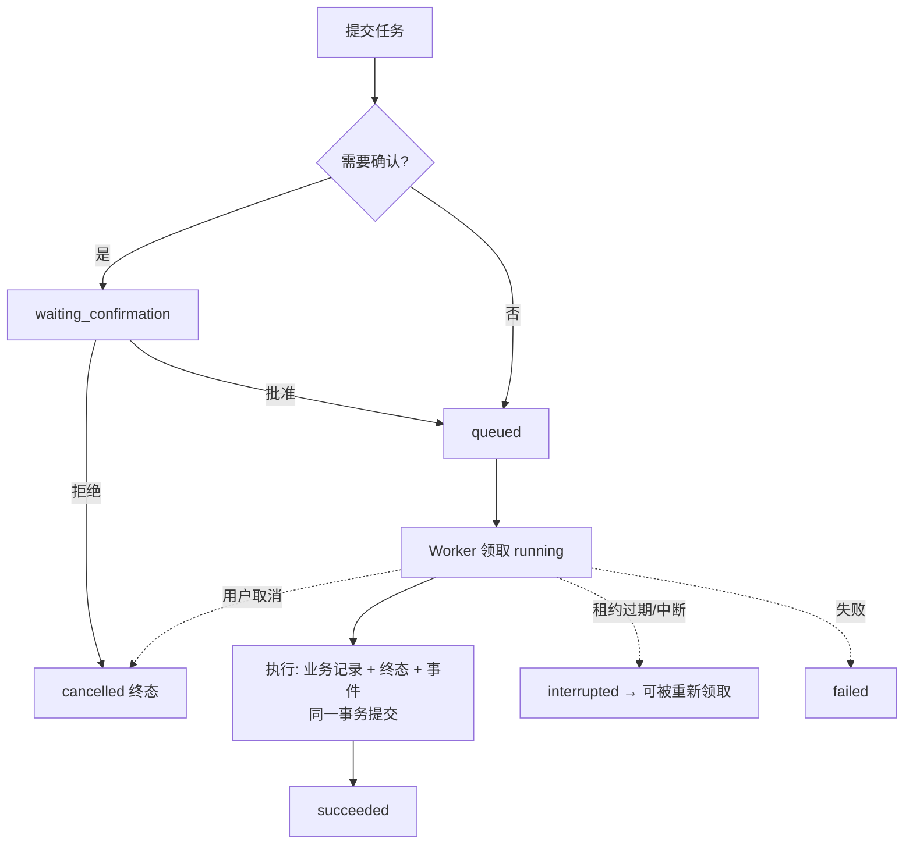
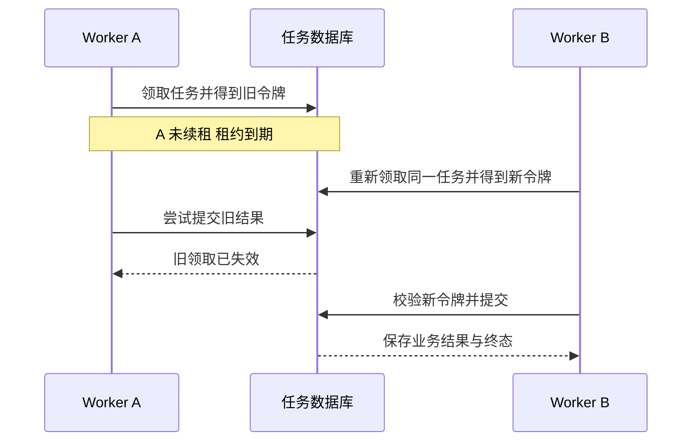

# 06 · 后台运行时：让长任务可靠地跑完

林澈提交岗位分析后可以先关掉网页，回来再用同一个任务编号找结果。本课会实际提交、重试并续看一次任务，再用测试观察 Worker 的租约到期后谁能写入。

只用浏览器时可先读图和预测题。接口实验沿用第 01 课的合成账号与运行中的 API、Worker。租约实验另需 Python 后端开发依赖。阅读约 20 分钟，跟做约 20 分钟。 [第 01 课](01-第一次跑起来.md) · [后台编译入口](05-Wiki知识组织.md)

**对应版本**：接口按当前 `main` 核对。

**对应源码**：`backend/app/runtime/`、`backend/app/models/run.py`、`backend/app/api/routes/runs.py`、`backend/app/schemas/run.py`。

---

## 为什么需要一套运行时

导入文件、编译 Wiki、分析岗位、生成报告都要几秒到几十秒，不能让浏览器一直干等。把这类操作丢到后台，就带来一串新问题：

- 网络重试导致同一任务提交两次，会不会做两遍？
- Worker 崩了，任务卡在「运行中」怎么办？
- 用户取消后，旧的 Worker 回调还能不能覆盖新状态？
- 刷新页面，进度怎么接上？

CareerLens 不用 Redis 做队列，而是**用数据库当队列**：Run / Step / Event 三张表，加租约、fencing 代次和提交边界来保证正确性。

<details>
<summary>一张图（文字版在下面）</summary>



提交时会进入 `queued` 或 `waiting_confirmation`。待确认的任务获批后再排队，拒绝后结束为 `cancelled`。Worker 领取后变 running，执行结果在**同一事务**里写入业务记录、终态和最终事件。成功到 succeeded；租约过期变 interrupted 可被重新领取；取消和失败是终态。

</details>

## 先看 Run 表存了什么

运行时不用 Redis 队列，而是把任务状态存在数据库里。理解三个机制之前，先看 `backend/app/models/run.py` 的 `AgentRun` 这张核心表——后面讲的幂等、租约、fencing 都是它上面的字段。

| 字段组 | 关键字段 | 作用 |
| --- | --- | --- |
| 身份 | `id`、`user_id`、`operation`、`request_key` | 任务是谁的、做什么、幂等键 |
| 输入 | `payload`、`upload_bytes`、`request_hash` | 输入快照与摘要 |
| 状态 | `status`、`confirmation`、`attempts`、`max_attempts` | 当前状态、确认状态、尝试次数 |
| 并发 | `lease_owner`、`lease_until`、`fencing_token` | 谁持有租约、到什么时候、令牌代次 |
| 新鲜度 | `input_epoch`、`target_key`、`target_generation` | 输入与目标是否还是最新的 |
| 进度 | `event_seq`、`result`、`error_code` | 事件游标、最终结果、失败原因 |

还有两张配套表：`RunStep`（复合主键 `run_id + name`，记录每个步骤的状态和 attempt）与 `RunEvent`（复合主键 `run_id + seq`，记录有序事件）。用 `store.py` 的 `event` 函数可以核对三个字段：`seq` 是递增后的 `run.event_seq`，`generation` 是当时的 `fencing_token`，`event_type` 是调用方传的字符串（`run.queued`、`run.started`、`step.running`、`run.succeeded` 等）。

**为什么把事件也存数据库？** 因为刷新页面后要能接回进度。事件有持久的 `seq`，前端带 `after_seq` 就能只取增量，不用重跑任务。内存队列做不到这一点——进程重启就没了。

## 三个机制，各防什么

| 机制 | 防什么 | 怎么工作 |
| --- | --- | --- |
| 幂等键 `Idempotency-Key` | 重复提交让任务做两遍 | 同一用户下，同一键和同一请求返回同一个 Run。改任务类型、输入或是否需要确认后复用键会得到 409 |
| 租约 lease | Worker 崩溃后任务永久卡住 | 领取时拿默认 30 秒租约（`RUN_LEASE_SECONDS` 可配 3–300），心跳间隔 `min(2, 租约/3)`（默认正好 2 秒，`worker.py:46`）；续不上就可被别人接管 |
| fencing token | 过期 Worker 的旧回调污染新状态 | 字段名是 `fencing_token`（事件的 `generation` 只是它的快照）；领取、中断、取消都会递增；提交前校验，不符就丢弃 |

想象 Worker A 算到一半断了心跳。它的租约到期后，B 领取同一个任务。A 恢复时也许还算出了一个答案，因此只在领取时校验一次还不够。保存前，数据库重新检查当前持有人、租约截止时间和令牌。A 手里的旧令牌会被拒绝。



当前 Worker 还要在保存时重查输入和目标。 `input_epoch` 用于发现任务所依赖的输入已变，`target_generation` 用于发现目标已经被更新，例如同一个 `wiki:{slug}` 有更新的工作。 `fencing_token` 回答的是「这个 Worker 还持有任务吗」。在 [任务存储](../backend/app/runtime/store.py)对照 `live_claim` 和 `check_inputs`，就能看到三项分别在哪里校验。

### 三种「新鲜度」各管一件事

Worker 提交前先用 `lock_claim` 校验领取资格，再用 `check_inputs` 比对输入与目标代次。普通任务读用户输入代次，文件或媒体导入读删除代次。 [代次比对](../backend/app/runtime/store.py#L59-L74) · [提交事务](../backend/app/runtime/worker.py#L76-L86)

| 字段 | 防什么 | 谁会让它变 | 例子 |
| --- | --- | --- | --- |
| `fencing_token` | 过期 Worker 还持有任务吗 | 领取、中断、取消（都 +1） | Worker A 租约过期后 B 重领，A 的旧令牌提交被拒 |
| `input_epoch` | 任务依赖的输入变了吗 | 证据删除、画像重建等（`privacy.py`、`profile.py` 里 bump） | 分析任务排队期间证据被删，提交时报 `stale_input` |
| `target_generation` | 目标已被更新的工作覆盖了吗 | 同一目标的更新请求（如同一个 `wiki:{slug}`） | 旧编译还在跑，用户又提交了一版，旧任务作废 |

一句话记法：**fencing 管「人」（Worker 还有没有资格）、input_epoch 管「料」（输入还在不在）、target_generation 管「位」（这页/这个文件是否已被新请求占了）**。三者任一不符，提交前都会抛 `StaleInput`（后两者）或 `LeaseLost`（前者），旧结果不会落库。

### 需要确认的任务：waiting_confirmation

有些操作不希望提交后立刻执行——比如要人先批准。这不是某个固定的 `operation`，而是提交时的 `requires_confirmation: bool`（`schemas/run.py:41`），任何 operation 都能用。

流程是这样的（`store.py:211-229`）：

1. 提交时若 `requires_confirmation=true`，状态直接是 `waiting_confirmation`，`confirmation="pending"`，初始事件是 `run.waiting_confirmation`。这种任务**不会**被 Worker 领取——队列只认 `queued` 和 `interrupted`。
2. 调用 `POST /api/v1/runs/{run_id}/decision`，路径格填待确认任务的 `id`，查询参数填原 `user_id`。批准时发送 `{"approve": true}`，拒绝时发送 `{"approve": false}`。
3. 批准：`confirmation="approved"`，状态回到 `queued`，事件 `run.approved`，这时 Worker 才会领。拒绝：直接 `end(cancelled, reason="rejected")`，进入终态。

有个细节：目标代际在确认阶段故意**不**递增（`bump=not confirmation`），等到批准那一刻才 bump。待确认的新请求此时尚未占用新的目标代次。批准时才更新目标，输入代次仍会在执行阶段接受检查。重复给同一个决定是幂等的（返回同一个 run），给相反决定或非等待状态再决定会 409（`test_approval_is_idempotent_releases_slot_and_conflicts_on_reversal`）。

`interrupted` 表示当前尝试已中断。若还有尝试次数，同一个 Run 可以被重新领取，`attempts` 增加并重新计算。达到次数上限会进入 `failed`。`succeeded`、`failed`、`cancelled` 都是终态。以同一个幂等键重试会读回原任务，想重新计算时用一个新键。

## 用真实接口观察

### 观察 1：提交 + 幂等

先在第 01 课所用服务的 Swagger 打开 `POST /api/v1/profiles/{user_id}/rebuild`，用 `learner` 重建画像。使用其他练习账号时，将下面请求和所有查询里的 `learner` 一起替换。如果还没为该账号导入材料，先完成第 01 课的导入。接着在 `POST /api/v1/runs` 点 **Try it out**，填入下面的请求体。

```json
{
  "user_id": "learner",
  "operation": "job_analysis",
  "input": {
    "title": "AI Agent 开发",
    "jd_text": "要求熟悉 Python、FastAPI、LangGraph、RAG 与 PostgreSQL；了解 Docker。",
    "weekly_hours": 10
  },
  "requires_confirmation": false
}
```

在 Swagger 的 `Idempotency-Key` 请求头输入框填 `my-first-run`。如果这个账号已用过该键，给这组实验选个新键，两次提交都用它。

```text
Idempotency-Key: my-first-run
```

首次发送返回 `202`，从响应顶层抄下 `id` 作为 Run ID。原样再提交一次（同样的键、同样的内容），返回 `200` 和**同一个 run id**——不会做第二遍。若改了内容却用同一个键，会返回 `409`。做冲突对照时只把 `weekly_hours` 从 `10` 改成 `11`，原任务的编号和输入仍保留。

JSON 提交支持下面三种 `operation` 的 `input` 字段不同：

| operation | input 字段 |
| --- | --- |
| `job_analysis` | `title`、`jd_text`（至少 10 字）、`weekly_hours`（1–80） |
| `wiki_compile` | `slug`、`title`、`evidence_ids`（1–50 条）、`base_version`（可选） |
| `report` | `job_analysis_id` |

### 观察 2：看状态和事件

```text
GET /api/v1/runs/<run_id>?user_id=learner     看状态（queued → running → succeeded）
GET /api/v1/runs/<run_id>/steps?user_id=...   看步骤
GET /api/v1/runs/<run_id>/events?user_id=...  看有序事件
```

在 Swagger 的各个 `GET` 接口里，`run_id` 填首次响应的 `id`，`user_id` 填提交时使用的账号。后台任务很快时可能直接看到 `succeeded`，此时可以从事件里补看排队和领取。岗位分析任务成功后，用 `result.job_analysis_id` 到 `GET /api/v1/jobs/{analysis_id}` 打开结果。

事件每条都有 `seq`（序号）、`generation`（代次）、`event_type`、`data`。事件类型形如 `run.queued`、`run.started`、`step.running`、`step.succeeded`、`run.succeeded`。

### 观察 3：刷新后续看

`GET /api/v1/runs/{run_id}/stream` 会以 SSE（服务端发送事件）逐条推送进度，帧里的 `id` 是事件序号。先查 `/events?after_seq=0`，挑一条终态前的 `seq`，把它填进下面的 `after_seq`。将 `RUN_ID` 换成实际编号。这里以 Compose 默认端口为例，练习副本则用自己的端口。PowerShell 使用 `curl.exe`。

```bash
curl -N "http://localhost:8000/api/v1/runs/RUN_ID/stream?user_id=learner&after_seq=1"
```

第一条事件的 `id` 应大于你填的序号。也可以用 `Last-Event-ID` 请求头传上次收到的序号。已完成的 Run 发送完剩余事件就会关闭流，便于对照重放。 [事件和流接口](../backend/app/api/routes/runs.py#L153-L223)

**先预测，再看**：如果 `after_seq` 给得比当前事件数还大，轮询和 SSE 流分别会怎样？

<details>
<summary>核对（两种接口行为不同，容易记错）</summary>

- **轮询** `GET .../events`：支持 `after_seq`，一次最多返回 100 条；游标超过当前事件数时**返回空列表 `[]`，不报错**（`runs.py:161-168`）。
- **SSE 流** `GET .../stream`：同样支持 `after_seq` / `Last-Event-ID`，但游标超过 `event_seq` 会返回 **409**（`runs.py:184-185`），非数字的 `Last-Event-ID` 返回 400。

轮询可用空列表表示这次没有增量。流收到超前游标时会给出 `Event cursor is ahead of this run`。重查该 Run 的事件，换成同一任务上已收到的有效序号后再连。

</details>

## 成功时，三件事在同一个事务里提交

这是运行时最值得记住的一条不变量。Worker 的 `execute`（`worker.py:76-86`）在最后一步用一个数据库事务同时完成：

1. `await effect(session)` —— 写业务记录（比如一条 `JobAnalysis` 或 `WikiPage`），用的是**同一个 session**；
2. `step(session, run, "persist", "succeeded")` 和 `event(..., "step.succeeded")` —— 记步骤和事件；
3. `end(session, run, "succeeded", result=result)` —— 写任务终态和最终结果。

事务块退出时一次提交，所以不会出现「业务记录写了但任务还显示 running」或「任务成功但结果读不到」这种中间态。反过来说，如果 `effect` 里出错，整块回滚——业务记录不会留下（测试 `test_failure_after_domain_flush_rolls_back_and_replays_once` 验证了 effect 内 flush 后抛错，最终 `JobAnalysis` 是 0 条，任务变成 `interrupted`，下次重跑成功）。

执行重活（解析、委派、核验）时**不**持有数据库事务，只在最后提交时开事务。这避免了长时间占着连接和锁。进度事件通过 `progress()` 各开短事务写入。

## Worker 必须运行

默认 Compose 会启动 Worker。如果沿用第三章练习 API，在仓库根用同一练习副本另开 `practice.py worker`。直接运行后端时，在另一终端进入 `backend`，激活相同虚拟环境，沿用 API 的数据库和鉴权配置，再执行：

```bash
python -m app.runtime.worker
```

任务一直显示 `queued` 时，先看 Worker 的容器状态和日志，再查同一个教学用户是否已有任务在运行。领取后可以用事件看它走到哪一步。成功提交时，业务记录、终态和最终事件都在同一个数据库事务里保存。收到成功事件后，可以用结果 ID 读取相应的分析或报告。

## 可复跑实验：租约重领与旧 Worker 拒写

幂等和事件续看能直接用 API 观察（观察 1、3）。**租约重领和 fencing 拒写不能纯靠 HTTP 复现**——它们依赖"时间过去、租约到期"，需要一个冻结的时钟，所以走后端测试。

**固定输入**（合成）：一个 `job_analysis` run，Worker A 领取（拿到旧 `fencing_token`），把时钟往前推 120 秒（租约只有 30 秒），Worker B 重新领取同一个 run（拿到更高的 token），然后让 A 尝试提交旧结果。

可复跑命令（在 `backend/` 目录）：

```bash
pytest tests/test_run_runtime.py::test_expired_lease_restarts_with_new_fence -v
```

**先预测，再核对**：

| 要观察什么 | 预期 | 依据 |
| --- | --- | --- |
| 两个 Worker 拿到的是不是同一个 run？ | 是，`old.run_id == new.run_id` | `test_run_runtime.py:173` |
| 重领后的 fencing token | `new.token > old.token`（领取与中断都会 +1） | `store.py:289,299` |
| Worker A 用旧 token 提交 | 抛 `store.LeaseLost`，**没有 HTTP 状态码**——被 `perform` 静默吞掉，不改任务状态 | `store.py:334-337`、`worker.py:114-115` |
| 最终结果 | `status="succeeded"`、`attempts==2`（第二个 Worker 从头重算） | `test_run_runtime.py:179` |

测试里冻结时钟的做法：`clock=[100]`，把 `store.now_seconds` 替换成 `lambda: clock[0]`，领取后 `clock[0] += 120`。**必须 patch `store.now_seconds`**（不是 `datetime`），因为 `live_claim`/`claim_next`/`heartbeat` 都调它（`store.py:251,292,316,323`）。

**可核对的产物**：一段记录，写清 run ID、两次领取的 token 大小关系、旧 token 提交的 `LeaseLost`、最终 `succeeded` + `attempts=2`。补充实验 `test_cancel_while_computing_fences_off_late_result` 演示取消后迟到的旧结果同样被挡住。

> 一个常见误解：以为"旧 Worker 拒写"会看到某个 HTTP 错误码。不会——它是进程内部的 `LeaseLost` 异常，被 Worker 捕获后**什么都不做**（不改状态、不写错误码）。可观测的是"旧结果没生效、新结果写入、attempts 加一"，以及在单测里直接断言 `pytest.raises(LeaseLost)`。

## 自查清单

- [ ] 提交一个 run，用同一幂等键再提交，拿到同一个 run id
- [ ] 说出 `interrupted` 和 `cancelled` 的区别，以及取消后重跑为什么要新键
- [ ] 能解释幂等键、租约、fencing 各防什么
- [ ] 刷新后用 `after_seq` 接着看进度，能看到事件序号连续
- [ ] 能分清「进程已启动」「依赖已就绪」「后台任务已完成」

## 常见坑

- **任务一直 `queued`。** 先确认 Worker 在线并连接同一个数据库，再查该账号已有任务是否占着执行槽。
- **同一幂等键改内容报 409**：这是设计行为，不是 bug；要新任务就用新键。
- **刷新后进度从头**：没带 `after_seq` / `Last-Event-ID` 游标。
- **以为取消后能「接着生成」**：取消是终态；重跑是全新任务，不是续写上一次输出。

## 下一步

现在核心机制都齐了。[07 · 接入与验证](07-接入与验证.md)讲怎么把 API、工作台、数据库、Worker 和质量门禁串成一个能交付的系统。术语见[术语表](术语表.md)。
