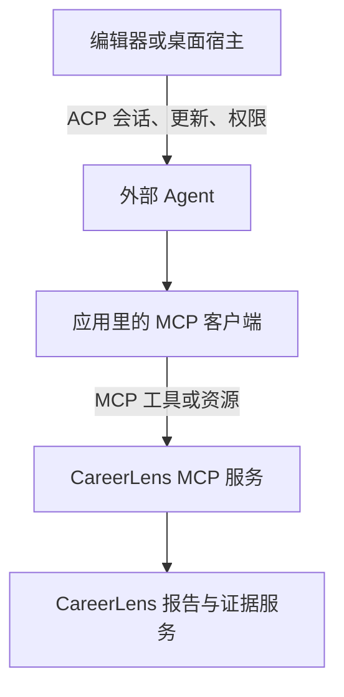

# 07-A · MCP 服务与 ACP：两个协议各接哪一段

**阅读约 9–12 分钟，练习约 10 分钟。** 先读过[工具调用](01-agent-design/01-B-工具调用.md)与[后台运行时](06-后台运行时.md)。纸面可以完成接线判断。跑测试需要[后端开发依赖](../CONTRIBUTING.md)，使用合成数据。

假设你已经跑出了林澈的报告，想让桌面助手读取它。再加一项需求：想在编辑器里控制另一个 Agent 会话，看它有没有开始工作，并批准它的一次操作。这两个需求都谈到「接入」，通信的两端却不同。

## 在 CareerLens 里找到 MCP 服务

MCP（Model Context Protocol）让有 MCP 客户端的应用发现并使用一个服务器提供的外部能力。CareerLens 的入口在 `backend/app/mcp/server.py`。文件中有三种装饰器，可以顺着这三类去找功能。

| 浏览哪种声明 | CareerLens 里的例子 | 什么时候用 |
| --- | --- | --- |
| `@mcp.tool()` | `get_evidence`、`analyze_job_description`、`generate_career_report` | 运行一个带参数的操作 |
| `@mcp.resource(...)` | `report://{user_id}/{report_id}` | 用 URI 读取已有报告 |
| `@mcp.prompt()` | `prepare_interview_pitch` | 取一个可复用的提示模板 |

以读取为例，外部客户端先获取工具列表，找到 `get_career_report`，传 `user_id` 和 `report_id`。开启鉴权时，处理程序检查调用者身份和权限。通过后读取已有报告，并记录工具调用的审计事件。HTTP API 和 MCP 共用数据与服务，所以本次调用可以读到同一份报告。 [MCP 架构](https://modelcontextprotocol.io/docs/learn/architecture) · [CareerLens 服务端](../backend/app/mcp/server.py)

服务端支持两种传输方式。本地 `stdio` 让可信客户端通过标准输入输出和子进程通信。`streamable-http` 把服务作为独立的 HTTP 端点，远程使用时要配置 Bearer Token 和相应的权限。仓库的接入文档写有用户身份和权限范围的配置。 [接入与安全](../docs/integrations-and-security.md)

## ACP 在桌面 Agent 会话中的位置

这里的 ACP 指 **Agent Client Protocol**。编辑器、IDE 或桌面客户端连接支持 ACP 的 Agent 后，可用这套协议新建会话、发提示、接收进度更新和处理权限请求。研究桌面实现时，可以沿「宿主 → Agent 会话 → 工具操作」画图。Agent 在执行任务时也可以借助 MCP 调用其他服务。 [ACP 介绍](https://agentclientprotocol.com/get-started/introduction)



### CareerLens 自己的任务进度在哪

CareerLens 第三期沿用 Web 架构，仓库未实现 ACP 服务。工作台提交任务到 `POST /api/v1/runs`，Worker 处理任务，页面用 SSE 接收进度事件。需要确认的动作通过 Web 界面提交决定。关闭页面以后，可以用同一个 Run ID 找回后台记录。这些就是在本仓库里要沿源码追踪的生命周期。 [第三期架构决定](../docs/phase-3-runtime.md) · [Run API](../backend/app/api/routes/runs.py)

| 你想做的事 | 到哪看 |
| --- | --- |
| 桌面助手读取已有的林澈报告 | CareerLens 的 MCP Tool 或 Resource |
| 在 CareerLens 页面刷新并接回后台进度 | Run ID、SSE 和事件序号 |
| 写一个编辑器客户端，和支持 ACP 的编码 Agent 建会话 | ACP 的会话和权限协议 |

上图描述外部客户端的一种部署。CareerLens 作为其中的 MCP 服务，桌面 Agent 和 ACP 会话由外部程序提供。

## 练习：跑一次真实的 MCP 合约

在已安装后端开发依赖的终端，从仓库根进入 `backend`。

```bash
cd backend
python -m pytest -q tests/test_mcp.py
```

再打开[测试源码](../backend/tests/test_mcp.py)，找到这两条用例。

1. `test_mcp_exposes_complete_contract` 从客户端请求工具、资源模板和提示模板。写出一项读取工具、一个报告 URI 和一个提示名。然后回 `server.py` 找到对应声明。
2. `test_mcp_job_report_flow_is_audited` 用合成的 Python 项目做岗位分析，拿到 `job_analysis_id` 去生成报告，再按 `report_id` 取回版本 1，最后读一次资源 URI。末尾检查数据库里出现了 `mcp.job.analyze`、`mcp.report.generate` 和 `mcp.report.read` 三类审计动作。你可以把这三个动作按自己的理解画成一条调用线。

这个练习用同进程 MCP 客户端和测试库。测试文件还检查令牌复用和 HTTP 需要认证的行为。可以把测试通过和真实桌面客户端完成接入分别记录，两个环境验证的内容不同。

<details>
<summary>只用浏览器时的自查答案</summary>

工具可选 `get_career_report`，报告资源模板是 `report://{user_id}/{report_id}`，提示名可选 `prepare_interview_pitch`。已有报告由 MCP 读取。在工作台刷新后看进度，沿 Run 和 SSE 查。编辑器中的外部 Agent 会话走它所支持的 ACP。

</details>

## 下一步

你已经能从问答、证据和 Wiki 走到任务运行与接入。想比较不同检索方法的结果，去 [08-2 评测](08-advanced/08-2-评测.md)亲手让一个指标下降。想换模型，再读 [08-1 真实模型](08-advanced/08-1-真实模型.md)。
