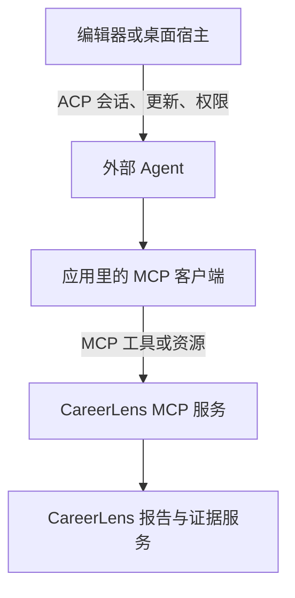

# 07-A · MCP 服务与 ACP：两个协议各接哪一段

**阅读约 15–18 分钟，练习约 10 分钟。** 先读过[工具调用](01-agent-design/01-B-工具调用.md)与[后台运行时](06-后台运行时.md)。纸面可以完成接线判断。跑测试需要[后端开发依赖](../CONTRIBUTING.md)，使用合成数据。

假设你已经跑出了林澈的报告，想让桌面助手读取它。再加一项需求：想在编辑器里控制另一个 Agent 会话，看它有没有开始工作，并批准它的一次操作。这两个需求都谈到「接入」，通信的两端却不同——这正是本课要分清的。

## 为什么要分清这两个协议

「让外部程序用上 CareerLens」和「让编辑器控制一个 Agent 干活」听上去都叫接入，但方向和两端的角色完全不同：

- **MCP** 回答的是：一个客户端（桌面助手、别的 Agent）怎么**发现并调用** CareerLens 已经具备的能力？这里 CareerLens 是**能力提供方（Server）**。
- **ACP** 回答的是：编辑器/IDE 怎么**驱动一个外部编码 Agent**，收发进度、处理权限请求？这里 Agent 是被驱动的那一方，CareerLens 仓库本身并没有实现 ACP。

把两者混成「接入协议」会导致接错端：想让桌面助手读报告，该接 MCP；想在编辑器里开 Agent 会话，那是 ACP 的事，跟 CareerLens 能不能提供报告能力无关。

## 在 CareerLens 里找到 MCP 服务

MCP（Model Context Protocol）让有 MCP 客户端的应用发现并使用一个服务器提供的外部能力。CareerLens 的入口在 `backend/app/mcp/server.py`。文件中有三种装饰器，可以顺着这三类去找功能。

| 浏览哪种声明 | CareerLens 里的例子 | 什么时候用 |
| --- | --- | --- |
| `@mcp.tool()` | `get_evidence`、`analyze_job_description`、`generate_career_report` | 运行一个带参数的操作 |
| `@mcp.resource(...)` | `report://{user_id}/{report_id}` | 用 URI 读取已有报告 |
| `@mcp.prompt()` | `prepare_interview_pitch` | 取一个可复用的提示模板 |

以读取为例，外部客户端先获取工具列表，找到 `get_career_report`，传 `user_id` 和 `report_id`。开启鉴权时，处理程序检查调用者身份和权限。通过后读取已有报告，并记录工具调用的审计事件。HTTP API 和 MCP 共用数据与服务，所以本次调用可以读到同一份报告。 [MCP 架构](https://modelcontextprotocol.io/docs/learn/architecture) · [CareerLens 服务端](../backend/app/mcp/server.py)

### 完整的 MCP 合约：10 个工具、3 个资源、3 个提示

当前服务声明了下列 10 个工具、3 个资源模板和 3 个提示。`test_mcp_exposes_complete_contract` 检查列表里有所有已知工具，并精确比对资源模板和提示名。额外工具本身不会让该测试失败。

**10 个 tool**（括号内是读/写 scope）：

| 工具 | scope | 做什么 |
| --- | --- | --- |
| `list_user_content` | read | 列该用户 Evidence，按时间倒序，`limit` 夹到 1–200 |
| `get_evidence` | read | 按 ID 读单条，不匹配该用户报 `Evidence not found for this user` |
| `import_text_evidence` | write | 导入文本证据，metadata 标 `imported_via=mcp` |
| `search_evidence` | read | 检索证据，返回候选和 `retrieval` 诊断 |
| `get_user_profile` | read | 读画像条目 |
| `list_job_analyses` | read | 列岗位分析，最多 100 条 |
| `analyze_job_description` | write | 分析岗位，`weekly_hours` 夹到 1–80 |
| `generate_career_report` | write | 生成职业报告 |
| `list_career_reports` | read | 列报告，最多 100 条 |
| `get_career_report` | read | 按 ID 读单份报告，含 Markdown |

**3 个 resource template**（URI 精确匹配）：

- `profile://{user_id}` → 画像 JSON
- `evidence://{user_id}/{evidence_id}` → 单条证据
- `report://{user_id}/{report_id}` → 报告（含 Markdown）

Resource 委托给对应的 tool，所以读 resource 也会产生 `mcp.profile.read` / `mcp.evidence.read` / `mcp.report.read` 审计。Prompt 不记审计。

**3 个 prompt**：`explain_profile_claim`、`review_job_match`、`prepare_interview_pitch`。它们是给客户端取用的提示模板，比如让模型「只把证据直接支持的结论标为 supported」。

### 鉴权：三道检查

服务端支持两种传输方式。本地 `stdio` 让可信客户端通过标准输入输出和子进程通信。`streamable-http` 把服务作为独立的 HTTP 端点，远程使用时要配置 Bearer Token 和相应的权限。 [接入与安全](../docs/integrations-and-security.md)

鉴权逻辑分三层（`server.py`）：

1. **构建期**：`MCP_AUTH_MODE` 只接受 `disabled` / `required`。`required` 时注入 `CareerLensTokenVerifier`，它复用业务 token 表 `verify_access_token`，命中就更新 `last_used_at`。
2. **调用期身份**：`_authorized_principal(user_id, scope)` 先取 token。本地禁用鉴权时允许按请求的 `user_id` 使用服务，包含可信 `stdio` 与回环 HTTP。开启鉴权的 HTTP 入口先检查 Bearer Token，未认证请求到不了工具。有 token 时强制 `token.subject == user_id`，防止 A 用户的 token 读 B 用户的数据。
3. **调用期 scope**：要求 `scope in token.scopes`，或者持有 `manage`（manage 覆盖一切）。读类工具要 `read`，写类要 `write`。

`streamable-http` 还有一条硬规则：绑定非回环地址（`host` 不是 `127.0.0.1`/`localhost`/`::1`）却没开鉴权，启动时直接 `RuntimeError`。远程暴露服务必须带鉴权，不能靠「应该没人扫到」。测试 `test_streamable_http_requires_bearer_token` 验证未带 token 的 POST 返回 **401**。

### 审计：成功调用如何留痕

上述工具成功执行时都会走 `_commit_audit`，写一条 `AuditEvent`，action 前缀统一是 `mcp.`。完整清单：`mcp.evidence.list/read/import/search`、`mcp.profile.read`、`mcp.job.list/analyze`、`mcp.report.generate/list/read`。审计记录包含 principal、resource_type、resource_id 和 details。

用工具读报告后，可以在审计里找到 `mcp.report.read`。调用报告资源模板也会委托给工具，因此两次读取可以对应两条同类型的审计事件。 [审计实现](../backend/app/mcp/server.py#L144-L161)

## ACP 在桌面 Agent 会话中的位置

这里的 ACP 指 **Agent Client Protocol**。编辑器、IDE 或桌面客户端连接支持 ACP 的 Agent 后，可用这套协议新建会话、发提示、接收进度更新和处理权限请求。研究桌面实现时，可以沿「宿主 → Agent 会话 → 工具操作」画图。Agent 在执行任务时也可以借助 MCP 调用其他服务。 [ACP 介绍](https://agentclientprotocol.com/get-started/introduction)



图上两段连线传递的内容不同。

- **上一条（ACP）**：编辑器 ↔ 外部 Agent。传的是会话、提示、流式更新、权限请求。
- **下一条（MCP）**：Agent 里的客户端 ↔ CareerLens 服务。传的是工具调用和资源读取。

在下半段，CareerLens 提供查报告和证据的能力。上半段的会话由编辑器和外部 Agent 管理。

### CareerLens 自己的任务进度在哪

CareerLens 第三期沿用 Web 架构，仓库未实现 ACP 服务。工作台提交任务到 `POST /api/v1/runs`，Worker 处理任务，页面用 SSE 接收进度事件。需要确认的动作通过 Web 界面提交决定。关闭页面以后，可以用同一个 Run ID 找回后台记录。这些就是在本仓库里要沿源码追踪的生命周期。 [第三期架构决定](../docs/phase-3-runtime.md) · [Run API](../backend/app/api/routes/runs.py)

| 你想做的事 | 到哪看 |
| --- | --- |
| 桌面助手读取已有的林澈报告 | CareerLens 的 MCP Tool 或 Resource |
| 在 CareerLens 页面刷新并接回后台进度 | Run ID、SSE 和事件序号（见 06） |
| 写一个编辑器客户端，和支持 ACP 的编码 Agent 建会话 | ACP 的会话和权限协议（外部实现） |

试着在纸上标三段。编辑器送出的提示从 ACP 会话进入外部 Agent。Agent 读取报告时把 `user_id` 和 `report_id` 交给 CareerLens 的 MCP 工具。用户回到 CareerLens 工作台看运行进度时，使用自己的 Run ID 和事件游标。

## 用 MCP 读取你刚生成的报告

这组操作使用 [07](07-接入与验证.md) 的 Compose 服务。API 在 8000，MCP 在 8001。带着同一个 `user_id` 和 **报告 ID** 继续，下面按 `learner-plan` 示范。使用练习副本的读者可以先做本页的合约测试；测试会在独立库中创建自己的报告。

1. 在 [8000 的 Swagger](http://localhost:8000/docs) 用 `GET /api/v1/reports/{report_id}` 打开 07 的报告。写下顶层的 `id`、`version` 与正文第一行。这三个值待会儿会从另一个入口再读一次。
2. 用 `POST /api/v1/auth/register` 为同一账号取得教学拥有者令牌。请求体为 `{"user_id":"learner-plan","name":"tutorial-owner"}`。若返回 409，使用该账号现有的拥有者令牌，或选新账号按 07 生成一份报告。用 `POST /api/v1/auth/tokens` 签发本次只读令牌。在 `Authorization` 参数格填 `Bearer ` 加拥有者令牌，请求体为：

```json
{
  "user_id": "learner-plan",
  "name": "tutorial-mcp-read",
  "scopes": ["read"]
}
```

3. 在项目根激活[此前用的 Python 环境](setup/动手准备.md#给源码练习准备一套-python)。把 `REPORT_ID` 换成刚才 201 响应的报告 ID：

```bash
python examples/tutorials/read_mcp_report.py learner-plan REPORT_ID
```

终端提示时粘贴只读令牌。程序以隐藏输入读取令牌，并通过 Bearer 请求头连接本机。它先建立 MCP 会话，调用 `get_career_report`，再读取 `report://learner-plan/REPORT_ID`。两次结果相同才打印编号、版本和 Markdown 首行。与第一步的 HTTP 结果核对，记录一次传的是 URL 和参数，一次传的是工具名与参数。 [完整练习脚本](../examples/tutorials/read_mcp_report.py)

4. 在 Swagger 打开 `GET /api/v1/privacy/{user_id}/audit`，填写教学账号和拥有者令牌。按报告 ID 找两条 `action=mcp.report.read` 的读取记录。合约测试也会核对这一类成功审计。 [审计接口](../backend/app/api/routes/privacy.py)

若连接失败，在项目根查看 `docker compose ps mcp`。HTTP 401 先核对令牌，工具提示用户不匹配时核对 `user_id` 和令牌对应的账号，提示找不到报告时回 07 核对是否传的是报告 ID。做完可在 Swagger 的令牌列表中撤销本次只读令牌。

## 练习：跑一次真实的 MCP 合约

在已安装后端开发依赖的终端，从仓库根进入 `backend`。

```bash
cd backend
python -m pytest -q tests/test_mcp.py
```

再打开[测试源码](../backend/tests/test_mcp.py)，里面有四个用例：

1. `test_mcp_exposes_complete_contract` 从客户端请求工具、资源模板和提示模板。写出一项读取工具、一个报告 URI 和一个提示名。然后回 `server.py` 找到对应声明。注意工具用「子集」断言、资源和提示用「精确相等」断言。
2. `test_mcp_job_report_flow_is_audited` 用合成的 Python 项目做岗位分析，拿到 `job_analysis_id` 去生成报告，再按 `report_id` 取回版本 1，最后读一次资源 URI。末尾检查数据库里出现了 `mcp.job.analyze`、`mcp.report.generate` 和 `mcp.report.read` 三类审计动作。你可以把这三个动作按自己的理解画成一条调用线。
3. `test_mcp_token_verifier_reuses_api_tokens` 把测试库签发的 CareerLens Token 直接交给 verifier，验证返回的 `client_id`、`subject`、`scopes` 与原 token 一致，无效 token 返回 `None`。这证明 MCP 和 HTTP 共用一套 token 体系。
4. `test_streamable_http_requires_bearer_token` 构造一个 `required` 模式的服务，对 `/mcp` 发空请求，断言 401。

这个练习用同进程 MCP 客户端和测试库。可以把「测试通过」和「真实桌面客户端完成接入」分别记录，两个环境验证的内容不同：测试证明合约和审计逻辑正确，真实客户端还要验证传输、鉴权配置和用户体验。

<details>
<summary>只用浏览器时的自查答案</summary>

工具可选 `get_career_report`，报告资源模板是 `report://{user_id}/{report_id}`，提示名可选 `prepare_interview_pitch`。已有报告由 MCP 读取。在工作台刷新后看进度，沿 Run 和 SSE 查。编辑器中的外部 Agent 会话走它所支持的 ACP。

</details>

### 失败反推

| 现象 | 最可能的原因 |
| --- | --- |
| 合约测试说少了某个工具 | 改了 tool 函数名，或忘记加 `@mcp.tool()` 装饰器 |
| 报 `The access token cannot access another user` | 传的 `user_id` 和 token 的 subject 不一致 |
| 报 `Missing required scope` | token 没有对应 scope，也没有 `manage` |
| 审计断言失败 | 先检查调用是否成功，再确认读资源时是否委托到相应工具并提交审计 |
| 非回环 HTTP 启动报错 | 没设 `MCP_AUTH_MODE=required` |

## 这些概念在 CareerLens 里落在哪

| 本课的词 | 源码位置 | 作用 |
| --- | --- | --- |
| `build_mcp_server` | `backend/app/mcp/server.py` | 构建服务，按 auth mode 注入 verifier |
| `_authorized_principal` | `backend/app/mcp/server.py` | 调用期校验用户身份与 scope |
| `_commit_audit` | `backend/app/mcp/server.py` | 随成功的工具调用提交审计 |
| `CareerLensTokenVerifier` | `backend/app/mcp/server.py` | 复用业务 token 表 |
| Run / SSE | `backend/app/api/routes/runs.py` | CareerLens 自己的进度通道，不是 ACP |

回到开头的例子。把 `get_career_report` 标在 MCP 那条线上，再标出外部 Agent 若需要操作权限，会向哪一端发请求。自己的后台任务则继续从 Run 记录和 SSE 检查。

## 下一步

接下来用[第 10 篇的合成作业](10-导入与可回查画像.md)导入一份新材料，从画像追回证据，再用[第 11 篇](11-岗位对比与学习计划.md)比较两个岗位。想检查检索质量，可另外做 [08-2 评测](08-advanced/08-2-评测.md)。
