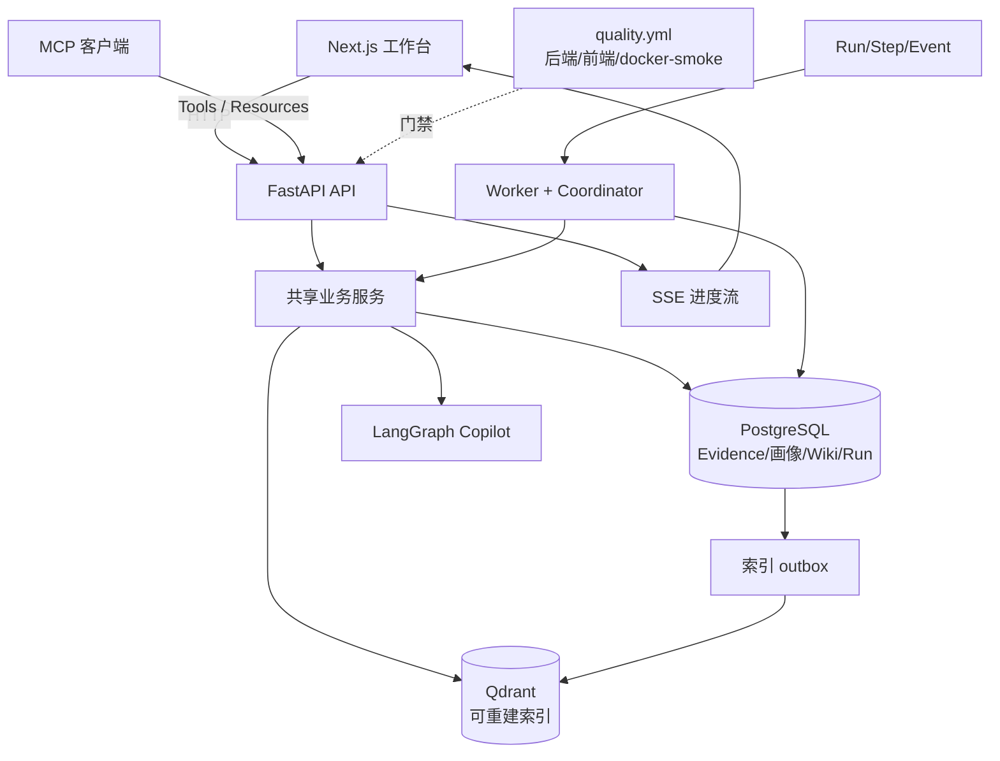

# 07 · 接入与验证：把各部分串成一个系统

**成果**：你能用同一个案例说清 API、工作台、数据库、Worker 和质量门禁怎么配合；能识别「进程已启动」「依赖已就绪」「后台任务已完成」三者差别；知道接真实模型和上生产前要验证什么。

**前置**：[01](01-quickstart.md) 跑通过；读过 [06](06-runtime.md)。

**对应版本**：接口按当前 `main` 核对。

**对应源码**：`backend/app/api/`、`frontend/app/workspace`、`backend/app/security.py`、`.github/workflows/`。

---

## 一张系统图

<details>
<summary>一张图（文字版在下面）</summary>



**文字版**：工作台和 MCP 客户端都走 FastAPI API，API 与 MCP 共用同一套业务服务。业务数据存 PostgreSQL，检索索引存 Qdrant（可由 Evidence 重建）。耗时操作进 Run 表，由 Worker 配合协调器执行；索引同步走 outbox 补偿。进度通过 SSE 推回工作台。CI 的 quality 工作流是持续门禁。

</details>

一个关键边界：**PostgreSQL 是业务数据源，Qdrant 是可从 Evidence 重建的检索索引**。这个分离让「索引坏了能重建」「业务数据只有一个真相来源」成为可能。

## 用同一个案例串起来

还是虚构学习者林澈。走一遍你会用到哪些部件：

| 步骤 | 发生了什么 | 涉及的部件 |
| --- | --- | --- |
| 打开工作台 | 前端从 API 读数据 | Web → FastAPI → PostgreSQL |
| 导入自述 | 文本写成带 ID 的证据，入检索索引 | API → 证据服务 → PostgreSQL → outbox → Qdrant |
| 构建画像 | 从证据抽条目，带 `evidence_ids` | Worker 或 API → 画像服务 |
| 分析岗位 → 报告 | 耗时操作走后台 | Run → Worker → 协调器 → 报告服务 |
| 追问题 | 检索证据 + 生成回答 | Copilot → 检索 → LangGraph → SSE |
| 导出 / 删除 | 数据可收回 | API → 隐私服务 → 各表 + 向量 |

## 观察：分清三种状态

新手最容易把这三个混成一件：

| 状态 | 怎么确认 | 不代表 |
| --- | --- | --- |
| 进程已启动 | `docker compose ps` 显示服务 `Up` | 不代表依赖就绪 |
| 依赖已就绪 | `GET /health/ready` 返回 `status: ok` | 不代表你的导入已完成 |
| 后台任务已完成 | `GET /api/v1/runs/{id}` 状态为 `succeeded` | 不代表结果质量好 |

按顺序查，能解决大部分「为什么没反应」的问题。健康接口是 `/health/ready`（无 `/api/v1` 前缀），依赖不可用时返回 503。

## 质量门禁怎么看

CI 的 `quality.yml` 有三项：后端（Ruff + 测试）、前端（ESLint + TypeScript + 生产构建）、docker-smoke（真实 PostgreSQL + 双 Worker 跑通主流程和后台任务）。

评测接口的精确路径（注意没有裸的 `/evaluation`）：

```text
POST /api/v1/evaluation/sample               内置小样本
POST /api/v1/evaluation/regression/benchmark 冻结基准 + 阈值
GET  /api/v1/evaluation/runs?limit=20        历史结果
```

四项核心指标：`profile_extraction_f1`、`evidence_recall_at_k`、`supported_claim_rate`、`requirement_matching_f1`。冻结基准 v3 的阈值是全 1.0，但那是**合成开发集、本地规则链路**的结果：

> **不能写成「真实业务准确率 100%」。** 它只说明默认 Demo 链路稳定，不代表 Qdrant + 真实模型 + 真实用户数据下的效果。评测口径见 [08-2](08-advanced/08-2-evaluation.md)。

## 接入边界：API、MCP、权限

- **API 与 MCP 共用业务服务**：同一份数据和权限规则，不是一个「后门」。
- **用户隔离**：检索按 `user_id` 过滤；HTTP / MCP 令牌限制资源归属和 Scope。
- **画像修正要确认**：长期画像不是一句话就改，而是先生成草案，用户确认后才写入（工作台里是「生成变更草案」→「确认写入」）。
- **隐私操作**：工作台提供数据导出、单条证据删除、账号清理；永久删除会同步清理向量和对话状态，只留不含原文的审计记录。

> 本地 Demo 默认不开鉴权（`AUTH_MODE=disabled`）。公网部署是另一套安全边界，见[接入、MCP 与安全](../docs/integrations-and-security.md)。

## 自查清单

- [ ] 能对着系统图说出一次「导入→报告」经过哪些部件
- [ ] 能分清进程启动 / 依赖就绪 / 任务完成，并各用一条命令确认
- [ ] 能说清 PostgreSQL 与 Qdrant 的职责边界
- [ ] 知道评测分数是合成集结果，不是真实准确率
- [ ] 能说出 API 与 MCP 为什么共用业务服务

## 常见坑

- **健康接口写错**：是 `/health/ready`，不是 `/api/v1/health/ready`。
- **把 CI 全绿当质量证明**：CI 证明默认链路能跑，不代表真实模型效果。
- **鉴权混淆**：本地 Demo 不开鉴权；上生产要配 Token 和 Scope，别照搬本地配置。

## 下一步

核心链路讲完了。剩下三篇进阶专题：[08-1 真实模型](08-advanced/08-1-real-models.md)、[08-2 评测](08-advanced/08-2-evaluation.md)、[08-3 贡献](08-advanced/08-3-contribute.md)。术语见[术语表](GLOSSARY.md)。
