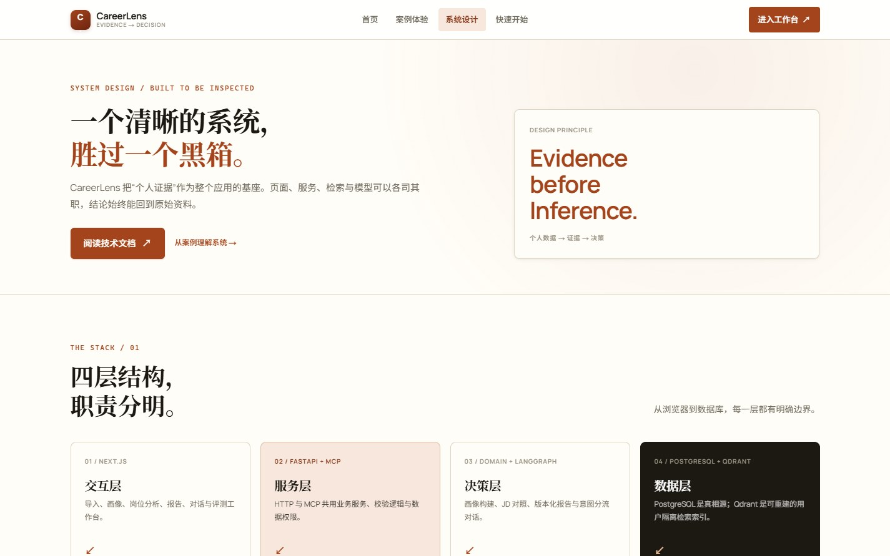
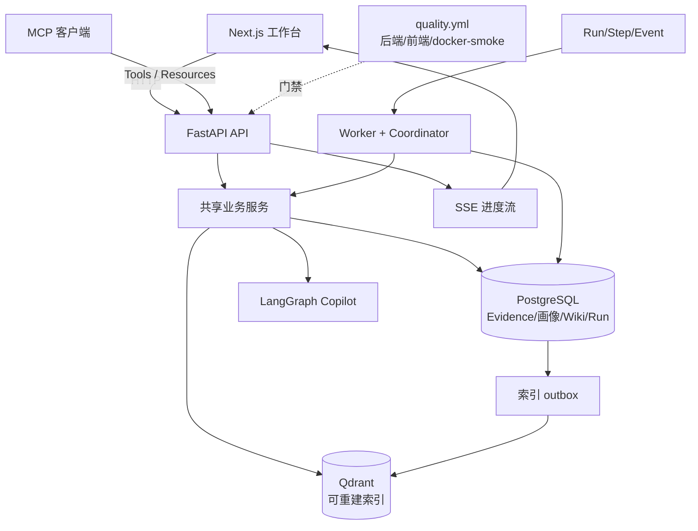

# 07 · 接入与验证：把各部分串成一个系统

**成果**：你能用同一个案例说清 API、工作台、数据库、Worker 和质量门禁怎么配合；能识别「进程已启动」「依赖已就绪」「后台任务已完成」三者差别；知道接真实模型和上生产前要验证什么。

**前置**：[01](01-第一次跑起来.md) 跑通过；读过 [06](06-后台运行时.md)。

**对应版本**：接口按当前 `main` 核对。

**对应源码**：`backend/app/api/`、`frontend/app/workspace`、`backend/app/security/`、`backend/app/services/jobs.py`、`backend/app/services/learning_path.py`、`.github/workflows/`。

---

先看一眼成品的全貌，再往下读每一部分各自负责什么。



## 一张系统图

<details>
<summary>一张图（文字版在下面）</summary>



**文字版**：工作台和 MCP 客户端都走 FastAPI API，API 与 MCP 共用同一套业务服务。业务数据存 PostgreSQL，检索索引存 Qdrant（可由 Evidence 重建）。耗时操作进 Run 表，由 Worker 配合协调器执行；索引同步走 outbox 补偿。进度通过 SSE 推回工作台。CI 的 quality 工作流是持续门禁。

</details>

一个关键边界：**PostgreSQL 是业务数据源，Qdrant 是可从 Evidence 重建的检索索引**。这个分离让「索引坏了能重建」「业务数据只有一个真相来源」成为可能。

## 用同一个案例串起来

还是虚构学习者林澈。走一遍你会用到哪些部件：

| 步骤 | 发生了什么 | 涉及的部件 |
| --- | --- | --- |
| 打开工作台 | 前端从 API 读数据 | Web → FastAPI → PostgreSQL |
| 导入自述 | 文本写成带 ID 的证据，入检索索引 | API → 证据服务 → PostgreSQL → outbox → Qdrant |
| 构建画像 | 从证据抽条目，带 `evidence_ids` | Worker 或 API → 画像服务 |
| 分析岗位（工作台） | 提交为**后台任务**，等成功后点「打开结果」 | 工作台 → `POST /api/v1/runs` → Worker → 匹配服务 |
| 分析岗位（Swagger） | **同步接口**，当场返回匹配分与排期 | `POST /api/v1/jobs/analyze` → 匹配服务 |
| 生成报告 | 耗时操作走后台 | Run → Worker → 协调器 → 报告服务 |
| 追问题 | 检索证据 + 生成回答，返回 **JSON** | Copilot → 检索 → LangGraph → JSON |
| 导出 / 删除 | 数据可收回 | API → 隐私服务 → 各表 + 向量 |

**同一个「分析岗位」，两个入口、两种提交方式，但产物是同一种快照**（都是 `job_analyses` 表里的一条记录，用同一套 `JobAnalysisRead` 读取、同一套失效规则）：

- **工作台**点「分析匹配度」走后台：`POST /api/v1/runs` 提交 `operation: "job_analysis"`（`frontend/app/workspace/page.tsx:163-170`），任务中心显示进度，成功后点「打开结果」才把分析填入页面（`frontend/components/run-center.tsx:165-166`）。
- **Swagger** 里调 `POST /api/v1/jobs/analyze` 是同步的：当场返回 `score / matches / gaps / learning_path`（`backend/app/api/routes/jobs.py:16-31`）。

所以「岗位分析走不走 Worker」要看入口：工作台走，Swagger 不走。别只记住其中一句。另外，**SSE 进度流只属于后台 Run**（`GET /api/v1/runs/{id}/stream`），Copilot 对话返回的是 JSON，不是 SSE。

## 观察：分清三种状态

新手最容易把这三个混成一件：

| 状态 | 怎么确认 | 不代表 |
| --- | --- | --- |
| 进程已启动 | `docker compose ps` 显示服务 `Up` | 不代表依赖就绪 |
| 依赖已就绪 | `GET /health/ready` 返回 `status: ok` | 不代表你的导入已完成 |
| 后台任务已完成 | `GET /api/v1/runs/{id}` 状态为 `succeeded` | 不代表结果质量好 |

按顺序查，能解决大部分「为什么没反应」的问题。健康接口是 `/health/ready`（无 `/api/v1` 前缀），依赖不可用时返回 503。

## 手算匹配分和学习周数

这是 CareerLens 最值得亲手复算的部分。规则在 `jobs.py` 和 `learning_path.py`，**全部可手算**——不需要模拟录用概率，也不靠模型判断。

**先固定输入**（合成，虚构）：JD 要求 4 项必需（Python、FastAPI、PostgreSQL、Docker）+ 2 项加分（RAG、MCP）。画像里 Python/FastAPI/PostgreSQL/MCP 有有效证据且 level≥3（strong），RAG 有证据但 level=2（partial），Docker 没有有效证据（gap）。

**先猜，再算**：

| 要算什么 | 你的答案 | 按公式核对 |
| --- | --- | --- |
| 匹配分 | （先填） | `strong` 系数 1、`partial` 0.65、`gap` 0；必需权重 1、加分 0.5。分子 `1+1+1+0+0.5×0.65+0.5×1 = 3.825`，分母 `4×1+2×0.5 = 5`，`round(100×3.825/5,1) = 76.5` |
| 有 Docker 这个必需缺口，分数又 ≥70，建议是什么？ | （先填） | **仍是「先补齐 1 项必需能力缺口，再判断是否重点投递」**——`jobs.py:115-120` 里必需缺口优先于分数分支 |
| 18 小时的必需缺口，每周 6 小时要几周？改成 9 小时呢？ | （先填） | `weeks = max(1, ceil(18/weekly_hours))`：6 小时 → 3 周，9 小时 → 2 周 |

<details>
<summary>三条规则的源码落点</summary>

1. **分数**：`match_requirements`（`jobs.py:21-54`）——`level≥3` 且有证据 = strong(1.0)，有证据但 level<3 = partial(0.65)，无有效证据 = gap(0)；权重必需 1.0、加分 0.5；`score = round(100×Σ权重×系数 / Σ权重, 1)`。报告里明写「这不是录用概率」（`jobs.py:122`）。
2. **缺口优先**：`prepare_analysis`（`jobs.py:115-120`）——只要有 required gap，就不进 `score>=70` 的分支。
3. **排期**：`build_learning_path`（`learning_path.py:16-59`）——必需缺口 → 必需弱项 → 加分缺口 → 加分弱项，最多 4 阶段；无基础必需项估 18h、`level=2` 估 9h；`weeks = max(1, ceil(hours/weekly_hours))`，阶段串行；`weekly_hours` 限 1–80。

</details>

### 跑一遍项目里的计算函数

这组数可以在终端复算。先按[准备 Python](setup/Python准备.md)装好后端依赖。在 `backend/` 目录把下面保存为 `match_demo.py`，用虚拟环境的 Python 运行 `python match_demo.py`。

```python
from app.models.profile import ProfileItem
from app.services.jobs import match_requirements
from app.services.learning_path import build_learning_path

requirements = [
    {"name": name, "priority": "required"}
    for name in ("Python", "FastAPI", "PostgreSQL", "Docker")
] + [
    {"name": name, "priority": "preferred"} for name in ("RAG", "MCP")
]
levels = {"Python": 3, "FastAPI": 3, "PostgreSQL": 3, "MCP": 3, "RAG": 2}
profile = [
    ProfileItem(category="skill", name=name, level=level, confidence=1.0,
                evidence_ids=[f"ev-{name}"])
    for name, level in levels.items()
]
valid_ids = {item.evidence_ids[0] for item in profile}
matches, score = match_requirements(requirements, profile, valid_ids)
print("score:", score)
for hours in (6, 9):
    path = build_learning_path(matches, title="后端开发", weekly_hours=hours)
    print(hours, [(step["skill"], step["start_week"], step["weeks"]) for step in path])
```

```text
score: 76.5
6 [('Docker', 1, 3), ('RAG', 4, 2)]
9 [('Docker', 1, 2), ('RAG', 3, 1)]
```

每周可用时间只进入排期。 `6h` 时 Docker 用 3 周，RAG 从第 4 周开始。 `9h` 时 Docker 用 2 周，RAG 提前到第 3 周。再试着在计算前从 `valid_ids` 去掉 `ev-Python`。即使画像对象里还留着 Python 等级，它也会降到 `gap`，分数变为 `56.5`。这一步验证了匹配还要核对有效证据。

### 在 API 里看同样的字段

到 `http://localhost:8000/docs` 展开 `POST /api/v1/jobs/analyze`，用同一个教学用户和同一份 JD 提交两次。只改 `weekly_hours`，分别填 6 和 9。JD 可以写「要求熟悉 Python、FastAPI、PostgreSQL 和 Docker。RAG 和 MCP 项目经验优先。」先看解析出的要求与当前用户的画像，再核对下表三项。

| 你要核对的 | 看返回的哪个字段 | 期望 |
| --- | --- | --- |
| 匹配分 | `score` | `76.5`（两次相同——分数与 `weekly_hours` 无关） |
| 必需缺口 | `matches[]` 里 Docker 那项的 `status` | `gap`；同时 `gaps` 里有它 |
| 排期周数 | `learning_path[]` 里 Docker 那一项的 `weeks`（同项还有 `estimated_hours`、`start_week`） | 6 小时 → `3`，9 小时 → `2` |

工作台和 API 使用当前教学用户的画像，只有输入与上面的算例相同时，分数才是 76.5。看到不同的分数时，先对照每项的 `priority`、`level` 和 `evidence_ids`，通常能找到哪项输入不同。

**改变量再跑一次**：在 `POST /api/v1/jobs/analyze` 里把 `weekly_hours` 从 6 改成 9，重新分析同一份 JD，看学习路径的周数从 3 变 2。注意必须**重新调用分析接口**才会重算——已保存的岗位分析是历史快照，改 `weekly_hours` 不会让旧快照自动更新。

**读取旧快照 ≠ 复用旧快照**，这两种情况要分清：

| 你在做什么 | 看到什么 | 代码依据 |
| --- | --- | --- |
| `GET /api/v1/jobs/{id}` 读一份旧分析 | **200**（存在就返回原样），不存在才 404 | `backend/app/api/routes/jobs.py:34-49`，读接口没有失效判断 |
| 用旧分析生成报告 | 快照失效时 **409**（`job_analysis_is_current` 为 false） | `backend/app/api/routes/reports.py:30-31` |
| Copilot 对话**显式传**失效的 `job_analysis_id` | **409**，提示重新分析 | `backend/app/api/routes/chat.py:70-73` |
| Copilot 对话**不传** `job_analysis_id` | 回退取该用户最新分析；若它也失效就静默忽略、继续对话，不报错 | `backend/app/api/routes/chat.py:60-74` |

「快照失效」的精确定义：用当前画像和当前有效证据重算匹配分和逐项状态，结果和快照里存的不一致（或规则版本不符）——通常是**画像变了、或被引用的证据被删了**。只改 JD 文本或 `weekly_hours` 不算失效，但因为快照不重算，你也看不到新周数，所以仍要重新分析。

> 上面 76.5% 和「6→9 小时」是**按源码公式构造的推算**，不是文档里的原例；文档原例是 `(1+0+0.5×0.65)/2.5×100 = 53.0%`。两者都只说明规则怎么算，不代表录用概率或就业承诺。完整规则见 [docs/job-matching-and-planning.md](../docs/job-matching-and-planning.md)。

## 质量门禁怎么看

CI 的 `quality.yml` 有三项：后端（Ruff + 测试）、前端（ESLint + TypeScript + 生产构建）、docker-smoke（真实 PostgreSQL + 双 Worker 跑通主流程和后台任务）。

评测接口的精确路径（注意没有裸的 `/evaluation`）：

```text
POST /api/v1/evaluation/sample               内置小样本
POST /api/v1/evaluation/regression/benchmark 冻结基准 + 阈值
GET  /api/v1/evaluation/runs?limit=20        历史结果
```

四项核心指标：`profile_extraction_f1`、`evidence_recall_at_k`、`supported_claim_rate`、`requirement_matching_f1`。冻结基准 v3 的阈值是全 1.0，但那是**合成开发集、本地规则链路**的结果：

> **不能写成「真实业务准确率 100%」。** 它只说明默认 Demo 链路稳定，不代表 Qdrant + 真实模型 + 真实用户数据下的效果。评测口径见 [08-2](08-advanced/08-2-评测.md)。

## 接入边界：API、MCP、权限

- **API 与 MCP 共用业务服务**：同一份数据和权限规则，不是一个「后门」。
- **用户隔离**：检索按 `user_id` 过滤；HTTP / MCP 令牌限制资源归属和 Scope。
- **画像修正要确认**：长期画像不是一句话就改，而是先生成草案，用户确认后才写入（工作台里是「生成变更草案」→「确认写入」）。
- **隐私操作**：工作台提供数据导出、单条证据删除、账号清理；永久删除会同步清理向量和对话状态，只留不含原文的审计记录。

> 本地 Demo 默认不开鉴权（`AUTH_MODE=disabled`）。公网部署是另一套安全边界，见[接入、MCP 与安全](../docs/integrations-and-security.md)。

## 自查清单

- [ ] 能对着系统图说出一次「导入→报告」经过哪些部件
- [ ] 能分清进程启动 / 依赖就绪 / 任务完成，并各用一条命令确认
- [ ] 能说清 PostgreSQL 与 Qdrant 的职责边界
- [ ] 知道评测分数是合成集结果，不是真实准确率
- [ ] 能说出 API 与 MCP 为什么共用业务服务

## 常见坑

- **健康接口写错**：是 `/health/ready`，不是 `/api/v1/health/ready`。
- **把 CI 全绿当质量证明**：CI 证明默认链路能跑，不代表真实模型效果。
- **鉴权混淆**：本地 Demo 不开鉴权；上生产要配 Token 和 Scope，别照搬本地配置。

## 下一步

核心链路讲完了。剩下三篇进阶专题：[08-1 真实模型](08-advanced/08-1-真实模型.md)、[08-2 评测](08-advanced/08-2-评测.md)、[08-3 贡献](08-advanced/08-3-贡献与结课.md)。术语见[术语表](术语表.md)。
