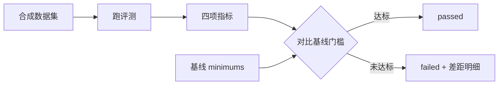

# 08-2 · 评测：怎么正确读那些分数

**成果**：你能复跑冻结基线、解读四项指标；能说清开发集分数为什么不能当真实业务准确率。

**前置**：[01](../01-quickstart.md)；读过 [08-1](08-1-real-models.md) 更好。

**对应版本**：接口按当前 `main` 核对。

**对应源码**：`eval/`、`backend/app/evaluation/`、`docs/evaluation-and-operations.md`。

---

## 评测评的是什么

项目里有两个容易混淆的东西：

- **评测数据集（dataset）**：一组合成案例，每个案例有证据、预期画像、检索问题及相关的证据 ID、JD 与预期匹配状态。
- **基线（baseline）**：给这个数据集设的一组最低分数门槛（minimums）。一个数据集可以有多份基线（v1 / v2 / v3）。

评测做的就是：拿数据集跑一遍，算出指标，再和基线的门槛比，判断「通过 / 未通过」。

<details>
<summary>一张图（文字版在下面）</summary>



**文字版**：合成数据集跑出四项指标，和基线的门槛对比，达标就 passed，否则 failed 并列出每项的实际值、门槛和差距。

</details>

## 四项指标

| 指标 | 大概在评什么 |
| --- | --- |
| `profile_extraction_f1` | 从证据抽画像条目，和预期条目的吻合度 |
| `evidence_recall_at_k` | 检索问题在前 K 条里找回相关证据的比例（默认 Recall@5） |
| `supported_claim_rate` | 结论里的说法有多少能被证据 ID 支持（代理校验） |
| `requirement_matching_f1` | 岗位要求匹配状态（strong/partial/gap）和预期的吻合度 |

注意 `supported_claim_rate` 是**别名与证据 ID 的代理校验**，不是语义层面的事实核查；`profile_extraction_f1` 用的是集合微平均。指标定义见 `backend/app/evaluation/runner.py`。

## 动手：复跑冻结基线

### 方式一：API（最简单）

在 `/docs` 里：

- `POST /api/v1/evaluation/sample` —— 跑内置小样本，先看格式；
- `POST /api/v1/evaluation/regression/benchmark` —— 用冻结的 v3 基准和阈值跑门禁；
- `GET /api/v1/evaluation/runs?limit=20` —— 看历史结果。

返回里 `status` 是 `passed` 或 `failed`；失败时 `failures` 列出每项的 `metric`、`actual`、`minimum`、`delta`。

> 评测接口需要 `manage` 权限（`AUTH_MODE=required` 时）；本地 Demo 不开鉴权，直接可调。

### 方式二：命令行（ reproducing CI 门禁）

```bash
cd backend
python -m app.evaluation.cli \
  --dataset app/evaluation/dev_benchmark_v3.json \
  --baseline ../eval/baselines/careerlens-dev-benchmark-v3.json
```

输出 JSON：`{status, dataset, metrics, minimums, failures}`；`status != "passed"` 时退出码为 1。CI 里的门禁就是这个逻辑。

### 数据集和基线的字段

数据集（看 `eval/datasets/careerlens-baseline-v1.json`）：

```json
{
  "name": "careerlens-baseline-v1",
  "recall_k": 3,
  "cases": [{
    "id": "agent-engineering-01",
    "evidence": [{"id": "ev-python", "content": "...", "source_type": "benchmark"}],
    "expected_profile": [{"category": "skill", "name": "Python"}],
    "retrieval_queries": [{"query": "...", "relevant_evidence_ids": ["ev-python"]}],
    "jd_text": "...",
    "expected_requirements": [{"name": "Python", "status": "partial"}]
  }]
}
```

基线：`{"dataset": "数据集名", "minimums": {四个指标各自的最低分}}`。基线里的 `dataset` 必须和数据集的 `name` 一致，否则报错。

## 最重要的边界：别把开发集分数当真实准确率

冻结的 v3 基准是 **20 个场景 / 80 条 Evidence / 40 个检索问题**，四项指标全 1.0。这个数字的意思是：

- ✅ 合成开发集上，本地规则链路稳定、可复现；
- ❌ 不是「真实业务准确率 100%」；
- ❌ 不代表 Qdrant + Qwen + DeepSeek 的线上链路效果；
- ❌ 没有用 LLM-as-a-Judge 做语义评估。

如果接了真实模型、换了自己的数据，必须**另建冻结集、另设门槛**，不要拿开发集的满分去汇报生产效果。阈值也应在测试集冻结后由团队评审确定，而不是看到 1.0 就写进 README。

## 自查清单

- [ ] 能说出 dataset 和 baseline 的区别
- [ ] 能复跑一次 sample 或 regression，并读懂 `failures` 的四个字段
- [ ] 能说清四项指标各评什么，以及 `supported_claim_rate` 是代理校验
- [ ] 能解释为什么「全 1.0」不能写成真实准确率

## 常见坑

- **把 benchmark 分数写进项目宣传当「准确率 100%」**：这是错误口径。
- **混用数据集和基线名**：基线的 `dataset` 必须等于数据集的 `name`。
- **以为评测接口有裸 `/evaluation`**：实际是 `/evaluation/run`、`/evaluation/regression` 等子路径。

## 下一步

最后一篇：[08-3 · 参与贡献](08-3-contribute.md)——怎么提交一个能复查的 PR，以及结课小项目怎么组织。术语见[术语表](../GLOSSARY.md)。
