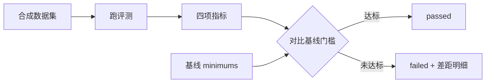

# 08-2 · 评测：怎么正确读那些分数

**成果**：你能复跑冻结基线、解读四项指标；能说清开发集分数为什么不能当真实业务准确率。

**前置**：[01](../01-第一次跑起来.md)；读过 [08-1](08-1-真实模型.md) 更好。

**对应版本**：接口按当前 `main` 核对。

**对应源码**：`eval/`、`backend/app/evaluation/`、`docs/evaluation-and-operations.md`。

---

## 评测评的是什么

项目里有两个容易混淆的东西：

- **评测数据集（dataset）**：一组合成案例，每个案例有证据、预期画像、检索问题及相关的证据 ID、JD 与预期匹配状态。
- **基线（baseline）**：给这个数据集设的一组最低分数门槛（minimums）。一个数据集可以有多份基线（v1 / v2 / v3）。

评测做的就是：拿数据集跑一遍，算出指标，再和基线的门槛比，判断「通过 / 未通过」。

<details>
<summary>一张图（文字版在下面）</summary>



**文字版**：合成数据集跑出四项指标，和基线的门槛对比，达标就 passed，否则 failed 并列出每项的实际值、门槛和差距。

</details>

## 四项指标：先看懂公式，再看分数

分数是算出来的，不是模型给的。四项都在 `backend/app/evaluation/runner.py`，可以逐行复算：

| 指标 | 精确算法 | 一个会让它下降的失败样例 |
| --- | --- | --- |
| `profile_extraction_f1` | 把所有 case 的 `(case_id, category, name)` 元组并成**一个全局集合**算 F1（微平均），不是逐 case F1 再平均；`F1 = 2PR/(P+R)`，`P=TP/预测数`、`R=TP/预期数` | 抽取器把「Python」误抽成「Python 3」（元组不匹配），TP 减少、FP 增加 |
| `evidence_recall_at_k` | 每条查询 `Recall@K = \|检索∩相关\| / \|相关\|`，再对所有查询取**算术平均**。K 取数据集的 `recall_k`（schema 默认 5，v3 冻结集为 5） | 相关证据排在第 6 位，Recall@5 里漏掉它 |
| `supported_claim_rate` | `supported_claims / claim_count`。每条画像项 +1 claim；当名字在别名表、有 `evidence_ids`、且至少一条证据原文命中别名时才算 supported | 画像项无证据 ID，或证据原文对不上别名——代理校验失败 |
| `requirement_matching_f1` | 与画像同理，`(case_id, requirement_name, status)` 元组全局集合的 F1 | 岗位要求本该 `gap` 却判成 `strong`，元组不匹配 |

**先猜再核对**：如果一个抽取器把所有 case 的画像条目都多报了一个「Python 3」（假阳性），`profile_extraction_f1` 会怎么变？微平均模式下，TP 不变但预测集合变大 → precision 下降 → F1 下降。这就是「微平均」和「逐 case 平均」的差别：全局集合里一次假阳性影响所有 case 分母。

三项重要边界：

- `supported_claim_rate` 是**别名与证据 ID 的代理校验**，不是语义层面的事实核查——它无法判断「收藏教程」是否真能支持「会 Kubernetes」。
- `evidence_recall_at_k` 的分母是**相关证据数**（recall 口径），不是检索条数。
- 冻结开发集用来**防回归**（分数掉了说明规则被改坏），不证明所选真实模型的质量。详见下方边界一节与 [08-1](08-1-真实模型.md)。

### 四项指标都从一个 `_f1` 算出来

`runner.py:13-18` 的底层函数很短，但两项 F1 指标都靠它：

```python
def _f1(predicted: set[Any], expected: set[Any]) -> tuple[float, float, float]:
    true_positive = len(predicted & expected)
    precision = true_positive / len(predicted) if predicted else (1.0 if not expected else 0.0)
    recall = true_positive / len(expected) if expected else (1.0 if not predicted else 0.0)
    f1 = 2 * precision * recall / (precision + recall) if precision + recall else 0.0
    return precision, recall, f1
```

**微平均的关键在传入的集合怎么构造**，而不是 `_f1` 本身。`profile_extraction_f1` 把所有 case 的 `(case_id, category, name)` 元组并成**一个全局集合**再算一次；`requirement_matching_f1` 同理用 `(case_id, requirement_name, status)`。带 `case_id` 前缀是为了防止两个 case 有同名条目时互相抵消。这跟「每个 case 各算一次 F1 再取平均」结果不同——全局集合里，一个假阳性会进入所有 case 共享的分母。

`evidence_recall_at_k` 则相反：逐条 query 算 `|检索∩相关|/|相关|`，再对所有 query 取**算术平均**，是宏平均（每条 query 等权）。`supported_claim_rate` 用全局计数 `supported_claims / claim_count`，也是微平均口径。所以「四项指标」其实混了两种平均方式，读分数时要知道每一项用的是哪种。

### supported_claim_rate 的别名命中还看否定句

`_is_supported`（`runner.py:21-29`）不是简单的字符串包含。它先查 `SKILL_ALIASES`，没有再查 `ROLE_ALIASES`；别名表按名字查，比如 `RAG: ("rag", "检索增强")`、`Agent: ("agent", "智能体")`。然后对每条 evidence_id 找原文，调 `affirmed_alias_matches`（`alias_match.py:6-21`）：

1. 全文 `casefold()`，用 `(?<![a-z0-9])别名(?![a-z0-9])` 做**边界匹配**——`rag` 不会命中 `drag`。
2. 找到命中点后，取它前面最近的句读分隔符（`，。；;！？!?\n`）之后的从句。
3. 如果这个从句尾部有否定词（`不要求`、`无需`、`未掌握`、`不会`、`未使用`、`未接触` 等），这次命中不算。

所以「我不要求 RAG 经验」里虽然出现 RAG，却不会算作支持「会 RAG」。这是代理校验里唯一一点语义味道，但仍然很窄——它认否定词表，不理解真正的语义。这正是它不能替代事实核查的原因。

## 动手：复跑冻结基线

### 方式一：API（最简单）

在 `/docs` 里：

- `POST /api/v1/evaluation/sample` —— 跑内置小样本，先看格式；
- `POST /api/v1/evaluation/run` —— 提交**自定义数据集**（下面小练习用这个）；
- `POST /api/v1/evaluation/regression` —— 自定义数据集 + 门槛跑门禁；
- `POST /api/v1/evaluation/regression/benchmark` —— 用冻结的 v3 基准和阈值跑门禁；
- `GET /api/v1/evaluation/runs?limit=20` —— 看历史结果。

返回里 `status` 是 `passed` 或 `failed`；失败时 `failures` 列出每项的 `metric`、`actual`、`minimum`、`delta`。

完整的评测接口有六个，别只记住常用的那两个：

| 路径 | 作用 |
| --- | --- |
| `POST /api/v1/evaluation/run` | 提交自定义数据集，只算指标、不设门禁 |
| `POST /api/v1/evaluation/sample` | 内置小样本冒烟 |
| `POST /api/v1/evaluation/regression` | 自定义数据集 + 自定义门槛 |
| `POST /api/v1/evaluation/regression/sample` | 样本集 + 样本门槛 |
| `POST /api/v1/evaluation/regression/benchmark` | 冻结 v3 开发集 + v3 门槛（CI 和演示页默认） |
| `GET /api/v1/evaluation/runs?limit=20` | 按时间倒序列出历史运行 |

**没有裸的 `/evaluation`**，也别把 `benchmark` 写成 `regression/baseline`。评测接口需要 `manage` 权限（`AUTH_MODE=required` 时），由 `authorize_ops` 校验——这是实例级权限，不按用户隔离；本地 Demo 不开鉴权时直接放行。

### 方式二 命令行复跑 CI 门禁

```bash
cd backend
python -m app.evaluation.cli \
  --dataset app/evaluation/dev_benchmark_v3.json \
  --baseline ../eval/baselines/careerlens-dev-benchmark-v3.json
```

输出 JSON：`{status, dataset, metrics, minimums, failures}`；`status != "passed"` 时退出码为 1。CI 里的门禁就是这个逻辑。加 `--output <path>` 可以把同一份 JSON 写到文件（目录会自动创建）。

CLI 只收三个参数：`--dataset`（必填）、`--baseline`（必填）、`--output`（可选）。加载 baseline 时会校验「baseline 里的 `dataset` 字段必须等于数据集的 `name`」，不等就抛 `ValueError`。**但这条校验只在 CLI 和基线文件里成立**——REST 的 `/regression` 不校验数据集名。这是两种入口的一处有意差异。

`failures` 里每项长这样：`{metric, actual, minimum, delta}`，其中 `delta = round(actual - minimum, 4)`。任何一项 `actual < minimum` 就把整体判成 `failed`。

### 数据集和基线的字段

数据集（看 `eval/datasets/careerlens-baseline-v1.json`）：

```json
{
  "name": "careerlens-baseline-v1",
  "recall_k": 3,
  "cases": [{
    "id": "agent-engineering-01",
    "evidence": [{"id": "ev-python", "content": "...", "source_type": "benchmark"}],
    "expected_profile": [{"category": "skill", "name": "Python"}],
    "retrieval_queries": [{"query": "...", "relevant_evidence_ids": ["ev-python"]}],
    "jd_text": "...",
    "expected_requirements": [{"name": "Python", "status": "partial"}]
  }]
}
```

基线：`{"dataset": "数据集名", "minimums": {四个指标各自的最低分}}`。基线里的 `dataset` 必须和数据集的 `name` 一致，否则报错（这条同名校验在 CLI 和基线文件里成立；REST 的 `/regression` 不校验数据集名）。

## 找出被挤出前两名的证据

先看两个前两名结果。原本是两条标为相关的证据，加入收藏卡后，前两名只剩一条相关证据。你要指出哪条被挤出去，再算新的召回率。[原始样本](../../eval/datasets/recall2-demo.json)和[加入收藏卡的样本](../../eval/datasets/recall2-demo-bookmark.json)使用同一个问句和同一份相关证据标注。

**先预测再跑**：给查询标了 2 条相关证据（`ev-rel-a`、`ev-rel-b`）。如果再塞进一条**没标为相关**的收藏卡，它的正文含查询全文——Recall@2 会怎么变？

在仓库根目录用 [06 评测脚本](../../examples/tutorials/lesson-06-eval/main.py) 跑两份数据。先把后端依赖装进 `backend/.venv)，步骤见[示例索引](../../examples/tutorials/README.md)。

```powershell
backend/.venv/Scripts/python.exe examples/tutorials/lesson-06-eval/main.py
```

macOS 或 Linux 用：

```bash
backend/.venv/bin/python examples/tutorials/lesson-06-eval/main.py
```

**实测输出**：

```text
=== 无收藏卡 ===
  检索 Top-2： ['ev-rel-a', 'ev-rel-b']
  命中相关证据：['ev-rel-a', 'ev-rel-b']（2/2）
  四项指标： {... 'evidence_recall_at_k': 1.0 ...}
=== 有收藏卡 ===
  检索 Top-2： ['ev-bookmark', 'ev-rel-a']
  命中相关证据：['ev-rel-a']（1/2）
  四项指标： {... 'evidence_recall_at_k': 0.5 ...}
```

召回率的分母是标为相关的证据数，这里始终是 2。前两名命中数从 2 变 1，所以 `Recall@2` 从 `2/2` 变 `1/2`。这份练习走[本地检索](../../backend/app/retrieval/hybrid.py)，收藏卡含有完整问句，拿到了 `exact_bonus=0.25`。加入一份文档也会改变词的文档频率，所以从这两组输出能确认「收藏卡挤进前两名」。如果想量出短语加分的单独影响，需要固定候选和分词结果，只改变短语命中条件。只改 `source_name` 不改变评分，因为该字段没有参与计算。

**再看门禁**：配一份门槛 `evidence_recall_at_k: 0.75` 的基线（`eval/baselines/recall2-demo.json`），跑 CLI：

```bash
cd backend
.venv/Scripts/python.exe -m app.evaluation.cli --dataset ../eval/datasets/recall2-demo.json --baseline ../eval/baselines/recall2-demo.json      # 退出 0，passed
.venv/Scripts/python.exe -m app.evaluation.cli --dataset ../eval/datasets/recall2-demo-bookmark.json --baseline ../eval/baselines/recall2-demo.json  # 退出 1，failed
```

失败时 `failures` 里有 `{"metric":"evidence_recall_at_k","actual":0.5,"minimum":0.75,"delta":-0.25}`——证明门禁真的在读指标。

> 这份 K=2 的小例子**不复用**冻结的 v3 基线：v3 是 K=5、门槛全 1.0、数据集名 `careerlens-dev-benchmark-v3`，CLI 强制基线与数据集同名，所以小例子用自己的 baseline。冻结基线的复跑仍按上一节命令。

## 最重要的边界：别把开发集分数当真实准确率

冻结的 v3 基准是 **20 个场景 / 80 条 Evidence / 40 个检索问题**，四项指标全 1.0。这个数字的意思是：

- ✅ 合成开发集上，本地规则链路稳定、可复现；
- ❌ 不是「真实业务准确率 100%」；
- ❌ 不代表 Qdrant + Qwen + DeepSeek 的线上链路效果；
- ❌ 没有用 LLM-as-a-Judge 做语义评估。

如果接了真实模型、换了自己的数据，必须**另建冻结集、另设门槛**，不要拿开发集的满分去汇报生产效果。阈值也应在测试集冻结后由团队评审确定，而不是看到 1.0 就写进 README。

## 自查清单

- [ ] 能说出 dataset 和 baseline 的区别
- [ ] 能复跑一次 sample 或 regression，并读懂 `failures` 的四个字段
- [ ] 能说清四项指标各评什么，以及 `supported_claim_rate` 是代理校验
- [ ] 能解释为什么「全 1.0」不能写成真实准确率

## 常见坑

- **把 benchmark 分数写进项目宣传当「准确率 100%」**：这是错误口径。
- **混用数据集和基线名**：基线的 `dataset` 必须等于数据集的 `name`。
- **以为评测接口有裸 `/evaluation`**：实际是 `/evaluation/run`、`/evaluation/regression` 等子路径。

## 下一步

最后一篇：[08-3 · 参与贡献](08-3-贡献与结课.md)——怎么提交一个能复查的 PR，以及结课小项目怎么组织。术语见[术语表](../术语表.md)。
