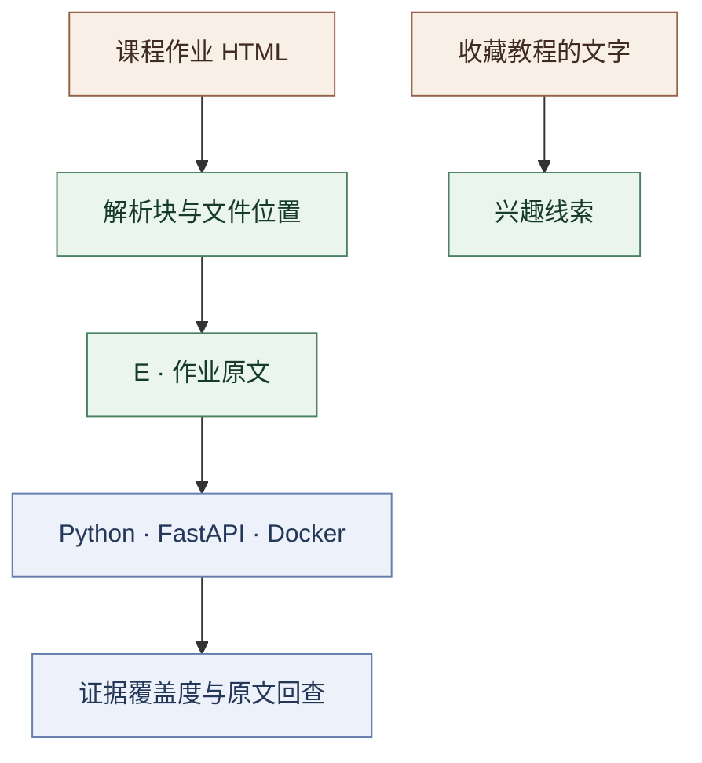

# 10 · 从导入记录追回画像证据

林澈有一份课程接口作业，还有一条「收藏了 Kubernetes 部署教程」的记录。两条都可以保存为证据。你会看到，只有作业里的行动描写进入技能画像。做完留下三个值：作业文件的来源编号、Python 条目引用的证据编号，以及画像概览里的覆盖度。

**准备**。约 25–35 分钟，使用 Demo 和一份合成文件。[第 01 篇](01-第一次跑起来.md)启动的接口在 [8000 Swagger](http://localhost:8000/docs)，[Agent 练习副本](01-agent-design/01-A-Agent工作流.md)用 [8030 Swagger](http://127.0.0.1:8030/docs)。选一个服务，整节和[第 11 篇](11-岗位对比与学习计划.md)沿用同一地址和账号 `hy4-lesson`。重做时可以换一个新名字，所有请求里的账号一起换。 [练习环境对照](setup/动手准备.md#核对环境与编号)

## 先认识三个层次

- **来源文档**记文件从哪来，返回的 `source_document_id` 指向这一层。
- **解析块**记读出哪些内容及其位置。HTML 样本是一块，PDF 可以按页，导出 ZIP 可以按包内成员。
- **Evidence** 是可引用的原文。画像条目的 `evidence_ids` 记录它用了哪些原文，概览再统计这些编号仍有多少可查。

下面这张图里，两条材料都入了证据层。你能指出哪一步把收藏留在技能画像之外吗？



证据仍保留收藏原句。重建画像时，抽取器把 `preference_signal` 作为兴趣线索处理。

## 步骤 1 上传后先看读出了什么

打开 [hy4-lin-api.html 合成样本](../examples/tutorials/fixtures/hy4-lin-api.html)，在 GitHub 点 **Download raw file**，或直接取本地仓库的 `examples/tutorials/fixtures/hy4-lin-api.html`。样本的正文写了 Python、FastAPI 和 Docker，脚本标签里另放了一个 Kubernetes 标记。先猜程序会把哪一部分读进原文。

在 Swagger 展开 `POST /api/v1/evidence/file`，点 **Try it out**。`user_id` 填 `hy4-lesson`，`source_type` 保持默认 `resume`，在 `upload` 选样本并提交。

| 返回字段 | 这次预期 | 怎么理解 |
| --- | --- | --- |
| `parse_status` | `parsed` | 样本解析出了文字 |
| `readable_count` | `1` | 有正文且当前可读的解析块数 |
| `ocr_pending_count` | `0` | 需要 OCR 的页数 |
| `count` | `1` | 本次返回的 Evidence 条数 |
| `items[0].content` | 标题和作业正文 | 搜索响应时找不到脚本中的 Kubernetes 标记 |

记下 `source_document_id` 为 D、`items[0].id` 为 E。把同一个文件原样再传一次。D 和 E 仍相同。判断重复上传是否复用时，比对这两个编号和证据列表的总数。文件上传响应里的 `duplicate_count` 当前会保留默认值，连接器导入则有自己的新增与重复计数。

工作台也能做上传。在「构建职业画像」下方用「HTML / 导出 ZIP」选文件。到「后台任务」等文档导入「已完成」，点「**打开结果**」。画像区上方会显示可读证据和待 OCR 页数。展开「证据定位」并点文件名即可读到原文。工作台提交的是 `POST /api/v1/runs/uploads`，也可以用任务 ID 查 `GET /api/v1/runs/{run_id}`，核对 `result.readable_count`、`result.ocr_pending_count` 和 `result.evidence_ids`。 [任务中心按钮](../frontend/components/run-center.tsx) · [导入结果卡](../frontend/components/import-result-card.tsx)

遇到扫描 PDF 时，Run 的执行状态与文档解析状态各回答一个问题。一个成功执行的任务可以返回 `parse_status="partial"`、`readable_count=0` 和大于零的 `ocr_pending_count`。下一步可以找带文字层的 PDF，或先把扫描页准备成图片再使用可选的媒体提取。[第 03 篇](03-解析层.md)讲如何分辨这几种解析来源。 [同步结果](../backend/app/api/routes/evidence.py) · [后台上传结果](../backend/app/runtime/operations.py)

## 步骤 2 加一条收藏，再看技能有没有多

给同一账号发 `POST /api/v1/evidence/text`，请求体填下面这份 JSON。

```json
{
  "user_id": "hy4-lesson",
  "source_name": "课程收藏对照",
  "content": "收藏了 Kubernetes 部署教程"
}
```

在返回的条目里确认 `source_metadata.claim_strength="preference_signal"`。然后执行 `POST /api/v1/profiles/{user_id}/rebuild`，把 `hy4-lesson` 填在路径的用户格里。技能条目里会出现 Python、FastAPI 和 Docker。找不到 Kubernetes 技能时，可以回到收藏原文，解释为何这条记录只能支撑兴趣。

1. 在 `GET /api/v1/profiles/{user_id}` 找 Python 的 `evidence_ids`。它包含 E。
2. 在 `GET /api/v1/evidence/{evidence_id}` 把 E 填进路径，把 `hy4-lesson` 填进查询参数。可以读回文件名和原话。
3. 用一句话写出这条原文支持的范围，例如「林澈用 Python 和 FastAPI 完成过课程接口」。如果要说他能在集群部署，还需要另一份记录。

工作台技能列表的五格刻度表示抽取等级。旁边的「可信高、中、低」和证据条数提供回查线索。下方的能力分布、证据覆盖度、技能矩阵和时间线，也都可以对到同一批材料。 [文本证据分类](../backend/app/ingestion/claim_strength.py) · [技能等级和可信分档](../frontend/app/workspace/page.tsx#L79-L104)

## 步骤 3 对照覆盖度和显示偏好

读 `GET /api/v1/profiles/{user_id}/overview`。新账号只做过上面几步时，预期 `evidence_count=2`、`source_document_count=1`、`profile_item_count=3`。收藏增加了独立证据数。作业是唯一上传的文档，三个技能各有同一份有效原文。

| 覆盖桶 | 这次预期 | 代码按什么分 |
| --- | --- | --- |
| `supported` | 0 | 至少两条有效证据，且条目置信度不低于 0.7 |
| `weak` | 3 | 只有一条有效证据，或有证据但置信度低于 0.7 |
| `missing` | 0 | 当前保留的条目查不到有效证据 |

源码里先用 `valid = [eid for eid in (item.evidence_ids or []) if eid in evidence_ids]` 得到**当前用户还存在的编号**，再选择上面的桶。重复上传同一份作业仍是 E，一个编号不会变成两条支持。重建后条目自身的 ID 可能变化，笔记里用「类别、技能名、原文编号」标记更容易再次查到。

试着在工作台「选择你现在的用途」改成「学习计划」，或给 `PUT /api/v1/profiles/{user_id}/view-preferences` 发送：

```json
{
  "user_id": "hy4-lesson",
  "mode": "learning_plan",
  "modules": {"learning_progress": true}
}
```

同一路径的 `GET` 会读回选中的模式和开关。再查 `overview`，上面的三个覆盖桶保持不变。若想知道 Agent 可以请求哪些动作，打开 `GET /api/v1/profiles/{user_id}/agent-manifest`，找 `query_evidence` 的 `requires_scope` 和 `writable_policy="agent_can_propose_only"`。画像写入仍需要用户在[确认流程](01-agent-design/01-B3-长期画像与确认.md)批准草案。 [覆盖度实现](../backend/app/services/profile_overview.py) · [显示偏好接口](../backend/app/api/routes/profile_extensions.py)

## 选做 · 给一个面试故事附上原文

在画像区的「面试故事库」填「课程接口作业」，写下你在 E 里能核对的行动。先留空证据编号并保存。故事会标为「待补证据」。再用同一个描述另存一条，加上 E，预期为「证据支持」。回到证据详情，核对原文只记录了课程接口和本机运行。

在 Swagger 可以用 `POST /api/v1/profiles/{user_id}/interview-stories` 练习相同操作。请求体中 `evidence_ids` 接受当前账号的编号。提交一个随意编的编号会得到 422。代码按用户和 ID 查 Evidence，再为故事设置状态。两条同名故事各有自己的 `id`，可以一起保留。这个状态告诉你原文可以回查，仍要人工判断措辞有没有超出材料。 [故事请求字段](../backend/app/schemas/assessment.py) · [故事创建与引用检查](../backend/app/api/routes/profile_extensions.py)

## 选做 · 同一条链接，换一次确认状态

`GET /api/v1/connectors/registry` 会列出来源和授权方式。`A` 是用户提交或导出，`B` 是当前页手动采集，`T` 是自备只读令牌。可在目录里看到 `official_oauth` 的 `available=false`。

给选做专用账号 `hy4-link-lesson` 向 `POST /api/v1/connectors/public-link/import` 提交下面的数据。第一次保留 `confirmed=false`，再只改为 `true` 重发。预期 `created_count` 从 0 变成 1，第二次会保存填写的说明、去掉 URL 查询参数，并将来源标为 `self_reported_published`。这是一个合成链接，后端只使用你填写的内容。需要访问 GitHub API 的读取路径见[第 09 篇的 GitHub 导入](09-画像与自陈测评.md)。

```json
{
  "user_id": "hy4-link-lesson",
  "cards": [{
    "url": "https://github.com/example/hy4-lesson?utm_source=class",
    "title": "合成作品卡",
    "note": "用于验证确认开关",
    "confirmed": false
  }]
}
```

## 下一步

记下账号、Python 引用的 E 和三条技能。沿同一个服务进入[第 11 篇 岗位对比与学习计划](11-岗位对比与学习计划.md)。你会用这份画像比较两份已保存的岗位描述。
