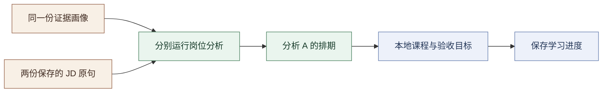

# 11 · 比较两个岗位，定下第一周的练习

林澈已有一份课程接口作业。做 Agent 应用还是继续练 Python 后端，缺口各在哪里？我们用同一份画像看两个岗位，再选一个缺口，找到一项本周能交的作品。最后留下两份分析 ID 和一条可查的学习进度。

**准备**。约 30–40 分钟。继续使用[第 10 篇](10-导入与可回查画像.md)的账号 `hy4-lesson` 和同一个 Swagger。上一课应已得到带作业证据的 Python、FastAPI、Docker 三条技能，想迁到另一个服务时先用相同材料重建画像。

## 先认识四种结果

| 对象 | 读它来回答什么 | 编号用在哪 |
| --- | --- | --- |
| 本地职业方向 | 这组技能与哪份职业模板重合，差哪些必需技能 | `role_id` 用来查目录模板 |
| 保存的 JD | 当初比较的岗位原话是什么 | 保存响应的 `id` 供查找或删除这份 JD |
| 岗位分析 | 用当前画像分析这份 JD，哪些要求已有部分证据，哪些仍是缺口 | 分析响应的 `id` 用于课程推荐，在工作台也用作 `plan_id` |
| 学习进度 | 某个技能阶段目前是什么状态，已经投入几小时 | 用 `plan_id`、`skill`、`stage` 查同一条记录 |



## 1 用同一条证据解释方向推荐

在工作台「岗位逐项匹配」点「**查看相邻职业方向**」，或用 Swagger 向 `POST /api/v1/recommendations/roles` 发：

```json
{"user_id": "hy4-lesson", "limit": 3}
```

找第一张 **Python 后端开发**，先抄 `coverage` 和 `gaps`，再从 `evidence_ids` 追回第 10 篇的 E。这张模板有四项必需技能。三项能回到仍存在的证据，覆盖率是 `3 / 4 = 0.75`。缺的是 PostgreSQL。AI Agent 应用开发卡有两个必需技能命中，当前缺 LangGraph 和 RAG。

[`recommend_roles`](../backend/app/services/recommendation.py#L17-L68) 会先过滤仍有证据的 `skill` 条目，再计算每个模板的必需技能命中比例。同覆盖率下先比命中的加分技能数，最后按 `role_id` 定序。`GET /api/v1/catalog/roles` 能查到模板的典型任务和必需技能。这里的比例描述已覆盖的模板技能。实际岗位仍需拿到 JD 后逐条分析。 [本地职业目录](../backend/app/catalog/roles.json)

## 2 保存两份 JD，再分别分析

在工作台填岗位名称、岗位描述，点「**保存 JD**」。API 做法是向 `POST /api/v1/saved-jobs` 分两次发送下面的内容。

**岗位 A**

```json
{
  "user_id": "hy4-lesson",
  "title": "课程 Agent 实习",
  "jd_text": "要求 Python、FastAPI 和 LangGraph。Kubernetes 优先。"
}
```

**岗位 B**

```json
{
  "user_id": "hy4-lesson",
  "title": "后端应用实习",
  "jd_text": "要求 Python、Docker 和 PostgreSQL。"
}
```

用 `GET /api/v1/saved-jobs/compare`，在查询格填 `user_id=hy4-lesson`。新账号只保存过这两份时，返回 `count=2` 和两段原文。最多读取最近三份，每次要用标题辨认。先用纸笔圈出共同要求 Python。

要取匹配分，把两份 JSON 各加上 `"weekly_hours": 8`，分别发给 `POST /api/v1/jobs/analyze`。记下两次响应顶层的 `id`。在工作台走「**分析匹配度**」时，任务成功后要到任务中心点「**打开结果**」，或用 Run 中的 `result.job_analysis_id` 找到同一个分析。

| 岗位 | 默认 Demo 的规则分 | 主要必需缺口 | 第一项计划 |
| --- | --- | --- | --- |
| A 课程 Agent 实习 | 37.1 | LangGraph | 第 1 周开始，约 18 小时，排 3 周 |
| B 后端应用实习 | 43.3 | PostgreSQL | 第 1 周开始，约 18 小时，排 3 周 |

A 的 Kubernetes 是加分缺口。回到 `matches` 看名字、`priority`、`status` 和 `evidence_ids`，可以解释它为何排在后面。这两个分数依赖本课的合成材料和岗位原句。你的选择还要看更想做哪类工作，以及接下来能补哪一项证据。 [匹配分手算](07-接入与验证.md#手算匹配分和学习周数) · [保存与对比实现](../backend/app/api/routes/learning.py)

## 3 用分析 A 找到一项课程和验收目标

向 `POST /api/v1/recommendations/learning-plan` 发下列请求。把占位值替换成 **A 的分析响应**里的 `id`。

```json
{
  "user_id": "hy4-lesson",
  "analysis_id": "填写岗位 A 的分析 ID"
}
```

在返回列表找到 LangGraph。它的 `stage=1`、`start_week=1`、`weeks=3`。18 小时按每周 8 小时安排，向上取整得到 3 周。接口沿用分析的计划顺序，并补上课程和验收文本。

这一项的 `resources` 包含 `cl-agent`。用 `GET /api/v1/catalog/courses` 可以核对它的课时与先修 `cl-rrf`。课程目录里这条记录的关键字段是：

```json
{
  "course_id": "cl-agent",
  "skill": "LangGraph",
  "estimated_hours": 4,
  "prerequisites": ["cl-rrf"]
}
```

先修字段提醒你先补哪块知识，读者可以[做完 RRF 小实验](04-检索Agent.md)再进 [Agent 源码课](01-agent-design/README.md)。第一周可以交一份小记录，举出一次对话的节点流转和它的引用允许集合。资源课时 4 小时，完整阶段预算还包括动手实践与复查。 [排期细节](../backend/app/services/learning_path.py) · [计划补充资源](../backend/app/services/recommendation.py)

## 4 保存一条学习进度，再看一次失败

在 `POST /api/v1/learning/plans/{plan_id}/progress` 的路径格填 A 的分析 ID，查询格填 `user_id=hy4-lesson`，发送下列请求。这里的 `stage` 和 `skill` 来自刚才的 LangGraph 计划。

```json
{
  "skill": "LangGraph",
  "stage": 1,
  "status": "进行中",
  "actual_hours": 1,
  "evidence_ids": []
}
```

用 `GET /api/v1/learning/plans/{plan_id}` 读回进度。`items` 里应有一条 LangGraph 的「进行中」，实际用时 1 小时。再只把 `evidence_ids` 改成 `["not-an-evidence-id"]` 提交。预期 422，原来那条进度仍能读到。这个检查允许进度引用当前用户已有的 Evidence。以后完成作品时，可以先用导入接口保存作业，再把新的证据编号关联到进度。

最后对照第 10 篇记录的画像覆盖度，再用相同输入分析 A。记录进度后，覆盖度和匹配分都保持原样。进度行记录的是学习行动，下一轮画像要用新导入的作品来补证据。 [进度写入与归属校验](../backend/app/api/routes/learning.py)

## 下一步

保留 A/B 的主要缺口、第一周想交的作品和一次 422 的解释。如果想探索自陈偏好会影响哪些字段，接着做[第 09 篇](09-画像与自陈测评.md)。也可以用这组输入直接填[结课模板](结课模板.md)。
