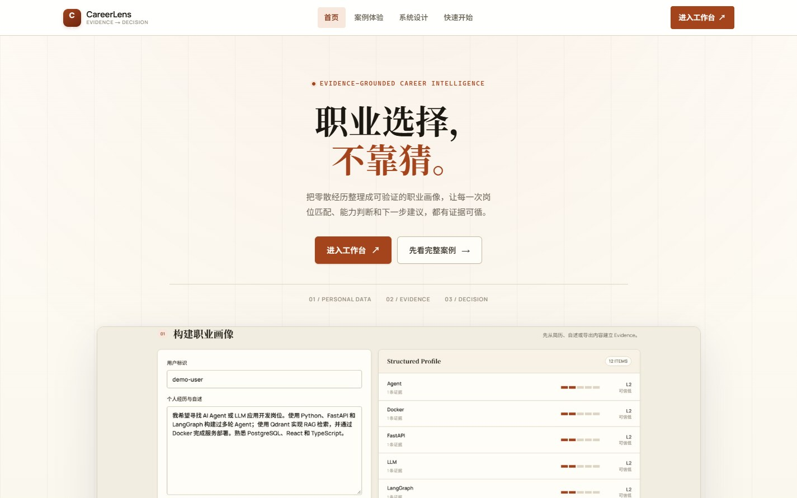

# 从这里开始

CareerLens 是一个**证据驱动的职业决策工具**：它把你授权的经历整理成一条条能追溯来源的证据，再回答「我适合什么岗位、还缺什么、下一步怎么做」。每个结论都能点开看到原始材料，没有依据的地方会直接写「证据不足」。

这套教程让你**从零开始看明白它、再把它跑起来**。你不需要先懂 Python、Docker 或向量检索——第一题用浏览器就能做完。



> [!NOTE]
> 本页的题目和材料都是**虚构演示**。不要在这里填入真实简历、账号或任何个人资料。

---

## 我能不能学？先花 10 分钟试试

先不看任何软件。读一遍下面的小练习，自己判断，再看答案。**做完这一题，你就已经完成了教程的第一个目标：区分「有证据」和「看着像有证据」。**

### 第一题（不装任何东西）

虚构学习者**林澈**想应聘 AI Agent 开发岗。他有三张材料卡：

| 卡片 | 内容 |
| --- | --- |
| A | 「用 Python 做过课程项目」 |
| B | 「收藏了 Kubernetes 教程」 |
| C | 「课程项目只在本机演示」 |

目标岗位的描述写着：**要求 Python 经验；有 Kubernetes 上线经验者优先。**

先自己想一想，把答案写在纸上或心里：

1. 哪张卡能支持「林澈用过 Python」？能不能进一步说「他很熟练」？
2. 哪张卡能支持「林澈有 Kubernetes 上线经验」？
3. 如果关于某项要求一张支持的卡都没有，应该怎么写？

<details>
<summary>点开看参考答案与讲解</summary>

**1. 能支持「用过 Python」的是 A，但不能说「很熟练」。**
「做过课程项目」说明有过这件事，这是准确的；「熟练」是程度判断，需要更多、更强的证据（比如独立完成、用于实际项目、能讲清细节）。把「做过」直接说成「熟练」，就是超出证据下结论。

**2. 没有一张卡能支持「Kubernetes 上线经验」。**
B 是「收藏了教程」——这只说明他感兴趣，不等于学过，更不等于上线过。C 是「只在本机演示」，恰好说明**没有**上线经验。岗位描述里写了 Kubernetes，那是**岗位的要求**，不是林澈的经历；把要求当成候选人的能力，是最常见的一种误判。

**3. 写「证据不足」。**
找不到依据就如实说没有依据。这正是 CareerLens 的核心规矩：**结论必须落到证据，缺证据就报缺口，不把推测写成经历。**

</details>

**常见误判**（看看你有没有踩中）：

- 把「收藏 / 点赞 / 关注」当成「掌握技能」——它们只是兴趣线索。
- 把「岗位要求」当成「候选人经历」——招聘方想要什么，不代表应聘者已经会什么。
- 把「做过」直接说成「熟练」——程度和数量需要独立证据。

> 想看懂上面这些词（Evidence、画像、RAG、幂等……）？随时查[术语表](GLOSSARY.md)，第一次遇到先解释，不用一次背完。

---

## 两条学习路线

你想怎么学，取决于你现在会什么。两条路最后汇合到同一套核心内容。

### A 轨｜零基础

适合：从没写过代码，或分不清 Agent、提示词、RAG、向量检索是什么。

1. **只用浏览器**完成[阶段 0](README.md#学习路径) 的四篇理解课——不装软件、不登录、不碰终端：[00-1 Agent 是什么](00-foundations/00-1-what-is-agent.md) → [00-2 提示词与证据](00-foundations/00-2-prompt-and-evidence.md) → [00-3 RAG 与检索](00-foundations/00-3-rag-and-vector.md) → [00-4 数据模型](00-foundations/00-4-data-model-in-plain-words.md)。
2. 想亲手跑时，再按你的操作系统做[本机准备](#什么时候需要安装软件)。
3. 跑通[第 01 篇](01-quickstart.md)，在工作台走一遍完整流程。
4. 有兴趣再往下学实现原理。

设备不允许装软件？走[静态观察路线](observe-only.md)也能学懂原理，但那算「理解演示」，不算「本机跑通」。

### B 轨｜有基础

适合：会用终端、装过 Docker，或直接想看实现。

- 已会 Docker Compose：从[第 01 篇](01-quickstart.md)开始。
- 已经跑过 Demo：从[第 02 篇](02-data-model.md)开始。
- 按目标选研读路线：数据与解析（02–03）、检索与 Wiki（04–05）、后台任务与工程化（06–08）。

---

## 按时间选学法

| 可用时间 | 推荐走法 |
| --- | --- |
| 10 分钟，先试试 | 做完上面的第一题，自查答案；不用安装。 |
| 一个周末，看懂并跑通 | 完成阶段 0，按系统做本机准备，跑通 [01](01-quickstart.md)。首次下载镜像和依赖的时间单独算，不承诺固定用时。 |
| 两周，认识核心实现 | 完成 [01](01-quickstart.md)–[05](05-wiki.md)，每部分做一次能核对结果的练习；每次 30–60 分钟作为安排参考。 |
| 四周及以上，做一个作品 | 走完 [01](01-quickstart.md)–[08-3](08-advanced/08-3-contribute.md)，选做复刻题，提交一页结课小项目。四个脚本按需选做，不承诺每篇一个。 |

---

## 阶段成果

每阶段结束都有「做到什么算过关」。入口只链接已经能读的内容，计划中的篇章会标明，不会给你坏链。

| 阶段 | 过关时你能做到 |
| --- | --- |
| 0 · 看得懂 | 不看答案，能从材料里指出一条支持证据和一条不能支持的证据，找不到依据时写「证据不足」。 |
| 1 · 跑得通 | 用工作台导入合成资料、完成一次岗位分析，找到一个有证据支持的匹配和一个缺口，并指出引用原文。 |
| 2 · 建地基 | 同一用户导入同一份文字两次，核对证据 ID 被复用；能指出来源与位置。 |
| 3 · 有智能 | 用同一个问题比较检索模式，追到一条原始证据；能说明为什么某条候选虽相关但应舍弃。 |
| 4 · 会验收 | 重复提交得到同一任务 ID，刷新后找回同一任务与进度；分清启动、迁移与 Worker 的状态。 |
| 5 · 会进阶 | 提交一页带引用、可复查的小项目；说清 Demo 和开发集成绩不代表生产准确率。 |

阶段 0 四篇已发布，从 [00-1](00-foundations/00-1-what-is-agent.md) 开始，按顺序读完约 1 小时，全程不用装软件。随时查[术语表](GLOSSARY.md)。

---

## 什么时候需要安装软件

**只有当你想亲手运行时才需要装。** 只想理解原理、做纸面练习，浏览这个页面就够了。

- 本机跑 Demo：需要 Docker Desktop / Docker Engine，**不需要**在电脑上另装 Python 或 Node.js，也**不需要** API Key、GPU 或真实个人资料。
- 想写脚本练习或做开发：再按系统补装 Python，见 [Python 选做准备](setup/python-basics.md)。
- 买不起或没有权限装软件：[静态观察路线](observe-only.md)用截图和预录响应学同样的原理。

安装步骤、命令逐行解释、按系统的差异，都在[第 01 篇的本机准备](01-quickstart.md#步骤-1本机准备按系统选)里。

---

## 遇到问题怎么求助

先按 [FAQ](FAQ.md) 自查——每项都按「看到什么 → 怎么确认 → 怎么恢复」写好了。

还解决不了，提 Issue 时请带上：

```text
1. 你正在读的篇名和卡在第几步
2. 你的操作系统和版本（Windows 11 / macOS 14 …）
3. 你执行的完整命令
4. 预期输出和实际输出（原样贴，不要只写「报错了」）
5. 你是否改过配置、用的是不是默认 Demo
```

**请遮掉密钥、账号、真实简历和任何个人资料再发。** 不要把真实数据贴到 Issue 或聊天窗口。

---

## 常用入口

- [在线教程站](https://wenmo-yu.github.io/careerlens/)（搜索、复制代码、手机阅读；内容与本仓库同步）
- [教程总览与学习路径](README.md)
- [术语表](GLOSSARY.md) · [常见问题](FAQ.md) · [教程更新记录](CHANGELOG.md)
- [技术文档首页](../docs/README.md) · [项目首页](../README.md)
