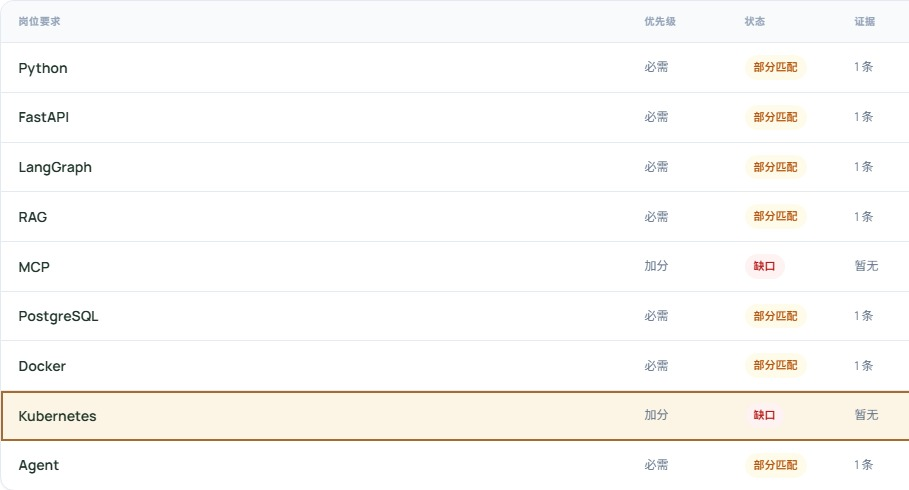

# 静态观察路线（无法安装软件时）

有些电脑装不了 Docker：学校或公司的设备限制、没有管理员权限、系统不满足虚拟化要求。**这不代表你学不了这套教程**——你可以用同一组虚构材料走完「理解演示」，只是不能算「本机跑通」。

> 这条路线只讲原理和读图，不需要终端、不需要安装、不需要登录。所有内容都是**静态示意**，不冒充在线推理。

---

## 这条路能学到什么，不能算什么

| 能学到 | 不能算 |
| --- | --- |
| 看懂证据 → 画像 → 岗位匹配 → 报告 → 追问这条数据流 | 不算「本机跑通」，因为没有真的启动服务 |
| 学会判断「有证据 / 证据不足」，看懂引用怎么回指原文 | 不能据此评估真实模型或真实数据的效果 |
| 认识工作台各区在做什么，为以后装机上手建立地图 | 静态分数和卡片不是系统实时算出来的结果 |

方案里写得很清楚：无法安装时走观察路线，**可继续学原理，不计为本机跑通**；不建议绕过设备限制。

---

## 观察步骤

### 第 1 步：读一遍第一题

在[开始页](从这里开始.md#先做一道证据题)做那道证据判断题，看参考答案。这题用浏览器就能做。

### 第 2 步：看虚构案例长什么样

下面是案例页的真实界面截屏，内容由虚构材料构成。找到框中的 Kubernetes 一行，记录它的状态和证据列。随后自己写一句可以对林澈说的话。

| 岗位要求 | 优先级 | 状态 | 证据 |
| --- | --- | --- | --- |
| Python | 必需 | 部分匹配 | 1 条 |
| Kubernetes | 加分 | 缺口 | 暂无 |

- **自述**：希望找 AI Agent / LLM 应用开发岗位；用 Python、FastAPI、LangGraph 做过多轮 Agent，用 Qdrant 做 RAG，Docker 部署，熟悉 PostgreSQL / React / TypeScript。
- **目标岗位**：要求 Python、FastAPI、LangGraph、RAG、PostgreSQL，了解 Docker，Kubernetes 或 MCP 经验优先。

你会请林澈带来什么记录，才能判断他具体参与了哪一步部署？例如同一份材料写着练习环境、执行人、操作步骤和结果，可以用来说明他完成了具体练习。更多界面见[案例展示](../docs/showcase.md)。

### 第 3 步：对着数据流读图

打开[系统架构](../docs/architecture.md)和[数据与证据生命周期](../docs/data-and-evidence.md)，按顺序找这几个位置：

1. 用户授权内容 → 标准化成带 ID 的 **Evidence**；
2. Evidence → 抽成带 `evidence_ids` 的**画像**条目；
3. 岗位要求逐条与画像比对 → `strong / partial / gap`；
4. 结论 + 缺口 → 学习路线与报告；
5. 追问时检索证据 → 回答带引用和检索诊断。

每读一步，回想在第一题里你判定的「哪些能支持、哪些不能」——这条链就是把那种判断自动化。

### 第 4 步：做一次纸上回溯

拿第一题的三张卡，自己回答：

- 「用 Python 做过课程项目」→ 能支持「用过 Python」，不能支持「熟练」。
- 「收藏了 Kubernetes 教程」→ 只是兴趣线索，不能支持「会 Kubernetes」。
- 「课程项目只在本机演示」→ 不能支持「有上线经验」。

如果你能不看答案说清这三点，就已经掌握了这套系统最重要的规矩。

---

## 等你有了设备

装好 Docker 后，从[第 01 篇](01-第一次跑起来.md)开始跑真实流程。观察路线里记住的名词（Evidence、画像、缺口、引用）会在工作台里一一对应上。Python 若也要装，见[选做准备](setup/Python准备.md)。

现在就可以读[从空目录写证据助手](01-agent-design/入门练习-从零写证据助手.md)的输入输出，再去 [01-A Agent 工作流](01-agent-design/01-A-Agent工作流.md)看同一问题怎样走真实路径。想动手改代码时，先做[动手准备](setup/动手准备.md)。
